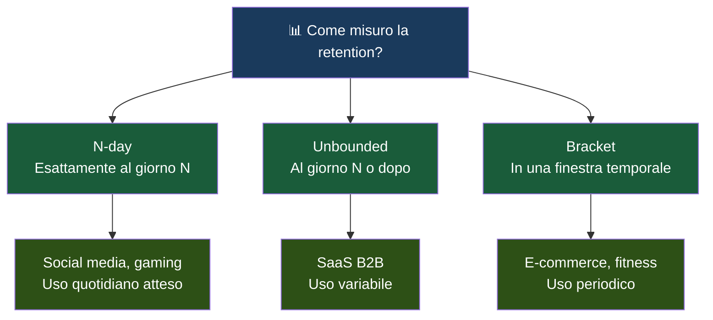
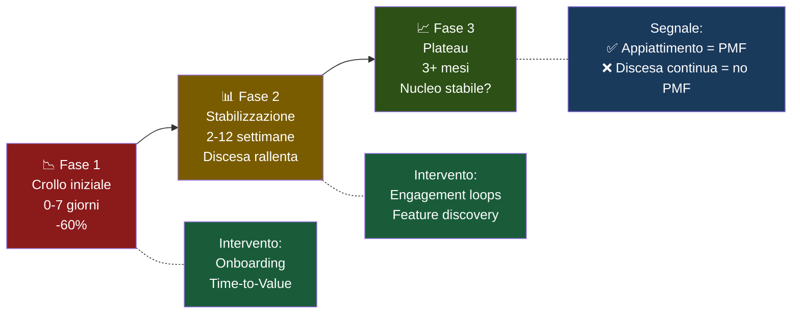
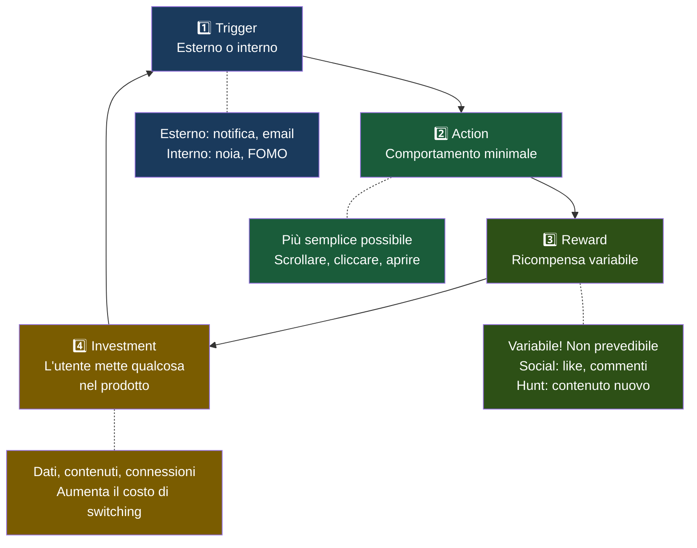
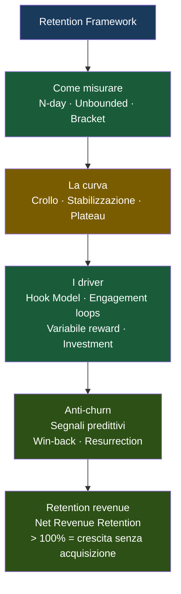

## RETENTION: LA METRICA CHE DECIDE SE VIVI O MUORI

La retention è il tasso di utenti che continuano a usare il tuo prodotto nel tempo. È la metrica più importante di un prodotto digitale — più importante dell'acquisizione, più importante del fatturato, più importante di qualsiasi altra metrica.

Perché? Perché **tutte le altre metriche dipendono dalla retention.** Un prodotto con alta acquisizione e bassa retention è un secchio bucato: più acqua ci versi, più ne perdi. Un prodotto con retention alta e acquisizione bassa cresce lentamente ma in modo sostenibile — e la crescita composta fa il resto.

> **La matematica è spietata:** con un churn mensile del 5%, dopo un anno hai perso il 46% della tua base utenti. Con un churn del 10%, dopo un anno ne resta solo il 28%. Nessuna macchina di acquisizione può compensare a lungo.

## Tre modi di misurare la retention

Non esiste un solo modo di calcolare la retention. I tre principali sono adatti a prodotti con frequenze d'uso diverse.

### N-day Retention

"Quanti utenti tornano **esattamente** al giorno N dopo la registrazione?"

| Giorno | Utenti attivi | N-day Retention |
|:------:|:------------:|:---------------:|
| 0 | 1.000 | 100% |
| 1 | 380 | 38% |
| 3 | 220 | 22% |
| 7 | 150 | 15% |
| 14 | 110 | 11% |
| 30 | 85 | 8,5% |

**Quando usarla:** prodotti ad alta frequenza d'uso (social media, messaging, gaming). L'utente è atteso ogni giorno o quasi.

**Limite:** se un utente usa il prodotto al giorno 6 e al giorno 8 ma non al giorno 7, la D7 retention lo segna come "perso". È troppo rigida per prodotti con uso variabile.

### Unbounded Retention (Rolling Retention)

"Quanti utenti tornano **al giorno N o dopo**?"

Con gli stessi dati di sopra:

| Giorno | N-day | Unbounded |
|:------:|:-----:|:---------:|
| 0 | 100% | 100% |
| 1 | 38% | 85% |
| 7 | 15% | 40% |
| 30 | 8,5% | 25% |

La unbounded retention al giorno 7 conta come "attivo" chiunque abbia usato il prodotto al giorno 7 o in qualsiasi giorno successivo. È più generosa, ma anche più realistica per prodotti con uso non quotidiano.

**Quando usarla:** prodotti con frequenza d'uso variabile (SaaS B2B, tool di produttività).

### Bracket Retention

"Quanti utenti sono attivi **in una finestra temporale** (bracket)?"

| Bracket | Finestra | Utenti attivi | Bracket Retention |
|---------|----------|:------------:|:-----------------:|
| Settimana 1 | Giorno 1-7 | 450 | 45% |
| Settimana 2 | Giorno 8-14 | 220 | 22% |
| Mese 2 | Giorno 31-60 | 120 | 12% |
| Mese 3 | Giorno 61-90 | 95 | 9,5% |

**Quando usarla:** prodotti con uso periodico: l'utente non deve tornare ogni giorno, ma almeno una volta alla settimana o al mese (e-commerce, app di fitness, tool di reportistica).

## La curva di retention e le sue tre fasi

Indipendentemente dal metodo di calcolo, la curva di retention ha sempre tre fasi:

### Fase 1: il crollo iniziale (giorno 0-7)

È la fase più violenta. Il 40-70% degli utenti abbandona nella prima settimana. È fisiologico: molti si registrano per curiosità, alcuni sono nel target sbagliato, altri non superano l'onboarding.

L'interventare in questa fase riguarda tutto ciò che abbiamo visto nella lezione sull'onboarding: ridurre il time-to-value, guidare verso l'aha moment, semplificare il setup.

### Fase 2: la stabilizzazione (settimana 2 - mese 3)

La curva rallenta la discesa. Gli utenti che restano stanno trovando valore. In questa fase, il rischio è la **zombie retention**: l'utente accede sporadicamente ma non trae valore reale. Tecnicamente "attivo", praticamente perso.

L'intervento: engagement loops, notifiche contestuali, feature discovery progressiva.

### Fase 3: il plateau (mese 3+)

Se la curva si appiattisce, hai un nucleo di utenti fedeli. Se continua a scendere, hai un prodotto leaky — nessuno resta abbastanza a lungo.

## I driver della retention

### Hook Model (Nir Eyal)

Il modello del "gancio" descrive il ciclo che trasforma un comportamento sporadico in un'abitudine:

La chiave è la **ricompensa variabile**: non sapere esattamente cosa troverai (un like? un messaggio? un'offerta?) è il meccanismo che rende il comportamento compulsivo. Instagram, TikTok, Slack — tutti usano questo principio.

L'**investimento** è ciò che rende lo switching costoso: ogni playlist creata su Spotify, ogni contatto aggiunto su LinkedIn, ogni workflow configurato in Zapier aumenta il costo di abbandonare il prodotto.

### Engagement loops vs Viral loops

**Engagement loop:** l'utente torna per il valore personale (Twitter: scrivo → ricevo like → torno a scrivere).

**Viral loop:** l'utente torna E porta nuovi utenti (Dropbox: uso → invito amico per spazio → amico usa → invita).

I prodotti migliori combinano entrambi. Ma la priorità è l'engagement loop: se l'utente non torna per sé, non consiglierà il prodotto ad altri.

## Strategie anti-churn

### 1. Identificare gli utenti a rischio

Non tutti i churner sono uguali. Prima di andarsene, gli utenti mostrano **segnali predittivi**:

| Segnale | Rischio | Intervento |
|---------|---------|------------|
| Frequenza d'uso in calo | Alto | Email di re-engagement personalizzata |
| Non usa feature chiave | Medio | Tooltip o guida contestuale |
| Ticket di supporto non risolti | Molto alto | Escalation e follow-up proattivo |
| Downgrade del piano | Alto | Conversazione 1:1 per capire il motivo |
| Assenza > X giorni (per tipo di prodotto) | Critico | Sequenza di win-back |

### 2. La win-back sequence

Per gli utenti che hanno smesso di usare il prodotto da più di X giorni:

| Timing | Messaggio | Obiettivo |
|---|---|---|
| Giorno X+3 | "Ti manca qualcosa? Ecco cosa c'è di nuovo" | Curiosità |
| Giorno X+7 | "Il tuo [dato/progetto] ti aspetta" | FOMO / senso di proprietà |
| Giorno X+14 | Case study: "Come [azienda simile] usa il prodotto" | Social proof |
| Giorno X+30 | Offerta speciale o demo 1:1 | Ultimo tentativo |

### 3. Resurrection flow

Per gli utenti che tornano dopo un lungo periodo di inattività, **non trattarli come nuovi utenti**. Il loro contesto è diverso:
- Ricordano vagamente il prodotto ma non i dettagli
- I loro dati sono ancora lì (o dovrebbero esserlo)
- Han bisogno di un "promemoria" non di un tutorial completo

Un **resurrection flow** dedicato — "Bentornato! Ecco cosa è cambiato da quando sei stato via" con un recap delle nuove feature — ha tassi di riattivazione 2-3x superiori rispetto al redirect alla homepage standard.

## Benchmark di retention per settore

| Settore | D1 | D7 | D30 | D90 |
|---------|:---:|:---:|:---:|:---:|
| Social media | 40-50% | 25-35% | 15-25% | 10-20% |
| Gaming mobile | 30-40% | 15-20% | 5-10% | 2-5% |
| SaaS B2B | 80-90% | 70-80% | 60-70% | 50-60% |
| E-commerce app | 25-35% | 12-18% | 5-10% | 3-6% |
| FinTech | 35-45% | 20-30% | 12-18% | 8-12% |
| Health & Fitness | 30-40% | 15-25% | 8-15% | 4-8% |

> **Nota:** i benchmark per SaaS B2B sono molto più alti perché l'utente ha un contratto, un costo di switching elevato e spesso un obbligo lavorativo di usare il tool. Non c'è paragone con un'app mobile scaricata per curiosità.

## Caso studio: Netflix e la retention tramite contenuto

Netflix non misura la retention come "accesso all'app" ma come **ore di contenuto consumate per membro**. Un utente che accede ma non guarda nulla è a rischio.

La loro strategia di retention è interamente basata sul **content loop**:
1. **Raccomandazione personalizzata** → l'utente trova qualcosa da guardare in < 90 secondi
2. **Autoplay del prossimo episodio** → riduce la frizione di continuare
3. **Release settimanale** → crea l'abitudine del "giovedì sera = nuovo episodio"
4. **Contenuto originale esclusivo** → aumenta il costo di switching (se vuoi vedere Squid Game, devi avere Netflix)

Il risultato: un churn mensile del ~2,5% in un settore (streaming) dove la media è 5-7%.

## Retention revenue: non solo utenti, anche soldi

La retention degli utenti e la retention del revenue sono due metriche diverse:

**Logo retention** = percentuale di clienti che restano
**Net Revenue Retention (NRR)** = revenue dell'anno corrente dai clienti dell'anno scorso / revenue dell'anno scorso

> **NRR = (Revenue iniziale + Expansion − Contraction − Churn) / Revenue iniziale**

Se NRR > 100%, i clienti esistenti generano più revenue di quanto perdono per churn. Puoi crescere **senza acquisire un solo nuovo cliente**.

| NRR | Interpretazione |
|:---:|-----------------|
| > 130% | Eccezionale (Snowflake, Twilio) |
| 110-130% | Ottimo per SaaS B2B |
| 100-110% | Buono |
| < 100% | Il secchio perde acqua |

Esempio: 100 clienti che pagavano 1.000€/anno. Quest'anno: 5 hanno churned (−5.000€), 10 hanno fatto upgrade a 1.500€ (+5.000€), 15 hanno aggiunto utenti (+3.000€). NRR = (100.000 + 5.000 + 3.000 − 5.000) / 100.000 = **103%**.

## Riepilogo

Tre cose da portare a casa:

1. **Scegli il metodo giusto per il tuo prodotto** — N-day per uso quotidiano, bracket per uso periodico, unbounded per uso variabile. La scelta sbagliata ti dà una curva che non riflette la realtà.

2. **La retention ha tre fasi e ognuna richiede un intervento diverso** — onboarding per il crollo iniziale, engagement loops per la stabilizzazione, value lock-in per il plateau.

3. **La Net Revenue Retention è la metrica definitiva** — se NRR > 100%, il tuo business cresce anche senza acquisire nuovi clienti. È la prova che il valore del prodotto aumenta nel tempo per chi lo usa.
