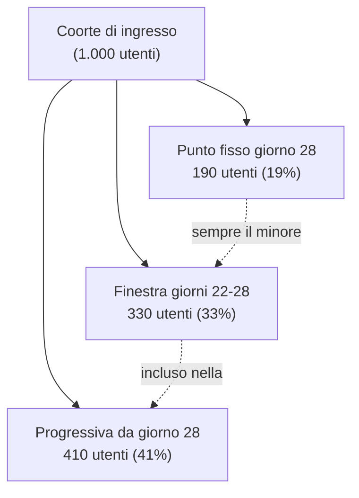

Un'app di prenotazione per studi dentistici manda in produzione un nuovo onboarding (scenario costruito, numeri di esempio). Il responsabile di prodotto apre la dashboard il lunedì mattina e trova una retention al giorno 28 del 19%, mentre il collega del marketing, sugli stessi dati, ne riporta una del 41%. Nessuno dei due ha sbagliato un conto. Il primo ha contato gli utenti attivi proprio il ventottesimo giorno, il secondo quelli tornati in quel giorno o in uno qualsiasi successivo. Le due cifre rispondono a domande diverse e finiscono in presentazioni diverse con conclusioni opposte.

> **Idea chiave:** la retention non è un numero ma una scelta di definizione, e la definizione corretta è quella che rispecchia il ritmo con cui il cliente ha davvero bisogno del prodotto.

Questa lezione parte dalle tre definizioni in uso, mostra come cambiano il risultato sulla stessa coorte, costruisce la tabella di coorte in SQL e in Python e chiude con il problema che più spesso rovina le decisioni: stabilire se un aumento di retention osservato dopo un rilascio è un miglioramento reale o una fluttuazione.

## Che cosa significa tornare: l'evento, la finestra e il denominatore

Ogni calcolo di retention richiede tre scelte che è meglio scrivere prima di toccare i dati. La prima è l'evento di ingresso, che definisce la coorte: la registrazione, il primo progetto creato, il primo ordine. La seconda è l'evento di ritorno, cioè che cosa conta come essere tornati. La terza è la finestra temporale in cui cerchi quel ritorno. Se cambia anche una sola delle tre, il numero cambia.

L'evento di ritorno deve essere un'azione intenzionale che dimostra l'uso del valore centrale del prodotto: esportare un report, completare una prenotazione, invitare un collega. Un'apertura di email o una notifica ricevuta non lo sono, perché dipendono dal sistema e non dall'utente. Il denominatore, poi, resta sempre il numero di utenti che sono entrati nella coorte e non cambia mai nei periodi successivi: se lo ricalcoli sugli utenti ancora attivi ottieni una percentuale vicina al 100% che non misura niente.

| Definizione | Domanda a cui risponde | Quando usarla | Svantaggio |
| :--- | :--- | :--- | :--- |
| Punto fisso (N-day) | Quanti sono tornati esattamente il giorno o la settimana N? | App usate ogni giorno, social network | Fragile per prodotti che non si usano ogni giorno |
| Progressiva (unbounded) | Quanti sono tornati il giorno N o in un giorno successivo? | E-commerce, viaggi, acquisti sporadici | I valori storici crescono con il tempo perché gli utenti tornano dopo |
| A finestra (bracket) | Quanti sono tornati almeno una volta dentro l'intervallo N? | SaaS B2B con uso settimanale o mensile | Richiede di scegliere gli intervalli con cura |

La scelta dipende dalla cadenza naturale dell'uso, non dalla comodità del calcolo. Un gestionale usato dal lunedì al venerdì ha un'attività che in un dato giorno di calendario può essere nulla anche per il cliente più fedele: se un utente si registra di domenica, il suo giorno 7 e il suo giorno 14 cadono di domenica e lo mostrano come perso. Una definizione a punto fisso giornaliera misura in quel caso il calendario e non l'abbandono.

## La stessa coorte, tre definizioni, tre risultati

Prendi una coorte di 1.000 utenti registrati nella stessa settimana (numeri di esempio). Vuoi calcolare la retention alla quarta settimana con le tre definizioni.

Con il punto fisso giornaliero conti chi ha un evento di ritorno esattamente il giorno 28. Il giorno 28 cade di sabato per una parte della coorte, e solo 190 utenti hanno attività quel giorno: 190 / 1.000 = 19%. Con la definizione a finestra conti chi ha almeno un evento nella settimana che va dal giorno 22 al giorno 28: sono 330 utenti, quindi 330 / 1.000 = 33%. Con la definizione progressiva conti chi ha un evento il giorno 28 o in qualsiasi giorno successivo, entro la data di estrazione: sono 410 utenti, quindi 410 / 1.000 = 41%.

L'ordine tra i tre valori non è casuale: il punto fisso è sempre il più basso, perché richiede il ritorno in un solo giorno; la finestra raccoglie più giorni, quindi è più alta; la progressiva include anche i ritorni successivi, ed è la più alta. Se i tre numeri non rispettano la relazione 19% ≤ 33% ≤ 41%, c'è un errore nella query. Il responsabile di prodotto e il collega del marketing avevano ragione entrambi: il 19% e il 41% sono corretti, e la differenza di 22 punti percentuali è prodotta interamente dalla definizione.

La progressiva ha un difetto che conviene conoscere: se la ricalcoli a distanza di mesi, i valori storici cambiano perché gli utenti di quella coorte continuano a tornare. Una presentazione al management che confronta la coorte di giugno, misurata a ottobre, con la coorte di settembre, misurata a ottobre, confronta coorti con tempi di osservazione molto diversi. Con la finestra questo non accade, perché ogni intervallo si chiude e il suo valore non viene più modificato.



## Costruire la tabella di coorte con SQL e Python

La tabella di coorte ha una riga per ogni coorte settimanale e una colonna per ogni settimana di vita. Ogni cella contiene la quota di utenti della coorte con almeno un evento di ritorno in quella settimana. La query seguente la produce in ClickHouse con retention a finestra settimanale, escludendo gli utenti interni e usando come denominatore il numero fisso di utenti della coorte.

```sql
-- Retention a finestra settimanale per coorte (ClickHouse)
WITH cohorts AS (
    SELECT user_id, toStartOfWeek(signup_date) AS cohort_week
    FROM users
    WHERE is_internal = 0
),
activity AS (
    SELECT DISTINCT user_id, toStartOfWeek(event_time) AS active_week
    FROM product_events
    WHERE event_name = 'booking_completed'
)
SELECT
    c.cohort_week,
    dateDiff('week', c.cohort_week, a.active_week) AS week_n,
    uniqExact(a.user_id) AS returned,
    -- il denominatore e' la dimensione della coorte, fissa per tutte le settimane
    any(cs.cohort_size) AS cohort_size,
    round(uniqExact(a.user_id) / any(cs.cohort_size), 3) AS bracket_retention
FROM cohorts AS c
INNER JOIN (
    SELECT cohort_week, count() AS cohort_size FROM cohorts GROUP BY cohort_week
) AS cs ON c.cohort_week = cs.cohort_week
LEFT JOIN activity AS a
    ON c.user_id = a.user_id AND a.active_week >= c.cohort_week
GROUP BY c.cohort_week, week_n
ORDER BY c.cohort_week, week_n;
```

Una tabella di questo tipo si legge per righe e per colonne. Lungo una riga vedi la forma della curva di una coorte: la discesa iniziale e il livello a cui si stabilizza. Lungo una colonna confronti coorti diverse alla stessa età, per capire se un intervento ha spostato il livello. Il passaggio da tabella a curve sovrapposte è immediato con pandas, e permette di individuare il plateau con un criterio numerico.

```python
import pandas as pd

# events: una riga per evento di ritorno (user_id, event_time)
# users: una riga per utente (user_id, signup_date, is_internal)
users = pd.read_csv("users.csv", parse_dates=["signup_date"])
events = pd.read_csv("events.csv", parse_dates=["event_time"])

users = users[users["is_internal"] == 0].copy()
users["cohort_week"] = users["signup_date"].dt.to_period("W")
events["active_week"] = events["event_time"].dt.to_period("W")

df = events.merge(users[["user_id", "cohort_week"]], on="user_id")
df["week_n"] = (df["active_week"] - df["cohort_week"]).apply(lambda d: d.n)
df = df[df["week_n"] >= 0]

returned = df.groupby(["cohort_week", "week_n"])["user_id"].nunique().unstack(fill_value=0)
cohort_size = users.groupby("cohort_week")["user_id"].nunique()

# il denominatore e' fisso: la dimensione iniziale della coorte
retention = returned.div(cohort_size, axis=0).round(3)

# plateau: variazione media delle ultime 4 settimane osservate sotto 1 punto
tail = retention.iloc[:, -4:]
retention["drift_pp"] = (tail.iloc[:, 0] - tail.iloc[:, -1]) * 100
print(retention)
```

Un controllo semplice da inserire nel codice è la verifica che nessuna cella superi il 100% e che la settimana 0 valga 100% quando l'evento di ingresso coincide con quello di ritorno. Se un valore supera il 100%, la query sta contando utenti non appartenenti alla coorte o sta duplicando righe in un join.

## Il rilascio che sembra aver migliorato la retention

Il test sul miglioramento è il punto in cui molte analisi di retention si rompono. Il team rilascia il nuovo onboarding e, nella settimana successiva, la coorte mostra una retention alla quarta settimana più alta della precedente. La domanda è se la differenza è un effetto del rilascio o una variazione casuale tra due gruppi di persone.

Confronta le due coorti (numeri di esempio). La coorte precedente al rilascio ha 800 utenti e 160 di loro sono ancora attivi alla quarta settimana, cioè 160 / 800 = 20%. La coorte successiva ha 900 utenti e 207 sono attivi, cioè 207 / 900 = 23%. La differenza è di 3 punti percentuali, un miglioramento relativo del 15%. Sembra un buon risultato, ma devi chiederti quanto rumore ci si può aspettare con campioni di questa dimensione.

L'errore standard della differenza tra due proporzioni è la radice della somma delle due varianze: sqrt(0,20 × 0,80 / 800 + 0,23 × 0,77 / 900). Il primo termine vale 0,16 / 800 = 0,0002 e il secondo 0,1771 / 900 = 0,00019678. La somma è 0,00039678 e la radice vale 0,0199, cioè 1,99 punti percentuali. Il rapporto tra la differenza e l'errore standard è 3 / 1,99 = 1,51, sotto la soglia di 1,96 per il 95%. L'intervallo di confidenza della differenza è 3 ± 1,96 × 1,99 punti, quindi da -0,9 a +6,9 punti percentuali, che include lo zero.

Il risultato corretto non è che l'onboarding non funziona, ma che i dati non bastano per dirlo. Un miglioramento reale potrebbe esistere e valere fino a 7 punti, oppure no: non lo sai. Hai due strade. Puoi osservare altre coorti con il nuovo onboarding e controllare se il livello si mantiene più alto, oppure puoi fare un test randomizzato che assegna a metà dei nuovi utenti il vecchio flusso e a metà il nuovo, con una numerosità calcolata in anticipo. Con un test da 2.000 utenti per braccio, la stessa differenza di 3 punti avrebbe un errore standard di sqrt(0,2 × 0,8 / 2.000 + 0,23 × 0,77 / 2.000) = sqrt(0,00008 + 0,00008855) = 0,0130, quindi z = 3 / 1,30 = 2,3, e il risultato sarebbe distinguibile dal rumore.

```python
from math import sqrt
from scipy.stats import norm

def confronto_retention(ret_a, n_a, ret_b, n_b, alpha=0.05):
    # ret_* sono conteggi di utenti ritenuti; n_* le dimensioni delle coorti
    p_a, p_b = ret_a / n_a, ret_b / n_b
    se = sqrt(p_a * (1 - p_a) / n_a + p_b * (1 - p_b) / n_b)
    z = (p_b - p_a) / se
    margine = norm.ppf(1 - alpha / 2) * se
    return {"delta_pp": round((p_b - p_a) * 100, 2), "z": round(z, 2),
            "ic_pp": (round((p_b - p_a - margine) * 100, 1), round((p_b - p_a + margine) * 100, 1))}

print(confronto_retention(160, 800, 207, 900))
```

## Errori ricorrenti nel calcolo della retention

### Usare una finestra giornaliera su un prodotto che si usa a settimane

Il sintomo è una curva a denti di sega: la retention al giorno 7 e al giorno 14 è molto più bassa di quella ai giorni 6 e 8, senza motivi di prodotto. Succede perché il prodotto ha un ritmo lavorativo e i giorni di calendario del fine settimana sono vuoti per quasi tutti gli utenti. Si corregge adottando la retention a finestra settimanale oppure allineando la coorte e il ritorno ai giorni lavorativi, in modo che la misura segua il ritmo reale del cliente.

### Contare eventi passivi come ritorno

Il sintomo è una retention alta che non si traduce in ricavi né in uso reale: gli utenti risultano attivi ma non creano contenuti, non completano transazioni e non rinnovano. Succede perché la definizione di utente attivo include aperture di email, notifiche ricevute o chiamate di API in background, che sono eventi generati dal sistema. Il rimedio è limitare l'evento di ritorno ad azioni intenzionali sul valore centrale e confrontare la curva con quella costruita sull'evento precedente: se cambia molto, la prima definizione era gonfiata.

### Giudicare la curva aggregata senza segmentazione

Il sintomo è una curva media che scende lentamente e che nessuno sa spiegare. Succede perché l'aggregato è quasi sempre la miscela di due popolazioni: una minoranza che trova valore e resta al 55-60% e una maggioranza che abbandona entro due giorni. Segmentare per canale di acquisizione, piano tariffario e azione compiuta nella prima settimana trasforma una media vaga in due curve con cause diverse e interventi diversi.

## Cicli lunghi e stagionalità: quando la finestra mensile sbaglia

Alcuni prodotti non si usano con regolarità. Un software di consulenza fiscale è usato intensamente a ridosso delle scadenze e poi può restare fermo per tre mesi senza che il cliente pensi di abbandonarlo. Una finestra mensile rigida lo classificherebbe come perso a ogni trimestre e poi come riattivato, distorcendo il calcolo del valore del cliente e le priorità del team che gestisce i recuperi.

Il metodo corretto parte dalla cadenza reale. Per ogni cliente fedele storico calcoli l'intervallo di giorni tra due usi consecutivi, e prendi l'ottantesimo percentile di quegli intervalli come soglia fisiologica di inattività. Supponi di avere dieci intervalli osservati su clienti fedeli: 12, 18, 25, 31, 38, 44, 52, 60, 75 e 95 giorni. Con il metodo del rango più vicino l'ottantesimo percentile corrisponde all'8° valore, cioè 60 giorni, perché 0,80 × 10 = 8. Un cliente fermo da 45 giorni è dentro la cadenza normale, uno fermo da 70 giorni è oltre la soglia e va considerato a rischio.

| Intervallo osservato (giorni) | Posizione | Dentro la soglia di 60 giorni |
| :--- | :--- | :--- |
| 12, 18, 25 | 1°-3° | Si |
| 31, 38, 44, 52 | 4°-7° | Si |
| 60 | 8° (80° percentile) | Limite |
| 75, 95 | 9°-10° | No, cliente a rischio |

Per evitare falsi allarmi ad agosto o a dicembre, confronta ogni coorte anche con lo stesso mese dell'anno precedente. Se il ritorno di agosto scende del 30% rispetto al luglio precedente ma lo stesso calo c'era l'anno scorso, la tenuta reale del prodotto non è cambiata: è cambiato il calendario. Questo confronto separa la componente stagionale dalla variazione di prodotto, e dà a ogni rilascio un termine di paragone onesto.

## Controllo prima di presentare una curva di retention

1. Una coorte di 2.500 utenti ha 600 utenti con attività il giorno 30 e 900 con attività il giorno 30 o dopo. Quali sono le retention a punto fisso e progressiva?

<details>
<summary>Mostra risposta</summary>

La retention a punto fisso è 600 / 2.500 = 24% e quella progressiva è 900 / 2.500 = 36%. Il denominatore è la dimensione della coorte in entrambi i casi. La progressiva è più alta di 12 punti perché include gli utenti tornati dopo il giorno 30, e per questo non può essere confrontata con la prima senza dichiarare la definizione.

</details>

2. Una coorte di 400 utenti ha 180 utenti attivi alla settimana 1 e un analista calcola la retention dividendo per i 180. Quale errore commette e qual è il valore corretto?

<details>
<summary>Mostra risposta</summary>

Il denominatore deve restare la dimensione della coorte di ingresso, 400, e non il numero di utenti attivi nel periodo. Il valore corretto è 180 / 400 = 45%. Dividere per gli attivi produrrebbe 100% in ogni periodo e renderebbe la misura inutilizzabile.

</details>

3. Dopo un rilascio la retention a quattro settimane passa dal 30% su 500 utenti al 34% su 500 utenti. La differenza è distinguibile dal rumore?

<details>
<summary>Mostra risposta</summary>

L'errore standard è sqrt(0,30 × 0,70 / 500 + 0,34 × 0,66 / 500) = sqrt(0,00042 + 0,0004488) = 0,0295, cioè 2,95 punti. Il rapporto è 4 / 2,95 = 1,36, sotto 1,96. L'intervallo al 95% va da circa -1,8 a +9,8 punti e include lo zero, quindi la differenza non è distinguibile dal rumore. Servono più utenti o un test randomizzato.

</details>

4. Un prodotto ha intervalli di uso 10, 20, 30, 40, 50, 60, 70, 80, 90 e 100 giorni. Qual è la soglia di inattività al 80° percentile con il metodo del rango più vicino?

<details>
<summary>Mostra risposta</summary>

Con dieci valori la posizione è 0,80 × 10 = 8, quindi la soglia è l'ottavo valore, 80 giorni. Un cliente inattivo da meno di 80 giorni rientra nella cadenza fisiologica; oltre quella soglia lo classifichi come a rischio di abbandono e puoi avviare le azioni di recupero.

</details>
