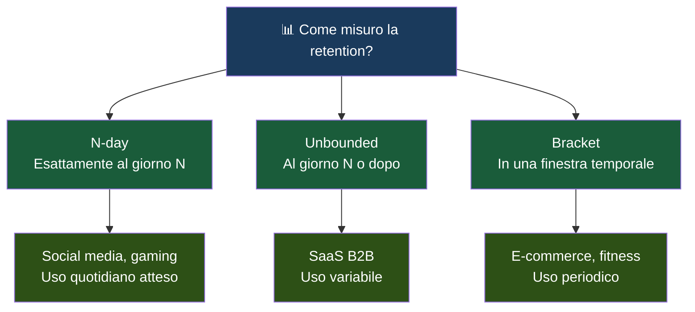
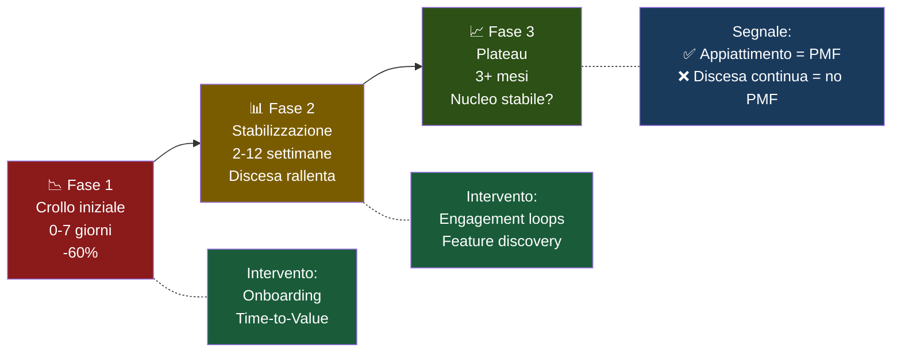
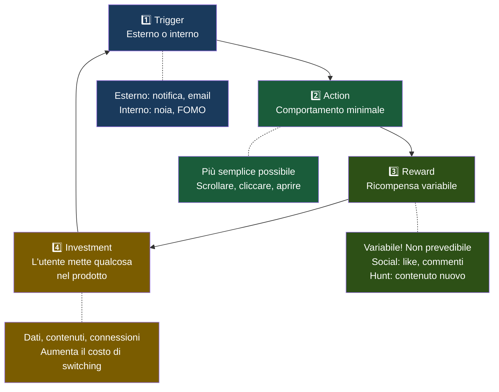
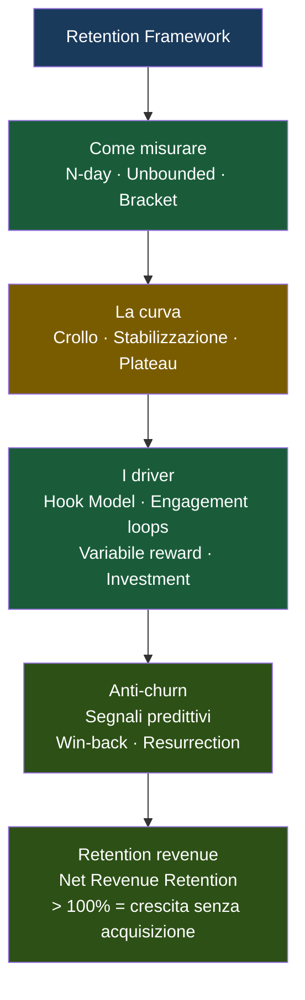

import { Aside } from '@astrojs/starlight/components'

La retention e' la prova piu' severa che un prodotto stia creando valore nel tempo. Acquisire utenti e' relativamente facile rispetto a farli tornare, usare il prodotto con continuita' e restare abbastanza a lungo da sostenere il modello economico.

Qui vediamo come leggere la curva di retention, quali driver la spostano davvero e come intervenire quando il churn inizia a mangiare crescita, margini e credibilita' del team.

## RETENTION: LA METRICA CHE DECIDE SE VIVI O MUORI

La retention è il tasso di utenti che continuano a usare il tuo prodotto nel tempo. È la metrica più importante di un prodotto digitale — più importante dell'acquisizione, più importante del fatturato, più importante di qualsiasi altra metrica.

Perché? Perché **tutte le altre metriche dipendono dalla retention.** Un prodotto con alta acquisizione e bassa retention è un secchio bucato: più acqua ci versi, più ne perdi. Un prodotto con retention alta e acquisizione bassa cresce lentamente ma in modo sostenibile — e la crescita composta fa il resto.

> **La matematica è spietata:** con un churn mensile del 5%, dopo un anno hai perso il 46% della tua base utenti. Con un churn del 10%, dopo un anno ne resta solo il 28%. Nessuna macchina di acquisizione può compensare a lungo.

## Tre modi di misurare la retention

Non esiste un solo modo di calcolare la retention. I tre principali sono adatti a prodotti con frequenze d'uso diverse.

### N-day Retention

"Quanti utenti tornano **esattamente** al giorno N dopo la registrazione?"

| Giorno | Utenti attivi | N-day Retention |
|:------:|:------------:|:---------------:|
| 0 | 1.000 | 100% |
| 1 | 380 | 38% |
| 3 | 220 | 22% |
| 7 | 150 | 15% |
| 14 | 110 | 11% |
| 30 | 85 | 8,5% |

**Quando usarla:** prodotti ad alta frequenza d'uso (social media, messaging, gaming). L'utente è atteso ogni giorno o quasi.

**Limite:** se un utente usa il prodotto al giorno 6 e al giorno 8 ma non al giorno 7, la D7 retention lo segna come "perso". È troppo rigida per prodotti con uso variabile.

### Unbounded Retention (Rolling Retention)

"Quanti utenti tornano **al giorno N o dopo**?"

Con gli stessi dati di sopra:

| Giorno | N-day | Unbounded |
|:------:|:-----:|:---------:|
| 0 | 100% | 100% |
| 1 | 38% | 85% |
| 7 | 15% | 40% |
| 30 | 8,5% | 25% |

La unbounded retention al giorno 7 conta come "attivo" chiunque abbia usato il prodotto al giorno 7 o in qualsiasi giorno successivo. È più generosa, ma anche più realistica per prodotti con uso non quotidiano.

**Quando usarla:** prodotti con frequenza d'uso variabile (SaaS B2B, tool di produttività).

### Bracket Retention

"Quanti utenti sono attivi **in una finestra temporale** (bracket)?"

| Bracket | Finestra | Utenti attivi | Bracket Retention |
|---------|----------|:------------:|:-----------------:|
| Settimana 1 | Giorno 1-7 | 450 | 45% |
| Settimana 2 | Giorno 8-14 | 220 | 22% |
| Mese 2 | Giorno 31-60 | 120 | 12% |
| Mese 3 | Giorno 61-90 | 95 | 9,5% |

**Quando usarla:** prodotti con uso periodico: l'utente non deve tornare ogni giorno, ma almeno una volta alla settimana o al mese (e-commerce, app di fitness, tool di reportistica).

## La curva di retention e le sue tre fasi

Indipendentemente dal metodo di calcolo, la curva di retention ha sempre tre fasi:

### Fase 1: il crollo iniziale (giorno 0-7)

È la fase più violenta. Il 40-70% degli utenti abbandona nella prima settimana. È fisiologico: molti si registrano per curiosità, alcuni sono nel target sbagliato, altri non superano l'onboarding.

L'interventare in questa fase riguarda tutto ciò che abbiamo visto nella lezione sull'onboarding: ridurre il time-to-value, guidare verso l'aha moment, semplificare il setup.

### Fase 2: la stabilizzazione (settimana 2 - mese 3)

La curva rallenta la discesa. Gli utenti che restano stanno trovando valore. In questa fase, il rischio è la **zombie retention**: l'utente accede sporadicamente ma non trae valore reale. Tecnicamente "attivo", praticamente perso.

L'intervento: engagement loops, notifiche contestuali, feature discovery progressiva.

### Fase 3: il plateau (mese 3+)

Se la curva si appiattisce, hai un nucleo di utenti fedeli. Se continua a scendere, hai un prodotto leaky — nessuno resta abbastanza a lungo.

## I driver della retention

### Hook Model (Nir Eyal)

Il modello del "gancio" descrive il ciclo che trasforma un comportamento sporadico in un'abitudine:

La chiave è la **ricompensa variabile**: non sapere esattamente cosa troverai (un like? un messaggio? un'offerta?) è il meccanismo che rende il comportamento compulsivo. Instagram, TikTok, Slack — tutti usano questo principio.

L'**investimento** è ciò che rende lo switching costoso: ogni playlist creata su Spotify, ogni contatto aggiunto su LinkedIn, ogni workflow configurato in Zapier aumenta il costo di abbandonare il prodotto.

### Engagement loops vs Viral loops

**Engagement loop:** l'utente torna per il valore personale (Twitter: scrivo → ricevo like → torno a scrivere).

**Viral loop:** l'utente torna E porta nuovi utenti (Dropbox: uso → invito amico per spazio → amico usa → invita).

I prodotti migliori combinano entrambi. Ma la priorità è l'engagement loop: se l'utente non torna per sé, non consiglierà il prodotto ad altri.

## Strategie anti-churn

### 1. Identificare gli utenti a rischio

Non tutti i churner sono uguali. Prima di andarsene, gli utenti mostrano **segnali predittivi**:

| Segnale | Rischio | Intervento |
|---------|---------|------------|
| Frequenza d'uso in calo | Alto | Email di re-engagement personalizzata |
| Non usa feature chiave | Medio | Tooltip o guida contestuale |
| Ticket di supporto non risolti | Molto alto | Escalation e follow-up proattivo |
| Downgrade del piano | Alto | Conversazione 1:1 per capire il motivo |
| Assenza > X giorni (per tipo di prodotto) | Critico | Sequenza di win-back |

### 2. La win-back sequence

Per gli utenti che hanno smesso di usare il prodotto da più di X giorni:

| Timing | Messaggio | Obiettivo |
|---|---|---|
| Giorno X+3 | "Ti manca qualcosa? Ecco cosa c'è di nuovo" | Curiosità |
| Giorno X+7 | "Il tuo [dato/progetto] ti aspetta" | FOMO / senso di proprietà |
| Giorno X+14 | Case study: "Come [azienda simile] usa il prodotto" | Social proof |
| Giorno X+30 | Offerta speciale o demo 1:1 | Ultimo tentativo |

### 3. Resurrection flow

Per gli utenti che tornano dopo un lungo periodo di inattività, **non trattarli come nuovi utenti**. Il loro contesto è diverso:
- Ricordano vagamente il prodotto ma non i dettagli
- I loro dati sono ancora lì (o dovrebbero esserlo)
- Han bisogno di un "promemoria" non di un tutorial completo

Un **resurrection flow** dedicato — "Bentornato! Ecco cosa è cambiato da quando sei stato via" con un recap delle nuove feature — ha tassi di riattivazione 2-3x superiori rispetto al redirect alla homepage standard.

## Benchmark di retention per settore

| Settore | D1 | D7 | D30 | D90 |
|---------|:---:|:---:|:---:|:---:|
| Social media | 40-50% | 25-35% | 15-25% | 10-20% |
| Gaming mobile | 30-40% | 15-20% | 5-10% | 2-5% |
| SaaS B2B | 80-90% | 70-80% | 60-70% | 50-60% |
| E-commerce app | 25-35% | 12-18% | 5-10% | 3-6% |
| FinTech | 35-45% | 20-30% | 12-18% | 8-12% |
| Health & Fitness | 30-40% | 15-25% | 8-15% | 4-8% |

> **Nota:** i benchmark per SaaS B2B sono molto più alti perché l'utente ha un contratto, un costo di switching elevato e spesso un obbligo lavorativo di usare il tool. Non c'è paragone con un'app mobile scaricata per curiosità.

## Caso studio: Netflix e la retention tramite contenuto

Netflix non misura la retention come "accesso all'app" ma come **ore di contenuto consumate per membro**. Un utente che accede ma non guarda nulla è a rischio.

La loro strategia di retention è interamente basata sul **content loop**:
1. **Raccomandazione personalizzata** → l'utente trova qualcosa da guardare in < 90 secondi
2. **Autoplay del prossimo episodio** → riduce la frizione di continuare
3. **Release settimanale** → crea l'abitudine del "giovedì sera = nuovo episodio"
4. **Contenuto originale esclusivo** → aumenta il costo di switching (se vuoi vedere Squid Game, devi avere Netflix)

Il risultato: un churn mensile del ~2,5% in un settore (streaming) dove la media è 5-7%.

## Retention revenue: non solo utenti, anche soldi

La retention degli utenti e la retention del revenue sono due metriche diverse:

**Logo retention** = percentuale di clienti che restano
**Net Revenue Retention (NRR)** = revenue dell'anno corrente dai clienti dell'anno scorso / revenue dell'anno scorso

> **NRR = (Revenue iniziale + Expansion − Contraction − Churn) / Revenue iniziale**

Se NRR > 100%, i clienti esistenti generano più revenue di quanto perdono per churn. Puoi crescere **senza acquisire un solo nuovo cliente**.

| NRR | Interpretazione |
|:---:|-----------------|
| > 130% | Eccezionale (Snowflake, Twilio) |
| 110-130% | Ottimo per SaaS B2B |
| 100-110% | Buono |
| < 100% | Il secchio perde acqua |

Esempio: 100 clienti che pagavano 1.000€/anno. Quest'anno: 5 hanno churned (−5.000€), 10 hanno fatto upgrade a 1.500€ (+5.000€), 15 hanno aggiunto utenti (+3.000€). NRR = (100.000 + 5.000 + 3.000 − 5.000) / 100.000 = **103%**.

## Riepilogo

Tre cose da portare a casa:

1. **Scegli il metodo giusto per il tuo prodotto** — N-day per uso quotidiano, bracket per uso periodico, unbounded per uso variabile. La scelta sbagliata ti dà una curva che non riflette la realtà.

2. **La retention ha tre fasi e ognuna richiede un intervento diverso** — onboarding per il crollo iniziale, engagement loops per la stabilizzazione, value lock-in per il plateau.

3. **La Net Revenue Retention è la metrica definitiva** — se NRR > 100%, il tuo business cresce anche senza acquisire nuovi clienti. È la prova che il valore del prodotto aumenta nel tempo per chi lo usa.

## Retention per layer: dal trigger al switching cost

La retention non è un singolo meccanismo — è un sistema a strati sovrapposti, ognuno con la propria logica e i propri strumenti di intervento. Comprendere questi layer permette di intervenire con la precisione giusta, invece di applicare tattiche a caso.

### Layer 1 — Notifiche e trigger esterni

Il livello più superficiale della retention. L'utente non torna perché il prodotto è diventato un'abitudine, ma perché riceve uno stimolo esterno che lo riporta dentro.

**Tipologie di trigger:**
- **Email di digest:** Duolingo manda ogni giorno una notifica push se salti una sessione ("Hai perso la tua streak!"). La streak è il trigger, ma la notifica è il meccanismo di delivery.
- **Notifiche di attività sociale:** LinkedIn notifica ogni volta che qualcuno visita il tuo profilo, commenta un post o condivide un tuo contenuto. È un trigger esterno che sfrutta la curiosità sociale.
- **Notifiche contestuali:** Spotify notifica quando un artista che ascolti pubblica un album. Amazon notifica quando un prodotto nella wishlist scende di prezzo.

**I limiti del trigger esterno:** funziona finché non diventa rumore. Le app che inviano troppe notifiche vengono mutate. Il tasso di disabilitazione delle notifiche push supera il 40% dopo i primi 30 giorni per la maggior parte delle app. Il trigger esterno è una rete di sicurezza, non una strategia di retention.

### Layer 2 — Habit forming e routine

Il secondo layer è quando il prodotto diventa parte della routine dell'utente. Non c'è bisogno di trigger esterni — l'utente torna da solo perché il comportamento è diventato automatico.

Il modello di Nir Eyal (Hook Model) descrive come i prodotti costruiscono abitudini. Ma l'applicazione pratica varia enormemente:

**Duolingo** ha costruito l'abitudine tramite la **streak**: ogni giorno che salti rompe la serie. Il costo psicologico di rompere una streak di 120 giorni è abbastanza alto da motivare anche gli utenti meno coinvolti. Nel 2023, Duolingo aveva oltre 2,3 miliardi di streak attive. La streak non è solo gamification — è un meccanismo di habit forming che sfrutta l'avversione alla perdita.

**Spotify** costruisce l'abitudine tramite i **playlist contestuali**: Discover Weekly ogni lunedì, Daily Mixes sempre aggiornati. L'utente sa che ogni lunedì troverà musica nuova calibrata sui suoi gusti. Questo crea un appuntamento fisso — un trigger interno basato sul calendario.

**Netflix** usa l'**autoplay** del prossimo episodio come meccanismo di habit forming. La scelta (guardare il prossimo episodio) viene automatizzata attraverso un'azione di default. Il 70% degli utenti non tocca il pulsante "salta" durante la sequenza di apertura — l'ha già vista 50 volte, ma il pattern è stabilizzato.

### Layer 3 — Switching costs e lock-in

Il layer più profondo e più difensivo. L'utente resta non solo perché ama il prodotto, ma perché il costo di abbandonarlo è diventato elevato.

**Dati personali e storia:** ogni playlist creata su Spotify, ogni nota in Notion, ogni documento in Google Docs aumenta il costo di switching. Portare anni di storia su un nuovo prodotto è faticoso — e spesso impossibile. Spotify non permette l'export delle playlist in formato compatibile con Apple Music. È un lock-in deliberato.

**Integrazioni e workflow:** Zapier ha integrato quasi tutto con quasi tutto. Un workflow di automazione che collega Slack, Google Sheets, Salesforce e Typeform è un lock-in potente: smontarlo richiede settimane. Più integrazioni un utente configura, più difficile è abbandonare.

**Social graph:** LinkedIn, Facebook e Twitter hanno costruito il moat più forte: il network di connessioni. Abbandonare LinkedIn significa abbandonare 500 contatti e la propria storia professionale. Questo switching cost è quasi insormontabile.

**Dati analitici e benchmark:** Amplitude e Mixpanel hanno un lock-in sottile ma potente: i dati storici, i funnel configurati, i benchmark accumulati. Passare a un nuovo tool significa perdere la storicità e ricominciare da zero.

## Churn prediction con SQL

Identificare gli utenti a rischio prima che se ne vadano è molto più efficace che tentare di recuperarli dopo. Il churn prediction non richiede necessariamente machine learning — un'analisi SQL ben strutturata può identificare i segnali predittivi con sufficiente anticipo per intervenire.

### Segnali predittivi di churn

Prima di costruire un modello, è necessario identificare i comportamenti che precedono il churn. In media, gli utenti mostrano segnali di disimpegno 2-4 settimane prima della cancellazione:

- Frequenza di accesso in calo (era 5 volte/settimana, ora 1)
- Riduzione dell'uso delle feature core (ma non dei feature di configurazione)
- Apertura delle email di notifica in calo
- Ticket di supporto senza risoluzione soddisfacente
- Accesso alla pagina di billing o pricing (segnale di possibile downgrade)

### Churn risk score in SQL

Un churn risk score semplice puo' essere costruito combinando tre famiglie di segnali:

| Segnale | Lettura operativa | Peso tipico |
|---|---|---:|
| **Attivita' recente** | Sessioni nelle ultime 4 settimane: zero o quasi zero accessi alzano molto il rischio | 0-40 |
| **Trend di utilizzo** | Se l'attivita' recente e' crollata rispetto alle 4 settimane precedenti, il rischio sale | 0-40 |
| **Uso della feature core** | Se l'utente e' ancora attivo ma non tocca piu' la funzionalita' che genera valore, il rischio cresce | 0-20 |

Una volta sommati i segnali, puoi usare tre fasce operative:
- **70-100**: rischio alto, serve intervento umano rapido.
- **40-69**: rischio medio, entra in sequenze di re-engagement e monitoraggio stretto.
- **0-39**: rischio basso, resta nel monitoraggio standard.

Il vantaggio di questo approccio e' che non pretende di predire tutto: serve a ordinare le priorita' del team e a muoversi prima che il churn diventi irreversibile.

Gli utenti con score "HIGH" vanno in una coda prioritaria per il Customer Success team. Quelli "MEDIUM" entrano in una sequenza email automatizzata di re-engagement. Quelli "LOW" continuano nel monitoraggio standard.

### L'intervento proattivo: il valore dell'anticipazione

Intervenire a rischio HIGH riduce il churn del 15-25% rispetto a non intervenire. Ma il tipo di intervento conta:

- **Contatto umano (CSM call o email personalizzata):** più efficace, più costoso. Riserva per account ad alto valore.
- **Email automatizzata contestuale:** buon compromesso. Deve essere personalizzata (non generica) e fare riferimento all'attività specifica dell'utente.
- **In-app nudge:** il più scalabile. Un tooltip o un messaggio contestuale che suggerisce di riprovare una feature può riattivare utenti che si sono persi.

## Retention nelle piattaforme più grandi: Netflix, Spotify, Duolingo

Tre case study concreti con numeri reali per capire come le aziende migliori del mondo pensano alla retention.

### Netflix: contenuto come motore di retention

Netflix pubblica trimestralmente la metrica di "engagement ratio" — ore di contenuto consumate per membro. Nel Q4 2023, la media era di 2 ore al giorno per abbonato (dati pubblici del management). Ogni membro che scende sotto 1 ora/giorno è classificato come "a rischio".

La strategia di retention di Netflix è costruita su tre pilastri:

**Contenuto originale esclusivo:** Squid Game, Stranger Things, The Crown. Non disponibili altrove. Il costo di switching include la perdita di accesso a questi contenuti.

**Algoritmo di raccomandazione:** Netflix investe oltre 1 miliardo di dollari all'anno nel suo motore di raccomandazione. L'obiettivo è che ogni utente trovi qualcosa da guardare entro 90 secondi dall'apertura dell'app. Se il discovery fallisce, l'utente chiude l'app — e potrebbe non riaprirla.

**Release strategy:** Breaking Bad ha costruito l'abitudine del "devo vedere il prossimo episodio". Il binge-watching non è un bug — è un feature deliberato di retention.

### Spotify: personalizzazione come lock-in

Spotify ha 602 milioni di utenti attivi mensili (Q4 2023). Il suo churn mensile è sotto il 3% per il piano premium — eccezionale per un servizio di streaming.

Il meccanismo principale di retention è la **personalizzazione progressiva**: più ascolti, più l'algoritmo ti capisce, più i suggerimenti migliorano. Dopo 3 anni di ascolto, il Discover Weekly di Spotify conosce il tuo gusto musicale meglio di qualsiasi altro servizio. Questo crea un lock-in basato sui dati — i tuoi anni di storia di ascolto non sono trasferibili.

### Duolingo: gamification come habit engine

Duolingo ha un DAU/MAU del 26% — straordinariamente alto per un'app educativa. Il meccanismo principale è la streak: la serie di giorni consecutivi di studio.

Nel 2023, Duolingo ha introdotto "Streak Freeze" — un power-up che permette di proteggere la streak per un giorno anche senza studiare. È una mossa apparentemente anti-educational, ma i dati hanno mostrato che gli utenti con Streak Freeze attivo hanno retention a 90 giorni superiore del 34% rispetto a quelli senza. La paura di perdere la streak è più potente della streak stessa.

<Aside type="tip">
La retention non si ottimizza mai su una sola dimensione. I prodotti migliori combinano tutti e tre i layer: trigger esterni per riportare gli utenti, habit forming per renderli autonomi, e switching costs per difendere la base esistente. Inizia dal layer più debole del tuo prodotto — è lì che si trova il maggiore margine di miglioramento.
</Aside>
