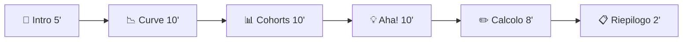
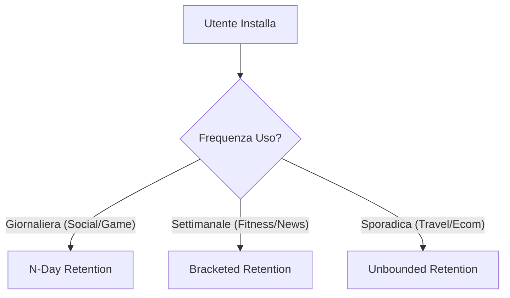

## Retention Framework — Lezione Completa

Tutti i founder vogliono vedere il grafico degli utenti crescere esponenzialmente ("Hockey Stick"). Ma se guardi sotto il cofano di molte startup fallite, trovi un "secchio bucato" (Leaky Bucket): spendono milioni in marketing per acquisire utenti che se ne vanno dopo 3 giorni. La Retention è l'unica metrica che conta davvero per la sopravvivenza a lungo termine. Se hai retention, hai un business. Se non ce l'hai, hai solo un passatempo costoso.

### Obiettivi di Apprendimento

Al termine di questa lezione, lo studente sarà in grado di:
1.  Calcolare e interpretare una Curva di Retention (Cohorts).
2.  Distinguere tra N-Day, Unbounded e Bracketed Retention e scegliere quella giusta per il proprio prodotto.
3.  Identificare il momento "Aha!" che correla con la retention a lungo termine.
4.  Applicare strategie di Lifecycle Marketing per riattivare gli utenti dormienti.
5.  Diagnosticare problemi di retention usando l'analisi per segmenti.

### Timeline della Lezione

| Fase | Argomento | Durata |
|------|-----------|--------|
| 1 | Introduzione: Retention > Acquisition | 5 min |
| 2 | Metrica: Le 3 Curve di Retention | 10 min |
| 3 | Analisi: Cohort Analysis | 10 min |
| 4 | Strategia: L'Habit Loop e il Momento Aha! | 10 min |
| 5 | Esercizi: Calcolo della Retention | 8 min |
| 6 | Riepilogo e Domande | 2 min |
| **Totale** | | **45 min** |

### Fase 1 — Introduzione: Retention > Acquisition (5 min)

La saggezza popolare del marketing dice: "Costa 5 volte di più acquisire un nuovo cliente che mantenerne uno vecchio". In realtà, nel SaaS e nelle App, questo rapporto può essere 20:1 o peggio.

La Retention è il fondamento della crescita per tre motivi:
1.  **Unit Economics:** Aumenta il Lifetime Value (LTV), permettendoti di spendere di più per acquisire (CAC).
2.  **Viralità:** Solo gli utenti felici e fedeli invitano gli amici.
3.  **Difendibilità:** Un prodotto con alta retention crea "lock-in" e abitudine, rendendo difficile per i competitor rubarti i clienti.

*Esempio:* Facebook ha vinto su MySpace non perché avesse più utenti all'inizio, ma perché la sua curva di retention si appiattiva (gli utenti restavano), mentre quella di MySpace andava a zero.

### Fase 2 — Metrica: Le 3 Curve di Retention (10 min)

Non esiste un solo modo di misurare "l'utente è tornato". Devi scegliere la metrica giusta per la frequenza naturale del tuo prodotto.

1.  **N-Day Retention (Retention Esatta):**
    *   *Definizione:* % di utenti che tornano *esattamente* il giorno N (es. Giorno 7).
    *   *Uso:* Giochi, Social Network, App di messaggistica (uso quotidiano).
    *   *Formula:* (Utenti attivi Giorno N / Utenti installati Giorno 0).

2.  **Unbounded (Rolling) Retention:**
    *   *Definizione:* % di utenti che tornano *in qualsiasi momento* dal giorno N in poi.
    *   *Uso:* SaaS B2B, E-commerce, Travel (uso sporadico).
    *   *Formula:* (Utenti attivi Giorno N+ / Utenti installati Giorno 0).
    *   *Nota:* È sempre più alta della N-Day (più indulgente).

3.  **Bracketed Retention (A Finestre):**
    *   *Definizione:* % di utenti che tornano in una finestra temporale (es. Settimana 1, Settimana 2).
    *   *Uso:* App di Fitness (settimanale), Finanza (mensile).
    *   *Formula:* (Utenti attivi Settimana N / Utenti installati Settimana 0).

### Fase 3 — Analisi: Cohort Analysis (10 min)

La media mente. Se dici "La nostra retention è del 20%", non dici nulla. Devi guardare le **Coorti** (gruppi di utenti che hanno iniziato nello stesso periodo).

Una **Triangular Cohort Chart** (o Heatmap di Retention) ti mostra l'evoluzione nel tempo.
*   *Righe:* Mese di acquisizione (Gennaio, Febbraio...).
*   *Colonne:* Mese di vita (Mese 1, Mese 2...).
*   *Celle:* % di utenti ancora attivi.

**Cosa cercare:**
1.  **Appiattimento (Flattening the Curve):** La curva deve diventare orizzontale a un certo punto (es. al 20%). Se continua a scendere verso lo zero, il prodotto è morto.
2.  **Miglioramento delle Coorti:** La retention del Mese 1 di Febbraio è migliore di quella di Gennaio? Se sì, il prodotto sta migliorando. Se no, le nuove feature non servono.

### Fase 4 — Strategia: L'Habit Loop e il Momento Aha! (10 min)

La retention non si compra, si progetta. Nir Eyal nel libro *Hooked* descrive il "Ciclo dell'Abitudine":
1.  **Trigger:** Esterno (notifica) o Interno (noia, solitudine).
2.  **Azione:** Semplice da fare (scrollare il feed).
3.  **Ricompensa Variabile:** Non sai cosa troverai (dopamina).
4.  **Investimento:** L'utente mette qualcosa di suo (carica una foto, segue qualcuno), rendendo difficile lasciare il prodotto.

**Il Momento "Aha!"**
È l'istante in cui l'utente capisce il valore del prodotto.
*   *Facebook:* Avere 7 amici in 10 giorni.
*   *Slack:* Inviare 2.000 messaggi nel team.
*   *Dropbox:* Mettere 1 file nella cartella.
*   *Strategia:* Tutta la tua UX di onboarding deve spingere l'utente verso questo momento il prima possibile.

### Fase 5 — Esercizi: Calcolo della Retention (8 min)

**Scenario:** Hai lanciato un'app di meditazione.
*   100 utenti si iscrivono il 1° Gennaio.
*   Di questi 100:
    *   30 aprono l'app il 2 Gennaio (Giorno 1).
    *   15 aprono l'app il 8 Gennaio (Giorno 7).
    *   10 aprono l'app il 31 Gennaio (Giorno 30).

**Domande:**
1.  Qual è la Retention D1? (30%)
2.  Qual è la Retention D7? (15%)
3.  Qual è la Retention D30? (10%)
4.  Se il tuo obiettivo è avere il 20% di retention al D30, quanti utenti devi acquisire a Febbraio per avere 200 utenti attivi al D30? (Reverse Engineering: 200 / 0.20 = 1.000 utenti).

### Fase 6 — Riepilogo e Domande (2 min)

1.  **Leaky Bucket.** Ripara il buco prima di versare altra acqua (marketing).
2.  **Frequenza.** Scegli la metrica giusta per la tua frequenza d'uso.
3.  **Coorti.** Analizza per gruppi temporali per vedere i trend.
4.  **Aha Moment.** Trovalo e ottimizza l'onboarding per raggiungerlo.

### Domande di Verifica

1.  Perché la "N-Day Retention" è una metrica troppo severa per un'app di prenotazione viaggi?
2.  Cosa indica una curva di retention che tende asintoticamente allo zero?
3.  In una Cohort Analysis, se le coorti più recenti hanno una retention peggiore di quelle vecchie, cosa potrebbe significare?
4.  Qual è la differenza tra un "Trigger Esterno" e un "Trigger Interno" nel modello di Hooked?
5.  Come useresti l'analisi di correlazione per trovare il tuo "Aha Moment"?

### Riferimenti Bibliografici

-   Nir Eyal, "Hooked: How to Build Habit-Forming Products", Portfolio, 2014.
-   Casey Winters, "Retention is the King of Growth", Blog Post.
-   Brian Balfour, "The Retention Lifecycle Framework", Reforge.
