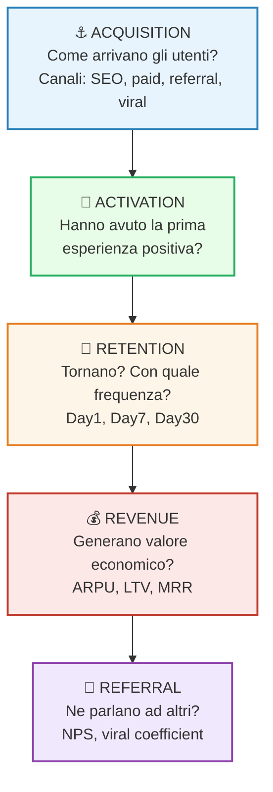

C'è un'ossessione nel marketing italiano: i nuovi clienti. Budget enorme per acquisire, budget minuscolo per tenere. Poi ci si stupisce che il business non cresca abbastanza.

La verità matematica è brutale: se perdi il 10% dei clienti ogni mese, in un anno hai perso il **72% della tua base**. Puoi acquisire quanto vuoi — se il secchio è bucato, l'acqua non resta.

La retention è il fondamento su cui si costruisce tutto il resto.

## Il framework AARRR — Pirate Metrics

Dave McClure, fondatore di 500 Startups, ha definito le cinque metriche fondamentali di qualsiasi business digitale. Le ha chiamate "Pirate Metrics" perché l'acronimo fa AARRR — come il verso di un pirata.

La maggior parte delle aziende ottimizza solo la A (Acquisition). Le aziende migliori ottimizzano tutte e cinque le fasi — e in particolare la R di Retention, che sblocca tutto il resto.

## L'Aha Moment: il momento chiave

Ogni prodotto ha un momento in cui l'utente "capisce" il valore. Quel momento si chiama **Aha Moment**. Se l'utente ci arriva, la probabilità che resti aumenta drasticamente.

| Prodotto | Aha Moment |
|---|---|
| **Satispay** | La prima volta che paghi al bar in 2 secondi senza tirar fuori il portafoglio |
| **Spotify** | La prima playlist automatica che "ti capisce" davvero |
| **LinkedIn** | Quando vieni contattato da un recruiter per la prima volta |
| **Esselunga a Casa** | Quando la spesa arriva in 2 ore esatte, come promesso |
| **Dropbox** | Quando apri un file modificato su un altro PC e lo trovi già aggiornato |

Il lavoro del product team è trovare l'Aha Moment e portarci il maggior numero possibile di nuovi utenti nel minor tempo possibile. Ogni frizione che impedisce di arrivare all'Aha Moment è un utente che stai perdendo.

## Metriche di retention per settore

**Day 1 / Day 7 / Day 30 Retention** = la percentuale di utenti che torna dopo 1, 7, 30 giorni dall'iscrizione.

| Categoria | Day 1 | Day 7 | Day 30 |
|---|---|---|---|
| App di pagamento (es. Satispay) | 60-70% | 40-55% | 30-45% |
| Social media | 50-70% | 30-50% | 20-35% |
| E-commerce | 30-40% | 15-25% | 8-15% |
| SaaS B2B | 85-95% | 75-85% | 65-80% |
| App di news/media | 25-40% | 15-25% | 8-15% |
| Food delivery | 35-50% | 20-35% | 12-22% |

Se sei sotto il benchmark del tuo settore: risolvi la retention prima di aumentare il budget acquisizione. Altrimenti stai versando acqua in un secchio bucato.

## Churn rate: il numero che tutti evitano

**Churn rate** = percentuale di clienti che smettono di usare il prodotto in un dato periodo.

Calcolo mensile: `Churn = Utenti persi nel mese / Utenti all'inizio del mese × 100`

| Churn mensile | Cosa significa | Vita media cliente |
|---|---|---|
| 2% | Ottimo (standard SaaS B2B) | 50 mesi |
| 5% | Accettabile | 20 mesi |
| 10% | Problematico | 10 mesi |
| 15%+ | Critico — il prodotto non funziona | Meno di 7 mesi |

Un churn del 15% mensile significa che la tua base clienti si dimezza ogni 5 mesi. Nessun budget acquisizione può compensare questo.

## Strategie di retention per il mercato italiano

**1. Loyalty program.** In Italia funzionano molto bene. Esselunga Fìdaty è uno dei programmi fedeltà più efficaci in Europa. I dati mostrano che i clienti con carta fedeltà hanno LTV 2-3x superiore rispetto agli altri. Conad, Coop, tutti i grandi retail ci investono pesantemente — e ne vale la pena.

**2. Re-engagement via email/push.** Se un utente non apre l'app da 7 giorni, è a rischio churn. Un'email personalizzata ("Ciao Marco, hai ancora 150 punti fedeltà da usare") costa quasi nulla e recupera una quota significativa di utenti dormienti. Il momento migliore per mandarla è 48-72 ore prima della finestra tipica di churn del tuo segmento.

**3. Onboarding strutturato.** La maggior parte del churn avviene nei primi 7 giorni. Un onboarding che porta l'utente all'Aha Moment in modo rapido e guidato è l'investimento con il ROI più alto nella retention. Prima risolvi l'onboarding, prima migliora tutto il resto.

**4. Customer Success (B2B).** Per i SaaS italiani (TeamSystem, Zucchetti, e simili), il Customer Success manager che contatta proattivamente i clienti a rischio churn è il fattore di differenza tra un churn del 3% e uno del 15%. La domanda chiave: "Stanno davvero usando il prodotto come previsto?"

## Problema reale

La crescita acquisisce nuovi utenti, ma le coorti si svuotano dopo pochi giorni: il problema non e portare traffico, e capire dove si rompe l abitudine.

La domanda pratica non e "so ripetere la teoria?", ma: **quale decisione migliora se applico bene questa lezione?** In product analytics, il rischio tipico e prendere un segnale parziale e trasformarlo in una scelta costosa: una feature lanciata troppo presto, un budget spostato senza causalita, un modello dati fragile o una raccomandazione piu elegante che utile.

## Modello concettuale

Usa questa griglia in tre passaggi: prima definisci il fenomeno, poi scegli l evidenza minima credibile, infine trasformi l evidenza in una decisione esplicita.

| Livello | Domanda guida | Output atteso |
|---|---|---|
| Fenomeno | Che cosa sta davvero succedendo? | Perimetro, segmenti e assunzioni |
| Evidenza | Quale dato cambierebbe la nostra opinione? | Metriche, osservazioni e guardrail |
| Decisione | Che cosa faremo se il segnale regge? | Azione, owner, timing e criterio di stop |

Questo modello evita due estremi: teoria senza applicazione e operativita senza ragionamento.

## Formalizzazione rigorosa

Formalizza la lezione come una catena decisionale:

| Elemento | Definizione operativa | Controllo di qualita |
|---|---|---|
| Input | eventi prodotto, funnel, coorti, survey, ticket supporto e session recording | Fonte, periodo, granularita e completezza dichiarati |
| Ipotesi | Relazione attesa tra comportamento, metrica e decisione | Assunzioni scritte prima dell analisi |
| Metrica | activation, retention, conversione, NPS, churn e valore per utente | Denominatore, segmento e finestra temporale espliciti |
| Guardrail | Cosa non deve peggiorare mentre ottimizzi | Soglie condivise con product, growth e design |
| Decisione | scegliere quali frizioni rimuovere, quali segmenti servire e quali interventi mettere in backlog | Owner, scadenza e criterio di revisione |

Una lezione e formalizzata bene quando un altra persona puo ricostruire il ragionamento e contestare le assunzioni senza chiedere spiegazioni extra.

## Esempio o caso studio

Immagina una review settimanale in cui product, growth e design deve decidere su "Retention Framework: il fondamento che tutti ignorano". Il dato iniziale mostra un segnale promettente, ma il team non si ferma al numero principale. Divide il problema per segmento, controlla i guardrail, cerca spiegazioni alternative e scrive una raccomandazione con tre parti: cosa sappiamo, cosa non sappiamo, cosa faremo adesso.

| Osservazione | Interpretazione prudente | Azione |
|---|---|---|
| Segnale positivo sulla metrica primaria | Potrebbe essere effetto reale o composizione del campione | Controllare segmenti e baseline |
| Guardrail stabile | Il miglioramento non sembra creare danni immediati | Procedere con rollout limitato |
| Evidenza ancora incompleta | Serve una verifica prima di scalare | Definire un secondo ciclo di misura |

Il valore del caso non sta nel trovare una risposta perfetta, ma nel rendere la decisione piu difendibile.

## Lab / esercizio

Usa questo esercizio per trasformare la lezione in pratica verificabile.

| Livello | Attivita | Output |
|---|---|---|
| Livello base | Riassumi il problema in cinque righe e scegli una metrica primaria con un guardrail. | Mini brief decisionale |
| Livello intermedio | Applica il modello a un caso reale o simulato, includendo segmenti, baseline e rischi. | Tabella di analisi con raccomandazione |
| Livello research-grade | Scrivi un memo che confronta due spiegazioni alternative e indica quale evidenza le distinguerebbe. | Decision memo revisionabile |

**Dataset e materiali consigliati:** esportazione eventi o metriche dal tuo prodotto, una dashboard gia usata dal team, note qualitative, risultati di un esperimento o un dataset pubblico coerente con il tema.

## Errore tipico da evitare

L errore piu comune e usare "Retention Framework: il fondamento che tutti ignorano" come etichetta autorevole invece che come metodo. Succede quando il team cita il concetto per giustificare una scelta gia presa, oppure quando ottimizza una metrica locale senza chiedersi quale comportamento sta incentivando.

Correzione pratica: prima di presentare la raccomandazione, scrivi una riga con la decisione proposta, una riga con l evidenza che la sostiene e una riga con la condizione che ti farebbe cambiare idea. Se manca una di queste tre righe, la lezione non e ancora stata applicata con rigore.

## Quiz o checkpoint

1. Quale decisione concreta dovrebbe migliorare applicando questa lezione?
2. Quale metrica useresti come segnale primario e quale come guardrail?
3. Quale spiegazione alternativa potrebbe rendere sbagliata la tua interpretazione?
4. Che cosa dovrebbe succedere nei dati per farti cambiare raccomandazione?
5. Quale output consegneresti a product, growth e design: dashboard, memo, esperimento, backlog o modello dati?

Se non riesci a rispondere in modo specifico, torna al problema reale prima di continuare.

## Riepilogo

- La retention è il fondamento: un business con retention alta può permettersi un CAC alto; uno con retention bassa non sopravvive
- Il framework **AARRR** mappa le 5 fasi del ciclo di vita utente — tutte devono essere ottimizzate, non solo l'acquisizione
- L'**Aha Moment** è il momento chiave: portarci l'utente velocemente è la priorità assoluta dell'onboarding
- **Churn rate** mensile >10% è un segnale critico: risolvi la retention prima di spendere in acquisizione
- In Italia i **loyalty program** hanno un impatto straordinario (Esselunga Fìdaty: LTV 2-3x superiore)
- La matematica è brutale: churn 10% mensile = -72% della base in un anno
