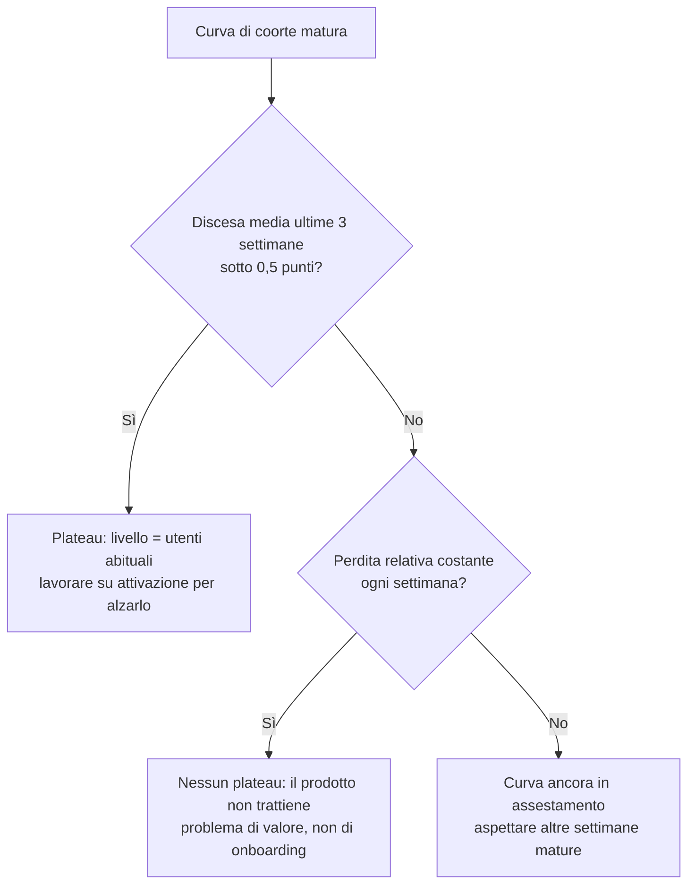

Un'app di fatturazione per freelance (scenario costruito, numeri di esempio) presenta i risultati del trimestre. Il product manager mostra una retention al giorno 28 del 19%. Dieci minuti dopo, il responsabile marketing mostra una retention al giorno 28 del 41%, calcolata sugli stessi utenti. Nessuno dei due ha sbagliato un conto: il primo ha contato chi ha usato l'app esattamente il ventottesimo giorno, il secondo chi l'ha usata quel giorno o in un giorno qualsiasi successivo. Le due cifre rispondono a domande diverse, e senza la definizione accanto portano a conclusioni opposte sulla salute del prodotto.

> **Idea chiave:** la retention è una famiglia di misure, non un numero; si sceglie la definizione che segue il ritmo naturale d'uso del prodotto, si tiene fisso il denominatore e si dichiara tutto nel titolo del grafico.

La retention è la metrica che più di ogni altra dice se un prodotto crea valore duraturo: l'acquisizione porta le persone, la retention dice se il prodotto le tiene. Per questo è anche la metrica su cui si prendono le decisioni più costose, ed è il motivo per cui le sue definizioni meritano rigore.

## Le scelte da fare prima di contare

Ogni numero di retention dipende da quattro scelte. Vanno scritte prima di aprire l'editor SQL, perché cambiarne una cambia il risultato.

L'**evento di ingresso** definisce la coorte: la registrazione, la prima fattura emessa, il primo abbonamento pagato. Coorti diverse rispondono a domande diverse: la retention dalla registrazione misura insieme onboarding e prodotto, quella dalla prima fattura misura il prodotto per chi lo ha già provato.

L'**evento di ritorno** definisce che cosa vuol dire essere tornati. Deve essere un'azione intenzionale legata al valore centrale: per l'app di fatturazione, inviare una fattura (`invoice_sent`). Un login, un'email aperta o una notifica ricevuta non bastano, perché possono avvenire senza che l'utente ottenga nulla. La stessa distinzione tra attività e valore regge le [metriche di engagement](/course/analisi-prodotto/engagement-metriche/).

La **definizione temporale** stabilisce quando il ritorno conta: in un giorno preciso, da un giorno in poi o dentro un intervallo. È l'oggetto della prossima sezione.

Il **denominatore** è la dimensione della coorte all'ingresso e non cambia mai. Dividere gli attivi della settimana 4 per gli attivi della settimana 3 produce un'altra metrica (la retention condizionata, utile per il churn), non la curva di coorte.

C'è infine una quinta condizione, spesso dimenticata: la **maturità**. Una coorte entra nel calcolo della retention al giorno $N$ solo se tutti i suoi membri hanno avuto almeno $N$ giorni di vita alla data di estrazione. Altrimenti le ultime celle sono sottostimate per costruzione.

## N-day, unbounded, bracket: tre definizioni a confronto

Chiamiamo $C$ la coorte e $|C|$ la sua dimensione. Le tre definizioni standard, con i nomi usati da Amplitude, Mixpanel e dalla letteratura di settore, sono queste.

La **retention N-day** conta chi è attivo esattamente il giorno $N$: $R_N = |\{u \in C : u \text{ attivo il giorno } N\}| / |C|$. È adatta ai prodotti d'uso quotidiano, come un social network o un'app di messaggistica, e fragile per tutto il resto.

La **retention unbounded** (o *rolling*) conta chi è attivo il giorno $N$ o in qualsiasi giorno successivo: $R^{+}_N = |\{u \in C : u \text{ attivo in un giorno} \ge N\}| / |C|$. È adatta ai prodotti d'uso sporadico, come un e-commerce o una prenotazione di viaggi. Al crescere di $N$ non può che scendere.

La **retention bracket** conta chi è attivo almeno una volta dentro un intervallo $[a, b]$: $R_{[a,b]} = |\{u \in C : u \text{ attivo in un giorno tra } a \text{ e } b\}| / |C|$. È la scelta tipica dei SaaS con uso settimanale o mensile.

| Definizione | Domanda a cui risponde | Prodotti adatti | Limite principale |
| :--- | :--- | :--- | :--- |
| N-day | Chi è attivo proprio il giorno N? | Social, messaggistica, giochi | Penalizza chi usa il prodotto a giorni alterni o solo nei feriali |
| Unbounded | Chi è tornato dal giorno N in poi? | E-commerce, viaggi, acquisti rari | Il valore storico cresce con il passare del tempo: va ricalcolato con la stessa data di taglio |
| Bracket | Chi è attivo almeno una volta nell'intervallo? | SaaS B2B, strumenti di lavoro | Il risultato dipende dall'ampiezza degli intervalli scelti |

Fra le tre esiste una sola relazione sempre vera: la N-day è minore o uguale sia alla bracket che contiene il giorno $N$ sia alla unbounded dal giorno $N$, perché chi è attivo il giorno $N$ è contato in entrambe. Bracket e unbounded invece non hanno un ordine fisso: una conta i giorni prima di $N$, l'altra quelli dopo. Se in una query la N-day risulta superiore a una delle altre due, c'è un errore.

## Esempio svolto: una coorte, tre numeri

La coorte è quella dei 1.000 freelance iscritti nella settimana dal 7 al 13 settembre 2026, con estrazione il 27 novembre: tutti hanno più di 75 giorni di vita, quindi la coorte è matura per il giorno 28. La query calcola le tre definizioni in un passaggio.

```sql
-- Tre definizioni di retention al giorno 28 sulla stessa coorte (dialetto Postgres/DuckDB)
WITH cohort AS (
    SELECT user_id, CAST(signup_time AS DATE) AS d0
    FROM users
    WHERE signup_time >= TIMESTAMP '2026-09-07'
      AND signup_time <  TIMESTAMP '2026-09-14'
),
attivita AS (
    SELECT DISTINCT c.user_id,
           CAST(e.event_time AS DATE) - c.d0 AS giorno     -- giorni di vita al momento dell'evento
    FROM cohort c
    JOIN events e ON e.user_id = c.user_id
    WHERE e.event_name = 'invoice_sent'
      AND e.event_time < TIMESTAMP '2026-11-27'           -- data di taglio fissa
)
SELECT
    (SELECT COUNT(*) FROM cohort)                                          AS coorte,
    COUNT(DISTINCT CASE WHEN giorno = 28 THEN user_id END)                 AS n_day_28,
    COUNT(DISTINCT CASE WHEN giorno BETWEEN 22 AND 28 THEN user_id END)    AS bracket_22_28,
    COUNT(DISTINCT CASE WHEN giorno >= 28 THEN user_id END)                AS unbounded_28
FROM attivita;
```

Il risultato è 190 utenti per la N-day, 330 per la bracket dei giorni 22–28 e 410 per la unbounded. Dividendo per la coorte: $190 / 1.000 = 19\%$, $330 / 1.000 = 33\%$, $410 / 1.000 = 41\%$. La relazione attesa è rispettata, perché 19% è minore di entrambi gli altri valori.

Il 19% è basso perché i freelance fatturano a fine mese o a fine lavoro, non ogni giorno: in un giorno qualsiasi solo una minoranza di utenti fedeli emette una fattura. Il 41% è alto perché include chiunque sia tornato in uno qualsiasi dei 50 giorni successivi, compresi utenti che hanno emesso una sola fattura a novembre e poi sono spariti. Per un prodotto con questa cadenza la definizione giusta è la bracket, con intervalli settimanali o, ancora meglio, mensili. La raccomandazione al team è di adottare la retention bracket settimanale come metrica ufficiale, di scrivere nel titolo di ogni grafico «utenti con almeno una fattura inviata nella settimana N, su iscritti della coorte», e di ritirare dai report gli altri due numeri.

## Curve di coorte e plateau

Una sola retention a un solo giorno è un punto. Per capire un prodotto serve la curva: la retention di una coorte per ogni periodo di vita, cioè $R_{[7k, 7k+6]}$ per $k = 0, 1, 2, \dots$ nel caso settimanale. Mettendo più coorti una sotto l'altra si ottiene la **tabella di coorte**, che si legge in due direzioni: lungo la riga si vede la forma della curva di una coorte, lungo la colonna si confrontano coorti diverse alla stessa età. Growth accounting e matrici di stato, che leggono molte coorti insieme, sono il tema dell'[analisi di coorte](/course/analisi-prodotto/analisi-coorte/).

```sql
-- Tabella di coorte: retention bracket settimanale con denominatore fisso
WITH cohort AS (
    SELECT user_id,
           CAST(signup_time AS DATE)      AS d0,
           DATE_TRUNC('week', signup_time) AS settimana_coorte
    FROM users
),
dimensione AS (
    SELECT settimana_coorte, COUNT(*) AS n_coorte
    FROM cohort
    GROUP BY settimana_coorte
),
attivita AS (
    SELECT DISTINCT c.user_id, c.settimana_coorte,
           CAST(FLOOR((CAST(e.event_time AS DATE) - c.d0) / 7.0) AS INT) AS settimana_n
    FROM cohort c
    JOIN events e ON e.user_id = c.user_id
    WHERE e.event_name = 'invoice_sent'
      AND e.event_time >= c.d0
)
SELECT
    a.settimana_coorte,
    a.settimana_n,
    COUNT(*)   AS attivi,
    d.n_coorte,                                            -- denominatore fisso: la coorte intera
    ROUND(100.0 * COUNT(*) / d.n_coorte, 1) AS retention_pct
FROM attivita a
JOIN dimensione d ON d.settimana_coorte = a.settimana_coorte
GROUP BY a.settimana_coorte, a.settimana_n, d.n_coorte
ORDER BY a.settimana_coorte, a.settimana_n;
```

La settimana $n$ si calcola sui giorni di vita dell'utente, non sulle settimane di calendario: un iscritto di domenica e uno di lunedì hanno la loro settimana 1 in giorni diversi, ma entrambe durano sette giorni dalla rispettiva iscrizione. Le celle senza attivi non compaiono nell'output e vanno riempite con zero; le celle oltre la data di taglio, invece, vanno lasciate vuote, perché non sono zero ma dati che non esistono ancora.

La forma della curva è l'informazione più importante. Due prodotti con la stessa retention alla settimana 4 possono avere futuri opposti:

| Settimana di vita | Prodotto A | Prodotto B |
| :--- | ---: | ---: |
| 1 | 45,0% | 40,0% |
| 4 | 30,0% | 30,0% |
| 5 | 29,0% | 25,5% |
| 6 | 28,5% | 21,7% |
| 7 | 28,2% | 18,4% |
| 8 | 28,0% | 15,7% |

Il prodotto A si stabilizza: dalla settimana 5 alla 8 perde 1 punto in tre settimane, $(29{,}0 - 28{,}0) / 3 = 0{,}33$ punti a settimana. Il prodotto B perde circa il 15% dei suoi utenti rimasti ogni settimana ($25{,}5 \times 0{,}85 = 21{,}7$, $21{,}7 \times 0{,}85 = 18{,}4$) e scivola verso lo zero. Un **plateau** è proprio questo: il punto da cui la curva smette di scendere in modo apprezzabile. Un criterio operativo è una discesa media inferiore a 0,5 punti a settimana sulle ultime tre settimane mature. Il livello del plateau, qui il 28%, è la quota di utenti per cui il prodotto è diventato un'abitudine, ed è uno dei segnali principali di [product-market fit](/course/analisi-prodotto/product-market-fit/).



Il plateau si controlla anche in automatico, partendo dalla tabella di coorte in formato largo:

```python
import pandas as pd

# tabella: righe = coorti, colonne = settimana di vita, valori = retention in percentuale (NaN se immatura)
tab = pd.read_csv("retention_coorti.csv", index_col="settimana_coorte")

def plateau(riga, ultime=3, soglia_pp=0.5):
    valori = riga.dropna()
    if len(valori) < ultime + 1:
        return None                               # coorte troppo giovane per giudicare
    coda = valori.iloc[-(ultime + 1):]
    discesa_media = (coda.iloc[0] - coda.iloc[-1]) / ultime
    return round(coda.iloc[-1], 1) if discesa_media < soglia_pp else None

tab["plateau_pct"] = tab.apply(plateau, axis=1)
print(tab[["plateau_pct"]])
```

## Retention e churn: due facce, due denominatori

Il **churn** è la quota di utenti attivi all'inizio di un periodo che non lo sono più alla fine. Per un abbonamento la definizione è netta: churn mensile = disdette nel mese / abbonati attivi all'inizio del mese. Con 2.000 abbonati al 1° ottobre e 160 disdette durante il mese, il churn è $160 / 2.000 = 8\%$. I 300 nuovi abbonati di ottobre non entrano nel denominatore, perché non erano attivi all'inizio.

La differenza con la retention di coorte è il denominatore. La retention di coorte divide sempre per la coorte iniziale; il churn divide per chi era ancora presente all'inizio del periodo. Se il churn è costante e pari a $c$ per periodo, la retention dopo $t$ periodi è $(1 - c)^t$ e la vita media di un cliente è $1 / c$ periodi. Con churn mensile dell'8% la retention a 12 mesi è $0{,}92^{12} = 36{,}8\%$ e la vita media è $1 / 0{,}08 = 12{,}5$ mesi.

La formula mostra il fatto più utile da ricordare: **un churn costante non produce mai un plateau**. La curva $(1-c)^t$ scende sempre della stessa quota relativa e tende a zero, come il prodotto B. Un plateau esiste solo se il churn diminuisce con l'anzianità, cioè se chi resta a lungo abbandona sempre meno. Nella realtà è il caso più comune: il churn del primo mese è spesso un multiplo di quello dei mesi successivi.

Questo ha una conseguenza pratica sul churn aggregato. Se l'azienda acquisisce meno clienti nuovi, la base invecchia e il churn complessivo scende anche se il prodotto non è cambiato, perché pesano di più i clienti anziani che abbandonano poco. Prima di festeggiare un calo del churn, lo si calcola per fascia di anzianità (primo mese, mesi 2–3, oltre 3): se ogni fascia è stabile, il calo è un effetto mix.

Per i prodotti senza abbonamento il churn va definito con una soglia di inattività, ricavata dalla cadenza reale degli utenti fedeli. Si calcolano gli intervalli tra due usi consecutivi e se ne prende un percentile alto. Con dieci intervalli osservati di 12, 18, 25, 31, 38, 44, 52, 60, 75 e 95 giorni, l'80° percentile con il metodo del rango più vicino è il valore in posizione $0{,}80 \times 10 = 8$, cioè 60 giorni. Un utente fermo da 45 giorni è dentro la cadenza normale; uno fermo da 70 è a rischio. Fissare 30 giorni per comodità significherebbe dichiarare «perso» un utente fedele a ogni pausa fisiologica.

## Il rilascio ha migliorato la retention? Il test su due proporzioni

Il team rilascia un nuovo onboarding a fine luglio. La coorte di luglio, prima del rilascio, ha 800 utenti e 160 sono attivi alla settimana 4: $160 / 800 = 20{,}0\%$. La coorte di agosto, dopo il rilascio, ha 900 utenti e 207 attivi: $207 / 900 = 23{,}0\%$. La differenza è di 3 punti, un miglioramento relativo del 15%. La domanda è se 3 punti superano il rumore che due gruppi di queste dimensioni producono anche senza alcun cambiamento.

L'errore standard della differenza tra due proporzioni indipendenti è $SE = \sqrt{p_1(1-p_1)/n_1 + p_2(1-p_2)/n_2}$. Con i numeri dell'esempio, il primo termine vale $0{,}20 \times 0{,}80 / 800 = 0{,}000200$ e il secondo $0{,}23 \times 0{,}77 / 900 = 0{,}000197$. La somma è $0{,}000397$ e la radice è $0{,}0199$, cioè 1,99 punti. La statistica è $z = 3{,}0 / 1{,}99 = 1{,}51$, sotto la soglia di 1,96 del livello al 95%. L'intervallo di confidenza è $3{,}0 \pm 1{,}96 \times 1{,}99$, cioè da $-0{,}9$ a $+6{,}9$ punti, e contiene lo zero.

La conclusione corretta non è «l'onboarding non funziona», ma «i dati non bastano per dirlo»: il vero effetto potrebbe essere nullo come vicino ai 7 punti. Quanti utenti servirebbero? Per riconoscere una differenza di 3 punti partendo dal 20%, con livello 5% e potenza 80%, la formula approssimata è $n = (1{,}96 + 0{,}84)^2 \times (0{,}20 \times 0{,}80 + 0{,}23 \times 0{,}77) / 0{,}03^2 = 7{,}84 \times 0{,}337 / 0{,}0009 \approx 2.940$ utenti per gruppo, più del triplo di quelli disponibili.

```python
from math import sqrt
from scipy.stats import norm

def confronto_retention(trattenuti_a, n_a, trattenuti_b, n_b, alpha=0.05):
    """Differenza di retention tra due coorti indipendenti, in punti percentuali."""
    p_a, p_b = trattenuti_a / n_a, trattenuti_b / n_b
    se = sqrt(p_a * (1 - p_a) / n_a + p_b * (1 - p_b) / n_b)
    z = (p_b - p_a) / se
    margine = norm.ppf(1 - alpha / 2) * se
    return {
        "delta_pp": round((p_b - p_a) * 100, 2),
        "z": round(z, 2),
        "p_value": round(2 * (1 - norm.cdf(abs(z))), 3),
        "ic_95_pp": (round((p_b - p_a - margine) * 100, 1), round((p_b - p_a + margine) * 100, 1)),
    }

print(confronto_retention(160, 800, 207, 900))
# {'delta_pp': 3.0, 'z': 1.51, 'p_value': 0.132, 'ic_95_pp': (-0.9, 6.9)}
```

C'è un secondo limite, più profondo del primo. Anche con un $z$ di 3, il confronto prima-dopo non dimostrerebbe che il merito è dell'onboarding: le coorti di luglio e agosto differiscono per stagione, canali di acquisizione e campagne attive. Il test statistico dice se la differenza è più grande del rumore di campionamento, non da che cosa è causata. Per attribuirla al rilascio servono un [test A/B](/course/analisi-prodotto/ab-testing/), con metà dei nuovi iscritti sul vecchio flusso e metà sul nuovo, oppure, se non è possibile, i [metodi quasi-sperimentali](/course/analisi-prodotto/inferenza-causale-osservazionale/) che si usano quando non si può randomizzare.

## Errori ricorrenti nel calcolo della retention

### Curva a denti di sega con la N-day giornaliera

Il sintomo è una curva che scende e risale: la retention al giorno 7 e al giorno 14 è molto più bassa dei giorni vicini. Succede perché per molti utenti quei giorni cadono nel fine settimana, e il prodotto si usa nei feriali. Si corregge passando alla bracket settimanale, che assorbe il ritmo della settimana lavorativa.

### Celle immature trattate come zeri

Il sintomo è un crollo della retention nelle coorti più recenti che si «sistema» da solo dopo qualche settimana. Succede quando la tabella di coorte mostra come 0% o come valori bassi le celle di settimane non ancora concluse. Si evita filtrando le celle per cui la data di iscrizione più la fine della settimana $n$ supera la data di taglio, e lasciandole vuote nel grafico.

### Media di coorti diverse senza pesi né segmenti

Il sintomo è una curva media che scende lentamente e che nessuno sa spiegare. Succede perché l'aggregato è la miscela di popolazioni diverse: una minoranza che trova valore e si stabilizza al 50–60% e una maggioranza che abbandona entro pochi giorni. Si evita segmentando la curva per canale di acquisizione, piano e attivazione nella prima settimana: due curve con cause diverse indicano due interventi diversi.

## Verifica sulla retention

1. Una coorte di 2.500 utenti ha 600 utenti attivi il giorno 30 e 900 attivi dal giorno 30 in poi. Quanto valgono la retention N-day e la unbounded al giorno 30?

<details>
<summary>Mostra risposta</summary>

La N-day è $600 / 2.500 = 24\%$ e la unbounded è $900 / 2.500 = 36\%$. In entrambi i casi il denominatore è la coorte iniziale. La unbounded è più alta perché include chi è tornato dopo il giorno 30, e va sempre presentata con la data di taglio, perché crescerà ancora con il passare del tempo.

</details>

2. Un analista calcola la retention alla settimana 2 dividendo i 180 attivi della settimana 2 per i 240 attivi della settimana 1, su una coorte di 600 utenti. Che cosa ha calcolato e qual è la retention di coorte corretta?

<details>
<summary>Mostra risposta</summary>

Ha calcolato una retention condizionata, cioè la quota di attivi della settimana 1 ancora attivi nella settimana 2 ($180 / 240 = 75\%$), che è il complemento di un churn settimanale. La retention di coorte usa la coorte iniziale come denominatore: $180 / 600 = 30\%$. Le due misure sono entrambe utili, ma non vanno confuse in un grafico.

</details>

3. Un abbonamento ha churn mensile costante del 5%. Qual è la retention a 12 mesi, quale la vita media del cliente, e ci sarà un plateau?

<details>
<summary>Mostra risposta</summary>

La retention a 12 mesi è $0{,}95^{12} = 54\%$ e la vita media è $1 / 0{,}05 = 20$ mesi. Con churn costante non c'è plateau: la curva perde sempre il 5% di chi resta e tende a zero. Un plateau richiede un churn che diminuisce con l'anzianità.

</details>

4. Dopo un rilascio la retention alla settimana 4 passa dal 30% su 500 utenti al 34% su 500 utenti. La differenza supera il rumore?

<details>
<summary>Mostra risposta</summary>

L'errore standard è $\sqrt{0{,}30 \times 0{,}70 / 500 + 0{,}34 \times 0{,}66 / 500} = \sqrt{0{,}000420 + 0{,}000449} = 0{,}0295$, cioè 2,95 punti. Il rapporto è $4 / 2{,}95 = 1{,}36$, sotto 1,96, e l'intervallo al 95% va da circa $-1{,}8$ a $+9{,}8$ punti. La differenza non è distinguibile dal rumore, e anche se lo fosse un confronto prima-dopo non attribuirebbe la causa al rilascio.

</details>
