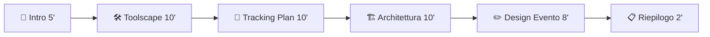
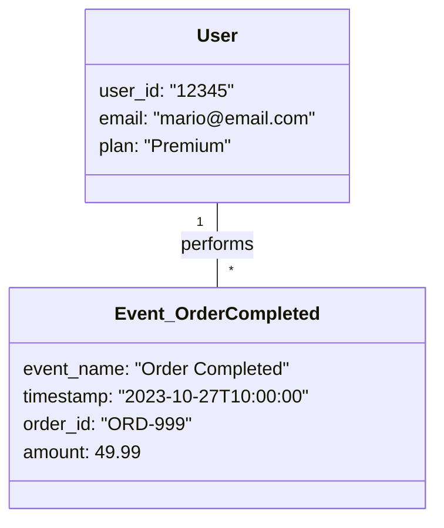

## Strumenti di Product Analytics — Lezione Completa

Il mercato dei software di analisi è esploso. Ogni settimana nasce una nuova piattaforma che promette "insight magici". Ma non tutti gli strumenti sono uguali e sceglierne uno sbagliato può costarti mesi di integrazione e dati inutilizzabili. In questa lezione, navigheremo nel panorama tecnologico della Product Analytics, capiremo le differenze architetturali e impareremo a costruire uno stack dati robusto.

### Obiettivi di Apprendimento

Al termine di questa lezione, lo studente sarà in grado di:
1.  Distinguere tra strumenti di Web Analytics (es. GA4) e Product Analytics (es. Amplitude).
2.  Progettare un Tracking Plan coerente per evitare il caos dei dati.
3.  Implementare una nomenclatura standard per gli eventi (Naming Convention).
4.  Comprendere i vantaggi e svantaggi del tracking Client-side vs Server-side.
5.  Valutare se adottare una soluzione All-in-One o un approccio Best-of-Breed.

### Timeline della Lezione

| Fase | Argomento | Durata |
|------|-----------|--------|
| 1 | Introduzione: Web vs Product Analytics | 5 min |
| 2 | Panorama Tool: GA4, Amplitude, Mixpanel, PostHog | 10 min |
| 3 | Metodologia: Il Tracking Plan | 10 min |
| 4 | Architettura: Client-side vs Server-side | 10 min |
| 5 | Esercizi: Design di un evento | 8 min |
| 6 | Riepilogo e Domande | 2 min |
| **Totale** | | **45 min** |

### Fase 1 — Introduzione: Web vs Product Analytics (5 min)

Molti iniziano con Google Analytics e poi si chiedono perché non riescono a capire cosa fanno i singoli utenti loggati. La risposta sta nella differenza di filosofia:

1.  **Web Analytics (Google Analytics):**
    *   *Focus:* Traffico, sessioni, acquisizione.
    *   *Domanda:* "Da dove vengono i visitatori? Quante pagine vedono?"
    *   *Unità:* Sessione / Pagina vista.
    *   *Utente:* Anonimo (Cookie).

2.  **Product Analytics (Amplitude, Mixpanel, Heap):**
    *   *Focus:* Comportamento, retention, feature usage.
    *   *Domanda:* "L'utente Mario Rossi ha usato la feature X dopo aver pagato?"
    *   *Unità:* Utente / Evento.
    *   *Utente:* Identificato (User ID).

Se hai un sito di news, usa Web Analytics. Se hai una SaaS o un e-commerce con login, ti serve Product Analytics.

### Fase 2 — Panorama Tool (10 min)

Ecco i principali attori e quando usarli:

| Categoria | Tool Principali | Best Use Case | Pro | Contro |
| :--- | :--- | :--- | :--- | :--- |
| **Generalista** | **Google Analytics 4** | Marketing, SEO, E-commerce base | Gratis, ecosistema Google | Difficile per analisi utente singolo, campionamento dati |
| **Product Pure** | **Amplitude** | SaaS, Mobile App | Analisi coorte potentissima, Free tier generoso | Costoso se scali molto |
| **Event-Based** | **Mixpanel** | Startup, B2C App | Report realtime, UI intuitiva | Costoso, meno focus su B2B |
| **Open Source** | **PostHog** | Dev Tools, Privacy-focused | Self-hosted (dati tuoi), feature flags incluse | Richiede manutenzione se self-hosted |
| **Auto-Capture** | **Heap** | Team senza dev resources | Traccia tutto retroattivamente | Costoso, può rallentare il sito |
| **Qualitativo** | **Hotjar / Clarity** | UX Research | Heatmaps, registrazioni | Non fa analisi quantitativa seria |

### Fase 3 — Metodologia: Il Tracking Plan (10 min)

Il 90% dei progetti fallisce perché i dati sono "spazzatura" (Garbage In, Garbage Out). Eventi duplicati, nomi a caso (`click_btn`, `Button Click`, `btn_registration`), proprietà mancanti.

La soluzione è il **Tracking Plan**: un foglio (Excel/Notion) che funge da "contratto" tra Product Manager e Sviluppatori.

**Struttura di un Evento:**
1.  **Event Name:** Deve essere `Oggetto` + `Azione` (passato).
    *   *Esempio:* `Order Completed`, `Account Created`, `Video Paused`.
2.  **Event Properties:** Il contesto dell'azione.
    *   *Per `Order Completed`:* `order_id`, `total_amount`, `currency`, `item_count`.
3.  **User Properties:** Chi è l'utente (stato).
    *   *Esempio:* `plan_type` (Free/Pro), `age`, `gender`.

**Regola d'Oro:** Non tracciare tutto. Traccia solo ciò che serve per rispondere a una domanda di business (KPI). "Less is More".

### Fase 4 — Architettura: Client-side vs Server-side (10 min)

Dove deve avvenire il tracciamento? Nel browser dell'utente (JavaScript) o nel tuo server (Backend)?

**Client-side Tracking (JavaScript SDK)**
*   *Come funziona:* Inserisci uno script nella pagina web.
*   *Pro:* Facile da implementare (spesso basta Google Tag Manager), cattura dati di contesto (device, browser, referrer).
*   *Contro:* Inaffidabile (AdBlocker bloccano il 10-30% degli eventi), problemi di performance, meno sicuro.

**Server-side Tracking (API / Python / Node)**
*   *Come funziona:* Il tuo server invia l'evento direttamente al tool di analytics quando accade l'azione.
*   *Pro:* 100% accurato (nessun AdBlocker), sicuro, non rallenta il client.
*   *Contro:* Più complesso da implementare, perde i dati di contesto del browser (devi passarli a mano).

**Approccio Ibrido (Consigliato)**
*   Usa **Client-side** per eventi di navigazione (`Page Viewed`, `Button Clicked`).
*   Usa **Server-side** per eventi critici di business (`Payment Success`, `Subscription Started`).

### Fase 5 — Esercizi: Design di un evento (8 min)

**Scenario:** Sei PM di "Netflix-Clone". Vuoi capire quali film piacciono.
Devi tracciare quando un utente finisce di guardare un film.

**Esercizio:**
Progetta l'evento `Video Completed`.
1.  Come lo chiami? (Naming Convention).
2.  Quali proprietà (Event Properties) sono essenziali per l'analisi?
    *   *Suggerimento:* `video_id`, `video_title`, `genre`, `duration_watched`, `device_type`.
3.  Quali proprietà utente (User Properties) ti servono?
    *   *Suggerimento:* `subscription_status`, `favorite_genre`.

**Trigger:** Quando scatta l'evento? Al 100% del video? O al 90% (per ignorare i titoli di coda)? Definiscilo chiaramente nel Tracking Plan.

### Fase 6 — Riepilogo e Domande (2 min)

1.  **Scegli il tool giusto.** Non usare un martello per avvitare.
2.  **Tracking Plan sacro.** Se non è nel piano, non esiste nel codice.
3.  **Naming consistente.** `Object` + `Action`.
4.  **Qualità > Quantità.** Meglio 10 eventi affidabili che 100 spazzatura.

### Domande di Verifica

1.  Perché Google Analytics 4 (GA4) non è considerato uno strumento di "Product Analytics" puro?
2.  Qual è il vantaggio principale di usare uno strumento "Open Source" come PostHog rispetto a Mixpanel?
3.  Spiega la differenza tra una "Event Property" e una "User Property" con un esempio.
4.  Perché il tracciamento "Server-side" è preferibile per gli eventi di pagamento?
5.  Cosa si intende per "Garbage In, Garbage Out" nel contesto della data analytics?

### Riferimenti Bibliografici

-   Alistair Croll & Benjamin Yoskovitz, "Lean Analytics", O'Reilly, 2013.
-   Timo Dechau, "The Data Track: Building a Tracking Plan", 2021.
-   Amplitude Team, "The Product Analytics Playbook", Amplitude Whitepaper.
