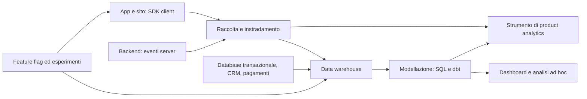

Scenario costruito con numeri di esempio. Il primo giorno in una scale-up, una nuova product analyst chiede quanti acquisti ci sono stati la settimana scorsa. Riceve tre risposte: 18.400 da Google Analytics 4, 19.300 dallo strumento di product analytics, 20.000 dal database degli ordini. Il marketing usa il primo numero, il prodotto il secondo, la finanza il terzo. Ognuno pensa che gli altri sbaglino.

Nessuno sbaglia: ogni strumento misura una cosa leggermente diversa, in un punto diverso della catena dei dati. Conoscere gli strumenti non significa saper cliccare nei menu, che cambiano a ogni versione. Significa sapere da dove arriva ogni numero, che cosa perde lungo la strada e quale strumento usare per quale domanda.

> **Idea chiave:** gli strumenti di product analytics servono a esplorare il comportamento velocemente; il warehouse con SQL serve a dare il numero ufficiale. Un buon analista sa passare dall'uno all'altro e sa spiegare perché i due numeri differiscono.

## Lo stack in quattro strati

Qualsiasi stack di product analytics, dalla startup con tre persone alla grande azienda, ha quattro strati. Cambiano i prodotti scelti, non la struttura.



Il primo strato è la **raccolta**: gli SDK nell'app e nel sito inviano eventi lato client, il backend invia gli eventi lato server, più affidabili perché non bloccabili dal browser. Strumenti come Segment, RudderStack o Snowplow raccolgono gli eventi una volta e li instradano verso più destinazioni. Il secondo strato è l'**archiviazione**: il data warehouse, per esempio BigQuery, Snowflake, Databricks o un Postgres per volumi piccoli, dove arrivano eventi, ordini, abbonamenti e dati del CRM. Il terzo è la **modellazione**: trasformazioni SQL, spesso gestite con dbt, che producono tabelle pulite e testate. Il quarto è il **consumo**: strumenti di product analytics per l'esplorazione, dashboard per il monitoraggio, notebook per le analisi ad hoc.

Le due frecce più importanti sono quelle che non si vedono subito. Gli strumenti di product analytics ricevono gli eventi direttamente dalla raccolta, quindi non vedono ordini rimborsati, piani cambiati in fattura o dati del CRM, a meno che non li si invii esplicitamente. Il warehouse vede tutto, ma richiede SQL e un modello dati curato.

## Amplitude, Mixpanel e PostHog

I tre strumenti più diffusi di product analytics condividono lo stesso modello: eventi con proprietà, associati a utenti con proprietà. Su questo modello offrono rapporti pronti per le domande più frequenti, che senza strumento richiederebbero query lunghe.

| Domanda | Rapporto tipico | Che cosa calcola |
| :--- | :--- | :--- |
| Quanti utenti fanno X ogni giorno? | Segmentazione eventi, Insights | Utenti unici o conteggi per periodo e segmento |
| Dove si perdono gli utenti? | Funnel | Conversione tra passi ordinati in una finestra |
| Gli utenti tornano? | Retention | Curve di ritorno per coorte di inizio |
| Che cosa fanno prima e dopo X? | Journeys, Flows, Paths | Sequenze di eventi più frequenti |
| Chi sono gli utenti che fanno X? | Coorti | Gruppi salvati e riusabili in altri rapporti |

Le differenze riguardano il modello di prodotto più che le funzioni. Amplitude e Mixpanel sono piattaforme commerciali in cloud, mature nei rapporti comportamentali e nella gestione delle coorti, ed entrambe hanno aggiunto esperimenti e session replay. PostHog nasce [open source](https://github.com/PostHog/posthog), si può ospitare in proprio o usare in cloud, e mette in un unico prodotto analytics, session replay, feature flag, esperimenti e sondaggi; permette di scrivere query SQL sui propri dati. Prezzi e piani cambiano spesso, quindi la scelta va fatta stimando il proprio volume di eventi e confrontando i listini aggiornati, non ricordando quelli di un anno fa.

Il valore di questi strumenti è la velocità. Una product manager può costruire un funnel in due minuti senza aspettare l'analista. Il rischio è la stessa velocità: due persone costruiscono lo stesso funnel con definizioni diverse, e nascono due verità. La cura è un [tracking plan](/course/analisi-prodotto/tracking-plan-event-model/) condiviso e un piccolo insieme di rapporti ufficiali, salvati e documentati.

## Google Analytics 4: forte sull'acquisizione, debole sul prodotto

GA4 è gratuito nella versione standard e molto diffuso, soprattutto nei team di marketing. Usa un modello a eventi simile agli strumenti di prodotto, ma è progettato attorno all'acquisizione: sorgenti di traffico, campagne, attribuzione, integrazione con Google Ads.

Per il lavoro di prodotto ha tre limiti pratici. Il primo è l'identità: GA4 lavora soprattutto con identificativi di dispositivo e browser, e collegare lo stesso utente tra app, web e sessioni diverse richiede di inviare un proprio identificativo utente. Il secondo sono le soglie e il campionamento nelle esplorazioni: su segmenti piccoli o periodi lunghi alcuni rapporti nascondono righe o lavorano su un campione. Il terzo è la perdita di dati lato client dovuta a blocchi pubblicitari e rifiuto del consenso, che per un sito europeo può essere rilevante.

La soluzione standard è l'esportazione dei dati grezzi in BigQuery, disponibile anche per le proprietà gratuite. Secondo la [documentazione di Google](https://support.google.com/analytics/answer/9358801), le proprietà standard hanno un limite di 1 milione di eventi al giorno per l'esportazione giornaliera, ed è disponibile anche un'esportazione continua. Con i dati in BigQuery si torna al lavoro in SQL, con il controllo completo su definizioni e deduplicazione. Nella pratica GA4 resta lo strumento del marketing per l'acquisizione; per retention, funnel di prodotto e coorti si usa uno strumento di prodotto o il warehouse.

## Warehouse, SQL e dbt: la fonte di verità

Il warehouse è l'unico posto in cui eventi di prodotto, ordini, abbonamenti, rimborsi e dati commerciali si incontrano. Per questo i numeri che vanno in un consiglio di amministrazione, in un business case o in un'analisi di esperimento si calcolano lì. Uno strumento di product analytics che dice 19.300 acquisti è utile per esplorare; il numero ufficiale è quello degli ordini nel warehouse.

Le query ripetute più volte non devono vivere nei notebook di una persona. dbt permette di scriverle come modelli SQL versionati, con dipendenze esplicite e test automatici. Un modello tipico pulisce gli eventi grezzi: toglie i duplicati, filtra i bot e gli utenti interni, normalizza i nomi.

```sql
-- models/staging/stg_events.sql (dbt): eventi deduplicati e puliti
WITH ranked AS (
  SELECT
    e.*,
    ROW_NUMBER() OVER (
      PARTITION BY e.user_id, e.event_name, e.event_time
      ORDER BY e.event_time
    ) AS rn
  FROM {{ source('raw', 'events') }} AS e
)
SELECT user_id, event_name, event_time, properties
FROM ranked
WHERE rn = 1
  AND user_id NOT IN (SELECT user_id FROM {{ ref('internal_users') }})
```

Accanto al modello si dichiarano i test, che dbt esegue a ogni aggiornamento. Se un test fallisce, la pipeline si ferma prima che il numero sbagliato arrivi in dashboard.

```yaml
# models/staging/schema.yml
models:
  - name: stg_events
    columns:
      - name: user_id
        data_tests:
          - not_null
      - name: event_name
        data_tests:
          - accepted_values:
              values: ['app_open', 'product_view', 'add_to_cart', 'checkout_start', 'purchase']
```

I test più utili sono pochi: chiavi non nulle e uniche, valori ammessi per i nomi degli eventi, relazioni tra tabelle, e un controllo di freschezza che segnala quando i dati non arrivano da troppe ore. Sono la versione automatica del primo passo di ogni diagnosi: verificare che il dato sia corretto prima di interpretarlo.

## Session replay e feature flag

Due famiglie di strumenti completano lo stack.

Il **session replay** ricostruisce che cosa ha visto e fatto un utente in una sessione: clic, scorrimenti, errori, esitazioni. Lo offrono strumenti dedicati come FullStory, Hotjar o Microsoft Clarity, e ormai anche Amplitude, Mixpanel e PostHog. Serve a passare dal «dove» al «perché»: il funnel dice che il 30% abbandona al passo di pagamento, venti registrazioni mostrano che il pulsante finisce sotto la tastiera su alcuni telefoni. Due regole: le registrazioni si scelgono partendo da un segmento definito con i dati, non a caso, e i campi sensibili vanno mascherati, perché nel quadro del GDPR registrare password, dati di pagamento o informazioni sanitarie è un rischio serio.

I **feature flag** sono interruttori che attivano una funzione per una parte degli utenti senza un nuovo rilascio. Strumenti come LaunchDarkly, Statsig, GrowthBook, Unleash o i flag di PostHog permettono di rilasciare gradualmente, spegnere una funzione che crea problemi e assegnare gli utenti a varianti di un esperimento. Per l'analista sono preziosi per una ragione: ogni esposizione a un flag registrata nel warehouse è un'informazione su chi ha visto che cosa, e quando. Senza quel registro, valutare un rilascio graduale diventa un confronto prima-dopo, con tutti i suoi limiti.

## Perché i numeri non tornano tra strumenti

Torniamo ai tre numeri dello scenario: 20.000 ordini nel database, 19.300 acquisti nello strumento di prodotto, 18.400 in GA4. Le cause tipiche delle differenze sono poche e si possono misurare una per una.

| Causa | Effetto sul conteggio | Strumento più colpito | Come si misura |
| :--- | :--- | :--- | :--- |
| Blocchi pubblicitari e consenso negato | Eventi client persi | GA4 e SDK client | Ordini senza evento corrispondente |
| Eventi duplicati da retry e doppi clic | Conteggio gonfiato | Ogni sistema senza deduplicazione | Eventi con lo stesso identificativo d'ordine |
| Fusi orari diversi | Ordini spostati tra giorni | Confronti giornalieri | Confronto per ora in UTC |
| Ordini creati fuori dall'app | Eventi assenti | Strumenti con solo SDK client | Ordini per canale di creazione |
| Rimborsi e annullamenti | Il database li toglie, gli strumenti no | Strumenti di prodotto | Ordini con stato finale |

Nello scenario, la query di riconciliazione mostra che lo strumento di prodotto ha ricevuto 19.700 eventi `purchase`, ma solo 19.300 identificativi d'ordine distinti: 400 eventi sono duplicati, il 2,0% del totale, e lo strumento li deduplica. Rispetto ai 20.000 ordini mancano 700 acquisti, il 3,5%, quasi tutti da browser con blocchi o consenso negato. GA4 ne vede 18.400, con un divario di 1.600 ordini, l'8%, perché è più spesso bloccato dalle estensioni e conta le transazioni secondo il proprio fuso orario della proprietà.

La conseguenza è una regola semplice: il numero ufficiale degli acquisti è quello del database, cioè 20.000; lo strumento di prodotto è affidabile per i tassi e le tendenze, perché la perdita del 3,5% è stabile nel tempo; GA4 serve per confrontare le sorgenti di traffico tra loro, non per contare gli ordini. Se la perdita dello strumento di prodotto passasse in una settimana dal 3,5% al 10%, sarebbe un problema di tracking da indagare prima di qualsiasi analisi.

```sql
-- Riconciliazione settimanale: ordini nel database contro eventi purchase tracciati.
-- orders(order_id, user_id, created_at, amount) arriva dal database transazionale.
-- properties ->> 'order_id' è la sintassi Postgres/DuckDB; in BigQuery: JSON_VALUE(properties, '$.order_id').
WITH ordini AS (
  SELECT order_id
  FROM orders
  WHERE created_at >= TIMESTAMP '2026-11-16 00:00:00'
    AND created_at <  TIMESTAMP '2026-11-23 00:00:00'
),
tracciati AS (
  SELECT properties ->> 'order_id' AS order_id
  FROM events
  WHERE event_name = 'purchase'
    AND event_time >= TIMESTAMP '2026-11-16 00:00:00'
    AND event_time <  TIMESTAMP '2026-11-23 00:00:00'
)
SELECT
  (SELECT COUNT(*) FROM ordini) AS ordini_db,
  (SELECT COUNT(*) FROM tracciati) AS eventi_purchase,
  (SELECT COUNT(DISTINCT order_id) FROM tracciati) AS ordini_tracciati,
  (SELECT COUNT(*) FROM tracciati) - (SELECT COUNT(DISTINCT order_id) FROM tracciati) AS duplicati,
  (SELECT COUNT(*) FROM ordini AS o
     WHERE NOT EXISTS (SELECT 1 FROM tracciati AS t WHERE t.order_id = o.order_id)) AS ordini_senza_evento,
  ROUND(100.0 * (SELECT COUNT(*) FROM ordini AS o
     WHERE NOT EXISTS (SELECT 1 FROM tracciati AS t WHERE t.order_id = o.order_id))
     / (SELECT COUNT(*) FROM ordini), 1) AS perdita_pct;
```

Sui dati dello scenario la query restituisce 20.000 ordini, 19.700 eventi, 19.300 ordini tracciati, 400 duplicati, 700 ordini senza evento e una perdita del 3,5%. Conviene salvarla come controllo giornaliero con una soglia di allarme.

## Scegliere lo stack: quando usare che cosa

La scelta dello strumento dipende dalla domanda e dalla fase dell'azienda, non dalla moda.

| Situazione | Strumento più adatto | Perché |
| :--- | :--- | :--- |
| Funnel o retention esplorativa, in autonomia della PM | Amplitude, Mixpanel o PostHog | Rapporti pronti, risposta in minuti |
| Numero ufficiale per finanza o direzione | Warehouse con SQL | Unisce eventi, ordini, rimborsi; definizioni versionate |
| Analisi di un esperimento | Piattaforma di esperimenti o warehouse | Assegnazioni registrate, test statistici controllati |
| Performance delle campagne e sorgenti di traffico | GA4 e strumenti di attribuzione | Integrazione nativa con le piattaforme pubblicitarie |
| Capire perché gli utenti si bloccano | Session replay su un segmento scelto con i dati | Mostra il comportamento, non solo il conteggio |
| Startup con poche persone e budget minimo | Uno strumento unico, anche open source, più un Postgres | Meno integrazioni da mantenere |

Prima di firmare un contratto si stima il volume di eventi, perché quasi tutti i listini dipendono dagli eventi o dagli utenti tracciati al mese. Esempio: un'app con 200.000 utenti attivi al mese, attivi in media 12 giorni al mese, con 25 eventi per giorno attivo, genera 200.000 × 12 × 25 = 60 milioni di eventi al mese, circa 2 milioni al giorno. È già il doppio del limite di 1 milione di eventi al giorno dell'esportazione giornaliera di GA4 standard.

Un'analisi del tracking plan mostra che il 40% degli eventi sono `scroll` e `screen_heartbeat`, che nessun rapporto usa. Toglierli porta il volume a 60 × 0,6 = 36 milioni al mese, con un risparmio proporzionale sul costo e una pulizia dei dati. La regola che ne deriva: si traccia ciò che serve a una decisione o a una metrica del tracking plan, non tutto ciò che è tecnicamente possibile.

Lo schizzo in Python rende la stima ripetibile quando cambiano le ipotesi.

```python
mau = 200_000
giorni_attivi_mese = 12
eventi_per_giorno_attivo = 25
quota_eventi_inutili = 0.40

eventi_mese = mau * giorni_attivi_mese * eventi_per_giorno_attivo
eventi_puliti = eventi_mese * (1 - quota_eventi_inutili)

print(f"Eventi al mese: {eventi_mese / 1e6:.0f} M (circa {eventi_mese / 30 / 1e6:.1f} M al giorno)")
print(f"Dopo la pulizia: {eventi_puliti / 1e6:.0f} M al mese")
# Eventi al mese: 60 M (circa 2.0 M al giorno)
# Dopo la pulizia: 36 M al mese
```

## Trappole comuni

### Due fonti di verità per la stessa metrica

Il sintomo è una riunione in cui si discute quale numero sia giusto invece di che cosa fare. Succede perché ogni team usa lo strumento che conosce. Si evita dichiarando per iscritto, per ogni metrica chiave, la fonte ufficiale e la definizione, e accettando che gli strumenti esplorativi diano numeri diversi ma con una differenza nota e stabile.

### Fidarsi solo del tracciamento lato client

Il sintomo è una perdita di dati che cresce senza che nessuno se ne accorga, per esempio dopo un aggiornamento dei browser o del banner del consenso. Succede perché gli eventi client sono facili da implementare. Si evita inviando dal backend gli eventi che contano economicamente, come acquisto, abbonamento e rinnovo, e tenendo la query di riconciliazione come controllo giornaliero.

### Scegliere lo strumento prima delle domande

Il sintomo è un contratto annuale per uno strumento potente, usato per tre grafici. Succede perché la scelta viene fatta su una demo. Si evita partendo dall'elenco delle dieci domande più frequenti del team e verificando, su dati reali, quale strumento le risolve con meno lavoro e con quale volume di eventi.

## Verifica la scelta degli strumenti

1. La PM vuole sapere quanti utenti nuovi completano l'onboarding entro 7 giorni, segmentati per piattaforma, e lo chiede per la riunione di domani. Quale strumento usi e perché?

<details>
<summary>Mostra risposta</summary>

Lo strumento di product analytics, con un funnel sui passi dell'onboarding, finestra di conversione di 7 giorni e segmentazione per piattaforma. È una domanda esplorativa sul comportamento, che lo strumento risolve in minuti. Se il numero dovesse entrare in un obiettivo trimestrale ufficiale, andrebbe poi ricalcolato nel warehouse con una definizione documentata.

</details>

2. Lo strumento di prodotto mostra 4.850 abbonamenti nel mese, il sistema di fatturazione 5.000. La differenza era del 3% anche nei mesi precedenti. È un problema?

<details>
<summary>Mostra risposta</summary>

Non è un problema urgente: 150 su 5.000 è il 3%, in linea con la perdita storica, probabilmente eventi client persi. I tassi e le tendenze nello strumento restano affidabili. Il numero ufficiale resta quello della fatturazione. Conviene comunque inviare l'evento di abbonamento dal backend, perché è economicamente rilevante e non deve dipendere dal browser.

</details>

3. Un'app ha 500.000 utenti attivi al mese, 10 giorni attivi al mese in media e 30 eventi per giorno attivo. Quanti eventi genera al mese e che cosa controlli prima di scegliere un piano?

<details>
<summary>Mostra risposta</summary>

500.000 × 10 × 30 = 150 milioni di eventi al mese, circa 5 milioni al giorno. Prima di scegliere un piano si controlla quali eventi servono davvero a metriche e decisioni: togliere eventi tecnici o ridondanti riduce costo e rumore. Si verifica anche il limite di esportazione verso il warehouse, per esempio il limite giornaliero di GA4 standard, che a questo volume non basta.

</details>

4. Che cosa fa un test `accepted_values` in dbt su `event_name` e quale problema reale previene?

<details>
<summary>Mostra risposta</summary>

Fa fallire la pipeline se compare un nome di evento fuori dall'elenco ammesso. Previene il caso tipico in cui una nuova versione dell'app invia `Purchase` o `purchase_completed` invece di `purchase`: senza il test gli acquisti calano in dashboard senza che nessuno capisca perché; con il test il problema emerge prima che il dato venga usato.

</details>
