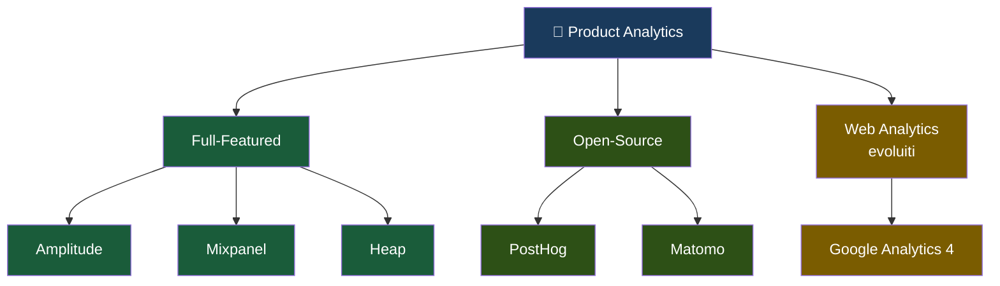
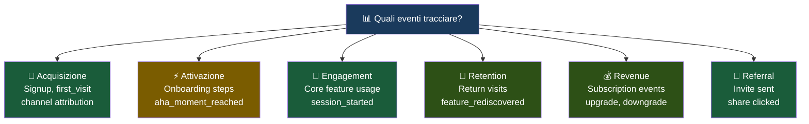
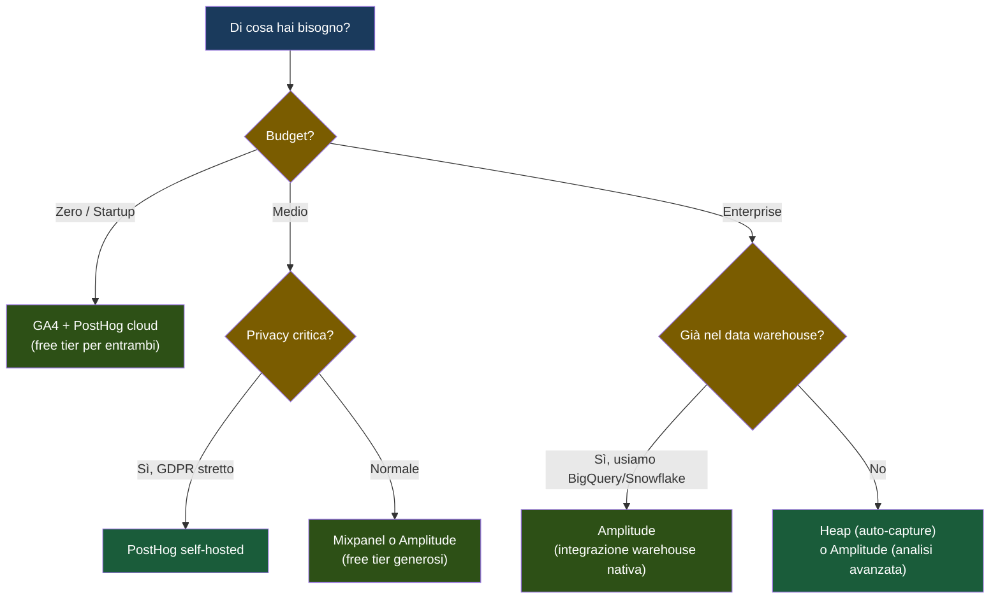
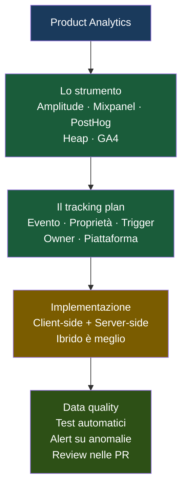

## PRODUCT ANALYTICS: SCEGLIERE GLI STRUMENTI GIUSTI

Un tool di product analytics risponde a una domanda semplice: **cosa fanno gli utenti nel tuo prodotto?** Non cosa dicono di fare, non cosa pensi che facciano — cosa fanno davvero, misurato con precisione.

La differenza con il web analytics tradizionale (Google Analytics) è fondamentale: il web analytics misura pagine viste e sessioni. Il product analytics misura **azioni, funnel, retention e comportamenti a livello utente.** Non "quante persone hanno visitato la pagina pricing" ma "quanti utenti hanno creato un progetto entro 48 ore dalla registrazione e sono tornati la settimana dopo".

## Il panorama degli strumenti

### Amplitude

**Punto di forza:** analisi comportamentale avanzata. Funnel complessi, analisi di coorte, behavioral clustering, analisi di impatto. Il prodotto di riferimento per team di product maturi.

**Ideale per:** aziende con product team dedicato, necessità di analisi profonde, integrazione con dati warehouse.

**Prezzo:** freemium fino a 10M eventi/mese, poi enterprise pricing.

**Caratteristiche distintive:**
- Behavioral cohorting: segmenta utenti per sequenze di azioni, non solo attributi
- Compass: identifica automaticamente i comportamenti correlati alla retention
- Notebooks: analisi collaborative tipo Jupyter, ma per analisti non-tecnici

### Mixpanel

**Punto di forza:** semplicità d'uso con potenza analitica. Funnel, retention, A/B testing integrato. Storico del settore — uno dei primi product analytics.

**Ideale per:** team di prodotto di dimensioni medie che vogliono un setup rapido.

**Prezzo:** freemium fino a 20M eventi/mese (generoso).

**Caratteristiche distintive:**
- JQL (JavaScript Query Language): per analisi custom senza SQL
- Signal: workflow guidato per scoprire i correlati della retention
- Group Analytics: analisi a livello account (non solo utente), fondamentale per B2B

### Heap

**Punto di forza:** auto-capture. Heap traccia automaticamente **ogni click, pageview e form submission** senza bisogno di implementare il tracking evento per evento. Retroattivo: puoi definire un evento oggi e analizzare i dati storici.

**Ideale per:** team senza engineering dedicato al tracking, prodotti con UI complessa e molte interazioni.

**Prezzo:** enterprise pricing (non pubblico).

**Caratteristiche distintive:**
- Autocapture: nessun codice di tracking da scrivere
- Session replay integration: guarda cosa ha fatto l'utente
- Definizione retroattiva degli eventi: analizza il passato senza averlo pianificato

### PostHog

**Punto di forza:** open-source e self-hostable. Product analytics + feature flags + session replays + A/B testing + surveys in un'unica piattaforma.

**Ideale per:** team tecnici che vogliono controllo sui dati e privacy (GDPR), startup in fase iniziale (pricing aggressivo).

**Prezzo:** open-source (self-hosted gratuito), cloud con free tier generoso.

**Caratteristiche distintive:**
- Self-hosting: i dati restano sulla tua infrastruttura
- All-in-one: analytics + feature flags + experiments + surveys
- SQL access: query dirette sui dati raw via HogQL
- Comunità open-source attiva

### Google Analytics 4 (GA4)

**Punto di forza:** gratuito, universale, integrazione con l'ecosistema Google (Ads, Search Console, BigQuery).

**Limite per product analytics:** pensato per il marketing, non per il prodotto. Il modello dati è basato su sessioni e eventi web, non su utenti e comportamenti. Funnel limitati, retention di base, nessuna analisi comportamentale avanzata.

**Quando usarlo:** come complemento per il marketing analytics, non come tool principale di product analytics.

## Confronto feature-by-feature

| Funzionalità | Amplitude | Mixpanel | Heap | PostHog | GA4 |
|---|:---:|:---:|:---:|:---:|:---:|
| Funnel analysis | ⭐⭐⭐ | ⭐⭐⭐ | ⭐⭐ | ⭐⭐⭐ | ⭐ |
| Retention analysis | ⭐⭐⭐ | ⭐⭐⭐ | ⭐⭐ | ⭐⭐⭐ | ⭐ |
| Behavioral cohorts | ⭐⭐⭐ | ⭐⭐ | ⭐⭐ | ⭐⭐ | ❌ |
| Auto-capture | ❌ | ❌ | ⭐⭐⭐ | ⭐⭐ | Parziale |
| Feature flags | ❌ | ❌ | ❌ | ⭐⭐⭐ | ❌ |
| A/B testing | ⭐⭐ | ⭐⭐ | ❌ | ⭐⭐⭐ | ⭐ |
| Session replay | ⭐⭐ | ❌ | ⭐⭐⭐ | ⭐⭐⭐ | ❌ |
| Self-hosting | ❌ | ❌ | ❌ | ⭐⭐⭐ | ❌ |
| Free tier | 10M ev | 20M ev | Enterprise | 1M ev/mo | Illimitato |
| SQL access | BigQuery | ❌ | ❌ | HogQL | BigQuery |

## Il Tracking Plan: il documento più importante

Lo strumento è il mezzo. Il **tracking plan** è il fondamento. Senza un tracking plan, i dati saranno inconsistenti, incompleti e inutilizzabili dopo tre mesi.

Un tracking plan è un documento che definisce **ogni evento tracciato** nel prodotto, con:

| Campo | Descrizione | Esempio |
|-------|-------------|---------|
| **Nome evento** | Nome standardizzato | `project_created` |
| **Descrizione** | Cosa rappresenta | "L'utente ha creato un nuovo progetto" |
| **Trigger** | Quando si attiva | Al click su "Crea Progetto" + conferma |
| **Proprietà** | Dati associati | `project_type`, `template_used`, `team_size` |
| **Tipo proprietà** | Formato dei dati | string, integer, boolean |
| **Piattaforme** | Dove è tracciato | Web, iOS, Android |
| **Owner** | Chi lo mantiene | Team Product |

### Convenzioni di naming

La coerenza nel naming è cruciale. Scegli UNA convenzione e applicala ovunque:

| Convenzione | Esempio | Pro | Contro |
|---|---|---|---|
| `object_action` | `project_created`, `report_exported` | Leggibile, raggruppabile per oggetto | Verboso |
| `Action Object` | `Created Project`, `Exported Report` | Leggibile per non-tecnici | Case-sensitive, meno programmabile |
| `action.object` | `create.project`, `export.report` | Namespace naturale | Meno comune |

> **La regola d'oro:** un evento deve descrivere **un'azione specifica e misurabile**. "Button Clicked" è troppo generico. "Pricing Page CTA Clicked" è specifico. "User Did Something" è inutile.

### Event taxonomy: quali eventi tracciare

Non tracciare tutto. Traccia ciò che serve per rispondere a domande di business specifiche.

Questa tassonomia segue il framework **pirate metrics (AARRR)** di Dave McClure: Acquisition, Activation, Retention, Revenue, Referral.

## Implementazione: server-side vs client-side

### Client-side tracking

Il codice di tracking viene eseguito nel browser o nell'app dell'utente.

**Pro:** facile da implementare, cattura interazioni UI dettagliate.
**Contro:** bloccato dagli ad blocker (20-40% degli utenti tech-savvy), dipendente dal device, dati persi se l'utente chiude il browser prima dell'invio.

### Server-side tracking

Gli eventi vengono inviati dal backend del server.

**Pro:** non bloccabile, più affidabile, un'unica fonte di verità.
**Contro:** non cattura le interazioni UI (click, scroll, hover), richiede più lavoro di sviluppo.

### La soluzione ibrida

La best practice è combinare entrambi:

| Tipo di evento | Tracking | Perché |
|---|---|---|
| Azioni di business (acquisto, iscrizione) | Server-side | Affidabilità critica, non bloccabile |
| Interazioni UI (click, scroll, navigazione) | Client-side | Necessario il contesto del browser |
| Feature usage (creazione progetto, export) | Entrambi | Ridondanza per validazione |

## Data quality: il problema che nessuno vuole affrontare

Il 90% dei problemi nei product analytics non è analitico — è di **qualità dei dati.** Eventi duplicati, proprietà mancanti, naming inconsistente, tracking rotto dopo un deploy.

### Checklist di data quality

- [ ] Ogni evento ha un test automatizzato che verifica il formato
- [ ] Le proprietà critiche non possono essere nulle
- [ ] Il tracking plan è aggiornato ad ogni release
- [ ] Esiste un processo di review del tracking nelle pull request
- [ ] I dati vengono confrontati con una seconda fonte (es. database vs analytics)
- [ ] C'è un alert automatico se il volume degli eventi cala improvvisamente

> **Regola pratica:** se il tuo team spende più del 30% del tempo a "pulire i dati" prima di analizzarli, il problema non è l'analisi — è l'implementazione del tracking.

## Come scegliere lo strumento giusto

## Riepilogo

Tre cose da portare a casa:

1. **Il tracking plan viene prima dello strumento** — senza un tracking plan solido, qualsiasi tool ti darà dati sporchi. Investi una settimana nel tracking plan prima di scrivere una riga di codice.

2. **PostHog ha cambiato le regole del gioco** — open-source, self-hostable, con analytics + feature flags + experiments in un'unica piattaforma. Per startup e team attenti alla privacy, è spesso la scelta migliore.

3. **La data quality è un processo continuo, non un progetto** — test automatici sugli eventi, alert su anomalie di volume, review del tracking nelle pull request. Trattala come tratti il codice di produzione.
