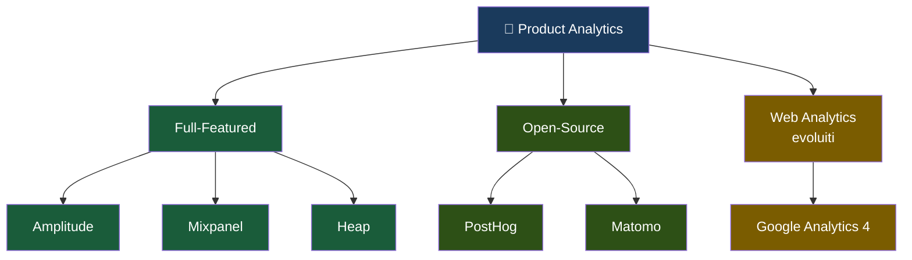
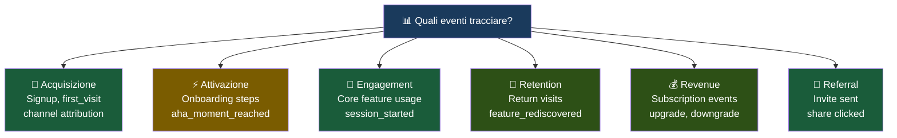
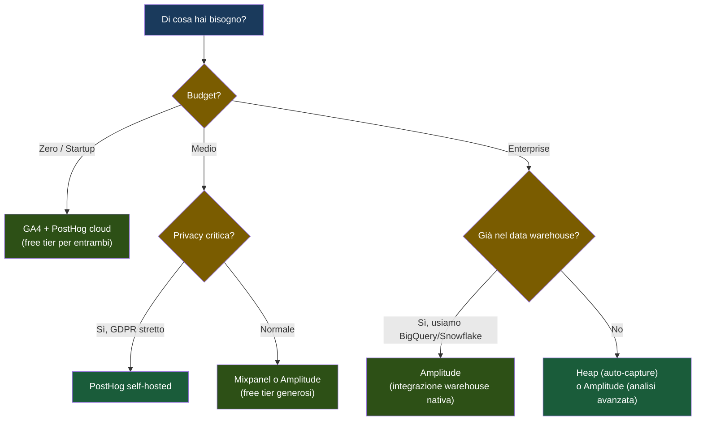
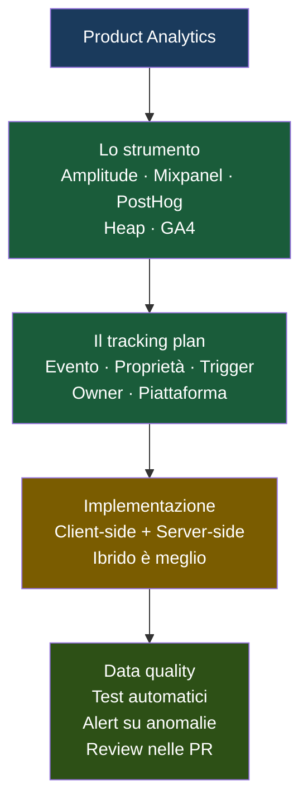
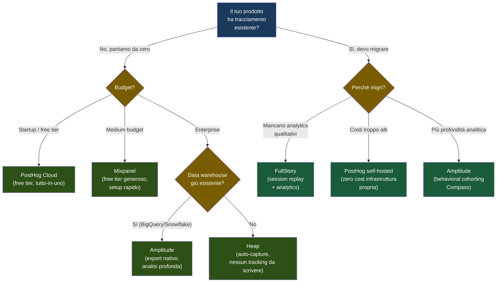
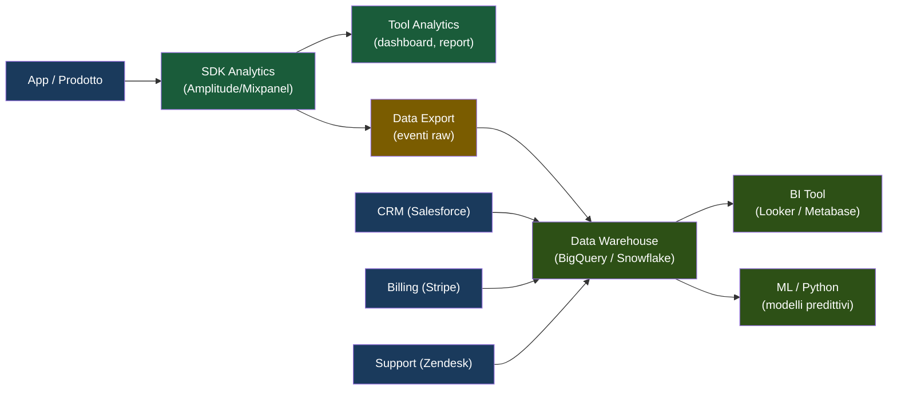

import { Aside } from '@astrojs/starlight/components'

Gli strumenti di product analytics non sono solo dashboard diverse con nomi diversi. Ogni scelta influenza il tipo di tracking che riuscirai a mantenere, la velocita' con cui il team risponde alle domande e il livello di fiducia che avra' nei dati.

In questa lezione confrontiamo categorie, trade-off e criteri pratici di selezione, cosi' da evitare implementazioni costose che poi nessuno usa davvero.

## PRODUCT ANALYTICS: SCEGLIERE GLI STRUMENTI GIUSTI

Un tool di product analytics risponde a una domanda semplice: **cosa fanno gli utenti nel tuo prodotto?** Non cosa dicono di fare, non cosa pensi che facciano — cosa fanno davvero, misurato con precisione.

La differenza con il web analytics tradizionale (Google Analytics) è fondamentale: il web analytics misura pagine viste e sessioni. Il product analytics misura **azioni, funnel, retention e comportamenti a livello utente.** Non "quante persone hanno visitato la pagina pricing" ma "quanti utenti hanno creato un progetto entro 48 ore dalla registrazione e sono tornati la settimana dopo".

## Il panorama degli strumenti

### Amplitude

**Punto di forza:** analisi comportamentale avanzata. Funnel complessi, analisi di coorte, behavioral clustering, analisi di impatto. Il prodotto di riferimento per team di product maturi.

**Ideale per:** aziende con product team dedicato, necessità di analisi profonde, integrazione con dati warehouse.

**Prezzo:** freemium fino a 10M eventi/mese, poi enterprise pricing.

**Caratteristiche distintive:**
- Behavioral cohorting: segmenta utenti per sequenze di azioni, non solo attributi
- Compass: identifica automaticamente i comportamenti correlati alla retention
- Notebooks: analisi collaborative tipo Jupyter, ma per analisti non-tecnici

### Mixpanel

**Punto di forza:** semplicità d'uso con potenza analitica. Funnel, retention, A/B testing integrato. Storico del settore — uno dei primi product analytics.

**Ideale per:** team di prodotto di dimensioni medie che vogliono un setup rapido.

**Prezzo:** freemium fino a 20M eventi/mese (generoso).

**Caratteristiche distintive:**
- JQL (JavaScript Query Language): per analisi custom senza SQL
- Signal: workflow guidato per scoprire i correlati della retention
- Group Analytics: analisi a livello account (non solo utente), fondamentale per B2B

### Heap

**Punto di forza:** auto-capture. Heap traccia automaticamente **ogni click, pageview e form submission** senza bisogno di implementare il tracking evento per evento. Retroattivo: puoi definire un evento oggi e analizzare i dati storici.

**Ideale per:** team senza engineering dedicato al tracking, prodotti con UI complessa e molte interazioni.

**Prezzo:** enterprise pricing (non pubblico).

**Caratteristiche distintive:**
- Autocapture: nessun codice di tracking da scrivere
- Session replay integration: guarda cosa ha fatto l'utente
- Definizione retroattiva degli eventi: analizza il passato senza averlo pianificato

### PostHog

**Punto di forza:** open-source e self-hostable. Product analytics + feature flags + session replays + A/B testing + surveys in un'unica piattaforma.

**Ideale per:** team tecnici che vogliono controllo sui dati e privacy (GDPR), startup in fase iniziale (pricing aggressivo).

**Prezzo:** open-source (self-hosted gratuito), cloud con free tier generoso.

**Caratteristiche distintive:**
- Self-hosting: i dati restano sulla tua infrastruttura
- All-in-one: analytics + feature flags + experiments + surveys
- SQL access: query dirette sui dati raw via HogQL
- Comunità open-source attiva

### Google Analytics 4 (GA4)

**Punto di forza:** gratuito, universale, integrazione con l'ecosistema Google (Ads, Search Console, BigQuery).

**Limite per product analytics:** pensato per il marketing, non per il prodotto. Il modello dati è basato su sessioni e eventi web, non su utenti e comportamenti. Funnel limitati, retention di base, nessuna analisi comportamentale avanzata.

**Quando usarlo:** come complemento per il marketing analytics, non come tool principale di product analytics.

## Confronto feature-by-feature

| Funzionalità | Amplitude | Mixpanel | Heap | PostHog | GA4 |
|---|:---:|:---:|:---:|:---:|:---:|
| Funnel analysis | ⭐⭐⭐ | ⭐⭐⭐ | ⭐⭐ | ⭐⭐⭐ | ⭐ |
| Retention analysis | ⭐⭐⭐ | ⭐⭐⭐ | ⭐⭐ | ⭐⭐⭐ | ⭐ |
| Behavioral cohorts | ⭐⭐⭐ | ⭐⭐ | ⭐⭐ | ⭐⭐ | ❌ |
| Auto-capture | ❌ | ❌ | ⭐⭐⭐ | ⭐⭐ | Parziale |
| Feature flags | ❌ | ❌ | ❌ | ⭐⭐⭐ | ❌ |
| A/B testing | ⭐⭐ | ⭐⭐ | ❌ | ⭐⭐⭐ | ⭐ |
| Session replay | ⭐⭐ | ❌ | ⭐⭐⭐ | ⭐⭐⭐ | ❌ |
| Self-hosting | ❌ | ❌ | ❌ | ⭐⭐⭐ | ❌ |
| Free tier | 10M ev | 20M ev | Enterprise | 1M ev/mo | Illimitato |
| SQL access | BigQuery | ❌ | ❌ | HogQL | BigQuery |

## Il Tracking Plan: il documento più importante

Lo strumento è il mezzo. Il **tracking plan** è il fondamento. Senza un tracking plan, i dati saranno inconsistenti, incompleti e inutilizzabili dopo tre mesi.

Un tracking plan è un documento che definisce **ogni evento tracciato** nel prodotto, con:

| Campo | Descrizione | Esempio |
|-------|-------------|---------|
| **Nome evento** | Nome standardizzato | `project_created` |
| **Descrizione** | Cosa rappresenta | "L'utente ha creato un nuovo progetto" |
| **Trigger** | Quando si attiva | Al click su "Crea Progetto" + conferma |
| **Proprietà** | Dati associati | `project_type`, `template_used`, `team_size` |
| **Tipo proprietà** | Formato dei dati | string, integer, boolean |
| **Piattaforme** | Dove è tracciato | Web, iOS, Android |
| **Owner** | Chi lo mantiene | Team Product |

### Convenzioni di naming

La coerenza nel naming è cruciale. Scegli UNA convenzione e applicala ovunque:

| Convenzione | Esempio | Pro | Contro |
|---|---|---|---|
| `object_action` | `project_created`, `report_exported` | Leggibile, raggruppabile per oggetto | Verboso |
| `Action Object` | `Created Project`, `Exported Report` | Leggibile per non-tecnici | Case-sensitive, meno programmabile |
| `action.object` | `create.project`, `export.report` | Namespace naturale | Meno comune |

> **La regola d'oro:** un evento deve descrivere **un'azione specifica e misurabile**. "Button Clicked" è troppo generico. "Pricing Page CTA Clicked" è specifico. "User Did Something" è inutile.

### Event taxonomy: quali eventi tracciare

Non tracciare tutto. Traccia ciò che serve per rispondere a domande di business specifiche.

Questa tassonomia segue il framework **pirate metrics (AARRR)** di Dave McClure: Acquisition, Activation, Retention, Revenue, Referral.

## Implementazione: server-side vs client-side

### Client-side tracking

Il codice di tracking viene eseguito nel browser o nell'app dell'utente.

**Pro:** facile da implementare, cattura interazioni UI dettagliate.
**Contro:** bloccato dagli ad blocker (20-40% degli utenti tech-savvy), dipendente dal device, dati persi se l'utente chiude il browser prima dell'invio.

### Server-side tracking

Gli eventi vengono inviati dal backend del server.

**Pro:** non bloccabile, più affidabile, un'unica fonte di verità.
**Contro:** non cattura le interazioni UI (click, scroll, hover), richiede più lavoro di sviluppo.

### La soluzione ibrida

La best practice è combinare entrambi:

| Tipo di evento | Tracking | Perché |
|---|---|---|
| Azioni di business (acquisto, iscrizione) | Server-side | Affidabilità critica, non bloccabile |
| Interazioni UI (click, scroll, navigazione) | Client-side | Necessario il contesto del browser |
| Feature usage (creazione progetto, export) | Entrambi | Ridondanza per validazione |

## Data quality: il problema che nessuno vuole affrontare

Il 90% dei problemi nei product analytics non è analitico — è di **qualità dei dati.** Eventi duplicati, proprietà mancanti, naming inconsistente, tracking rotto dopo un deploy.

### Checklist di data quality

- [ ] Ogni evento ha un test automatizzato che verifica il formato
- [ ] Le proprietà critiche non possono essere nulle
- [ ] Il tracking plan è aggiornato ad ogni release
- [ ] Esiste un processo di review del tracking nelle pull request
- [ ] I dati vengono confrontati con una seconda fonte (es. database vs analytics)
- [ ] C'è un alert automatico se il volume degli eventi cala improvvisamente

> **Regola pratica:** se il tuo team spende più del 30% del tempo a "pulire i dati" prima di analizzarli, il problema non è l'analisi — è l'implementazione del tracking.

## Come scegliere lo strumento giusto

## Riepilogo

Tre cose da portare a casa:

1. **Il tracking plan viene prima dello strumento** — senza un tracking plan solido, qualsiasi tool ti darà dati sporchi. Investi una settimana nel tracking plan prima di scrivere una riga di codice.

2. **PostHog ha cambiato le regole del gioco** — open-source, self-hostable, con analytics + feature flags + experiments in un'unica piattaforma. Per startup e team attenti alla privacy, è spesso la scelta migliore.

3. **La data quality è un processo continuo, non un progetto** — test automatici sugli eventi, alert su anomalie di volume, review del tracking nelle pull request. Trattala come tratti il codice di produzione.

## Amplitude vs Mixpanel vs Heap vs FullStory: il confronto reale

La scelta del tool di product analytics non è solo tecnica — è strategica. Ogni piattaforma ha un modello concettuale diverso, punti di forza reali e limitazioni che emergono solo nell'uso quotidiano.

### Amplitude: la profondità analitica per team maturi

Amplitude è il tool di riferimento per i team di prodotto più sofisticati. Il suo modello dati è costruito attorno agli **utenti** e alle loro **sequenze comportamentali** — non solo alle singole azioni, ma ai pattern che emergono nel tempo.

**Cosa rende Amplitude unico:**

Il **behavioral cohorting** di Amplitude permette di segmentare gli utenti non per attributi demografici (età, paese) ma per sequenze di comportamento: "utenti che hanno creato un progetto entro 24 ore dalla registrazione e poi hanno invitato un collega entro 48 ore". Questa capacità di segmentare per pathway comportamentali è unica nel mercato dei product analytics.

**Compass**, il modulo di retention analysis intelligente, analizza automaticamente tutti gli eventi e identifica quelli più correlati alla retention a lungo termine. È essenzialmente l'automazione del processo di "trovare l'aha moment": invece di fare l'analisi manualmente (come descritto nella lezione sull'onboarding), Compass lo fa per te in minuti.

**Notebook** è l'ambiente di analisi collaborativa: combina grafici Amplitude, testo narrativo e insights in un documento condiviso. È Jupyter Notebook per analisti non-tecnici — permette di raccontare storie con i dati senza sapere scrivere codice.

**Pricing e scala:** Amplitude ha un tier gratuito fino a 10 milioni di eventi al mese — generoso per startup in fase iniziale. Sopra quella soglia, il pricing diventa enterprise e le quote sono negoziabili. Per un prodotto con 50.000 utenti attivi e 200 eventi per sessione, si stimano 10M eventi al mese. Al crescere della scala, i costi possono diventare significativi (50.000-200.000 €/anno per prodotti grandi).

**Integrazione con data warehouse:** Amplitude Data Export permette di esportare tutti gli eventi raw in formato JSON verso S3, BigQuery o Snowflake. Questo permette di combinare i dati di comportamento prodotto con i dati di business (CRM, billing, supporto) nel data warehouse per analisi più complete.

### Mixpanel: semplicità con potenza

Mixpanel è il veterano del settore — lanciato nel 2009, prima di tutti gli altri. È spesso la scelta per team che vogliono setup rapido senza sacrificare la potenza analitica.

**Il vantaggio competitivo di Mixpanel** è la semplicità dell'interfaccia di analisi. Costruire un funnel, una retention analysis o una segmentazione richiede meno click che in Amplitude. I project manager non tecnici trovano Mixpanel più accessibile.

**JQL (JavaScript Query Language)** è il tool per analisi custom: permette di scrivere query JavaScript per esplorare i dati in modo flessibile, senza dover esportare su un data warehouse. È meno potente di SQL ma più accessibile.

**Group Analytics** è la funzionalità più importante per i prodotti B2B: permette di analizzare i dati non solo a livello utente singolo, ma a livello account/azienda. Fondamentale per rispondere a domande come "quale tipo di azienda ha il churn più basso?" o "quanto tempo ci mette una PMI vs un'enterprise ad attivare il prodotto?".

**Raw Data Export** di Mixpanel permette di esportare gli eventi in CSV o JSON, ma l'integrazione nativa con data warehouse è meno sviluppata rispetto ad Amplitude. Per team con un data warehouse già esistente, questo può essere una limitazione.

**Pricing:** free tier fino a 20 milioni di eventi al mese — il più generoso del mercato. Questo rende Mixpanel particolarmente attraente per prodotti in crescita che vogliono posticipare il costo del tool.

### Heap: l'auto-capture come rivoluzione

Heap ha rivoluzionato il product analytics con un'idea semplice ma potente: invece di richiedere al team di implementare ogni evento manualmente, cattura automaticamente tutto.

**Auto-capture** registra ogni click, ogni pageview, ogni form submission, ogni cambio di focus — automaticamente, senza una riga di codice di tracking aggiuntiva. Il vantaggio è enorme: nessun "oh, non avevamo il tracking su quel pulsante" retroattivo.

**La definizione retroattiva degli eventi** è il potere principale di Heap: puoi definire oggi un evento (es. "click sul pulsante verde nel checkout") e analizzare tutti i dati storici che corrispondono a quella definizione. Con i tool tradizionali, gli eventi non tracciati non esistono — con Heap, tutto esiste in potenza e viene materializzato quando serve.

**Il limite di Heap** è la complessità del modello dati che ne deriva: con tutto tracciato, i dataset diventano enormi e il rumore è alto. Identificare il segnale rilevante richiede più sforzo. Heap funziona meglio per team con un analista dedicato che sa come filtrare il rumore.

**Integrazione con FullStory:** Heap ha acquisito elementi della filosofia di FullStory (session replay + analytics quantitativo). FullStory è uno strumento separato, specializzato nella **digital experience analytics**: session replay avanzato, rage click detection, dead click analysis. È particolarmente potente per i team UX che vogliono capire il "dove" e il "come" dell'interazione utente — non solo il "quanti".

### Quando usare quale strumento: una guida pratica

## Integrazione con il data warehouse

Il product analytics tool ideale non è un silo — è un componente di un ecosistema di dati più ampio. L'integrazione con il data warehouse (BigQuery, Snowflake, Redshift) è la chiave per analisi che nessun tool stand-alone può fare da solo.

### Perché l'integrazione è critica

**Esempio 1 — Revenue attribution:** vuoi sapere quali feature usano i clienti che hanno il lifetime value più alto. Questa analisi richiede i dati di billing (Stripe, dal data warehouse) combinati con i dati di comportamento (Amplitude). Nessuno dei due soli può rispondere alla domanda.

**Esempio 2 — Churn prediction arricchito:** il modello di churn prediction in SQL che abbiamo visto nella lezione sulla retention usa solo dati di comportamento. Arricchirlo con i dati di supporto (numero di ticket, tempo di risoluzione), i dati di billing (piani, downgrade) e i dati CRM (dimensione azienda, settore) aumenta significativamente la precisione.

**Esempio 3 — Marketing attribution:** quale canale di acquisizione produce gli utenti con la retention più alta a 90 giorni? Questa analisi richiede i dati di UTM (Google Analytics o il data warehouse di marketing) combinati con i dati di retention (Amplitude o Mixpanel).

### Flusso di dati tipico

### Privacy e GDPR: considerazioni concrete

La scelta del tool di analytics non è solo tecnica — ha implicazioni legali significative, soprattutto in Europa dove il GDPR è applicato con sanzioni concrete (Meta sanzionata per 1,2 miliardi € nel 2023).

**Dove risiedono i dati?** Amplitude e Mixpanel hanno data center in EU (opzione EU residency), ma i dati passano comunque attraverso infrastrutture US-based per l'elaborazione. PostHog self-hosted elimina completamente questo problema — i dati restano sulla tua infrastruttura, in EU.

**Cosa è PII (Personally Identifiable Information)?** L'indirizzo email, il nome, l'ID utente collegabile a una persona reale sono PII. IP address e User-Agent sono PII nella maggior parte delle interpretazioni GDPR. Il tracking plan deve esplicitamente escludere i PII dagli eventi analytics, o pseudonimizzarli.

**Il consenso dell'utente:** il tracking comportamentale in-app richiede il consenso solo se raccoglie PII. Il tracking tecnico anonimizzato (contare eventi senza collegarli a identità specifiche) non richiede consenso esplicito, ma la linea è sottile. Consulta sempre un legal advisor specializzato in privacy.

**Serverless tracking come soluzione privacy-friendly:** alcune aziende implementano il tracking server-side (non client-side) per evitare la raccolta di dati nel browser, riducendo l'esposizione a ad-blocker e le complicazioni di consenso cookie.

<Aside type="tip">
Prima di scegliere il tool, definisci le tre domande di business più importanti a cui devi rispondere. Poi verifica quale tool risponde a tutte e tre in modo nativo, senza export su data warehouse. La risposta spesso sorprende: molte aziende scelgono Amplitude per la profondità, ma le loro domande reali si risolvono benissimo con Mixpanel (più economico) o PostHog (gratuito). Il tool perfetto è quello che risponde alle tue domande reali, non alle domande più sofisticate che potresti fare in futuro.
</Aside>
