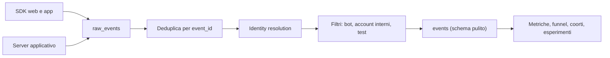

Scenario costruito, numeri di esempio. Il team di crescita di un'app per la gestione delle spese di squadra presenta il funnel della landing page: 40.000 visitatori nella settimana, 2.000 registrazioni, conversione del 5%. Il piano è una riprogettazione completa della pagina con l'obiettivo di arrivare al 6%. Due settimane dopo un analista ricalcola il funnel collegando le visite anonime agli utenti che poi si sono registrati: i 40.000 visitatori erano in realtà 32.000 persone, perché molte avevano visitato la pagina da due dispositivi o dopo aver cancellato i cookie. La conversione vera era già del 6,25%, sopra l'obiettivo. Il problema da risolvere non era la pagina ma il modo in cui veniva contata.

Episodi del genere sono la norma, non l'eccezione. Eventi doppi inviati dall'app quando la connessione cade, bot che simulano visite, colleghi che testano il prodotto con il proprio account, lo stesso evento chiamato in tre modi diversi su web, iOS e Android. Ogni analisi delle lezioni successive (funnel, retention, esperimenti) eredita questi errori se nessuno li ha intercettati prima.

> **Idea chiave:** un'analisi di prodotto non è mai più affidabile dei dati di evento su cui poggia. Il tracking plan stabilisce che cosa si registra e come si chiama; l'identity resolution stabilisce chi l'ha fatto; la QA dei dati stabilisce se il numero è vero.

## Il modello a eventi

La product analytics descrive il comportamento come una sequenza di eventi. Un evento è un'azione avvenuta in un istante, attribuita a qualcuno, con un contesto. Quasi tutti gli strumenti, dalle [piattaforme commerciali](/course/analisi-prodotto/strumenti-product-analytics/) al data warehouse interno, condividono gli stessi cinque concetti.

| Concetto | Che cos'è | Esempio | Dove vive nello schema |
| :--- | :--- | :--- | :--- |
| Evento | Un'azione con un nome e un istante | `report_created` alle 10:42:17 | Una riga di `events` |
| Proprietà di evento | Il contesto di quella singola azione | `template = "budget"`, `source = "onboarding"` | Il campo JSON `properties` |
| Utente | L'entità a cui si attribuiscono gli eventi | `user_id = "u_381"` | `users`, con chiave `user_id` |
| Proprietà di utente | Attributi stabili o lenti della persona | `channel`, `country`, `platform`, piano | Colonne di `users` |
| Sessione | Un gruppo di eventi ravvicinati dello stesso utente | Gli eventi fino a 30 minuti di inattività | Derivata, non registrata |

Lo schema comune del modulo riflette questa struttura: `events(user_id, event_name, event_time, properties)` e `users(user_id, signup_time, channel, country, platform)`. È però lo schema pulito, quello su cui si fanno le analisi. A monte c'è una tabella grezza con più colonne, che arriva direttamente dagli SDK e dai server:

`raw_events(event_id, anonymous_id, user_id, event_name, event_time, received_at, user_agent, properties)`

Le colonne in più servono tutte alla pulizia: `event_id` per eliminare i duplicati, `anonymous_id` per collegare le visite prima del login, `received_at` per distinguere l'orologio del dispositivo da quello del server, `user_agent` per riconoscere i bot.



La sessione merita un'osservazione a parte. Non è un oggetto che l'utente compie: è una convenzione dell'analista. Google Analytics 4, per esempio, chiude una sessione dopo 30 minuti di inattività per impostazione predefinita e permette di cambiare la soglia ([documentazione di Google Analytics](https://support.google.com/analytics/answer/9191807?hl=it)). Due strumenti con soglie diverse contano sessioni diverse sugli stessi eventi, ed è uno dei motivi per cui le [metriche di engagement](/course/analisi-prodotto/engagement-metriche/) serie si basano di preferenza su utenti ed eventi di valore, non sulle sessioni.

Proprietà di evento e proprietà di utente si confondono spesso. La regola è semplice: se il valore può cambiare da un'azione all'altra della stessa persona, appartiene all'evento; se descrive la persona, all'utente. Il piano di abbonamento è un caso delicato: conviene registrarlo anche come proprietà di evento, perché le analisi storiche devono sapere quale piano aveva l'utente nel momento dell'azione, non quello che ha oggi.

## Convenzioni di nome

Senza una convenzione, la stessa azione prende nomi diversi a seconda di chi la implementa. La documentazione di PostHog porta un esempio familiare: lo sviluppatore web registra `Create Account` al clic sul pulsante, quello iOS registra `user_sign_up`, quello Android `create-account` ma solo a registrazione completata ([PostHog, product analytics best practices](https://posthog.com/docs/product-analytics/best-practices)). Tre nomi, due momenti diversi del flusso, un funnel inutilizzabile.

Le regole che la stessa guida suggerisce sono un buon punto di partenza:

- solo lettere minuscole e snake case, per esempio `report_created` o `signup_button_click`;
- un elenco chiuso di verbi ammessi (click, submit, create, view, add, invite, update, delete, start, cancel e pochi altri);
- una struttura oggetto più azione, eventualmente preceduta dal contesto (`signup_flow:pricing_page_view`);
- per le proprietà, il prefisso `is_` o `has_` per i booleani e il suffisso `_date` o `_timestamp` per le date.

Altre guide preferiscono il verbo al passato e i nomi leggibili con lo spazio, come `Report Created`. La scelta tra le convenzioni conta poco; conta applicarne una sola, ovunque, e farla rispettare con un controllo automatico. Due accorgimenti in più evitano problemi frequenti. Il nome dell'evento deve essere statico: `report_created` con la proprietà `template = "budget"`, non `budget_report_created`, altrimenti ogni nuovo modello genera un evento nuovo e le analisi trasversali diventano impossibili. E l'evento deve descrivere ciò che è accaduto, non l'elemento dell'interfaccia: `report_shared` resta valido anche quando il pulsante di condivisione cambia posizione.

## Il tracking plan

Il tracking plan è il documento che elenca tutti gli eventi che il prodotto registra, con la loro definizione esatta. È il contratto tra prodotto, ingegneria e analisi: lo sviluppatore sa che cosa implementare, l'analista sa che cosa trovare nei dati, il product manager sa che cosa sarà misurabile dopo il rilascio. Per ogni evento il piano riporta almeno queste informazioni.

| Evento | Quando si attiva | Proprietà (tipo) | Fonte | Responsabile |
| :--- | :--- | :--- | :--- | :--- |
| `user_signed_up` | Account creato e salvato nel database | `signup_method` (stringa), `plan` (stringa) | Server | Team Crescita |
| `onboarding_step_completed` | Fine di ciascun passo dell'onboarding | `step_number` (intero), `step_name` (stringa) | Client | Team Attivazione |
| `report_created` | Primo salvataggio di un nuovo report | `template` (stringa), `is_from_onboarding` (booleano) | Server | Team Core |
| `report_shared` | Invio del link o dell'invito a un collega | `recipients_count` (intero), `channel` (stringa) | Server | Team Core |
| `subscription_started` | Primo pagamento riuscito di un piano | `plan` (stringa), `billing_period` (stringa), `amount_eur` (decimale) | Server | Team Ricavi |

La colonna «quando si attiva» è quella che previene più errori. «Quando l'utente clicca su Registrati» e «quando l'account è salvato» danno numeri diversi, perché una parte dei clic fallisce per email già usata o password non valida. Per gli eventi di valore, quelli che entrano nella North Star o nei funnel principali, conviene la fonte server: non è bloccata dagli ad blocker, non si perde se l'utente chiude il browser e registra il fatto compiuto. PostHog, nella guida citata, raccomanda di preferire il tracciamento lato server per la stessa ragione. Il client resta indispensabile per le interazioni che il server non vede, come le schermate visualizzate o i passi di un flusso abbandonato.

Il piano si scrive prima dello sviluppo, insieme alla specifica della funzione, partendo dalle domande che si vorranno porre dopo il rilascio. Se la domanda sarà «quanti utenti completano l'onboarding e dove si fermano», servono un evento per ogni passo con il numero del passo come proprietà, non un unico evento finale. Ogni modifica al piano ha una versione e una data: le analisi storiche devono sapere da quando una proprietà esiste e da quando un evento ha cambiato significato.

## Identity resolution: chi ha fatto che cosa

Prima della registrazione o del login un visitatore non ha un `user_id`. Gli SDK gli assegnano un `anonymous_id`, salvato in un cookie o nella memoria dell'app. Quando la persona si registra o accede, lo strumento lega quell'`anonymous_id` al `user_id`. Da quel momento è possibile attribuire all'utente anche gli eventi anonimi precedenti, come le visite alla landing page. Il processo si chiama identity resolution o identity stitching.

Le complicazioni sono tre. La stessa persona accumula più `anonymous_id`, uno per dispositivo o per ogni cancellazione dei cookie. Lo stesso `anonymous_id` può legarsi a più utenti quando un dispositivo è condiviso, come il computer di un ufficio. E un `anonymous_id` che non si autentica mai resta anonimo: non si sa se appartiene a un utente esistente o a una persona nuova. La mappa delle identità si costruisce dai dati grezzi prendendo, per ogni `anonymous_id`, il primo utente con cui si è autenticato, e segnalando i casi ambigui.

```sql
-- Mappa delle identità: per ogni anonymous_id il primo user_id autenticato
WITH links AS (
  SELECT
    anonymous_id,
    user_id,
    MIN(event_time) AS first_linked_at
  FROM raw_events
  WHERE anonymous_id IS NOT NULL
    AND user_id IS NOT NULL
  GROUP BY anonymous_id, user_id
),
ranked AS (
  SELECT
    anonymous_id,
    user_id,
    ROW_NUMBER() OVER (PARTITION BY anonymous_id ORDER BY first_linked_at) AS rn,
    COUNT(*)     OVER (PARTITION BY anonymous_id)                          AS linked_users
  FROM links
)
SELECT
  anonymous_id,
  user_id,
  linked_users > 1 AS is_shared_device
FROM ranked
WHERE rn = 1;
```

Gli `anonymous_id` con `is_shared_device` vero vanno contati e monitorati: se superano qualche punto percentuale, attribuire tutti gli eventi anonimi al primo utente distorce le analisi, e conviene attribuire solo gli eventi successivi a ciascun login.

### Esempio svolto: la conversione della landing page

Riprendiamo lo scenario di apertura. Nella settimana la landing page registra 40.000 `anonymous_id` distinti e 2.000 registrazioni.

**Passo 1, il conteggio ingenuo.** 2.000 / 40.000 = 5,0%. È il numero che lo strumento mostra se conta i visitatori come `anonymous_id`.

**Passo 2, il collegamento.** Dei 40.000 identificativi, 12.000 si sono poi autenticati e la mappa li lega a 6.500 utenti: in media 1,85 identificativi per persona, perché molti hanno visitato la pagina dal telefono e poi dal computer prima di registrarsi. Gli altri 28.000 restano anonimi. Il numero di persone distinte stimato è 6.500 + 28.000 = 34.500.

**Passo 3, la duplicazione residua tra gli anonimi.** Anche tra i 28.000 anonimi esistono persone con più identificativi, che la mappa non può vedere. Applicando con prudenza un tasso di duplicazione più basso di quello osservato, per esempio 1,1 identificativi per persona, si stimano 28.000 / 1,1 ≈ 25.500 utenti distinti. Il totale diventa 6.500 + 25.500 = 32.000 utenti.

**Passo 4, la conversione per persona.** 2.000 / 32.000 = 6,25%. Il valore corretto è più alto di 1,25 punti, cioè del 25% in termini relativi rispetto al conteggio ingenuo.

**La decisione.** L'obiettivo del 6% era già raggiunto e la riprogettazione completa della pagina non è giustificata dalla conversione. Il team sposta il lavoro sui passi successivi del funnel. L'analista documenta che la stima del passo 3 dipende da un'ipotesi (1,1 identificativi per persona tra gli anonimi) e mostra la sensibilità: con 1,0 la conversione è 2.000 / 34.500 = 5,8%, con 1,2 è 2.000 / (6.500 + 23.333) ≈ 6,7%. In tutti i casi la conversione reale è vicina o superiore all'obiettivo, quindi la decisione regge.

L'effetto vale per ogni metrica basata su utenti unici: utenti attivi mensili gonfiati, [retention](/course/analisi-prodotto/retention-framework/) sottostimata (chi torna da un altro dispositivo sembra un utente perso e uno nuovo), [funnel](/course/analisi-prodotto/funnel-analysis/) con conversioni più basse del vero.

## Pulizia dei dati: duplicati, bot, account interni

La tabella pulita `events` nasce dalla tabella grezza con tre trasformazioni: deduplica, attribuzione all'utente, filtri. La query seguente le applica in un passaggio. La deduplica usa `event_id`, generato dall'SDK al momento dell'azione: se l'app reinvia lo stesso evento perché la prima risposta del server non è arrivata, l'identificativo resta lo stesso e la copia viene scartata.

```sql
-- Da raw_events a events: deduplica, identità, filtri
WITH dedup AS (
  SELECT
    r.*,
    ROW_NUMBER() OVER (PARTITION BY r.event_id ORDER BY r.received_at) AS copy_rank
  FROM raw_events AS r
),
resolved AS (
  SELECT
    COALESCE(d.user_id, m.user_id, 'anon:' || d.anonymous_id) AS user_id,
    d.event_name,
    d.event_time,
    d.received_at,
    d.user_agent,
    d.properties
  FROM dedup AS d
  LEFT JOIN identity_map AS m ON m.anonymous_id = d.anonymous_id
  WHERE d.copy_rank = 1
)
SELECT user_id, event_name, event_time, properties
FROM resolved AS x
WHERE LOWER(COALESCE(x.user_agent, '')) NOT LIKE '%bot%'
  AND LOWER(COALESCE(x.user_agent, '')) NOT LIKE '%spider%'
  AND LOWER(COALESCE(x.user_agent, '')) NOT LIKE '%headless%'
  AND NOT EXISTS (
    SELECT 1 FROM internal_users AS i WHERE i.user_id = x.user_id
  );
```

Il filtro sullo user agent intercetta solo i bot che si dichiarano. Gli altri si riconoscono dal comportamento: decine di eventi al secondo, nessun movimento del mouse, sessioni che visitano centinaia di pagine in ordine alfabetico, traffico concentrato su pochi indirizzi IP di data center. Per questi conviene un elenco di identificativi sospetti mantenuto a parte e aggiornato con regole esplicite. La tabella `internal_users` raccoglie gli account dei dipendenti e quelli di test, riconosciuti per dominio email, flag nel CRM o lista manuale; la clausola `NOT EXISTS` funziona correttamente anche se la colonna confrontata contiene valori nulli, a differenza di `NOT IN`.

Quanto pesa la pulizia su un giorno di dati di esempio:

| Passaggio | Eventi rimasti | Eventi rimossi | Quota rimossa sul grezzo |
| :--- | ---: | ---: | ---: |
| Eventi grezzi | 1.000.000 | — | — |
| Deduplica per `event_id` | 970.000 | 30.000 | 3,0% |
| Bot dichiarati e comportamentali | 925.000 | 45.000 | 4,5% |
| Account interni e di test | 920.000 | 5.000 | 0,5% |
| Totale | 920.000 | 80.000 | 8,0% |

L'8% complessivo non si distribuisce in modo uniforme, ed è questo che lo rende pericoloso. I duplicati si concentrano sugli eventi inviati da app su reti instabili, quindi gonfiano di più le metriche mobili. Se il 3% di duplicati colpisse l'evento `subscription_started`, i ricavi registrati dallo strumento di analytics supererebbero del 3% quelli contabili. I bot si concentrano sulle pagine pubbliche e abbassano tutte le conversioni dalla landing page. Gli account interni sono pochi ma usano le funzioni nuove prima di chiunque altro e gonfiano l'adozione dei primi giorni dopo un rilascio.

### Il controllo automatico dei volumi

La pulizia elimina errori noti; il monitoraggio intercetta quelli nuovi. Il controllo più efficace è anche il più semplice: confrontare ogni giorno il volume di ciascun evento con la media dei sette giorni precedenti e segnalare gli scostamenti oltre una soglia.

```sql
-- Allarme sui volumi: eventi del giorno fuori da +/-30% rispetto alla media dei 7 giorni precedenti
WITH daily AS (
  SELECT
    event_name,
    CAST(event_time AS DATE) AS day,
    COUNT(*)                 AS n
  FROM events
  GROUP BY event_name, CAST(event_time AS DATE)
),
with_baseline AS (
  SELECT
    event_name,
    day,
    n,
    AVG(n) OVER (
      PARTITION BY event_name
      ORDER BY day
      ROWS BETWEEN 7 PRECEDING AND 1 PRECEDING
    ) AS avg_prev_7d
  FROM daily
)
SELECT
  event_name,
  day,
  n,
  ROUND(avg_prev_7d)          AS baseline,
  ROUND(n / avg_prev_7d, 2)   AS ratio
FROM with_baseline
WHERE avg_prev_7d IS NOT NULL
  AND (n < 0.7 * avg_prev_7d OR n > 1.3 * avg_prev_7d)
ORDER BY day, event_name;
```

Un esempio di lettura: `report_created` ha una media di 4.200 eventi al giorno nella settimana precedente e martedì ne registra 2.650. Il rapporto è 2.650 / 4.200 ≈ 0,63, sotto la soglia di 0,70: l'allarme scatta. Se nello stesso giorno è uscita una versione dell'app e il calo è concentrato su quella versione, quasi certamente si tratta di un evento non più inviato, non di utenti che smettono di creare report. Senza il controllo, il calo sarebbe finito nella retention del mese come un peggioramento del prodotto.

Due limiti della query vanno conosciuti. Un evento che smette del tutto di arrivare non produce righe in `daily` e quindi non genera allarme: per coprire il caso si incrocia la tabella con un calendario di tutti i giorni e tutti gli eventi attesi. E una soglia fissa al 30% genera falsi allarmi per eventi con forte stagionalità settimanale; per questi si confronta il giorno con lo stesso giorno delle settimane precedenti.

Oltre ai volumi conviene controllare la quota di valori nulli nelle proprietà obbligatorie, i valori fuori dominio (un `plan` che non esiste nel listino) e la distanza tra `event_time` e `received_at`. L'orologio del dispositivo può essere sbagliato di ore o di giorni; gli eventi raccolti offline arrivano in ritardo. Se la distanza supera una soglia ragionevole, per esempio 24 ore, si usa il tempo del server o si marca l'evento come tardivo.

## Errori comuni nella strumentazione

### Tracciare tutto in automatico e niente di preciso

Il sintomo è uno strumento pieno di eventi di clic catturati in automatico e nessun evento affidabile per la registrazione o il pagamento. L'autocapture è comoda per esplorare, ma i nomi derivano dalla struttura della pagina e cambiano a ogni redesign. Si evita definendo nel tracking plan gli eventi di valore, registrandoli lato server con nomi stabili, e usando l'autocapture solo come complemento.

### Identificare l'utente troppo tardi o mai

Il sintomo è un numero di utenti unici che cresce più in fretta delle registrazioni e una retention sospettosamente bassa sulle app. Succede quando l'SDK non riceve la chiamata di identificazione al login o la riceve solo su una piattaforma. Si evita includendo l'identificazione nel tracking plan come requisito, verificandola in fase di QA con un account di prova su ogni piattaforma, e monitorando la quota di eventi anonimi dopo il login, che dovrebbe essere vicina a zero.

### Cambiare il significato di un evento senza cambiarne il nome

Il sintomo è un salto netto in una serie storica senza alcun cambiamento di comportamento. Un evento che prima si attivava al clic e ora alla conferma del server conta meno eventi a parità di utenti. Si evita creando un nuovo evento o una nuova versione (per esempio con la proprietà `schema_version`) e annotando la data del cambiamento nel tracking plan e nei grafici.

## Domande per verificare la comprensione

1. Un evento `checkout_completed` viene inviato dall'app al clic sul pulsante Paga. Quali problemi crea e come lo correggeresti nel tracking plan?

<details>
<summary>Mostra risposta</summary>

Il clic non garantisce il pagamento: una parte delle transazioni fallisce per carta rifiutata o errore di rete, quindi l'evento sovrastima gli acquisti. In più l'evento client può essere bloccato da un ad blocker o duplicato da un reinvio. Si separano due eventi: `checkout_submit_click` lato client per l'analisi dell'interfaccia e `payment_succeeded` lato server, attivato solo a pagamento confermato, con importo e piano come proprietà.

</details>

2. Una landing page ha 30.000 `anonymous_id` e 1.500 registrazioni. Dopo l'identity resolution le persone stimate sono 24.000. Quanto vale la conversione nei due casi e quale usi per decidere?

<details>
<summary>Mostra risposta</summary>

Con gli identificativi 1.500 / 30.000 = 5,0%; per persona 1.500 / 24.000 = 6,25%. Per le decisioni si usa la conversione per persona, perché l'unità di analisi corretta è la persona che decide se registrarsi. Va dichiarata l'ipotesi usata per stimare le persone tra gli anonimi, con un intervallo di sensibilità.

</details>

3. Perché la deduplica si fa su `event_id` e non sulla combinazione di utente, nome dell'evento e minuto?

<details>
<summary>Mostra risposta</summary>

Perché un utente può compiere davvero la stessa azione due volte nello stesso minuto, per esempio creare due report, e la deduplica per utente, evento e minuto cancellerebbe un evento reale. L'`event_id` è generato dall'SDK al momento dell'azione e resta identico solo nei reinvii tecnici della stessa azione, quindi distingue un duplicato da una ripetizione legittima.

</details>

4. La query di allarme non segnala nulla, ma l'evento `report_shared` non compare più nei dati da tre giorni. Perché, e come si corregge?

<details>
<summary>Mostra risposta</summary>

Un evento che smette di arrivare non genera righe nella tabella giornaliera, quindi non c'è nessun valore da confrontare con la media e il filtro non lo seleziona. Si corregge generando tutte le combinazioni di giorno ed evento atteso da un calendario e dall'elenco degli eventi del tracking plan, unendole ai conteggi con un join esterno e trattando i mancanti come zero.

</details>

5. In un giorno il 3% degli eventi grezzi è duplicato. Perché questo 3% può tradursi in un errore molto più grande su una metrica specifica?

<details>
<summary>Mostra risposta</summary>

Perché i duplicati non sono distribuiti in modo uniforme: si concentrano sugli eventi inviati da app su reti instabili o da flussi con reinvio automatico, come i pagamenti. Se quegli eventi sono pochi in valore assoluto ma tutti soggetti a reinvio, la quota di duplicati su quella metrica può essere del 10% o più, con ricavi o conversioni gonfiati della stessa misura. Per questo la quota si controlla evento per evento, non solo sul totale.

</details>
