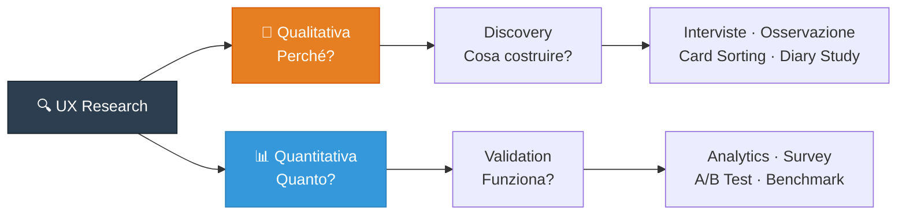
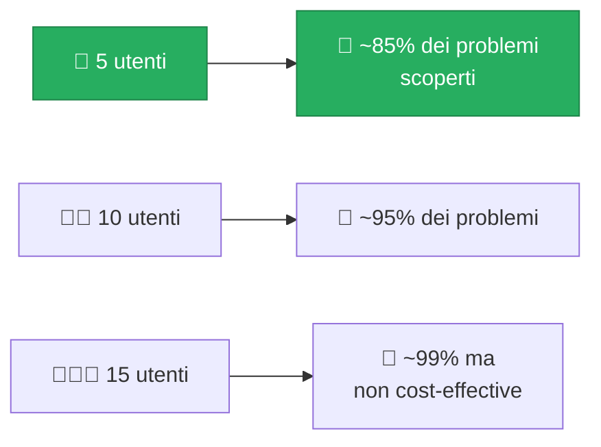
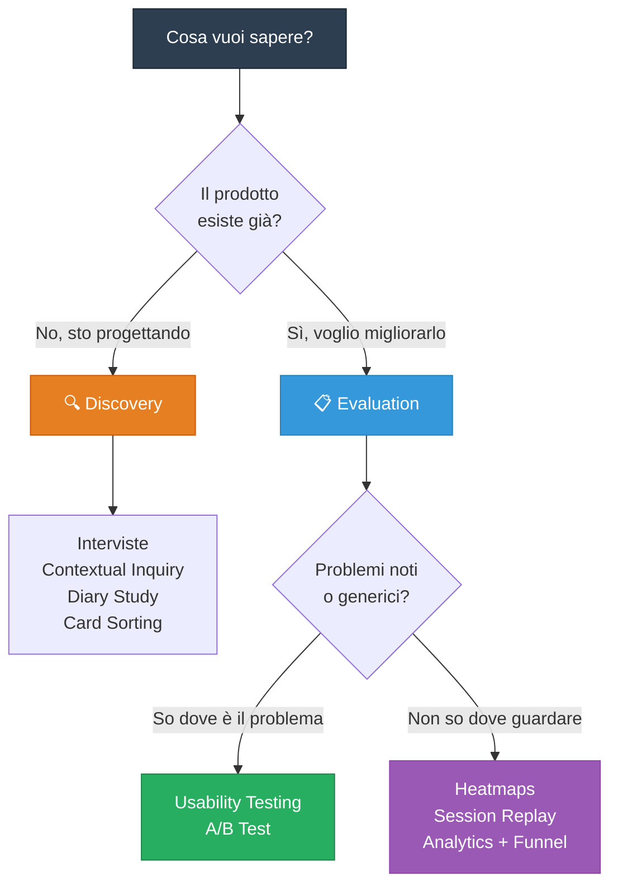
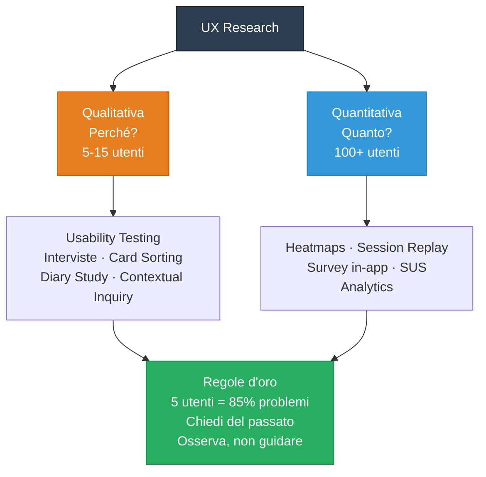

## UX RESEARCH: CAPIRE GLI UTENTI PRIMA DI COSTRUIRE PER LORO

La UX Research è il processo sistematico di comprendere i bisogni, i comportamenti e le motivazioni degli utenti attraverso l'osservazione e il feedback. Non è un lusso per aziende grandi — è il modo più economico per evitare di costruire la cosa sbagliata.

Un prodotto senza UX research è un prodotto costruito sulle assunzioni del team. A volte il team ha ragione. Più spesso, no. Il costo di scoprirlo dopo mesi di sviluppo è enormemente superiore al costo di un paio di settimane di ricerca.

## Ricerca qualitativa vs quantitativa

La UX research si divide in due macro-categorie che rispondono a domande diverse:

| | Qualitativa | Quantitativa |
|---|---|---|
| **Domanda** | Perché? Come? | Quanto? Quanti? |
| **Output** | Insight, pattern, storie | Numeri, percentuali, correlazioni |
| **Sample** | 5-15 utenti | 100+ utenti |
| **Metodo** | Interviste, osservazione, card sorting | Analytics, survey, A/B test |
| **Forza** | Scopre l'inaspettato | Misura e valida |
| **Debolezza** | Non generalizzabile | Non spiega il perché |

La regola pratica: **la qualitativa scopre, la quantitativa valida.** Usa la qualitativa per generare ipotesi ("gli utenti non capiscono il menu di navigazione") e la quantitativa per validarle ("il 45% abbandona alla seconda schermata del checkout, confermando il problema").

## I metodi qualitativi

### 1. Usability Testing

L'utente prova a completare dei task nel prodotto mentre tu osservi. È il metodo più potente della UX research.

**Come si fa:**
1. Definisci 3-5 task specifici e misurabili ("Trova il report delle vendite di gennaio e scaricalo in PDF")
2. Recluta 5-8 utenti rappresentativi del target
3. Chiedi all'utente di pensare ad alta voce mentre opera (*think-aloud protocol*)
4. Non aiutare, non guidare, non spiegare. Osserva.
5. Registra la sessione (schermo + audio)

**Quanto basta?** Jakob Nielsen ha dimostrato che **5 utenti scoprono l'85% dei problemi di usabilità.** Dopo 5, i pattern si ripetono. Meglio fare 3 round da 5 utenti con iterazioni in mezzo che un round da 15.

**Metriche di usability testing:**
- **Task Success Rate** — % di utenti che completano il task
- **Time on Task** — quanto tempo ci mettono
- **Error Rate** — quanti errori commettono
- **Satisfaction** — scala post-task (SUS, SEQ)

### 2. Interviste utente

Conversazioni semi-strutturate per capire bisogni, motivazioni, frustrazioni. Diverse dalle interviste di Customer Development (che validano il problema di mercato): qui si esplora l'esperienza d'uso.

**Le 5 regole dell'intervista UX:**
1. **Chiedi del passato, non del futuro** — "Raccontami l'ultima volta che..." non "Cosa faresti se..."
2. **Osserva le emozioni** — quando l'utente cambia tono, si anima o si frustra, lì c'è l'insight
3. **Non proporre soluzioni** — "Come risolveresti questo?" non "Ti piacerebbe se aggiungessimo X?"
4. **Segui il filo** — le risposte più preziose arrivano dalle domande di follow-up
5. **Documenta verbatim** — le parole esatte dell'utente, non la tua interpretazione

### 3. Card Sorting

Tecnica per capire come gli utenti **raggruppano e categorizzano le informazioni**. Fondamentale per progettare l'architettura dell'informazione (menu, navigazione, categorie).

**Card sorting aperto:** l'utente raggruppa le card e nomina i gruppi.
**Card sorting chiuso:** i gruppi sono predefiniti, l'utente assegna le card.
**Tree testing:** l'utente cerca un'informazione in una struttura ad albero (test della navigazione esistente).

**Quando usarlo:** prima di progettare la navigazione, durante un redesign, quando gli utenti non trovano le cose.

### 4. Diary Study

L'utente documenta la propria esperienza per un periodo esteso (1-4 settimane), registrando quando e come usa il prodotto, le frustrazioni, i momenti positivi.

**Quando usarlo:** per capire l'uso nel contesto reale, non nel contesto artificiale di un lab. Ideale per prodotti con uso discontinuo o per capire il percorso completo (non solo una sessione).

### 5. Contextual Inquiry

Il ricercatore osserva l'utente **nel suo ambiente naturale** (ufficio, casa, in mobilità) mentre usa il prodotto o gestisce il problema che il prodotto dovrebbe risolvere. Come un'intervista, ma nel contesto reale.

**Quando usarlo:** per prodotti B2B complessi dove il contesto (colleghi, processi aziendali, strumenti usati insieme) è fondamentale.

## I metodi quantitativi

### 1. Heatmaps e Click Maps

Visualizzazioni aggregate di dove gli utenti cliccano, scrollano e muovono il mouse. Tool: Hotjar, Microsoft Clarity (gratuito), FullStory.

**Cosa cercano:**
- Zone calde (molte interazioni) e zone fredde (ignorate)
- Click su elementi non cliccabili (rage clicks = frustrazione)
- Profondità di scroll (quanti vedono il contenuto below the fold?)

### 2. Session Replays

Registrazioni anonimizzate delle sessioni utente. Vedere un utente cercare per 30 secondi un pulsante che ritieni "ovvio" vale più di mille analytics.

**Best practice:** non guardare sessioni a caso. Filtra per:
- Sessioni con rage clicks (click ripetuti sullo stesso punto)
- Sessioni che hanno abbandonato un funnel critico
- Sessioni di utenti che hanno contattato il supporto

### 3. Survey in-app

Micro-sondaggi contestuali mostrati nel momento giusto.

| Trigger | Domanda | Obiettivo |
|---------|---------|-----------|
| Dopo il checkout | "Quanto è stato facile completare l'acquisto?" (CES) | Misurare la frizione |
| Dopo 7 giorni di uso | "Come ti sentiresti se non potessi più usare il prodotto?" (PMF) | Misurare il valore percepito |
| Dopo una feature specifica | "Quanto è stata utile questa funzionalità?" | Validare una feature |
| Su exit-intent | "Cosa stavi cercando?" | Capire abbandoni |

**Regola:** massimo 1-2 domande. Nessuno vuole compilare un questionario di 20 domande mentre sta lavorando.

### 4. System Usability Scale (SUS)

Questionario standardizzato di 10 domande che produce un punteggio da 0 a 100.

| Punteggio SUS | Valutazione |
|:---:|---|
| > 80 | Eccellente |
| 68-80 | Buono |
| 50-68 | OK ma migliorabile |
| < 50 | Problematico |

**Vantaggi:** standardizzato (confrontabile tra prodotti e nel tempo), veloce (10 domande), robusto statisticamente (validato da 30+ anni di ricerca).

## Quando usare quale metodo

## Il processo di UX Research nel ciclo di prodotto

La UX research non è un'attività una tantum. Si inserisce in ogni fase del ciclo di sviluppo:

| Fase | Metodo | Output |
|------|--------|--------|
| **Discovery** | Interviste, contextual inquiry | Bisogni utente, pain points, opportunity areas |
| **Design** | Card sorting, tree testing, paper prototype test | Architettura informativa, wireframe validati |
| **Sviluppo** | Usability testing su prototipo | Lista di problemi di usabilità da risolvere |
| **Lancio** | Analytics, heatmaps, in-app survey | Metriche baseline, primi feedback |
| **Iterazione** | A/B test, session replay, SUS | Miglioramenti misurabili |

## L'errore più comune: la ricerca che conferma

Il bias di conferma è il nemico della UX research. Se fai ricerca per confermare una decisione già presa, troverai sempre le prove che cerchi. Le domande saranno orientate, i partecipanti selezionati, i risultati interpretati a favore della tesi.

**Come evitarlo:**
- Definisci le domande di ricerca PRIMA di iniziare
- Fai condurre le sessioni da qualcuno che non ha interesse nel risultato
- Documenta anche i finding che contraddicono le aspettative
- Invita gli stakeholder a osservare le sessioni dal vivo
- Usa il metodo delle "5 ipotesi da invalidare": prima di ogni round di ricerca, scrivi 5 cose che ti aspetti di trovare. Se le trovi tutte, probabilmente il tuo metodo è biased.

## Riepilogo

Tre cose da portare a casa:

1. **5 utenti bastano per l'85% dei problemi** — non serve un campione da centinaia di persone per l'usability testing. Cinque sessioni da 30-45 minuti danno più insight di qualsiasi dashboard di analytics.

2. **La qualitativa scopre, la quantitativa valida** — interviste e osservazione per capire il "perché", analytics e survey per misurare il "quanto". Servono entrambe.

3. **La ricerca deve precedere la soluzione** — fare UX research per confermare una decisione già presa è peggio che non farla. Definisci le domande prima, documenta anche i risultati scomodi.
