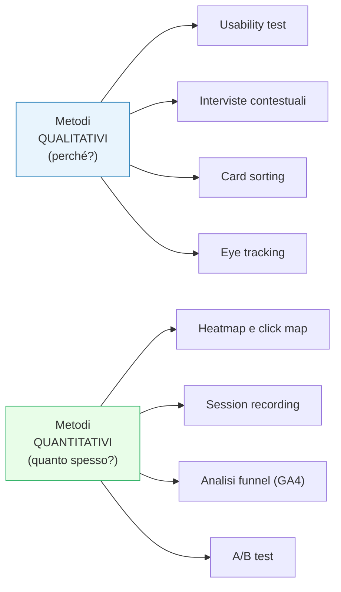

C'è una verità scomoda nel design digitale: gli utenti non usano i prodotti come li hai progettati tu.

Li usano come **vogliono loro**. E se non riescono, si arrabbiano e se ne vanno — senza dirti perché. Perché non è compito loro spiegarti cosa non va. È compito tuo scoprirlo prima che accada.

La UX Research è la disciplina che ti permette di scoprirlo prima che sia troppo tardi.

## Cos'è la UX Research

UX Research (User Experience Research) è l'insieme di metodi per capire come le persone interagiscono con un prodotto, cosa le confonde, cosa le soddisfa, e perché.

Non è design. Non è marketing. È ascolto sistematico del comportamento reale degli utenti.

Il principio fondamentale:

> **Quello che gli utenti dicono ≠ quello che gli utenti fanno.**

In un'intervista, l'utente dirà "sì, è chiaro" perché non vuole sembrare stupido. In un test di usabilità, ti guarderai l'utente fissare il bottone sbagliato per 30 secondi senza capire cosa fare.

## I principali metodi di UX Research

| Metodo | Fase ideale | Cosa trova | Costo |
|---|---|---|---|
| **Usability test** | Prototipo o prodotto esistente | Problemi di navigazione | Basso (si fa da soli) |
| **Interviste contestuali** | Discovery | Bisogni e contesto reale | Basso |
| **Card sorting** | Architettura informativa | Come gli utenti categorizzano | Basso |
| **Heatmap** | Prodotto live | Dove cliccano e si fermano | Basso (Hotjar gratuito) |
| **Session recording** | Prodotto live | Comportamento completo | Basso (Hotjar gratuito) |
| **Eye tracking** | Prodotto maturo | Dove guardano davvero | Alto (richiede attrezzatura) |

## Usability Test: il metodo più potente (e il più ignorato)

Il **test di usabilità** consiste nel far svolgere a utenti reali dei task specifici su un prodotto — mentre li osservi. Senza aiutarli. Senza spiegare. Senza dire "no, intendevo cliccare lì."

### Quanti utenti servono?

Jakob Nielsen, il guru della usabilità, ha dimostrato matematicamente che:

> **5 utenti trovano l'80% dei problemi di usabilità.**

Non servono settimane di testing e centinaia di persone. Bastano 5 sessioni da 45 minuti per identificare la maggior parte dei problemi critici. Aggiungere altri utenti porta rendimenti decrescenti — è molto più utile fare 3 round da 5 utenti che un round da 15.

### Come si conduce un usability test

**1. Definisci i task** — scenari realistici. Non "clicca su acquista" ma "immagina di voler comprare un regalo per tua sorella entro 30 euro. Completalo."

**2. Recluta 5 utenti** — non amici, non colleghi (ti diranno che è tutto bello). Trova persone del target reale: LinkedIn, social, panel online.

**3. Usa il think-aloud** — chiedi all'utente di dire ad alta voce quello che sta pensando mentre naviga. "Sto cercando il carrello, mi aspetto che sia in alto a destra... ah ma non lo vedo..." Ogni esitazione è un dato.

**4. Osserva senza intervenire** — quando l'utente si blocca, non aiutare. Puoi chiedere "cosa stai cercando di fare?" ma non rispondere alle sue domande. Quel momento di confusione è oro puro.

**5. Analizza i pattern** — dopo 5 sessioni: dove si sono bloccati tutti? Quali task hanno fallito? Cosa ripetevano?

## Esempio italiano: Trenitalia app

Immagina di condurre un usability test sull'app Trenitalia. Task: "Hai un biglietto per Bologna di domani alle 10. Scopri che non puoi partire. Cambiagli la data."

Osservazioni tipiche:
- L'utente cerca "modifica biglietto" → non lo trova al posto ovvio
- Prova a cliccare sul biglietto → apre dettaglio ma non vede l'opzione cambio
- Va su "Assistenza" → legge FAQ ma non trova la procedura
- Dopo 4 minuti di frustrazione: "Forse devo farlo dalla versione web?"

Questo è un problema di **information architecture** e **discoverability** — il processo esiste ma non è trovabile. Costerebbe zero correggere il labelling del menu, ma ha un impatto enorme sulla soddisfazione degli utenti che devono cambiare biglietto.

## Heatmap e Session Recording

Per prodotti già live, gli strumenti di **behavioral analytics** come Hotjar o Microsoft Clarity (entrambi con piani gratuiti) permettono di vedere:

- **Heatmap click**: dove cliccano gli utenti sulla pagina (spesso cliccano elementi che non sono cliccabili)
- **Scroll map**: fin dove scrollano (scopri se il contenuto importante è visibile senza scroll)
- **Session recording**: replay delle sessioni — vedi il cursore muoversi, le esitazioni, i backtrack

Un e-commerce italiano di moda ha scoperto tramite heatmap che il 60% degli utenti mobile cliccava sulla foto prodotto aspettandosi uno zoom — ma il prodotto non supportava lo zoom. Aggiunto lo zoom: conversion rate +8%. Costo dello sviluppo: un giorno di lavoro.

## Problema reale

Un prodotto ha un funnel apparentemente sano, ma gli utenti esitano, tornano indietro e abbandonano proprio nei passaggi che il team riteneva ovvi.

La domanda pratica non e "so ripetere la teoria?", ma: **quale decisione migliora se applico bene questa lezione?** In product analytics, il rischio tipico e prendere un segnale parziale e trasformarlo in una scelta costosa: una feature lanciata troppo presto, un budget spostato senza causalita, un modello dati fragile o una raccomandazione piu elegante che utile.

## Modello concettuale

Usa questa griglia in tre passaggi: prima definisci il fenomeno, poi scegli l evidenza minima credibile, infine trasformi l evidenza in una decisione esplicita.

| Livello | Domanda guida | Output atteso |
|---|---|---|
| Fenomeno | Che cosa sta davvero succedendo? | Perimetro, segmenti e assunzioni |
| Evidenza | Quale dato cambierebbe la nostra opinione? | Metriche, osservazioni e guardrail |
| Decisione | Che cosa faremo se il segnale regge? | Azione, owner, timing e criterio di stop |

Questo modello evita due estremi: teoria senza applicazione e operativita senza ragionamento.

## Formalizzazione rigorosa

Formalizza la lezione come una catena decisionale:

| Elemento | Definizione operativa | Controllo di qualita |
|---|---|---|
| Input | eventi prodotto, funnel, coorti, survey, ticket supporto e session recording | Fonte, periodo, granularita e completezza dichiarati |
| Ipotesi | Relazione attesa tra comportamento, metrica e decisione | Assunzioni scritte prima dell analisi |
| Metrica | activation, retention, conversione, NPS, churn e valore per utente | Denominatore, segmento e finestra temporale espliciti |
| Guardrail | Cosa non deve peggiorare mentre ottimizzi | Soglie condivise con product, growth e design |
| Decisione | scegliere quali frizioni rimuovere, quali segmenti servire e quali interventi mettere in backlog | Owner, scadenza e criterio di revisione |

Una lezione e formalizzata bene quando un altra persona puo ricostruire il ragionamento e contestare le assunzioni senza chiedere spiegazioni extra.

## Esempio o caso studio

Immagina una review settimanale in cui product, growth e design deve decidere su "UX Research: gli utenti non fanno quello che dici — e hanno sempre ragione". Il dato iniziale mostra un segnale promettente, ma il team non si ferma al numero principale. Divide il problema per segmento, controlla i guardrail, cerca spiegazioni alternative e scrive una raccomandazione con tre parti: cosa sappiamo, cosa non sappiamo, cosa faremo adesso.

| Osservazione | Interpretazione prudente | Azione |
|---|---|---|
| Segnale positivo sulla metrica primaria | Potrebbe essere effetto reale o composizione del campione | Controllare segmenti e baseline |
| Guardrail stabile | Il miglioramento non sembra creare danni immediati | Procedere con rollout limitato |
| Evidenza ancora incompleta | Serve una verifica prima di scalare | Definire un secondo ciclo di misura |

Il valore del caso non sta nel trovare una risposta perfetta, ma nel rendere la decisione piu difendibile.

## Lab / esercizio

Usa questo esercizio per trasformare la lezione in pratica verificabile.

| Livello | Attivita | Output |
|---|---|---|
| Livello base | Riassumi il problema in cinque righe e scegli una metrica primaria con un guardrail. | Mini brief decisionale |
| Livello intermedio | Applica il modello a un caso reale o simulato, includendo segmenti, baseline e rischi. | Tabella di analisi con raccomandazione |
| Livello research-grade | Scrivi un memo che confronta due spiegazioni alternative e indica quale evidenza le distinguerebbe. | Decision memo revisionabile |

**Dataset e materiali consigliati:** esportazione eventi o metriche dal tuo prodotto, una dashboard gia usata dal team, note qualitative, risultati di un esperimento o un dataset pubblico coerente con il tema.

## Errore tipico da evitare

L errore piu comune e usare "UX Research: gli utenti non fanno quello che dici — e hanno sempre ragione" come etichetta autorevole invece che come metodo. Succede quando il team cita il concetto per giustificare una scelta gia presa, oppure quando ottimizza una metrica locale senza chiedersi quale comportamento sta incentivando.

Correzione pratica: prima di presentare la raccomandazione, scrivi una riga con la decisione proposta, una riga con l evidenza che la sostiene e una riga con la condizione che ti farebbe cambiare idea. Se manca una di queste tre righe, la lezione non e ancora stata applicata con rigore.

## Quiz o checkpoint

1. Quale decisione concreta dovrebbe migliorare applicando questa lezione?
2. Quale metrica useresti come segnale primario e quale come guardrail?
3. Quale spiegazione alternativa potrebbe rendere sbagliata la tua interpretazione?
4. Che cosa dovrebbe succedere nei dati per farti cambiare raccomandazione?
5. Quale output consegneresti a product, growth e design: dashboard, memo, esperimento, backlog o modello dati?

Se non riesci a rispondere in modo specifico, torna al problema reale prima di continuare.

## Riepilogo

- La UX Research serve a scoprire come gli utenti usano **davvero** il prodotto — non come credi tu che lo usino
- **5 utenti** bastano per trovare l'80% dei problemi di usabilità — la regola di Nielsen è dimostrata empiricamente
- Il **think-aloud** è il metodo più rivelatorio: senti in tempo reale il ragionamento dell'utente
- **Heatmap e session recording** (Hotjar, Microsoft Clarity — entrambi con piano gratuito) rivelano comportamenti su larga scala
- La differenza tra "cosa dicono" e "cosa fanno" è dove si nascondono i problemi veri del prodotto
- Il costo di trovare un problema in fase di design è 1x. In produzione è 100x. La UX Research abbassa quel costo.
