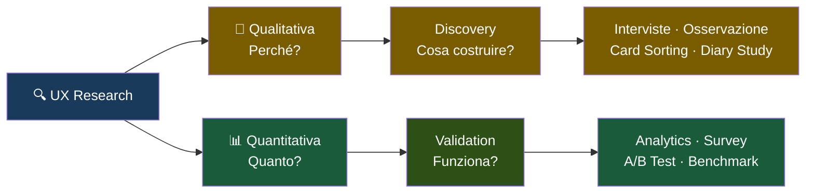
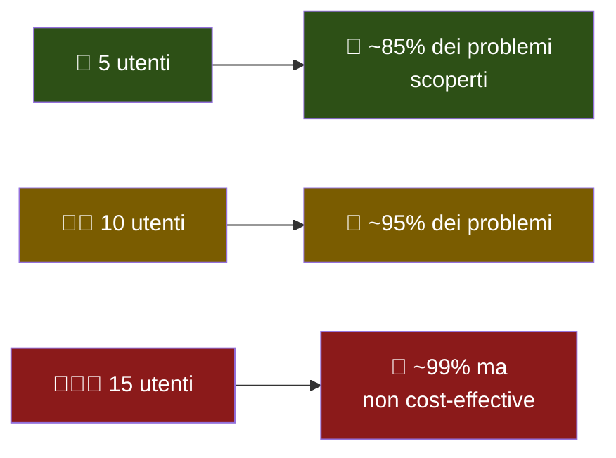
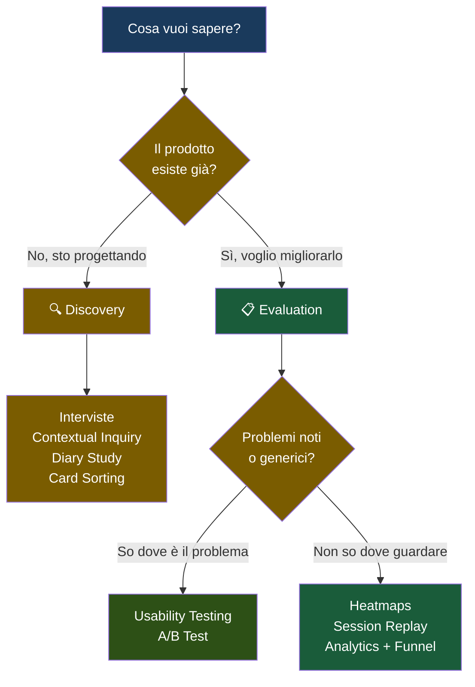
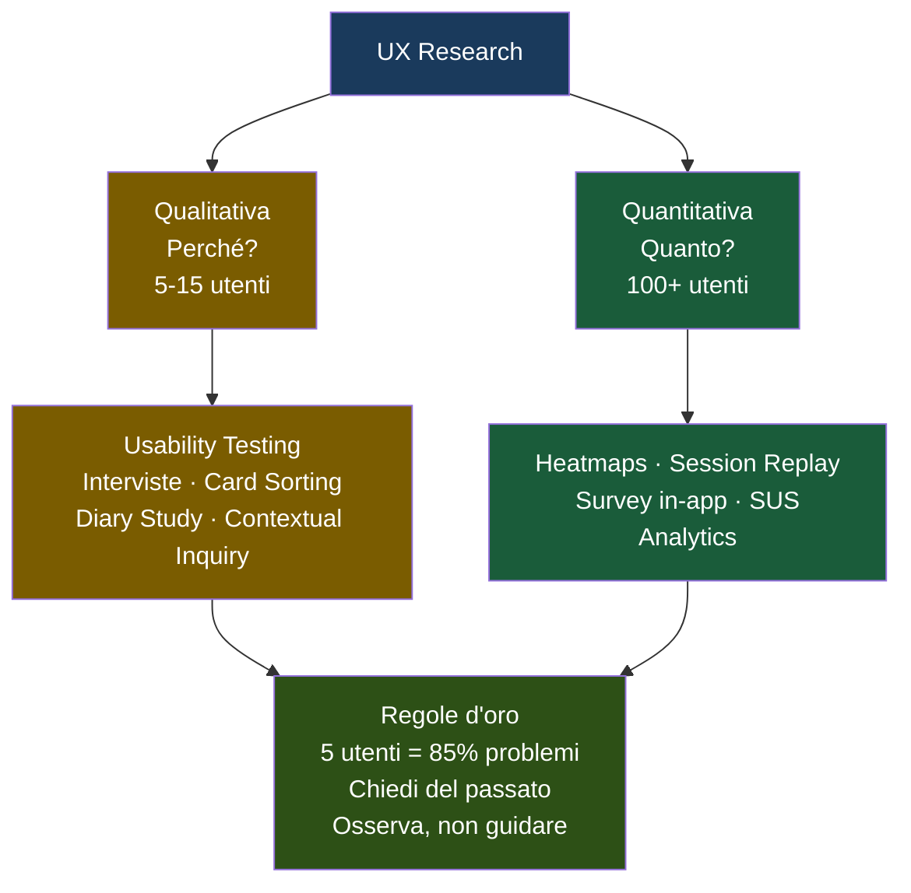

import { Aside } from '@astrojs/starlight/components'

La UX research riduce il costo dell'errore prima che l'errore arrivi in produzione. E' il passaggio che trasforma ipotesi sul comportamento degli utenti in evidenze osservabili, e per questo ha un impatto diretto su roadmap, onboarding e retention.

In questa lezione vediamo quali metodi usare, quando servono dati qualitativi o quantitativi e come collegare la ricerca alle decisioni di prodotto senza trasformarla in teatro organizzativo.

## UX RESEARCH: CAPIRE GLI UTENTI PRIMA DI COSTRUIRE PER LORO

La UX Research è il processo sistematico di comprendere i bisogni, i comportamenti e le motivazioni degli utenti attraverso l'osservazione e il feedback. Non è un lusso per aziende grandi — è il modo più economico per evitare di costruire la cosa sbagliata.

Un prodotto senza UX research è un prodotto costruito sulle assunzioni del team. A volte il team ha ragione. Più spesso, no. Il costo di scoprirlo dopo mesi di sviluppo è enormemente superiore al costo di un paio di settimane di ricerca.

## Ricerca qualitativa vs quantitativa

La UX research si divide in due macro-categorie che rispondono a domande diverse:

| | Qualitativa | Quantitativa |
|---|---|---|
| **Domanda** | Perché? Come? | Quanto? Quanti? |
| **Output** | Insight, pattern, storie | Numeri, percentuali, correlazioni |
| **Sample** | 5-15 utenti | 100+ utenti |
| **Metodo** | Interviste, osservazione, card sorting | Analytics, survey, A/B test |
| **Forza** | Scopre l'inaspettato | Misura e valida |
| **Debolezza** | Non generalizzabile | Non spiega il perché |

La regola pratica: **la qualitativa scopre, la quantitativa valida.** Usa la qualitativa per generare ipotesi ("gli utenti non capiscono il menu di navigazione") e la quantitativa per validarle ("il 45% abbandona alla seconda schermata del checkout, confermando il problema").

## I metodi qualitativi

### 1. Usability Testing

L'utente prova a completare dei task nel prodotto mentre tu osservi. È il metodo più potente della UX research.

**Come si fa:**
1. Definisci 3-5 task specifici e misurabili ("Trova il report delle vendite di gennaio e scaricalo in PDF")
2. Recluta 5-8 utenti rappresentativi del target
3. Chiedi all'utente di pensare ad alta voce mentre opera (*think-aloud protocol*)
4. Non aiutare, non guidare, non spiegare. Osserva.
5. Registra la sessione (schermo + audio)

**Quanto basta?** Jakob Nielsen ha dimostrato che **5 utenti scoprono l'85% dei problemi di usabilità.** Dopo 5, i pattern si ripetono. Meglio fare 3 round da 5 utenti con iterazioni in mezzo che un round da 15.

**Metriche di usability testing:**
- **Task Success Rate** — % di utenti che completano il task
- **Time on Task** — quanto tempo ci mettono
- **Error Rate** — quanti errori commettono
- **Satisfaction** — scala post-task (SUS, SEQ)

### 2. Interviste utente

Conversazioni semi-strutturate per capire bisogni, motivazioni, frustrazioni. Diverse dalle interviste di Customer Development (che validano il problema di mercato): qui si esplora l'esperienza d'uso.

**Le 5 regole dell'intervista UX:**
1. **Chiedi del passato, non del futuro** — "Raccontami l'ultima volta che..." non "Cosa faresti se..."
2. **Osserva le emozioni** — quando l'utente cambia tono, si anima o si frustra, lì c'è l'insight
3. **Non proporre soluzioni** — "Come risolveresti questo?" non "Ti piacerebbe se aggiungessimo X?"
4. **Segui il filo** — le risposte più preziose arrivano dalle domande di follow-up
5. **Documenta verbatim** — le parole esatte dell'utente, non la tua interpretazione

### 3. Card Sorting

Tecnica per capire come gli utenti **raggruppano e categorizzano le informazioni**. Fondamentale per progettare l'architettura dell'informazione (menu, navigazione, categorie).

**Card sorting aperto:** l'utente raggruppa le card e nomina i gruppi.
**Card sorting chiuso:** i gruppi sono predefiniti, l'utente assegna le card.
**Tree testing:** l'utente cerca un'informazione in una struttura ad albero (test della navigazione esistente).

**Quando usarlo:** prima di progettare la navigazione, durante un redesign, quando gli utenti non trovano le cose.

### 4. Diary Study

L'utente documenta la propria esperienza per un periodo esteso (1-4 settimane), registrando quando e come usa il prodotto, le frustrazioni, i momenti positivi.

**Quando usarlo:** per capire l'uso nel contesto reale, non nel contesto artificiale di un lab. Ideale per prodotti con uso discontinuo o per capire il percorso completo (non solo una sessione).

### 5. Contextual Inquiry

Il ricercatore osserva l'utente **nel suo ambiente naturale** (ufficio, casa, in mobilità) mentre usa il prodotto o gestisce il problema che il prodotto dovrebbe risolvere. Come un'intervista, ma nel contesto reale.

**Quando usarlo:** per prodotti B2B complessi dove il contesto (colleghi, processi aziendali, strumenti usati insieme) è fondamentale.

## I metodi quantitativi

### 1. Heatmaps e Click Maps

Visualizzazioni aggregate di dove gli utenti cliccano, scrollano e muovono il mouse. Tool: Hotjar, Microsoft Clarity (gratuito), FullStory.

**Cosa cercano:**
- Zone calde (molte interazioni) e zone fredde (ignorate)
- Click su elementi non cliccabili (rage clicks = frustrazione)
- Profondità di scroll (quanti vedono il contenuto below the fold?)

### 2. Session Replays

Registrazioni anonimizzate delle sessioni utente. Vedere un utente cercare per 30 secondi un pulsante che ritieni "ovvio" vale più di mille analytics.

**Best practice:** non guardare sessioni a caso. Filtra per:
- Sessioni con rage clicks (click ripetuti sullo stesso punto)
- Sessioni che hanno abbandonato un funnel critico
- Sessioni di utenti che hanno contattato il supporto

### 3. Survey in-app

Micro-sondaggi contestuali mostrati nel momento giusto.

| Trigger | Domanda | Obiettivo |
|---------|---------|-----------|
| Dopo il checkout | "Quanto è stato facile completare l'acquisto?" (CES) | Misurare la frizione |
| Dopo 7 giorni di uso | "Come ti sentiresti se non potessi più usare il prodotto?" (PMF) | Misurare il valore percepito |
| Dopo una feature specifica | "Quanto è stata utile questa funzionalità?" | Validare una feature |
| Su exit-intent | "Cosa stavi cercando?" | Capire abbandoni |

**Regola:** massimo 1-2 domande. Nessuno vuole compilare un questionario di 20 domande mentre sta lavorando.

### 4. System Usability Scale (SUS)

Questionario standardizzato di 10 domande che produce un punteggio da 0 a 100.

| Punteggio SUS | Valutazione |
|:---:|---|
| > 80 | Eccellente |
| 68-80 | Buono |
| 50-68 | OK ma migliorabile |
| < 50 | Problematico |

**Vantaggi:** standardizzato (confrontabile tra prodotti e nel tempo), veloce (10 domande), robusto statisticamente (validato da 30+ anni di ricerca).

## Quando usare quale metodo

## Il processo di UX Research nel ciclo di prodotto

La UX research non è un'attività una tantum. Si inserisce in ogni fase del ciclo di sviluppo:

| Fase | Metodo | Output |
|------|--------|--------|
| **Discovery** | Interviste, contextual inquiry | Bisogni utente, pain points, opportunity areas |
| **Design** | Card sorting, tree testing, paper prototype test | Architettura informativa, wireframe validati |
| **Sviluppo** | Usability testing su prototipo | Lista di problemi di usabilità da risolvere |
| **Lancio** | Analytics, heatmaps, in-app survey | Metriche baseline, primi feedback |
| **Iterazione** | A/B test, session replay, SUS | Miglioramenti misurabili |

## L'errore più comune: la ricerca che conferma

Il bias di conferma è il nemico della UX research. Se fai ricerca per confermare una decisione già presa, troverai sempre le prove che cerchi. Le domande saranno orientate, i partecipanti selezionati, i risultati interpretati a favore della tesi.

**Come evitarlo:**
- Definisci le domande di ricerca PRIMA di iniziare
- Fai condurre le sessioni da qualcuno che non ha interesse nel risultato
- Documenta anche i finding che contraddicono le aspettative
- Invita gli stakeholder a osservare le sessioni dal vivo
- Usa il metodo delle "5 ipotesi da invalidare": prima di ogni round di ricerca, scrivi 5 cose che ti aspetti di trovare. Se le trovi tutte, probabilmente il tuo metodo è biased.

## Riepilogo

Tre cose da portare a casa:

1. **5 utenti bastano per l'85% dei problemi** — non serve un campione da centinaia di persone per l'usability testing. Cinque sessioni da 30-45 minuti danno più insight di qualsiasi dashboard di analytics.

2. **La qualitativa scopre, la quantitativa valida** — interviste e osservazione per capire il "perché", analytics e survey per misurare il "quanto". Servono entrambe.

3. **La ricerca deve precedere la soluzione** — fare UX research per confermare una decisione già presa è peggio che non farla. Definisci le domande prima, documenta anche i risultati scomodi.

## La matrice metodi: scegliere in base al contesto

Una delle difficoltà pratiche della UX Research è scegliere il metodo giusto per la domanda giusta. La matrice comportamentale/attitudinale di Christian Rohrer (Nielsen Norman Group) è lo strumento di riferimento.

L'asse orizzontale distingue tra ciò che gli utenti **fanno** (comportamentale) e ciò che **dicono** (attitudinale). L'asse verticale distingue tra metodi **qualitativi** (pochi utenti, molto contesto) e **quantitativi** (molti utenti, misurazioni precise).

| | Attitudinale (dicono) | Comportamentale (fanno) |
|---|---|---|
| **Qualitativo** | Interviste in profondità, Focus group | Usability testing, Contextual inquiry |
| **Quantitativo** | Survey, PMF test | Analytics, A/B test, Eye tracking |

L'errore più comune è affidarsi troppo all'attitudinale: chiedere agli utenti cosa pensano o cosa farebbero. Gli utenti non sanno prevedere il proprio comportamento — lo ricerca di Daniel Kahneman e Amos Tversky sull'economia comportamentale lo ha dimostrato senza ambiguità. Le persone razionalizzano le proprie decisioni dopo il fatto, non le prevedono accuratamente prima.

Il metodo più robusto combina entrambi: osserva il comportamento reale (usability testing, analytics) e poi intervista per capire il perché.

## La regola di Jakob Nielsen: i 5 utenti e la curva della scoperta

Nel 1993, Jakob Nielsen e Tom Landauer pubblicarono uno studio rivoluzionario che ha cambiato per sempre il modo di condurre l'usability testing. La loro analisi di 83 studi di usabilità mostrò che la proporzione di problemi scoperti segue una curva con rendimenti decrescenti.

La formula è:

> **Problemi scoperti = N × (1 - (1 - L)^n)**

Dove L è la probabilità che un singolo utente scopra un problema (mediamente 0,31) e n è il numero di utenti.

Con 5 utenti (n=5): 1 - (1-0,31)^5 ≈ 85% dei problemi
Con 10 utenti (n=10): 1 - (1-0,31)^10 ≈ 97% dei problemi
Con 15 utenti (n=15): 1 - (1-0,31)^15 ≈ 99% dei problemi

Il salto da 5 a 15 utenti è enorme in termini di costo (triplicato) ma minimo in termini di problemi scoperti (dal 85% al 99%). Per questo motivo, Nielsen raccomanda sessioni multiple da 5 utenti ciascuna, con iterazioni del design in mezzo — non un singolo studio grande.

**La pratica corretta:**
- Round 1: 5 utenti → identifichi i problemi principali
- Iterazione del design: risolvi i 3-4 problemi più critici
- Round 2: 5 nuovi utenti → verifichi le soluzioni e scopri problemi secondari
- Iterazione 2 e Round 3 se necessario

Questo approccio iterativo scopre il 90-95% dei problemi con lo stesso budget che costerebbe un singolo studio da 15-20 utenti, e ha il vantaggio di produrre un design migliorato invece di una lista di problemi.

## Script di usability testing: come condurre una sessione

Un buon script di usability testing si struttura in tre parti: introduzione, task e debriefing.

### Fase di introduzione (5-10 minuti)

L'obiettivo è mettere l'utente a proprio agio e spiegare le regole:

"Grazie per essere qui. Oggi stiamo testando il nostro prodotto, non te — qualsiasi difficoltà che incontri è un'informazione preziosa per noi. Non ci sono risposte giuste o sbagliate. Mentre usi il prodotto, ti chiedo di pensare ad alta voce: dimmi cosa stai guardando, cosa stai pensando, cosa ti aspetti che succeda. Se hai domande durante i task, te le risponderò alla fine — durante il task ho bisogno di osservare come ti comporti senza la mia interferenza."

Le ultime tre parole sono fondamentali. Il moderatore non aiuta, non suggerisce, non annuisce troppo energicamente. Osserva.

### I task (20-40 minuti)

Ogni task deve essere:
- **Realistico:** basato su uno scenario autentico di utilizzo
- **Misurabile:** puoi determinare se è stato completato con successo
- **Non direzionale:** non usare le parole del prodotto (se testi il "checkout", non dire "completa il checkout")

Esempio di task mal scritto: "Vai alla sezione Analytics e crea un nuovo report mensile cliccando sul pulsante 'Nuovo Report'."

Esempio di task ben scritto: "Hai bisogno di preparare una presentazione per il tuo manager con i dati di vendita dell'ultimo mese. Mostrami come lo faresti con questo prodotto."

Il secondo task usa il linguaggio dell'utente, non quello del prodotto. Non svela dove cliccare o come si chiama la funzione. Mette l'utente nel contesto mentale reale.

### Debriefing (10-15 minuti)

Al termine dei task, chiedi:
1. "C'è qualcosa che ti ha sorpreso o confuso durante l'uso?"
2. "Se potessi cambiare una cosa di questo prodotto, cosa cambieresti?"
3. "Descrivi in una frase che tipo di persona userebbe questo prodotto."

Quest'ultima domanda è particolarmente preziosa: la risposta rivela come l'utente percepisce il target del prodotto, e se quella percezione è allineata con la tua intenzione.

## Tree testing e card sorting: progettare la navigazione con i dati

Navigazione e architettura dell'informazione sono tra le aree più critiche dell'UX — e tra quelle meno testate. La maggior parte dei redesign della navigazione si basa sull'intuizione del designer. Il tree testing e il card sorting portano i dati in questa decisione.

### Card Sorting: costruire la struttura dal basso

Il card sorting chiede agli utenti di organizzare un set di "card" (elementi di contenuto) in gruppi che abbiano senso per loro, e di nominare i gruppi. Il risultato è una mappa di come gli utenti pensano all'informazione — che spesso differisce radicalmente da come il team la pensa.

**Card sorting aperto:** nessuna struttura predefinita. L'utente crea i gruppi da zero. Usato nella fase di design per costruire la struttura iniziale.

**Card sorting chiuso:** i gruppi sono predefiniti, l'utente assegna le card. Usato per validare una struttura esistente.

**Strumenti:** Optimal Workshop (a pagamento), UsabilityHub, o anche semplicemente post-it in una sessione in presenza.

**Quanti partecipanti?** Per un card sorting quantitativo significativo, servono almeno 15-30 partecipanti. L'analisi della matrice di similarità (quante coppie di card vengono messe nello stesso gruppo da quanti partecipanti) richiede un campione sufficiente per emergere pattern stabili.

**Caso reale — Shopify:** quando Shopify ha ridisegnato la navigazione del suo admin panel nel 2019, ha condotto un card sorting con 150 merchant. La struttura che emergeva dai dati era molto diversa da quella che il team di design aveva proposto: i merchant raggruppavano le funzioni per "cosa voglio fare oggi" (gestire ordini, aggiungere prodotti, vedere le statistiche), non per categoria tecnica (Orders, Products, Analytics). Il redesign finale ha adottato la struttura dei merchant, riducendo del 23% il tempo per trovare le funzioni principali.

### Tree Testing: validare la navigazione esistente

Il tree testing mostra agli utenti la struttura ad albero della navigazione (senza stile grafico, solo testo) e chiede loro di trovare un'informazione specifica. La metrica principale è il **success rate** e il **directness** (l'utente ha trovato la risposta senza tornare indietro?).

Esempio pratico di tree test per un sito e-commerce:

- **Task**: "Dove troveresti una politica di reso per un prodotto acquistato?"
- **Percorsi mostrati all'utente**:
  - Prodotti: Abbigliamento, Elettronica, Casa
  - Account: Ordini, Preferenze, Dati personali
  - Supporto: FAQ, Contattaci, Politiche > Reso / Spedizione / Privacy

Se molti utenti cercano la risposta dentro `Account > Ordini` invece che sotto `Supporto > Politiche`, il problema non e' il copy del bottone ma l'architettura dell'informazione.

Se solo il 40% degli utenti trova "Politiche" sotto "Supporto" (e molti cercano sotto "Account" → "Ordini"), il tree testing ha rivelato un problema di architettura che una heatmap non avrebbe mai potuto identificare.

## Guerrilla testing: la ricerca rapida e a basso costo

Il guerrilla testing è la versione minimalista dell'usability testing: recluti partecipanti in luoghi pubblici (caffetterie, biblioteche, aree comuni dell'ufficio) e chiedi loro 10-15 minuti per testare il tuo prodotto.

**Quando funziona:**
- Prodotti consumer (non B2B specializzato)
- Fase iniziale di un progetto, quando serve feedback rapido su wireframe o prototipi
- Budget quasi zero

**Quando non funziona:**
- Prodotti B2B con utenti altamente specializzati (un accountant software non può essere testato su persone a caso in una caffetteria)
- Quando la riservatezza del prodotto è critica
- Quando hai bisogno di un campione rappresentativo preciso

**Procedura tipica:**
Il tester si avvicina con un laptop o un tablet, chiede gentilmente 10 minuti di tempo, spiega brevemente il contesto, fa completare 2-3 task e ringrazia (spesso con un piccolo incentivo, come un buono caffè).

Il vantaggio del guerrilla testing non è la qualità del dato — è la velocità e il volume: puoi raccogliere 20-30 sessioni in un pomeriggio, con un budget di poche decine di euro. Non sostituisce l'usability testing strutturato, ma è molto meglio di nessuna ricerca.

## Integrare UX Research e analytics: il loop completo

La UX Research non vive in un silo separato dagli strumenti di analytics. I metodi migliori combinano i dati quantitativi (analytics) con la comprensione qualitativa (ricerca) in un ciclo continuo.

### Il flusso ideale

1. **Analytics identifica il problema:** la funnel analysis mostra che il 60% degli utenti abbandona alla terza schermata del checkout. Sai il "quanto", non il "perché".

2. **Session replay localizza il comportamento:** filtrando i replay per gli utenti che hanno abbandonato alla schermata 3, vedi che molti cliccano sul campo "Codice postale" e poi tornano indietro. Probabilmente c'è un problema di validazione.

3. **Usability testing conferma e approfondisce:** 5 sessioni di usability testing rivelano che il campo "Codice postale" usa la validazione italiana solo, ma il 35% degli utenti ha indirizzi di fatturazione stranieri. Il messaggio d'errore non è chiaro.

4. **A/B test valida la soluzione:** il team propone due soluzioni (campo con selezione del paese + codice postale dinamico vs un messaggio d'errore più chiaro). Un A/B test su 10.000 utenti rivela quale delle due riduce di più l'abbandono.

5. **Il ciclo ricomincia:** dopo l'implementazione, l'analytics mostra il nuovo tasso di abbandono. Se è migliorato, si passa al problema successivo. Se no, si torna alla ricerca qualitativa.

Questo ciclo — analytics → session replay → usability testing → A/B test → analytics — è il processo di ottimizzazione UX più robusto che esiste. Ogni metodo risponde a una domanda diversa, e insieme costruiscono una comprensione completa.

<Aside type="tip">
Il momento più prezioso dell'intera UX Research è quando uno stakeholder osserva una sessione di usability testing dal vivo. Non i report, non le presentazioni — vedere con i propri occhi un utente reale lottare con qualcosa che sembrava ovvio è l'esperienza che cambia le priorità. Se non riesci a far partecipare gli stakeholder a ogni studio, registra sempre le sessioni e condividi i clip dei momenti più rivelatori. Due minuti di video valgono più di venti slide di findings.
</Aside>
