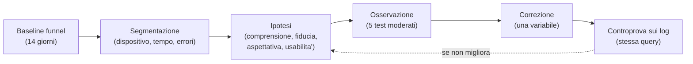

Un portale B2B di forniture industriali perde il 58% dei nuovi clienti nel passaggio che segue la conferma dell'indirizzo di spedizione (caso ricostruito, numeri di esempio). I log non mostrano errori HTTP e i tempi di caricamento sono normali, ma il tasso di completamento del primo ordine resta fermo. Il funnel indica con precisione il punto della perdita e non spiega che cosa succede nella testa di chi chiude la scheda un secondo dopo. Per rispondere servono due strumenti che raramente stanno nello stesso team: l'analisi quantitativa e l'osservazione diretta di persone che usano il prodotto.

> **Idea chiave:** i dati comportamentali dicono dove guardare e quanto vale il problema, l'osservazione dice perché succede, e solo una nuova misura sugli stessi dati dice se la correzione ha funzionato.

La lezione costruisce questo percorso su un caso numerico completo: dalla baseline del funnel alla segmentazione per dispositivo, dall'ipotesi al test con cinque utenti, fino alla verifica dopo il rilascio.

## Dalla perdita al punto del funnel: la baseline

Il lavoro comincia con una misura, non con un'opinione sul design. Per ogni passaggio del flusso critico calcoli quante sessioni lo raggiungono, la conversione al passo successivo, il tempo mediano di permanenza e la frequenza degli errori di validazione nei campi. La finestra di osservazione deve coprire almeno quattordici giorni, per assorbire la differenza tra giorni feriali e fine settimana e per avere volumi sufficienti.

Nel portale le sessioni degli ultimi 14 giorni si distribuiscono così. Al passaggio di inserimento della spedizione arrivano 9.000 sessioni, alla conferma dell'indirizzo 8.100, al pagamento 3.402 e all'ordine completato 3.000. Le conversioni tra un passo e il successivo sono 8.100 / 9.000 = 90% per la conferma, 3.402 / 8.100 = 42% per il pagamento e 3.000 / 3.402 = 88,2% per l'ordine. Il passaggio che perde di più è il terzo: il 58% delle sessioni che arrivano alla conferma non raggiunge il pagamento, mentre gli altri passaggi perdono il 10% e l'11,8%.

| Passaggio | Sessioni raggiunte | Conversione al passo successivo | Perdita |
| :--- | :--- | :--- | :--- |
| Inserimento spedizione | 9.000 | 90% | 10% |
| Conferma indirizzo | 8.100 | 42% | 58% |
| Pagamento | 3.402 | 88,2% | 11,8% |
| Ordine completato | 3.000 | non applicabile | non applicabile |

La tabella è la baseline: da questo momento ogni modifica va misurata contro di essa. Se un designer propone di rifare la pagina perché appare datata, la prima domanda riguarda il numero da cui parte. Senza una baseline su quattordici giorni, dopo il rilascio non potrai sapere se il nuovo design ha ridotto l'attrito oppure ha spostato l'abbandono al passaggio successivo.



## Segmentare per dispositivo prima di interpretare

Un funnel aggregato nasconde quasi sempre il problema. Molti software B2B sono progettati su monitor ampi, ma vengono consultati da responsabili commerciali e tecnici dallo smartphone mentre sono fuori sede. Se mescoli i dispositivi nello stesso conteggio, il pulsante di conferma che finisce fuori dallo schermo sui telefoni piccoli azzera la conversione mobile e la media la nasconde.

Dividi le 8.100 sessioni che arrivano alla conferma indirizzo: 4.050 da mobile e 4.050 da desktop (numeri di esempio). Da mobile passano al pagamento in 1.215, cioè 1.215 / 4.050 = 30%. Da desktop passano in 2.187, cioè 2.187 / 4.050 = 54%. La somma 1.215 + 2.187 = 3.402 coincide con il totale, e la media del 42% è esattamente la media delle due quote: (30% + 54%) / 2 = 42%. La media non è sbagliata, ma non descrive nessuno dei due gruppi.

Il tempo di permanenza aggiunge una seconda lettura. Sul passaggio di conferma il tempo mediano è di 38 secondi su desktop e di 76 secondi su mobile, e il tasso di errori di validazione sui campi è del 22% su mobile contro il 6% su desktop. Un tempo doppio e un errore tre volte più frequente suggeriscono un attrito di compilazione, non un problema di prezzo o di fiducia. Il tipo di segnale restringe le ipotesi: un utente che resta a lungo e sbaglia il campo ha una difficoltà di usabilità, mentre uno che esce in pochi secondi senza toccare nulla ha probabilmente un dubbio diverso.

La query seguente calcola queste metriche per dispositivo e passaggio negli ultimi quattordici giorni, con la mediana esatta del tempo e il tasso di errore.

```sql
-- Metriche per passaggio e dispositivo, ultimi 14 giorni (ClickHouse)
WITH step_metrics AS (
    SELECT
        device_type,
        step_name,
        uniqExact(session_id) AS reached_sessions,
        quantileExact(0.5)(seconds_on_step) AS median_seconds,
        countIf(has_validation_error = 1) / nullIf(count(), 0) AS error_rate
    FROM funnel_step_logs
    WHERE event_date >= today() - 14
    GROUP BY device_type, step_name
)
SELECT
    device_type,
    step_name,
    reached_sessions,
    median_seconds,
    round(error_rate * 100, 2) AS error_pct
FROM step_metrics
ORDER BY device_type, reached_sessions DESC;
```

## Quanto vale il problema: la stima economica

Prima di mobilitare design e sviluppo conviene stimare il valore del recupero, perché decide la priorità rispetto ad altri interventi. Il calcolo parte dalla differenza tra i due dispositivi: se la conversione mobile al pagamento salisse almeno fino alla metà del gap, cioè dal 30% al 42%, quante sessioni in più arriverebbero al pagamento?

Le sessioni mobili alla conferma sono 4.050. Al 42% passerebbero in 4.050 × 0,42 = 1.701, contro le 1.215 attuali: sono 1.701 - 1.215 = 486 sessioni in più verso il pagamento. Il passaggio successivo converte l'88,2% delle sessioni, quindi 486 × 0,882 = 428,6, cioè circa 429 ordini in più ogni quattordici giorni. Con un valore medio ordine di 480 euro, il ricavo aggiuntivo è 429 × 480 = 205.920 euro nel periodo, pari a circa 5,4 milioni di euro su base annua se il comportamento si mantenesse.

Il numero va letto come ordine di grandezza e non come previsione: il valore medio ordine su mobile può essere più basso, e non tutte le sessioni recuperate completano l'acquisto. Anche con una riduzione prudente del 50% della stima, il valore resta molto superiore al costo di una correzione di un campo di un modulo. Questo confronto dà al team un criterio per decidere: un intervento che costa due giorni di lavoro e vale decine di migliaia di euro passa avanti a una riprogettazione estetica di una pagina che non è sul percorso di acquisto.

```python
# Stima del ricavo recuperabile chiudendo meta' del gap mobile/desktop
sessioni_mobile = 4_050
conv_mobile = 1_215 / sessioni_mobile          # 0.30
conv_desktop = 2_187 / sessioni_mobile         # 0.54
conv_target = conv_mobile + 0.5 * (conv_desktop - conv_mobile)  # 0.42

sessioni_extra = sessioni_mobile * (conv_target - conv_mobile)  # 486
conv_pagamento_ordine = 3_000 / 3_402                           # 0.882
ordini_extra = sessioni_extra * conv_pagamento_ordine           # ~428.6
ricavo_extra = round(ordini_extra) * 480

print(f"sessioni extra {sessioni_extra:.0f}, ordini {ordini_extra:.0f}, ricavo {ricavo_extra:,} euro per 14 giorni")
```

## Dalle quattro famiglie di ipotesi al test con pochi utenti

Il dato quantitativo restringe il punto del problema, e la causa va cercata fra quattro famiglie. La comprensione riguarda ciò che l'utente non capisce: un'etichetta ambigua, un'istruzione scritta nel gergo dell'azienda. La fiducia riguarda ciò che teme: costi nascosti, sicurezza dei dati, condizioni di reso. L'aspettativa riguarda ciò che pensava di trovare: elementi che sembrano cliccabili e non lo sono. L'usabilità riguarda la difficoltà pratica: campi con formati rigidi, pulsanti fuori schermo.

| Famiglia di ipotesi | Segnale nei dati | Verifica qualitativa | Intervento tipico |
| :--- | :--- | :--- | :--- |
| Comprensione | Tempo lungo sullo schermo senza clic | Chiedere di spiegare a voce che cosa chiede il campo | Riscrivere l'etichetta nel linguaggio del cliente |
| Fiducia | Uscita subito prima di inserire dati sensibili | Intervista sui dubbi di costo e sicurezza | Mostrare il totale finale e le garanzie |
| Aspettativa | Clic ripetuti su elementi non cliccabili | Test con osservazione del comportamento | Allineare aspetto e funzione degli elementi |
| Usabilità | Errori ripetuti sullo stesso campo | Osservazione su desktop e su mobile | Semplificare formati e validazione |

Nel portale i segnali puntano all'usabilità su mobile: tempo doppio ed errori del 22%. Ma anche una causa di comprensione dei codici fiscali e delle partite IVA produrrebbe errori ripetuti, quindi serve osservare. Il test moderato con cinque persone è il metodo più rapido: chiedi a ciascuna di completare l'ordine pensando ad alta voce e non intervieni quando esita. Quanti utenti servono per vedere un problema? Se un ostacolo colpisce il 31% degli utenti, la probabilità che un singolo utente lo incontri è 0,31 e la probabilità che nessuno dei cinque lo incontri è 0,69 elevato a 5, pari a 0,1564. La probabilità di osservarlo almeno una volta è quindi 1 - 0,1564 = 84,4%.

Questo calcolo dà due indicazioni. La prima: cinque utenti bastano per scoprire gli ostacoli frequenti, e conviene fare più cicli piccoli (cinque test, correzione, altri cinque test) invece di un unico test da venti utenti. La seconda: cinque utenti non misurano la frequenza di un problema, e un ostacolo che colpisce il 5% degli utenti ha una probabilità di essere osservato di 1 - 0,95 elevato a 5 = 22,6%, quindi può sfuggire. Il test qualitativo scopre le cause, i log misurano quanto pesano.

Nelle cinque sessioni sul mobile, tre utenti su cinque si fermano sul campo che chiede il codice fiscale o la partita IVA, perché non capiscono quale dei due inserire. Il problema non è il colore del pulsante ma l'assenza di un esempio accanto all'etichetta, e il campo accetta solo un formato senza spazi, rifiutando valori copiati dalle fatture. La correzione è di due giorni di sviluppo: aggiungere un esempio, accettare entrambi i formati e mostrare l'errore accanto al campo.

## Controprova sui log dopo il rilascio

La correzione è una ipotesi finché non misuri di nuovo. Dopo il rilascio ripeti la stessa query sullo stesso passaggio per quattordici giorni e confronta con la baseline. Supponi che su mobile la conversione dalla conferma al pagamento salga dal 30% al 38% e il tasso di errore sul campo scenda dal 22% al 9% (numeri di esempio). Su 4.050 sessioni mobili, 4.050 × 0,38 = 1.539 raggiungono il pagamento contro le 1.215 precedenti: 324 sessioni in più, con una crescita di 8 punti percentuali. La correzione recupera 324 / 486 = 66,7% della stima iniziale.

Con campioni così ampi l'aumento di 8 punti su 4.050 sessioni per periodo è chiaramente distinguibile dal rumore: l'errore standard della differenza tra due proporzioni vicine al 30-38% con 4.050 sessioni ciascuna è circa 1 punto percentuale. Non vale lo stesso per i flussi a basso volume, dove servono più settimane per accumulare sessioni sufficienti.

Un confronto prima e dopo ha un limite noto: tra i due periodi cambiano anche stagione, campagne e composizione del traffico. Per ridurlo confronta lo stesso intervallo del calendario, controlla che il mix di dispositivi sia simile e verifica che il desktop, che non ha ricevuto la correzione, sia rimasto stabile al 54%. Il desktop funziona come gruppo di controllo naturale: se anche lì la conversione fosse salita di 8 punti, l'effetto sarebbe dovuto a qualcosa di esterno.

## Errori frequenti quando si uniscono UX research e analytics

### Riprogettare l'interfaccia prima di misurare la baseline

Il sintomo è un rilascio dopo il quale nessuno sa dire se le cose sono migliorate: i numeri variano e ogni parte del team li interpreta a proprio favore. Succede perché la proposta nasce da un giudizio estetico e la misura iniziale non esiste. Si corregge fissando prima della modifica la query, la finestra di quattordici giorni e la soglia attesa, e rifiutando riprogettazioni senza una metrica di partenza.

### Guardare registrazioni di sessione senza campionamento

Il sintomo è una lista di problemi suggestivi, vissuti da una sola persona su un browser vecchio, che occupa settimane di lavoro senza spostare i numeri. Succede perché guardare replay casuali produce aneddoti e non una distribuzione. Il rimedio è selezionare le registrazioni partendo dal segmento che si blocca: le sessioni mobili con errore di validazione sul passaggio critico o con tempo oltre il doppio della mediana.

### Ignorare la differenza tra desktop e mobile

Il sintomo è una conversione complessiva accettabile e un reparto commerciale che segnala clienti incapaci di ordinare dal telefono. Succede perché l'aggregato è dominato dal dispositivo con più sessioni o più conversioni, e il problema di quello più debole resta sotto la soglia di allarme. Si evita segmentando sempre per dispositivo i funnel critici e confrontando i due gruppi con la stessa definizione di passo.

## Flussi rari ad alto impatto: pochi dati, decisioni rapide

Alcune schermate si usano poco ma costano molto quando falliscono: la configurazione della fatturazione elettronica, il cambio del piano annuale, l'invito di nuovi amministratori. I volumi giornalieri sono troppo bassi per un test A/B classico in tempi accettabili. Con 40 sessioni a settimana, rilevare una differenza di 10 punti percentuali richiede mesi, mentre ogni abbandono è un mancato incasso o un ticket al supporto.

In questi flussi il metodo qualitativo diventa la fonte principale di decisione. Cinque interviste mirate mostrano l'ostacolo, la correzione si rilascia subito e si controllano i log degli errori per verificare che l'errore sul campo scenda a zero nelle settimane successive. Non serve la significatività statistica per correggere un messaggio tecnico incomprensibile: serve osservare l'ostacolo e verificare che sparisca.

Dopo la correzione conviene monitorare in modo specifico le prime cinquanta aziende che completano il flusso, confrontando i ticket di assistenza associati con quelli del periodo precedente. Tieni un registro condiviso tra design, prodotto e ingegneria con la data di rilascio, la query di riferimento e la variazione osservata. Il registro evita di ripetere gli stessi errori di usabilità nelle sezioni nuove e permette a chi entra nel team di capire perché una schermata è fatta in un certo modo.

## Controllo prima di avviare una riprogettazione

1. Un funnel ha 6.000 sessioni al passo A e 2.400 al passo B. Quanto vale la perdita tra i due passi e che cosa devi misurare prima di intervenire?

<details>
<summary>Mostra risposta</summary>

La conversione è 2.400 / 6.000 = 40% e la perdita è del 60%. Prima di intervenire devi avere una baseline su quattordici giorni e segmentare per dispositivo, tempo di permanenza ed errori di validazione, per capire se la perdita è uniforme o concentrata in un gruppo. Senza segmentazione rischi di correggere il gruppo sbagliato.

</details>

2. Su mobile 2.000 sessioni arrivano a un passaggio e 500 lo superano, mentre su desktop 3.000 sessioni arrivano e 1.500 lo superano. Quali sono le conversioni e la media complessiva?

<details>
<summary>Mostra risposta</summary>

Su mobile la conversione è 500 / 2.000 = 25% e su desktop 1.500 / 3.000 = 50%. La media complessiva è (500 + 1.500) / (2.000 + 3.000) = 2.000 / 5.000 = 40%. Il 40% non descrive nessuno dei due gruppi e nasconde che il mobile converte la metà del desktop.

</details>

3. Un problema colpisce il 20% degli utenti. Con un test di cinque utenti, qual è la probabilità di osservarlo almeno una volta?

<details>
<summary>Mostra risposta</summary>

La probabilità di non incontrarlo con un utente è 0,80, e con cinque utenti è 0,80 elevato a 5, cioè 0,3277. La probabilità di osservarlo almeno una volta è 1 - 0,3277 = 67,2%. È una probabilità decente ma non una garanzia: per i problemi meno frequenti servono più cicli di test o l'integrazione con i log.

</details>

4. Dopo una correzione la conversione mobile passa dal 30% al 36% su 4.000 sessioni, mentre quella desktop resta al 54%. Quante sessioni recuperi e perché il desktop è utile?

<details>
<summary>Mostra risposta</summary>

Le sessioni in più sono 4.000 × (0,36 - 0,30) = 4.000 × 0,06 = 240. Il desktop che resta stabile al 54% funziona da gruppo di controllo: se fosse salito anche lui, parte del miglioramento mobile potrebbe dipendere da fattori esterni come stagione o campagne. Poiché non si è mosso, l'attribuzione del recupero alla correzione è più credibile.

</details>
