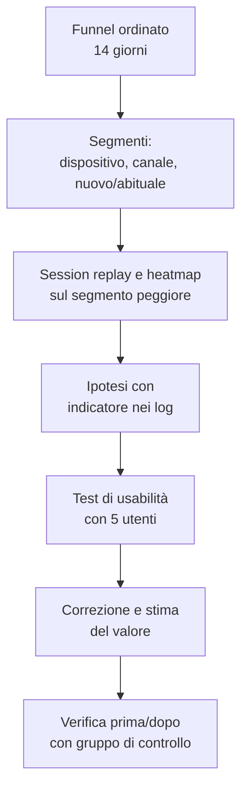

Un portale B2B di forniture industriali perde il 58% dei clienti nel passaggio che segue la conferma dell'indirizzo di spedizione (scenario costruito, numeri di esempio). I log non mostrano errori HTTP, i tempi di caricamento sono normali e la pagina non è cambiata da mesi. Il funnel indica con precisione il punto della perdita, ma non dice che cosa succede nella testa di chi chiude la scheda un secondo dopo. Il product manager ha già una teoria, i costi di spedizione troppo alti, e chiede di confermarla con i dati.

> **Idea chiave:** i dati comportamentali dicono dove guardare e quanto vale il problema, l'osservazione dice perché succede, e solo una nuova misura sugli stessi dati dice se la correzione ha funzionato.

## Gli strumenti e la domanda a cui rispondono

La UX research è l'insieme dei metodi che spiegano come le persone usano un prodotto. Per un product analyst conta una distinzione: alcuni metodi misurano su tutti gli utenti ma non spiegano, altri spiegano su pochi utenti ma non misurano. Il lavoro consiste nel passare dagli uni agli altri in un ordine preciso, senza chiedere a uno strumento quello che non può dare.

| Strumento | Domanda a cui risponde | Copertura | Limite principale |
| :--- | :--- | :--- | :--- |
| Funnel ordinato | In quale passo e per quale segmento si perdono gli utenti? | Tutti gli utenti | Non dice perché |
| Session replay | Che cosa fa sullo schermo chi abbandona? | Campione di sessioni | Facile scegliere le sessioni che confermano la propria tesi |
| Heatmap di clic e scroll | Dove si concentrano attenzione e clic? | Aggregato di sessioni | Mescola dispositivi e schermi diversi se non segmentata |
| Test di usabilità moderato | Che cosa capisce e che cosa si aspetta l'utente? | 5–8 persone | Non stima la frequenza di un problema |
| Sondaggio di uscita | Che motivo dichiara chi abbandona? | Chi risponde, spesso meno del 5% | Risposte razionalizzate e poco rappresentative |
| Esperimento o confronto controllato | La correzione cambia il comportamento? | Tutti gli utenti esposti | Richiede traffico e tempo |

La sequenza che funziona parte dal funnel, scende nei segmenti, passa all'osservazione per formulare ipotesi, torna ai log per misurare l'indicatore di ciascuna ipotesi e chiude con un confronto controllato dopo la correzione.



## La baseline: un funnel ordinato e segmentato

Un funnel conta quanti utenti completano ciascun passo di un percorso, nell'ordine previsto, partendo da una popolazione fissa. Le due parole chiave sono "ordine" e "popolazione fissa", come nella [lezione sui funnel](/course/analisi-prodotto/funnel-analysis/). Se conti semplicemente gli utenti distinti che hanno generato ciascun evento nel periodo, un utente che ha confermato l'indirizzo oggi ma ha visto il carrello la settimana prima, fuori finestra, entra nel secondo passo e non nel primo, e un tasso può superare il 100%.

La query che segue parte dagli utenti che hanno visto il carrello nei 14 giorni di osservazione e, per ciascun passo, considera solo la prima occorrenza dell'evento successiva al passo precedente. Usa lo schema comune: `events(user_id, event_name, event_time, properties)` e `users(user_id, signup_time, channel, country, platform)`.

```sql
-- Funnel ordinato del checkout, 14 giorni, per dispositivo
WITH base AS (
  SELECT e.user_id, u.platform, MIN(e.event_time) AS t_carrello
  FROM events e
  JOIN users u ON u.user_id = e.user_id
  WHERE e.event_name = 'cart_viewed'
    AND e.event_time >= DATE '2026-10-01' AND e.event_time < DATE '2026-10-15'
  GROUP BY e.user_id, u.platform
),
passo2 AS (
  SELECT b.user_id, MIN(e.event_time) AS t_indirizzo
  FROM base b
  JOIN events e ON e.user_id = b.user_id
   AND e.event_name = 'address_confirmed'
   AND e.event_time >= b.t_carrello
  GROUP BY b.user_id
),
passo3 AS (
  SELECT p.user_id, MIN(e.event_time) AS t_spedizione
  FROM passo2 p
  JOIN events e ON e.user_id = p.user_id
   AND e.event_name = 'shipping_selected'
   AND e.event_time >= p.t_indirizzo
  GROUP BY p.user_id
),
passo4 AS (
  SELECT p.user_id
  FROM passo3 p
  JOIN events e ON e.user_id = p.user_id
   AND e.event_name = 'order_placed'
   AND e.event_time >= p.t_spedizione
  GROUP BY p.user_id
)
SELECT
  b.platform,
  COUNT(*)                AS carrello,
  COUNT(p2.user_id)       AS indirizzo,
  COUNT(p3.user_id)       AS spedizione,
  COUNT(p4.user_id)       AS ordine,
  ROUND(100.0 * COUNT(p3.user_id) / NULLIF(COUNT(p2.user_id), 0), 1) AS tasso_indirizzo_spedizione
FROM base b
LEFT JOIN passo2 p2 ON p2.user_id = b.user_id
LEFT JOIN passo3 p3 ON p3.user_id = b.user_id
LEFT JOIN passo4 p4 ON p4.user_id = b.user_id
GROUP BY b.platform;
```

Ogni passo è un sottoinsieme del precedente per costruzione, perché si collega solo agli utenti già presenti nel passo prima. Nessun tasso può superare il 100%. In un'analisi reale va aggiunta una finestra massima di conversione, per esempio 24 ore tra carrello e ordine, altrimenti utenti tornati dopo settimane vengono contati come conversioni dello stesso percorso.

### Esempio svolto: dove sta davvero la perdita

La query restituisce questi conteggi per i 14 giorni di baseline.

| Passo | Totale | Tasso sul passo precedente | Desktop | Mobile |
| :--- | ---: | ---: | ---: | ---: |
| Carrello visto | 4.000 | — | 2.500 | 1.500 |
| Indirizzo confermato | 3.200 | 80,0% | 2.000 | 1.200 |
| Spedizione scelta | 1.344 | 42,0% | 1.040 (52,0%) | 304 (25,3%) |
| Ordine inviato | 1.210 | 90,0% | — | — |

Il passaggio critico perde 3.200 − 1.344 = 1.856 utenti, il 58%. La segmentazione cambia la lettura: su desktop passa il 52,0% (1.040 / 2.000), su mobile il 25,3% (304 / 1.200). Mobile è il 37,5% di chi conferma l'indirizzo ma genera 896 dei 1.856 abbandoni, il 48%. Se il problema fosse il costo di spedizione, come pensa il product manager, dovrebbe colpire allo stesso modo i due dispositivi, perché il prezzo è identico. Un divario di 26,7 punti tra dispositivi indica qualcosa nell'interfaccia mobile.

La decisione a questo punto non è ancora la correzione: è dove indirizzare l'osservazione. Le risorse di ricerca vanno sulle sessioni mobile che abbandonano al passo della spedizione.

## Session replay e heatmap: osservare con un piano di campionamento

Un session replay ricostruisce ciò che l'utente ha visto e fatto: scorrimenti, tocchi, campi compilati, pause. Una heatmap aggrega i clic o la profondità di scorrimento di molte sessioni su una pagina. Strumenti come Hotjar, Microsoft Clarity, FullStory o i replay integrati in PostHog e Amplitude li producono a partire da uno script nel browser o da un SDK nell'app.

Il rischio principale è il campionamento di comodo: guardare le prime sessioni che capitano, o fermarsi quando si trova quella che conferma la propria idea. Il piano corretto si scrive prima di aprire lo strumento: popolazione (sessioni mobile che arrivano alla scelta della spedizione e non proseguono), numero (30 sessioni estratte a caso), griglia di osservazione (che cosa annotare per ogni sessione) e criterio di conteggio. La griglia per questo caso contiene: ha visto la tabella dei costi? ha scorso fino alle opzioni di spedizione? ha toccato il pulsante Continua quando era disattivato? ha cambiato pagina per cercare informazioni? quanto tempo è rimasto sulla pagina?

Due vincoli valgono sempre. I replay vanno configurati con il mascheramento dei campi di input e dei dati personali, perché registrano ciò che l'utente digita e ricadono nel GDPR. Le heatmap vanno segmentate per dispositivo e larghezza dello schermo, perché una heatmap che somma desktop e mobile mette sullo stesso punto elementi che si trovano in posizioni diverse.

### Dall'osservazione a un indicatore misurabile

Su 30 sessioni mobile estratte a caso, 19 (63%) mostrano lo stesso schema: l'utente vede la tabella dei costi di spedizione, che occupa tutto lo schermo, tocca più volte il pulsante Continua, che è disattivato perché nessuna opzione è selezionata, e abbandona. Le opzioni selezionabili si trovano sotto la tabella, fuori dallo schermo. Altre 7 sessioni (23%) mostrano un abbandono dopo aver letto i costi, coerente con l'ipotesi del prezzo, e 4 non sono classificabili.

Trenta sessioni sono poche per stimare una quota, ma bastano per trovare un indicatore da misurare su tutti. Il tocco su un pulsante disattivato è un "dead click", un clic senza effetto, e si può tracciare con un evento `dead_click` con la proprietà `element = 'continue_shipping'`. Misurato su tutti gli abbandoni del passo, l'indicatore compare in 540 dei 896 abbandoni mobile, il 60,3%, e in 96 dei 960 abbandoni desktop, il 10,0%. Il dato conferma l'osservazione sulla popolazione intera e spiega la maggior parte del divario tra dispositivi.

## Quattro ipotesi e come distinguerle

Davanti a un abbandono, le cause possibili si raggruppano in quattro famiglie. Scriverle tutte prima di decidere evita di innamorarsi della prima.

| Ipotesi | Che cosa succede | Indicatore nei log | Verifica qualitativa |
| :--- | :--- | :--- | :--- |
| Usabilità | L'utente non trova o non riesce a usare il controllo | Dead click, molte interazioni senza avanzamento | Test di usabilità sul compito |
| Aspettativa | Il costo o i tempi sono diversi da quanto atteso | Abbandono subito dopo la visualizzazione del prezzo, uguale su tutti i dispositivi | Domanda di uscita, intervista |
| Comprensione | Le opzioni non sono chiare | Lunga permanenza, apertura delle FAQ, cambi ripetuti di opzione | Pensiero ad alta voce durante il test |
| Fiducia | L'utente teme costi nascosti o errori | Visita a pagine su resi, termini, contatti | Intervista su episodi recenti |

Nel caso del portale, l'usabilità ha l'indicatore più forte e specifico di mobile. L'aspettativa esiste ma è minoritaria e trasversale ai dispositivi. Il passo successivo è confermare l'ipotesi di usabilità con persone reali.

## Test di usabilità: quanti utenti servono

Un test di usabilità moderato chiede a poche persone del profilo giusto di svolgere un compito, "ordina 20 confezioni di guanti con consegna entro tre giorni", mentre pensano ad alta voce, senza aiuti. Jakob Nielsen e Tom Landauer hanno modellato la quota di problemi trovati con n utenti come 1 − (1 − L)^n, dove L è la quota di problemi scoperta da un singolo utente; nei progetti analizzati da Nielsen L vale in media il 31%, e con 5 utenti si trova circa l'85% dei problemi ([Nielsen Norman Group, 2000](https://www.nngroup.com/articles/why-you-only-need-to-test-with-5-users/)).

La stessa formula letta per un singolo problema è più utile all'analista: se un problema colpisce una quota p degli utenti, la probabilità di osservarlo almeno una volta con n partecipanti è 1 − (1 − p)^n.

Con 5 partecipanti, un problema che colpisce il 60% degli utenti si osserva con probabilità 1 − 0,4^5 = 1 − 0,010 = 99,0%. Se colpisce il 31%, la probabilità è 1 − 0,69^5 = 1 − 0,156 = 84,4%. Se colpisce il 10%, scende a 1 − 0,9^5 = 1 − 0,590 = 41,0%: più di metà dei test da cinque persone non lo vedrebbe affatto.

Cinque utenti bastano per i problemi frequenti, non per quelli rari. Per questo Nielsen raccomanda più test piccoli e iterativi invece di uno grande, e per questo un test con 5 persone non dice nulla sulla frequenza: se 4 su 5 inciampano nello stesso punto, la conclusione corretta è "il problema esiste ed è probabilmente frequente", non "colpisce l'80% degli utenti". La frequenza si misura sui log.

Nel test del portale, 4 partecipanti su 5 su smartphone non trovano le opzioni di spedizione entro 30 secondi e toccano Continua aspettandosi che la pagina avanzi. Il quinto scorre per abitudine. Due commentano che il prezzo è alto, ma completano comunque il compito. Le tre fonti, replay, indicatore sui log e test, puntano sulla stessa causa.

## Quanto vale la correzione

La correzione proposta sposta le opzioni di spedizione sopra la tabella dei costi su mobile e seleziona di default l'opzione standard. Prima di chiedere priorità al team, l'analista stima il valore con scenari espliciti invece di un singolo numero.

Ipotesi di partenza: 1.200 utenti mobile confermano l'indirizzo ogni 14 giorni; dopo la scelta della spedizione il 90% invia l'ordine; il valore medio dell'ordine è di 450 € e il margine di contribuzione del 20%. Il tasso mobile attuale è 25,3% e quello desktop 52,0%: lo scenario base assume che mobile recuperi circa metà del divario e arrivi al 40%.

Calcolo dello scenario base: ordini aggiuntivi ogni 14 giorni = 1.200 × (0,40 − 0,253) × 0,90 = 158,4. Ricavo aggiuntivo = 158,4 × 450 = 71.280 € ogni 14 giorni. Su 26 periodi l'anno sono 1.853.280 € di ricavo e, con il 20% di margine, circa 370.700 € di contribuzione annua.

```python
# Valore annuo della correzione su mobile in tre scenari
utenti_mobile_14g = 1200
tasso_attuale = 304 / 1200          # 25,3%
tasso_ordine = 0.90                 # dalla spedizione all'ordine
valore_ordine = 450                 # euro
margine = 0.20
periodi_anno = 26

for nome, tasso_nuovo in [("prudente", 0.33), ("base", 0.40), ("ottimista", 0.47)]:
    ordini_extra = utenti_mobile_14g * (tasso_nuovo - tasso_attuale) * tasso_ordine
    ricavo_anno = ordini_extra * valore_ordine * periodi_anno
    print(f"{nome:9s} ordini/14g {ordini_extra:6.1f}  ricavo/anno {ricavo_anno:12,.0f}  "
          f"margine/anno {ricavo_anno * margine:10,.0f}")
# prudente  ordini/14g   82.8  ricavo/anno      968,760  margine/anno    193,752
# base      ordini/14g  158.4  ricavo/anno    1,853,280  margine/anno    370,656
# ottimista ordini/14g  234.0  ricavo/anno    2,737,800  margine/anno    547,560
```

Anche lo scenario prudente, che recupera meno di un terzo del divario, vale quasi 194.000 € di margine l'anno contro qualche giorno di sviluppo. La decisione non dipende dall'esattezza dello scenario: dipende dal fatto che il peggiore resta ampiamente positivo. Questo è il modo corretto di presentare una stima incerta.

## Verificare la correzione sui log

Con traffico sufficiente la verifica migliore è un A/B test su mobile, con la metrica primaria "quota di chi conferma l'indirizzo che sceglie la spedizione" e l'ordine inviato come guardrail. Quando un test non è possibile, per vincoli tecnici o perché il team ha già rilasciato a tutti, si usa un confronto prima e dopo con un gruppo di controllo che non ha ricevuto la modifica: qui il desktop, dove la pagina non è cambiata.

### Esempio svolto: differenza delle differenze

Nei 14 giorni dopo il rilascio, su mobile 513 utenti su 1.250 scelgono la spedizione, il 41,0%; su desktop 1.087 su 2.050, il 53,0%.

La variazione mobile è 41,0% − 25,3% = +15,7 punti. La variazione desktop, che cattura stagionalità e altri cambiamenti comuni ai due dispositivi, è 53,0% − 52,0% = +1,0 punto. L'effetto stimato della correzione è la differenza tra le due variazioni: 15,7 − 1,0 = +14,7 punti.

Il test z per due proporzioni sul solo mobile dà z = 8,2, e l'intervallo di confidenza al 95% della differenza va da +12,0 a +19,4 punti: la variazione non è rumore. La differenza delle differenze resta un confronto osservazionale e si regge su un'ipotesi: senza la correzione, mobile e desktop avrebbero avuto la stessa variazione. Va controllata guardando che i due andamenti fossero paralleli nelle settimane prima del rilascio, e va ripetuta dopo altri 14 giorni per escludere un effetto novità. Il metodo e le sue verifiche sono trattati per esteso nella lezione sull'[inferenza causale osservazionale](/course/analisi-prodotto/inferenza-causale-osservazionale/).

```python
from math import sqrt

def diff_proporzioni(x1, n1, x2, n2, z=1.96):
    p1, p2 = x1 / n1, x2 / n2
    pooled = (x1 + x2) / (n1 + n2)
    z_stat = (p2 - p1) / sqrt(pooled * (1 - pooled) * (1 / n1 + 1 / n2))
    se = sqrt(p1 * (1 - p1) / n1 + p2 * (1 - p2) / n2)
    return p2 - p1, z_stat, (p2 - p1 - z * se, p2 - p1 + z * se)

delta_mobile, z_stat, ic = diff_proporzioni(304, 1200, 513, 1250)
delta_desktop = 1087 / 2050 - 1040 / 2000
print(f"mobile +{delta_mobile:.1%}  z={z_stat:.1f}  IC95% {ic[0]:.1%} / {ic[1]:.1%}")
print(f"desktop +{delta_desktop:.1%}  diff-in-diff +{delta_mobile - delta_desktop:.1%}")
# mobile +15.7%  z=8.2  IC95% 12.0% / 19.4%
# desktop +1.0%  diff-in-diff +14.7%
```

Il risultato effettivo, 41,0%, cade tra lo scenario base e quello ottimista. Il resoconto finale riporta la stima, l'intervallo, l'ipotesi del confronto e il valore annuo ricalcolato sul dato osservato.

## Trappole comuni

### Funnel non ordinato che supera il 100%

Il sintomo è un passo con più utenti del precedente, o tassi che cambiano molto se si sposta di un giorno la finestra. Succede quando si contano gli utenti distinti per evento senza ancorare ciascun passo al precedente. Si evita partendo da una popolazione fissa e collegando ogni passo alla prima occorrenza successiva al passo prima.

### Percentuali ricavate da cinque utenti

Il sintomo è una presentazione con "l'80% degli utenti non trova le opzioni" basata su un test con 5 persone. Succede perché le percentuali sembrano più solide delle osservazioni. Si evita usando il test per dire che il problema esiste e come si manifesta, e i log per dire quanto è frequente.

### Replay scelti a mano

Il sintomo è una serie di clip che confermano esattamente l'ipotesi iniziale del team. Succede quando si guarda finché non si trova ciò che si cerca. Si evita scrivendo prima popolazione, numero di sessioni e griglia, estraendo a caso e riportando anche le sessioni che non confermano.

## Domande per verificare la comprensione

1. Una query di funnel mostra 2.100 utenti al passo "indirizzo confermato" e 2.180 al passo "spedizione scelta". Qual è la causa più probabile e come correggi la query?

<details>
<summary>Mostra risposta</summary>

La query conta gli utenti distinti per evento nel periodo senza ancorare i passi: utenti che hanno confermato l'indirizzo prima dell'inizio della finestra, o che sono entrati nel percorso da un altro punto, compaiono al terzo passo ma non al secondo. Si corregge partendo da una popolazione fissa, chi ha visto il carrello nella finestra, e collegando ogni passo alla prima occorrenza dell'evento successiva al passo precedente, con un `LEFT JOIN` dalla base.

</details>

2. Un problema colpisce il 20% degli utenti. Quanti partecipanti servono in un test di usabilità per avere almeno il 90% di probabilità di osservarlo almeno una volta?

<details>
<summary>Mostra risposta</summary>

Serve 1 − 0,8^n ≥ 0,90, cioè 0,8^n ≤ 0,10. Con n = 10 si ha 0,8^10 = 0,107, quindi probabilità dell'89,3%, non sufficiente; con n = 11 si ha 0,8^11 = 0,086, cioè 91,4%. Servono 11 partecipanti del profilo giusto, oppure due test iterativi da 5–6 persone, il secondo dopo aver corretto i problemi più frequenti trovati nel primo.

</details>

3. Il product manager sostiene che l'abbandono dipende dai costi di spedizione. Quale dato dei log usi per valutare l'ipotesi prima di qualsiasi test?

<details>
<summary>Mostra risposta</summary>

Il confronto tra dispositivi: i costi sono identici su desktop e mobile, quindi un problema di aspettativa sul prezzo dovrebbe produrre tassi simili. Un divario di 26,7 punti tra 52,0% e 25,3% indica una causa specifica di mobile. Il prezzo può contribuire, e le 7 sessioni su 30 che abbandonano dopo aver letto i costi lo suggeriscono, ma non spiega la parte principale della perdita.

</details>

4. Dopo un rilascio su tutti i dispositivi, il tasso mobile passa dal 25% al 38% e quello desktop dal 52% al 60%. Che effetto attribuisci alla correzione e perché qui la differenza delle differenze è meno affidabile?

<details>
<summary>Mostra risposta</summary>

La differenza delle differenze vale (38 − 25) − (60 − 52) = 13 − 8 = 5 punti. È meno affidabile perché la correzione è stata rilasciata anche su desktop, quindi il desktop non è più un gruppo di controllo: la sua variazione di 8 punti mescola l'effetto della correzione con stagionalità e altri cambiamenti. Servirebbe un controllo non esposto, per esempio un paese o una quota di traffico esclusa, oppure un A/B test.

</details>
