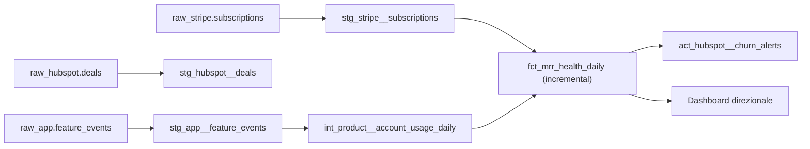

Una scale-up B2B italiana ha tre sorgenti grezze disallineate in ClickHouse: gli abbonamenti da Stripe (`raw_stripe.subscriptions`), le trattative da HubSpot (`raw_hubspot.deals`) e gli eventi di utilizzo prodotto (`raw_app.feature_events`). Questo è uno scenario costruito con numeri di esempio che riunisce le competenze del modulo in un solo progetto.

Fino a ieri i numeri uscivano da query manuali. Gli importi Stripe in centesimi venivano sommati agli euro di HubSpot, i retry dei webhook producevano abbonamenti duplicati e il Customer Success non sapeva quali aziende paganti avessero smesso di usare la piattaforma da 14 giorni. L'obiettivo è costruire il grafo `sources`, `staging`, `intermediate`, `marts` e attivazione, certificato da test e pronto per alimentare dashboard e CRM.

> **Idea chiave:** un mini analytics stack è completo solo se isola la pulizia nello staging, porta gli eventi al grano giusto prima di ogni join, dimostra la quadratura dei totali con un test e consegna sia i KPI sia l'azione operativa.

## Centesimi sommati agli euro e clienti a rischio invisibili

L'azienda ha 2.400 account clienti e vuole unificare finanza, vendite e utilizzo per governare la crescita e prevenire l'abbandono. Le tre tabelle di partenza nascondono le trappole tipiche. `raw_stripe.subscriptions` esprime il canone in centesimi (`mrr_cents = 49900` per 499,00 euro), contiene account di test interni e righe duplicate quando il webhook ritenta la consegna. `raw_hubspot.deals` ha gli importi in euro ma le email con spazi e maiuscole incoerenti.

`raw_app.feature_events` registra 50 milioni di azioni al mese ma non è collegata al canone pagato. Un cliente enterprise da 2.000 euro al mese può non fare login per tre settimane senza che nessun account manager riceva un avviso. Il progetto trasforma le tre sorgenti in un'architettura dbt in quattro passi: pulire, pre-aggregare, unire con un contratto, attivare.

## L'architettura del mini stack

Il grafo ha quattro livelli con compiti separati. Lo staging pulisce ogni sorgente 1:1, l'intermediate porta gli eventi al grano `(account_id, activity_date)`, il mart unisce canone e utilizzo e assegna lo stato di salute, il livello di attivazione prepara le righe per il CRM.



| Modello | Livello | Grano | Materializzazione | Test principali |
|---|---|---|---|---|
| `stg_stripe__subscriptions` | Staging | Una riga per `subscription_id` | `view` | `unique`, `not_null` |
| `int_product__account_usage_daily` | Intermediate | Una riga per account e giorno | `table` | `unique` su coppia |
| `fct_mrr_health_daily` | Mart | Una riga per giorno e account | `incremental` | `unique`, `accepted_values`, quadratura |
| `act_hubspot__churn_alerts` | Attivazione | Una riga per account a rischio | `table` | `unique`, `not_null` |

## Staging: dichiarare le sorgenti e ripulirle

Le tre sorgenti si dichiarano in un file YAML con controllo di freschezza a 6 ore sulla colonna di ingestione. Il controllo segnala quando il caricamento si è fermato prima che qualcuno veda un numero vecchio.

```yaml
# models/staging/_sources.yml
version: 2

sources:
  - name: stripe
    schema: raw_stripe
    loaded_at_field: _ingested_at
    freshness:
      warn_after: {count: 6, period: hour}
      error_after: {count: 12, period: hour}
    tables:
      - name: subscriptions
```

Il modello di staging per Stripe fa quattro cose: deduplica i retry dei webhook tenendo l'ultima versione di ogni `subscription_id`, converte i centesimi in euro, normalizza l'email ed esclude i domini di test interni. Dopo questo modello nessuna colonna in centesimi deve circolare nel progetto.

```sql
-- models/staging/stripe/stg_stripe__subscriptions.sql
-- Deduplica i retry dei webhook, converte centesimi in euro ed esclude i test interni.
SELECT
    subscription_id,
    account_id,
    lower(trim(billing_email)) AS billing_email_clean,
    lower(plan_tier) AS plan_tier,
    lower(status) AS subscription_status,
    toDecimal64(mrr_cents / 100.0, 2) AS mrr_eur,
    toDate(started_at) AS started_date,
    toDateTime(updated_at, 'UTC') AS updated_at_utc
FROM {{ source('stripe', 'subscriptions') }}
WHERE billing_email NOT LIKE '%@nostraazienda.it'
ORDER BY _ingested_at DESC
LIMIT 1 BY subscription_id;
```

## Intermediate: pre-aggregare gli eventi prima del join

Unire direttamente gli abbonamenti, una riga per account, con gli eventi, migliaia di righe per account, e sommare il canone è l'errore di modellazione più distruttivo, noto come fan-out. Un esempio numerico lo rende evidente. Un cliente paga 500 euro al mese e i suoi utenti generano 2.000 eventi: il `LEFT JOIN` ripete la riga dell'abbonamento 2.000 volte, e `sum(mrr_eur)` restituisce 500 × 2.000 = 1.000.000 euro invece di 500 euro, cioè 2.000 volte il valore vero.

La correzione è un modello intermedio che riduce gli eventi al grano `(account_id, activity_date)` prima di ogni join. I 50 milioni di eventi al mese diventano al più una riga per account e giorno, quindi non più di 2.400 × 30 = 72.000 righe al mese.

```sql
-- models/intermediate/product/int_product__account_usage_daily.sql
-- Pre-aggrega gli eventi al grano esatto (account_id, activity_date) per evitare fan-out nei join.
{{ config(materialized='table', order_by='(account_id, activity_date)') }}

SELECT
    account_id,
    toDate(occurred_at_utc) AS activity_date,
    uniqExact(user_id) AS daily_active_users,
    countIf(event_type = 'core_workflow_completed') AS core_workflows_completed,
    max(occurred_at_utc) AS last_event_at_utc
FROM {{ ref('stg_app__feature_events') }}
GROUP BY account_id, activity_date;
```

## Il mart: canone e salute d'uso nella stessa riga

Il mart `fct_mrr_health_daily` ha una riga per giorno e account. Somma il canone degli abbonamenti attivi, legge l'uso degli ultimi 14 giorni dal modello intermedio e assegna uno stato: `CRITICAL_DORMANT` se l'ultimo giorno di attività risale ad almeno 14 giorni fa o manca del tutto, `AT_RISK` se i flussi completati nella finestra sono meno di 5, altrimenti `HEALTHY`.

```sql
-- models/marts/core/fct_mrr_health_daily.sql
-- Una riga per (snapshot_date, account_id). Una riesecuzione nello stesso giorno sostituisce le righe.
{{
    config(
        materialized = 'incremental',
        engine = 'MergeTree()',
        unique_key = '(snapshot_date, account_id)',
        incremental_strategy = 'delete_insert',
        partition_by = 'toYYYYMM(snapshot_date)',
        order_by = '(snapshot_date, health_status, account_id)'
    )
}}

WITH active_subs AS (
    SELECT
        today() AS snapshot_date,
        account_id,
        argMax(billing_email_clean, updated_at_utc) AS billing_email_clean,
        argMax(plan_tier, updated_at_utc) AS plan_tier,
        sum(mrr_eur) AS total_mrr_eur
    FROM {{ ref('stg_stripe__subscriptions') }}
    WHERE subscription_status = 'active'
    GROUP BY account_id
),

usage_14d AS (
    SELECT
        account_id,
        sum(core_workflows_completed) AS workflows_last_14d,
        dateDiff('day', max(activity_date), today()) AS days_since_last_active
    FROM {{ ref('int_product__account_usage_daily') }}
    WHERE activity_date >= today() - 14
    GROUP BY account_id
)

SELECT
    s.snapshot_date,
    s.account_id,
    s.billing_email_clean,
    s.plan_tier,
    s.total_mrr_eur,
    coalesce(u.workflows_last_14d, 0) AS workflows_last_14d,
    coalesce(u.days_since_last_active, 999) AS days_since_last_active,
    multiIf(
        coalesce(u.days_since_last_active, 999) >= 14, 'CRITICAL_DORMANT',
        coalesce(u.workflows_last_14d, 0) < 5, 'AT_RISK',
        'HEALTHY'
    ) AS health_status
FROM active_subs AS s
LEFT JOIN usage_14d AS u
    ON s.account_id = u.account_id
SETTINGS join_use_nulls = 1;
```

In ClickHouse un `LEFT JOIN` senza corrispondenza restituisce per impostazione predefinita il valore di default del tipo e non `NULL`, quindi un account senza eventi avrebbe `days_since_last_active` pari a 0 e finirebbe tra i sani. L'impostazione `join_use_nulls = 1` ripristina il comportamento standard, così `coalesce` assegna 999 e l'account senza attività nella finestra diventa `CRITICAL_DORMANT`.

## Test, quadratura e consegna

Il contratto del mart dichiara chiave, valori ammessi e tipi. A fianco, un test singolare confronta l'MRR totale del mart con la somma di Stripe dopo la deduplicazione: se la differenza supera mezzo centesimo, il test restituisce una riga e `dbt build` si ferma.

```yaml
# models/marts/core/_core__models.yml
version: 2

models:
  - name: fct_mrr_health_daily
    description: "Una riga per giorno e account attivo, con canone e stato di salute d'uso."
    config:
      contract:
        enforced: true
    tests:
      - dbt_utils.unique_combination_of_columns:
          combination_of_columns: [snapshot_date, account_id]
    columns:
      - name: snapshot_date
        data_type: Date
      - name: account_id
        data_type: String
        tests: [not_null]
      - name: billing_email_clean
        data_type: String
      - name: plan_tier
        data_type: String
      - name: total_mrr_eur
        data_type: Decimal(18, 2)
      - name: workflows_last_14d
        data_type: UInt64
      - name: days_since_last_active
        data_type: Int32
      - name: health_status
        data_type: String
        tests:
          - accepted_values:
              values: ['HEALTHY', 'AT_RISK', 'CRITICAL_DORMANT']
```

```sql
-- tests/assert_mrr_matches_stripe.sql
-- Fallisce se l'MRR del mart di oggi differisce da Stripe deduplicato di oltre mezzo centesimo.
WITH mart AS (
    SELECT sum(total_mrr_eur) AS mrr FROM {{ ref('fct_mrr_health_daily') }} WHERE snapshot_date = today()
),
stripe AS (
    SELECT sum(mrr_eur) AS mrr FROM {{ ref('stg_stripe__subscriptions') }} WHERE subscription_status = 'active'
)
SELECT mart.mrr AS mart_mrr, stripe.mrr AS stripe_mrr
FROM mart CROSS JOIN stripe
WHERE abs(mart.mrr - stripe.mrr) > 0.005;
```

```bash
# Controllo di freschezza delle sorgenti, poi build completa del grafo con test
dbt source freshness
dbt build --select +fct_mrr_health_daily+
```

## I conti della dashboard: baseline, esposizione e azione

La query finale della dashboard restituisce, per stato di salute, il numero di account, l'MRR esposto e la quota sul totale.

```sql
-- Query dashboard direzionale: MRR per stato di salute con quota sul totale.
SELECT
    health_status,
    count() AS active_accounts,
    sum(total_mrr_eur) AS mrr_exposed_eur,
    round(sum(total_mrr_eur) * 100.0 / sum(sum(total_mrr_eur)) OVER (), 1) AS share_of_total_mrr_pct,
    round(avg(days_since_last_active), 1) AS avg_days_inactive
FROM analytics_prod.fct_mrr_health_daily
WHERE snapshot_date = today()
GROUP BY health_status
ORDER BY mrr_exposed_eur DESC;
```

Con numeri di esempio, la baseline certificata è di 2.400 account attivi per un MRR di 480.000 euro, con scarto di 0 euro rispetto a Stripe. Senza la deduplicazione dei webhook, se i duplicati valessero il 7% del canone, lo staging mostrerebbe 480.000 × 1,07 = 513.600 euro, cioè 33.600 euro di ricavo inesistente.

La distribuzione è questa: `HEALTHY` pesa 81,5% pari a 391.200 euro, `AT_RISK` pesa 11,0% pari a 52.800 euro e `CRITICAL_DORMANT` pesa 7,5% pari a 36.000 euro su 145 clienti. La somma torna: 391.200 + 52.800 + 36.000 = 480.000 euro e 81,5 + 11,0 + 7,5 = 100%. Il canone medio dei 145 clienti dormienti è 36.000 / 145 = 248,3 euro al mese, contro una media generale di 480.000 / 2.400 = 200 euro. Il valore è più alto di 48,3 euro, quindi il rischio si concentra su clienti più grandi della media, un'informazione che il numero aggregato non mostra.

Come azione, i 145 clienti dormienti passano dal modello `act_hubspot__churn_alerts` al CRM, deduplicati sulla chiave e filtrati per consenso, e aprono un task prioritario per il Customer Success. Ogni consegna alla direzione include anche il rischio residuo, per esempio il 3% dei clienti enterprise che usa un modulo via API non ancora tracciato e che potrebbe risultare dormiente senza esserlo, e il prossimo passo: integrare i log API in `int_product__account_usage_daily` entro lo sprint e misurare il tasso di salvataggio a 30 giorni sui 145 contattati.

## Un solo progetto dbt o più progetti con dbt Mesh

Dopo la messa in produzione per finanza, vendite e prodotto resta una decisione di scala: un repository unico oppure più progetti collegati, la configurazione chiamata dbt Mesh. La regola pratica è restare su un progetto unico finché il team conta meno di 15-20 analytics engineer e i modelli sono meno di 600-800. Un solo grafo, una sola CI e `ref()` diretti tra finanza, prodotto e marketing hanno un valore alto in quelle dimensioni.

Si passa a più progetti, con modelli `access: public` e dipendenze tra progetti, solo quando team autonomi in paesi o business unit diverse hanno cicli di rilascio e permessi sul codice incompatibili. L'errore tipico è spezzare un team di 4 persone in 4 repository, uno per area: ogni colonna aggiunta in `stg_stripe` e consumata dal marketing richiede tre pull request coordinate. Un unico progetto con sottocartelle `marts/finance/`, `marts/marketing/`, `marts/product/` e regole `CODEOWNERS` dà la governance necessaria senza quel costo.

## Tre errori che fanno fallire la verifica finale

Questi tre errori sono quelli che una revisione trova più spesso nel progetto finale. Ciascuno produce un numero plausibile ma sbagliato, che è la condizione peggiore.

### Unire tabelle a grano diverso senza pre-aggregare

Il sintomo è un MRR di milioni di euro per un cliente da 500, come nell'esempio di 1.000.000 euro. Sembra ragionevole perché una sola query risponde alla domanda. Succede perché il join ripete la riga dell'abbonamento per ogni evento. Si corregge con il modello intermedio al grano account-giorno e con il test `unique` sulla chiave del mart.

### Lasciare la conversione dei centesimi fuori dallo staging

Il sintomo è un report che sovrastima i ricavi di 100 volte in alcuni modelli e non in altri. Sembra ragionevole perché la divisione per 100 si può fare dove serve. Succede che qualcuno dimentica di dividere in un modello e il valore sbagliato si propaga. Si corregge con una regola netta: nessuna colonna `_cents` o con timestamp interi esce viva dallo strato di staging.

### Consegnare i modelli senza quadratura, documentazione e prossimo passo

Il sintomo è un lavoro accettato che nessuno sa difendere quando un numero viene contestato. Sembra ragionevole perché i file `.sql` funzionano. Succede che mancano descrizioni di colonna, l'exposure della dashboard, il test che confronta l'MRR con Stripe e la lettura critica con baseline, rischio residuo e azione. Si corregge consegnando la soluzione di business verificata, non solo la tabella.

## Collaudo finale del progetto

La metrica che chiude il modulo è una pipeline `dbt build` verde, con 0 euro di discrepanza tra i marts e Stripe e la tracciabilità completa dal dato grezzo all'azione nel CRM.

1. Il grafo completo compila ed esegue con `dbt build` restituendo zero errori sui test generici e sul test di quadratura?

<details>
<summary>Mostra risposta</summary>

Sì, quando `dbt build --select +fct_mrr_health_daily+` termina senza errori e il test `assert_mrr_matches_stripe` restituisce zero righe. Un test fallito deve interrompere i modelli a valle, compreso quello di attivazione, e non va silenziato con un `warn`.

</details>

2. Un account paga 800 euro al mese e produce 1.500 eventi in un mese. Quanto vale il suo MRR se unisci gli eventi grezzi senza pre-aggregare, e quale modello lo evita?

<details>
<summary>Mostra risposta</summary>

Vale 800 × 1.500 = 1.200.000 euro, cioè 1.500 volte il valore reale. Lo evita `int_product__account_usage_daily`, che riduce gli eventi a una riga per account e giorno prima del join con il canone.

</details>

3. La distribuzione mostra `AT_RISK` al 11,0% di un MRR da 480.000 euro. Quanti euro sono esposti e quale controllo verifichi sulla somma?

<details>
<summary>Mostra risposta</summary>

Sono 480.000 × 0,11 = 52.800 euro. Si verifica che le tre fasce sommino al totale certificato: 391.200 + 52.800 + 36.000 = 480.000 euro, e che le quote sommino al 100%.

</details>

4. Il modello `act_hubspot__churn_alerts` deve rispettare tre condizioni prima di alimentare il CRM. Quali?

<details>
<summary>Mostra risposta</summary>

Deve avere una sola riga per la chiave usata dal CRM, con test `unique` e `not_null`, deve escludere gli account senza consenso privacy e deve calcolare un `payload_hash` per inviare solo le variazioni reali. Un circuit breaker sul volume del delta completa la protezione.

</details>

5. Quando passeresti da un progetto dbt unico a più progetti collegati?

<details>
<summary>Mostra risposta</summary>

Quando il team supera 15-20 analytics engineer e i modelli superano 600-800, e soprattutto quando team autonomi hanno cicli di rilascio e permessi di accesso al codice incompatibili. Con 4 persone resta preferibile un solo progetto con sottocartelle e `CODEOWNERS`.

</details>
