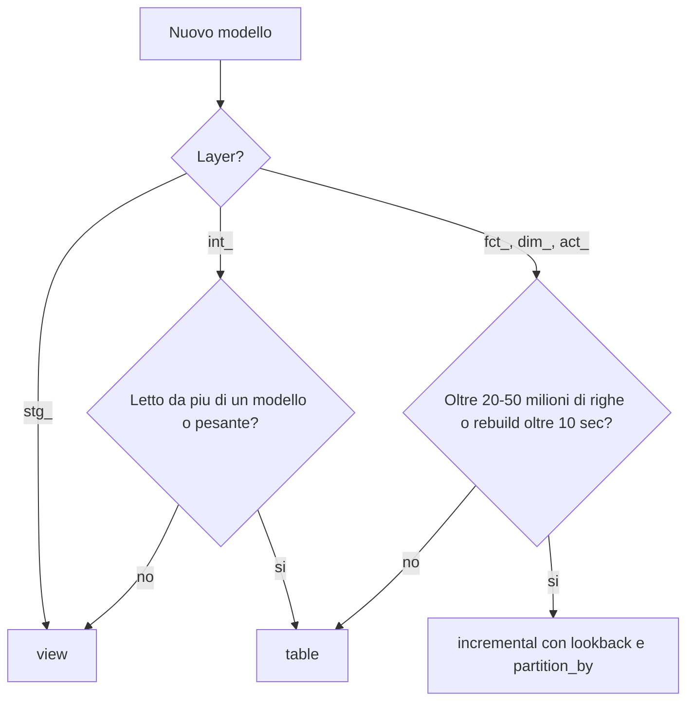

Un progetto dbt cresce in sei mesi da 15 a 220 modelli scritti da cinque persone senza uno standard condiviso (scenario costruito con numeri di esempio). Metà dei file si chiama `clean_orders.sql` o `final_sales_v2.sql`, alcuni marts leggono direttamente le tabelle `raw` e saltano lo staging, i modelli incrementali perdono gli eventi in ritardo. Il run notturno supera le due ore e ogni modifica a una colonna rompe tre dashboard che nessuno sapeva dipendessero da quel modello.

Il progetto non è diventato fragile perché è grande. È diventato fragile perché nessuno ha imposto con costanza le stesse regole di naming, layering, test e rilascio a ogni pull request. Questa scheda le raccoglie in un punto solo, pensato per essere aperto durante lo sviluppo e la revisione del codice.

> **Idea chiave:** un progetto dbt resta governabile anche a 500 modelli solo se ogni pull request rispetta la gerarchia `stg_`, `int_`, `fct_` e `dim_`, protegge le chiavi con `unique` e `not_null`, applica lookback e filtro di sviluppo ai modelli incrementali e supera la Slim CI.

## Duecentoventi modelli senza convenzioni: le tre patologie

Quando un repository dbt cresce senza regole ferree si ripetono sempre gli stessi sintomi. Il primo: dal nome del file è impossibile capire il ruolo di un modello. `users_summary.sql` è uno staging, un intermedio o un mart? Chi lo interroga e qual è la sua chiave primaria? Il secondo: i test vengono aggiunti quando avanza tempo, e un `LEFT JOIN` su una tabella senza `unique` può raddoppiare i ricavi per quattro giorni prima che qualcuno se ne accorga.

Il terzo: i modelli incrementali nascono copiando vecchi snippet senza finestra di lookback e senza filtro per l'ambiente. In sviluppo scansionano tutto lo storico e la CI di ogni pull request sale a 45 min. Le sezioni che seguono mettono a fuoco quattro aree da controllare in ordine: layer e naming, test e contratti, materializzazione e CI.

## Layer e naming: dove vive ogni modello

Ogni modello entra in uno dei tre layer e il suo nome dichiara a quale appartiene. La tabella riassume ruolo, prefisso e vincoli. La regola che pesa di più è l'ultima colonna: `source()` si usa in un solo punto del progetto.

| Layer | Cartella e prefisso | Compito | Materializzazione tipica | Vincolo |
|---|---|---|---|---|
| Staging | `staging/`, `stg_<sorgente>__<entita>` | Rapporto 1:1 con la sorgente: rename, cast, pulizia, deduplicazione tecnica | `view` | Unico layer che chiama `source()` |
| Intermediate | `intermediate/`, `int_<dominio>__<verbo_plurale>` | Unisce più `stg_`, pre-aggrega, porta le tabelle alla stessa granularità | `view` o `ephemeral` se letto da un solo modello, `table` se pesante e letto da almeno 2 modelli | Mai esposto alla BI |
| Marts | `marts/`, `fct_<evento>`, `dim_<entita>`, `act_<tool>__<entita>` | Tabelle finali per dipartimento: finanza, marketing, prodotto, attivazione | `table` o `incremental` con `partition_by` e `order_by` | Solo `ref()` verso gli strati inferiori |

La doppia sottolineatura separa sorgente ed entità nei nomi dello staging, per esempio `stg_stripe__subscriptions`, ed evita ambiguità quando due sistemi hanno una tabella con lo stesso nome. Il prefisso `act_` identifica i modelli costruiti per un destinatario operativo, come il CRM, e rende immediato nel grafo quali nodi producono effetti fuori dal warehouse.

## Test minimi e contratti: la soglia sotto cui non si approva

Ogni modello, senza eccezioni, dichiara nel file YAML i test `unique` e `not_null` sulla propria chiave primaria. Se la chiave è composta si usa `unique_combination_of_columns` del pacchetto `dbt_utils`. Le colonne di stato o tipo hanno `accepted_values`, le chiavi esterne nei marts hanno `relationships` e i marts pubblicati hanno `contract: {enforced: true}`, che blocca la build se tipi o colonne divergono da quanto dichiarato. L'esecuzione avviene sempre con `dbt build`, mai con `dbt run` isolato, perché solo `build` interrompe i modelli a valle quando un test a monte fallisce.

```yaml
# models/marts/finance/_finance__models.yml
version: 2

models:
  - name: fct_invoices
    description: "Una riga per fattura emessa, stornata o rimborsata."
    config:
      contract:
        enforced: true
    columns:
      - name: invoice_id
        data_type: String
        tests:
          - unique
          - not_null
      - name: customer_id
        data_type: String
        tests:
          - relationships:
              to: ref('dim_customers')
              field: customer_id
      - name: invoice_status
        data_type: String
        tests:
          - accepted_values:
              values: ['issued', 'paid', 'refunded']
      - name: gross_amount_eur
        data_type: Decimal(18, 2)
```

La descrizione del modello deve contenere la granularità in una frase. Se non si riesce a scrivere "una riga per ...", il modello mescola grani diversi e prima o poi un join lo trasformerà in una sorgente di totali gonfiati.

## Materializzazione: scegliere in cinque secondi

La scelta dipende da layer, volume e tempo di ricostruzione. Le viste bastano per lo staging e per gli intermedi leggeri letti da un solo figlio. Le tabelle servono per dimensioni, modelli di attivazione, intermedi condivisi da più figli e tabelle dei fatti che contano meno di 20-50 milioni di righe, con un rebuild sotto i 10 sec. L'incremental si riserva a fatti ed eventi oltre quella soglia.



Gli errori simmetrici sono due. Mettere `incremental` ovunque per principio costringe a lanciare `--full-refresh` a mano a ogni cambio di logica anche su tabelle da 50.000 righe. Lasciare come `view` catene di cinque join pesanti, interrogate direttamente da Metabase o Looker, sposta il costo sull'utente finale a ogni apertura del cruscotto. La soglia dei 10 sec di rebuild è un'indicazione da verificare sul proprio motore, ClickHouse o altro.

## Template di un mart incrementale pronto da copiare

Il modello seguente contiene gli elementi che ogni incrementale deve avere: configurazione completa, filtro anticipato con lookback di 3 giorni, limite a 7 giorni per gli ambienti diversi dalla produzione e proiezione esplicita delle colonne, senza `SELECT *`.

```sql
-- models/marts/finance/fct_invoices.sql
-- Template di riferimento per un mart incrementale su ClickHouse.
{{
    config(
        materialized = 'incremental',
        engine = 'MergeTree()',
        unique_key = 'invoice_id',
        incremental_strategy = 'delete_insert',
        partition_by = 'toYYYYMM(invoice_date)',
        order_by = '(country_code, invoice_date, invoice_id)',
        on_schema_change = 'append_new_columns'
    )
}}

WITH invoices_filtered AS (
    -- Early filtering e early projection: solo le colonne necessarie, niente SELECT *.
    SELECT
        invoice_id,
        customer_id,
        country_code,
        invoice_status,
        toDate(issued_at_utc) AS invoice_date,
        net_amount_eur,
        vat_amount_eur
    FROM {{ ref('stg_erp__invoices') }}
    WHERE invoice_status IN ('issued', 'paid', 'refunded')
    
      -- Lookback di 3 giorni per catturare ritardi e cambi di stato.
      AND toDate(issued_at_utc) >= (SELECT max(invoice_date) - 3 FROM {{ this }})
    
    
      -- Dev e CI guardano solo gli ultimi 7 giorni.
      AND toDate(issued_at_utc) >= today() - 7
    
)

SELECT
    i.invoice_id,
    i.customer_id,
    c.company_segment,
    i.country_code,
    i.invoice_status,
    i.invoice_date,
    i.net_amount_eur,
    i.vat_amount_eur,
    i.net_amount_eur + i.vat_amount_eur AS gross_amount_eur
FROM invoices_filtered AS i
LEFT JOIN {{ ref('dim_customers') }} AS c
    ON i.customer_id = c.customer_id;
```

Chiunque apra `fct_invoices.sql` legge nella configurazione la chiave univoca, la partizione mensile e l'ordinamento fisico. Per le query tipiche per paese e intervallo di date, il prefisso `country_code, invoice_date` nella chiave di ordinamento permette a ClickHouse di saltare i blocchi non pertinenti.

## Misurare la conformità: tre indici e una Slim CI

La conformità si misura con tre percentuali calcolate sul progetto. Con numeri di esempio, supponiamo che i 220 modelli siano distribuiti in 120 di staging, 70 intermedi e 30 marts. Gli audit trovano 154 modelli con il nome conforme, 132 con test sulla chiave primaria e 18 marts su 30 con contratto enforced.

Gli indici sono quindi: naming 154 / 220 = 70%, copertura test sulla chiave 132 / 220 = 60%, contratti 18 / 30 = 60%. La media semplice dei tre è (70 + 60 + 60) / 3 = 63,3%, ben lontana dal 100% che si chiede a un repository in buona salute. Il numero più utile è la distanza dall'obiettivo per ogni indice: 66 modelli senza test sulla chiave primaria sono 220 − 132 = 88 modelli, quindi 88 test da scrivere. Con 3 minuti ciascuno, sono 264 min di lavoro, circa 4,4 ore, un debito quantificabile che si può pianificare.

```sql
-- Audit di governance: naming, test sulle chiavi e contratti per layer (tabella di metadati del progetto).
SELECT
    layer,
    count() AS total_models,
    countIf(
        (layer = 'staging' AND model_name LIKE 'stg_%__%')
        OR (layer = 'intermediate' AND model_name LIKE 'int_%__%')
        OR (layer = 'marts' AND (model_name LIKE 'fct_%' OR model_name LIKE 'dim_%' OR model_name LIKE 'act_%'))
    ) AS naming_compliant_models,
    countIf(has_primary_key_tests = 1) AS tested_pk_models,
    countIf(layer = 'marts' AND has_enforced_contract = 1) AS contracted_marts,
    round(max(last_execution_time_sec), 1) AS slowest_model_sec
FROM analytics_meta.dbt_project_governance_audit
GROUP BY layer
ORDER BY layer ASC;
```

La Slim CI riduce il costo della verifica. Se una pull request modifica 6 modelli e i loro discendenti sono altri 14, la build tocca 20 modelli su 220, cioè 20 / 220 = 9,1%. Se la build completa impiega 45 min, la Slim CI impiega circa 45 × 0,091 = 4,1 min, mentre il Data Diff contro la produzione mostra le differenze reali tra i dati del ramo e quelli di `analytics_prod`.

```bash
# Slim CI: costruisce solo i modelli modificati e i discendenti, riusando gli artefatti di produzione
dbt build --select state:modified+ --defer --state ./prod-artifacts

# Elenca i modelli che la Slim CI toccherebbe, senza eseguirli, per stimare il costo della PR
dbt ls --select state:modified+ --state ./prod-artifacts
```

## Violazioni da respingere al primo sguardo in pull request

Tre errori compaiono con più frequenza di tutti gli altri e si individuano leggendo il diff senza eseguire nulla.

### Chiamare source() in un intermedio o in un mart

Il sintomo è un `FROM {{ source('stripe', 'charges') }}` dentro `fct_revenue.sql`. Sembra una scorciatoia innocua, ma se due marts leggono la stessa tabella grezza la deduplicazione tecnica, la conversione dei centesimi in euro e il filtro degli account di test vengono duplicati in due posti e finiscono per divergere. Si corregge spostando la lettura in un modello `stg_` e referenziando quello con `ref()`.

### Consegnare un modello senza unique e not_null sulla chiave

Il sintomo è un file `.sql` nuovo senza voce nel file YAML. Sembra ragionevole perché il risultato a occhio è corretto. Senza un test sul grano, né l'autore né chi modificherà il file tra sei mesi sa se una riga è un ordine, una riga d'ordine o un pagamento, e il primo join impreciso gonfia i totali senza far fallire `dbt build`. Si corregge dichiarando la granularità e i due test prima dell'approvazione.

### Creare tabelle fisiche senza order_by e partition_by

Il sintomo è un modello da decine di milioni di righe creato con una chiave di ordinamento generica o sull'identificativo casuale, e query per intervallo di date che scandiscono tutto. Sembra ragionevole perché la configurazione di default funziona. Rinuncia però a gran parte del vantaggio di ClickHouse sui blocchi saltati. Si corregge dichiarando `partition_by = 'toYYYYMM(data)'` e `order_by = '(dimensione_a_bassa_cardinalità, data, id_univoco)'` in ogni modello fisico dei marts.

## Checklist di pull request dbt

Cinque domande da porsi prima di approvare, ciascuna con la risposta attesa.

1. Il file sta nella cartella giusta, ha il prefisso corretto e usa `source()` solo se è uno staging?

<details>
<summary>Mostra risposta</summary>

Sì, e questo si verifica leggendo il percorso, il nome e la presenza di `source()` nel codice. Un `source()` fuori da `models/staging/` è un motivo sufficiente per respingere la pull request.

</details>

2. Il file YAML contiene descrizione della granularità, `unique` e `not_null` sulla chiave, `accepted_values` sugli stati e contratto enforced se si tratta di un mart?

<details>
<summary>Mostra risposta</summary>

Deve contenere tutti gli elementi. Se manca anche solo la descrizione del grano, il revisore non può sapere cosa il test `unique` stia proteggendo, e un cambio futuro di join può alterare il significato della riga senza che nulla fallisca.

</details>

3. Su una tabella da 220 modelli totali, una PR tocca 8 modelli e 22 discendenti. Quale percentuale del progetto costruisce la Slim CI e quanto tempo stimi se la build completa dura 45 min?

<details>
<summary>Mostra risposta</summary>

I modelli toccati sono 8 + 22 = 30, cioè 30 / 220 = 13,6%. Il tempo stimato è 45 × 0,136 = 6,1 min, a patto che i modelli modificati non siano i più lenti del grafo, caso in cui la stima va corretta con i tempi reali.

</details>

4. Un modello incrementale non ha il filtro `target.name != 'prod'`. Quale effetto produce sulla CI e quale correzione applichi?

<details>
<summary>Mostra risposta</summary>

In dev e CI il modello scansiona l'intero storico invece degli ultimi 7 giorni, e il tempo della pull request cresce senza alcun beneficio. Si aggiunge il blocco condizionale con il limite di 7 giorni e si verifica che la build in CI torni nei tempi attesi.

</details>

La scheda va usata come promemoria operativo e non come sostituto dei test: le percentuali di conformità, e non la sensazione di avere un progetto ordinato, sono quelle che dicono se il repository regge un cambio di colonna tra sei mesi.
