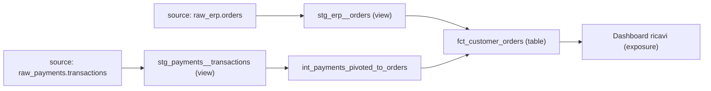

Un e-commerce italiano da dodici milioni di euro di fatturato annuo arriva alla chiusura del trimestre con due numeri diversi per lo stesso ricavo netto: la finanza riporta `3.000.000 €`, il marketing `3.420.000 €`, cioè il `14%` in più (scenario costruito con numeri di esempio). Dentro lo strumento di Business Intelligence vivono sedici viste SQL salvate a mano e quattro procedure schedulate alle tre di notte. Una vista esclude i resi parziali, l'altra no, e una procedura gira prima che arrivino i pagamenti del corriere.

Il database funziona e il linguaggio SQL pure. Quello che manca è un luogo unico in cui la regola di calcolo del ricavo netto sia scritta una volta, versionata, testata e eseguita nell'ordine giusto. Questo luogo è il progetto dbt, e chi lo costruisce e lo mantiene fa l'analytics engineer.

> **Idea chiave:** dbt trasforma ogni query di business in un modello `SELECT` dentro un grafo di dipendenze verificato: la logica vive in un solo posto, l'ordine di esecuzione lo decide il compilatore e nessun numero arriva alla dashboard senza aver superato i test sulla propria chiave.

## Due fatturati nello stesso consiglio: dove nasce la divergenza

I data engineer caricano nel warehouse le tabelle grezze dell'ERP, del sito e del gateway di pagamento. Gli analisti, pressati dalle richieste del giorno, scrivono query da trecento righe direttamente nei cruscotti e copiano da un report all'altro il calcolo di sconti e IVA. Dopo diciotto mesi il margine operativo è calcolato in otto query diverse.

Quando il gestionale cambia il codice degli ordini annullati da `CANC` a `VOID`, un analista aggiorna tre cruscotti e ne dimentica cinque. Per due settimane il direttore commerciale vede un fatturato gonfiato di `86.000 €`, finché un controllo incrociato con la contabilità fa emergere l'errore. In parallelo, le tabelle derivate vengono ricalcolate da script `cron` alle `03:00` e alle `03:15` senza sapere se l'estrazione dell'ERP è finita: un ritardo di venti minuti e la tabella dei ricavi gira sui dati del giorno prima.

Nessuno di questi guasti dipende dall'abilità con l'SQL. Dipendono dal fatto che le trasformazioni di produzione stanno fuori dal controllo di versione, senza separazione a strati e senza un compilatore che ricavi l'ordine di esecuzione dalle dipendenze reali tra tabelle. Per capire come dbt colma il vuoto serve prima chiarire chi fa cosa.

## Il ruolo dell'analytics engineer tra ingestione e decisione

L'analytics engineer occupa lo spazio tra chi sposta i dati e chi li interpreta. Non gestisce i connettori di ingestione e non produce l'analisi finale: possiede il codice che trasforma il dato grezzo in tabelle affidabili, con nomi, tipi, granularità e test dichiarati. La divisione di responsabilità si legge meglio in una tabella.

| Ruolo | Possiede | Strumenti tipici | Metrica di successo |
|---|---|---|---|
| Data engineer | Ingestione, orchestrazione, infrastruttura del warehouse | Connettori EL, Airflow, Terraform | Freschezza e completezza del dato grezzo |
| Analytics engineer | Trasformazioni SQL versionate, test, documentazione, modelli di dominio | dbt, Git, CI | Copertura dei test sui marts e assenza di logica duplicata |
| Analista di business | Domande, analisi, storytelling sui numeri | BI, notebook | Decisioni prese su numeri condivisi |

Il confine non è rigido. In un team piccolo la stessa persona può coprire due righe della tabella, ma le responsabilità restano distinte: chi sposta il dato non decide cosa significhi un ordine valido, e chi costruisce il grafico non dovrebbe ridefinirlo ogni volta. Quando manca la riga centrale, i data engineer passano parte del tempo a riscrivere query di business che non conoscono a fondo, e gli analisti dedicano la maggior parte della giornata a pulire `NULL` e deduplicare log invece di studiare i clienti.

## Il grafo delle dipendenze: source(), ref() e compilazione

In dbt un modello è un file `.sql` che contiene una sola istruzione `SELECT`, senza `CREATE TABLE` o `INSERT` scritti a mano. Il framework decide se materializzarlo come vista o come tabella, e in quale schema. Il collante tra i modelli sono due funzioni Jinja: `source()` per leggere una tabella grezza dichiarata nel file YAML delle sorgenti e `ref()` per leggere un altro modello del progetto.

Quando un modello richiama `{{ ref('stg_orders') }}`, dbt registra la dipendenza, sostituisce la chiamata con il nome fisico di schema e tabella dell'ambiente corrente e costruisce il grafo aciclico diretto (DAG) dell'intero progetto. Nessun modello parte finché i suoi genitori non hanno terminato e superato i test. Lo stesso codice gira in uno schema personale di sviluppo, in uno schema di collaudo e in produzione senza modificare una riga.



Il diagramma mostra due sorgenti, due modelli di staging, un intermedio e un fatto finale. Se `raw_payments.transactions` arriva in ritardo, `dbt build` non esegue `fct_customer_orders` sui dati del giorno prima: attende, oppure si ferma e segnala. Il guasto delle tre di notte non può ripetersi, perché l'ordine non dipende più dall'orologio ma dal grafo.

La terza leva è il contratto di qualità nel file YAML. Ogni modello dichiara `unique`, `not_null`, `accepted_values`, `relationships`, e dbt traduce ciascuna dichiarazione in una query che deve restituire zero righe. Se ne restituisce anche una sola, la pipeline si ferma prima di pubblicare il numero errato.

## Tre strati, una granularità dichiarata per ciascuno

La struttura standard di un progetto dbt ha tre strati con compiti separati. Lo strato `staging` ha rapporto 1:1 con le tabelle grezze: rinomina le colonne, converte i tipi, normalizza i codici di stato e scarta i record tecnici di prova, senza join né aggregazioni. Lo strato `intermediate` porta le tabelle alla stessa granularità prima di incrociarle, per esempio riducendo i pagamenti a una riga per ordine. Lo strato `marts` espone fatti e dimensioni pronti per il business, dove ogni metrica è definita una sola volta.

Ogni modello deve dichiarare la propria granularità in una frase del tipo "una riga rappresenta un ordine valido non annullato". Se la frase non si riesce a scrivere, il modello fa troppe cose. Ecco la riscrittura corretta del caso iniziale, con il mapping `CANC`/`VOID` in un solo punto.

```sql
-- models/staging/erp/stg_erp__orders.sql
-- Rapporto 1:1 con raw_erp.orders: solo rename, cast e normalizzazione degli stati.
SELECT
    order_id,
    customer_id,
    toDateTime(order_ts, 'UTC') AS order_at,
    toDecimal64(order_total_eur, 2) AS order_total_eur,
    if(status IN ('CANC', 'VOID'), 'cancelled', lower(status)) AS order_status
FROM {{ source('raw_erp', 'orders') }}
WHERE order_id != '';
```

```sql
-- models/intermediate/finance/int_payments_pivoted_to_orders.sql
-- Porta i pagamenti alla granularità di una riga per order_id PRIMA del join con gli ordini.
SELECT
    order_id,
    countIf(payment_status = 'captured') AS captured_payments_count,
    sumIf(payment_amount_eur, payment_status = 'captured') AS captured_amount_eur
FROM {{ ref('stg_payments__transactions') }}
GROUP BY order_id;
```

```sql
-- models/marts/finance/fct_customer_orders.sql
-- Mart finale: una riga per ordine valido, solo ref() verso gli strati inferiori.
{{ config(materialized='table') }}

SELECT
    o.order_id,
    o.customer_id,
    o.order_at,
    o.order_total_eur,
    coalesce(p.captured_amount_eur, 0) AS captured_amount_eur
FROM {{ ref('stg_erp__orders') }} AS o
LEFT JOIN {{ ref('int_payments_pivoted_to_orders') }} AS p
    ON o.order_id = p.order_id
WHERE o.order_status != 'cancelled';
```

Il contratto sul mart vive nel file YAML accanto ai modelli e dichiara la granularità e i test sulla chiave.

```yaml
# models/marts/finance/_finance__models.yml
version: 2

models:
  - name: fct_customer_orders
    description: "Una riga per ordine valido non annullato."
    columns:
      - name: order_id
        description: "Chiave primaria dell'ordine nell'ERP."
        tests:
          - unique
          - not_null
      - name: customer_id
        tests:
          - not_null
```

Costruire i tre strati fin dal primo modello non aggiunge costo di calcolo, perché `staging` e gli intermedi leggeri sono viste o sotto-query. Ristrutturare invece cinquanta query monolitiche già collegate ai report richiede settimane di migrazione campo per campo.

## Il fan-out contato riga per riga

Il motivo per cui il livello `intermediate` esiste si vede con un esempio numerico. Prendiamo tre ordini e i loro tentativi di pagamento (numeri di esempio).

| order_id | order_total_eur | Tentativi di pagamento | Pagamenti riusciti |
|---|---:|---:|---:|
| A | 100 | 2 (1 rifiutato, 1 riuscito) | 1 |
| B | 60 | 1 | 1 |
| C | 40 | 3 (2 rifiutati, 1 riuscito) | 1 |

Il ricavo corretto è la somma dei tre ordini: `100 + 60 + 40 = 200 €` su `3` ordini. Se però la `SELECT` finale unisce direttamente `orders` con `transactions` e poi somma, la relazione 1:N ripete ogni ordine una volta per tentativo. Il join produce `2 + 1 + 3 = 6` righe invece di `3`. La somma diventa `100 × 2 + 60 × 1 + 40 × 3 = 200 + 60 + 120 = 380 €`, mentre `count(order_id)` restituisce `6` invece di `3`.

Lo scarto è `380 − 200 = 180 €`, cioè `180 / 200 = 90%` di ricavo in eccesso, e il numero di ordini raddoppia. La query non fallisce e nessun errore compare nei log: il totale è semplicemente sbagliato, e lo resta finché qualcuno non lo confronta con la contabilità. Con `int_payments_pivoted_to_orders` i pagamenti diventano `1 + 1 + 1 = 3` righe, una per ordine, e il join restituisce `3` righe con totale `200 €`. Il test `unique` su `order_id` sarebbe bastato a bloccare il caso: con `6` righe e `3` chiavi distinte il test restituisce `3` righe di violazione e `dbt build` si ferma in pochi secondi.

## Materializzazione: table finché costa poco, incremental quando serve

Quando i marts crescono bisogna decidere come dbt li salva fisicamente. La materializzazione `table` ricostruisce l'intera tabella a ogni esecuzione. La materializzazione `incremental` elabora solo le righe nuove o modificate dall'ultima volta, grazie al blocco ``. Le viste restano la scelta naturale per lo staging.

La regola pratica è usare `table` finché il ricalcolo completo costa meno di due o tre minuti e la sorgente conta pochi milioni di righe. Si passa a `incremental` quando la sorgente è un flusso di eventi da decine di milioni di righe e il ricalcolo completo viola i tempi di consegna o gonfia i costi. Un calcolo di ordine di grandezza aiuta: un clickstream che cresce di `20 milioni di righe` al mese, ricostruito ogni ora, rielabora dopo tre anni circa `720 milioni di righe` per produrre `28.000 righe` nuove nella finestra dell'ultima ora, cioè lo `0,004%` del lavoro svolto è davvero utile.

```sql
-- models/marts/web/fct_sessions_daily.sql
-- Incrementale con lookback di 3 giorni per catturare gli eventi in ritardo.
{{
    config(
        materialized = 'incremental',
        incremental_strategy = 'delete_insert',
        unique_key = 'session_id',
        partition_by = 'toYYYYMM(session_date)',
        order_by = '(session_date, session_id)'
    )
}}

SELECT
    session_id,
    toDate(started_at_utc) AS session_date,
    count() AS events_count
FROM {{ ref('stg_web__events') }}

WHERE toDate(started_at_utc) >= (SELECT max(session_date) - 3 FROM {{ this }})

GROUP BY session_id, session_date;
```

L'esecuzione passa sempre dal comando che combina modelli e test.

```bash
# Primo caricamento o cambio di logica: ricostruzione completa del modello incrementale
dbt build --select fct_sessions_daily --full-refresh

# Esecuzioni ordinarie: solo le righe della finestra di lookback, test inclusi
dbt build --select fct_sessions_daily+
```

Scegliere `incremental` troppo presto è un errore speculare a quello opposto. Su una tabella da `50.000 righe` si introduce il rischio di deriva storica quando cambiano le regole di business o arrivano aggiornamenti oltre la finestra di guardia, e si finisce a lanciare comunque `--full-refresh` a mano. Lasciare invece come `table` un registro di clickstream che raddoppia ogni mese brucia budget di calcolo per rielaborare ogni ora anni di storia immutata. I tempi di soglia dipendono dal motore (ClickHouse, Snowflake, BigQuery, DuckDB) e vanno misurati sul proprio warehouse, non copiati.

## Tre errori che portano il caos dentro dbt

Il caso classico è copiare una query monolitica dentro un file dbt senza rispettare gli strati. Il risultato è una `SELECT` con nome tabella cablato, join 1:N prima di aggregare e nessun filtro sugli annullati. Di seguito i tre errori che un revisore deve riconoscere in pull request.

### Cablare i nomi fisici delle tabelle invece di usare source() e ref()

Il sintomo è un modello che funziona nel terminale SQL ma si comporta in modo imprevedibile con `dbt build`. Sembra più rapido scrivere `FROM raw_erp.orders` perché evita di dichiarare il file YAML delle sorgenti. Succede che dbt non vede la dipendenza, la esclude dal grafo, esegue i modelli in un ordine che non la rispetta e impedisce di far girare i test in uno schema isolato, fino a sovrascrivere le tabelle di produzione durante le prove. Si corregge sostituendo ogni nome fisico con `source()` nello staging e `ref()` altrove, e controllando che il grafo mostri l'arco.

### Unire tabelle a granularità diversa nel modello finale

Il sintomo è un totale più alto del vero senza alcun errore visibile, come i `380 €` contro `200 €` dell'esempio. Sembra ragionevole perché risparmia un file intermedio e funziona sui cento ordini controllati a occhio in sviluppo. In produzione la relazione 1:N ripete ogni ordine per tentativo di pagamento. Si corregge portando la tabella figlia alla stessa granularità della tabella padre in un modello `int_` prima del join.

### Rilasciare un modello senza test sulla chiave primaria

Il sintomo è un errore scoperto settimane dopo, quando i conti non tornano con il bilancio. Sembra innocuo perché a sviluppo il risultato è corretto. Succede che il fan-out di un join o un caricamento duplicato della sorgente entra in tabella senza allarme. Si corregge aggiungendo `unique` e `not_null` sulla chiave dichiarata e lasciando che `dbt build` blocchi la pipeline.

## Controllo prima di approvare una pull request dbt

Prima di unire un modello nel ramo principale conviene verificare cinque punti. Il modello usa solo `source()` nello staging e `ref()` altrove, senza schemi scritti in chiaro. I modelli `stg_` si limitano a rinominare e tipizzare una sola sorgente. Prima di ogni `LEFT JOIN` la tabella di destra ha una riga per chiave di join. Il file YAML dichiara la granularità e i test sulla chiave. Se la materializzazione è incremental, il filtro include una finestra di sovrapposizione.

La metrica che distingue un progetto governato da un mucchio di query rinominate è la percentuale di marts coperti da test sulla chiave primaria, che deve essere al `100%`, insieme al numero di riferimenti diretti a tabelle grezze fuori dallo staging, che deve essere esattamente zero.

## Verifica sulle tue query dbt

1. Un ordine da 80 euro ha tre tentativi di pagamento e il modello finale fa `LEFT JOIN` diretto con la tabella delle transazioni prima di `sum(order_total_eur)`. Quanto vale il contributo di quell'ordine al totale e come lo correggi?

<details>
<summary>Mostra risposta</summary>

Il contributo è `80 × 3 = 240 €` invece di `80 €`, perché la riga dell'ordine compare una volta per tentativo. Lo correggi aggregando i pagamenti a una riga per `order_id` in un modello `int_` prima del join e aggiungendo il test `unique` su `order_id` nel mart.

</details>

2. Perché `source()` va usata solo nello strato `staging` e quali problemi evita questa regola?

<details>
<summary>Mostra risposta</summary>

Concentrare `source()` nello staging fa sì che pulizia, cast e deduplicazione tecnica di una sorgente vivano in un solo modello. Se due marts leggono la stessa tabella grezza, la logica viene duplicata e prima o poi diverge, producendo due numeri diversi per lo stesso concetto.

</details>

3. Una tabella di eventi cresce di 20 milioni di righe al mese e oggi ne contiene 240 milioni. Un rebuild orario con `table` quante righe rielabora e quando passeresti a `incremental`?

<details>
<summary>Mostra risposta</summary>

Rielabora tutte le `240 milioni di righe` a ogni esecuzione, per produrre una frazione minima di righe nuove. Il passaggio a `incremental` è giustificato quando il rebuild completo supera i tempi di consegna o il budget di calcolo; con questi volumi va misurato il tempo reale, ma la crescita mensile rende il passaggio quasi certo.

</details>

4. Quale parametro rende sicuro un modello incrementale rispetto agli eventi in ritardo e che cosa succede se lo ometti?

<details>
<summary>Mostra risposta</summary>

La finestra di lookback, per esempio gli ultimi tre giorni ricalcolati a ogni run insieme a una `unique_key` coerente. Senza di essa gli eventi arrivati dopo l'ultimo run restano fuori dalla tabella e il totale resta sotto la realtà finché qualcuno non lancia un `--full-refresh`.

</details>
