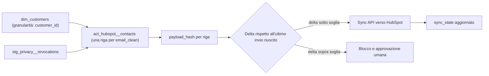

Un'azienda B2B calcola nel warehouse un punteggio di rischio abbandono (`churn_risk_score`) e il valore cliente (`ltv_eur`). Per portarli in HubSpot un connettore di Reverse ETL punta direttamente a una vista non deduplicata sull'email, senza filtro sul consenso marketing e con un ricalcolo completo ogni ora di `500.000` contatti (scenario costruito con numeri di esempio).

Alla prima sincronizzazione il connettore crea `14.000` contatti duplicati, esaurisce in pochi minuti la quota giornaliera di chiamate API bloccando i moduli del sito e manda email promozionali a `3.200` persone che avevano revocato il consenso. Lo strumento di Reverse ETL funziona come previsto. Ha ricevuto una tabella sbagliata.

> **Idea chiave:** il Reverse ETL è sicuro solo se legge da un modello `act_` costruito per quel destinatario: una riga per chiave del tool, consensi filtrati alla fonte, solo le righe con `payload_hash` cambiato e un interruttore che ferma l'invio quando il delta supera una soglia.

## Quattordicimila duplicati e una quota esaurita in pochi minuti

Il Reverse ETL chiude il cerchio dell'architettura dati: invece di lasciare punteggi e segmenti in dashboard che qualcuno deve ricordarsi di aprire, li porta dentro gli strumenti dove lavorano commerciali, customer success e marketing. L'azienda del caso usa ClickHouse e dbt e vuole sincronizzare i risultati verso HubSpot, Salesforce e le Conversion API delle piattaforme pubblicitarie.

L'integrazione improvvisata produce tre incidenti, uno per ogni scorciatoia. Il primo riguarda la chiave: `dim_customers` è unica per `customer_id`, ma la stessa persona può aver aperto due account con la stessa email, mentre HubSpot usa l'email come identificativo del contatto. Inviare entrambe le righe genera errori `409 Conflict` e schede doppie per i commerciali.

Il secondo riguarda il volume. Il job invia a ogni giro tutti i `500.000` profili anche se nell'ultima ora ne sono cambiati `1.200`, e le chiamate `PATCH` saturano il limite del CRM, tanto che i webhook del sito principale iniziano a fallire. Il terzo riguarda il consenso: il modello non controlla il flag marketing e non esclude gli account da cancellare, quindi parte una campagna verso chi si era disiscritto.

Dietro i tre incidenti c'è un'asimmetria di fondo. Un warehouse colonnare regge scansioni enormi e perdona un grafico sbagliato per mezz'ora. Un tool operativo ha invece API lente con quote strette, chiavi naturali rigide come email o partita IVA e, soprattutto, effetti irreversibili: un messaggio inviato non si richiama.

## Perché un tool operativo non è una dashboard

Conviene fissare le differenze prima di scrivere il modello, perché ognuna diventa una regola del livello di attivazione.

| Caratteristica | Dashboard di BI | Tool operativo (CRM, ads, marketing automation) | Conseguenza nel modello |
|---|---|---|---|
| Chiave | Qualsiasi dimensione del grafico | Una chiave naturale rigida (email, `external_id`, partita IVA) | Una sola riga per chiave, con test `unique` |
| Volume di scrittura | Lettura di milioni di righe | Quota API limitata per ora o per giorno | Inviare solo il delta con `payload_hash` |
| Errore | Un numero sbagliato, correggibile | Azione esterna irreversibile | Filtro di consenso e circuit breaker |
| Schema | Colonne a piacere | Proprietà predefinite del tool | Nomi e tipi allineati all'API del destinatario |

Il modello `act_` esiste per assorbire queste quattro differenze in un punto solo. Un connettore di Reverse ETL come Hightouch, Census o uno script custom non deve mai leggere una `fct_` o una `dim_` generica: legge soltanto il modello costruito per il proprio destinatario, e il resto del warehouse resta libero di evolvere senza rompere il CRM.



## Il modello act_: una riga per chiave, consensi alla fonte

Il modello `act_hubspot__contacts` ha per contratto esattamente una riga per `email_clean`, testata con `unique` e `not_null`. Le colonne hanno già i nomi delle proprietà HubSpot, così il connettore non deve fare mapping, e i `NULL` sono sostituiti da valori espliciti per non cancellare campi compilati a mano dai commerciali.

La deduplicazione deve essere deterministica. Quando la stessa email compare su più `customer_id`, il modello tiene il profilo con LTV maggiore e, a parità, il più recente, mentre il valore di LTV esposto è la somma dei profili. Il filtro sul consenso agisce prima di ogni aggregazione: chi non ha il consenso per quella finalità non entra nel modello.

```sql
-- models/marts/activation/act_hubspot__contacts.sql
-- Garantisce: una riga per email_clean, consenso filtrato alla fonte, payload_hash deterministico.
{{
    config(
        materialized = 'table',
        engine = 'MergeTree()',
        order_by = '(email_clean)'
    )
}}

WITH customers_valid AS (
    SELECT
        lower(trim(email)) AS email_clean,
        customer_id,
        company_name,
        plan_tier,
        total_ltv_eur,
        churn_risk_tier,
        updated_at
    FROM {{ ref('dim_customers') }}
    WHERE email != ''
      AND is_gdpr_erased = 0
      AND is_test_account = 0
      AND marketing_consent_granted = 1
),

deduplicated_by_email AS (
    -- Se la stessa email compare su più customer_id, tiene il profilo con LTV maggiore e più recente.
    SELECT
        email_clean,
        argMax(customer_id, (total_ltv_eur, updated_at)) AS primary_customer_id,
        argMax(company_name, (total_ltv_eur, updated_at)) AS hs_company_name,
        argMax(plan_tier, (total_ltv_eur, updated_at)) AS hs_plan_tier,
        sum(total_ltv_eur) AS hs_lifetime_value_eur,
        argMax(churn_risk_tier, (total_ltv_eur, updated_at)) AS hs_churn_risk
    FROM customers_valid
    GROUP BY email_clean
)

SELECT
    email_clean,
    primary_customer_id,
    hs_company_name,
    hs_plan_tier,
    hs_lifetime_value_eur,
    hs_churn_risk,
    -- Impronta del record: cambia solo se almeno un attributo sincronizzato è cambiato.
    hex(MD5(concat(
        toString(primary_customer_id), '|',
        hs_company_name, '|',
        hs_plan_tier, '|',
        toString(hs_lifetime_value_eur), '|',
        hs_churn_risk
    ))) AS payload_hash,
    now() AS dbt_computed_at
FROM deduplicated_by_email;
```

Il contratto sul modello rende esplicito cosa il destinatario può aspettarsi, e il test singolare qui sotto verifica che nessuna email revocata sia mai uscita.

```yaml
# models/marts/activation/_activation__models.yml
version: 2

models:
  - name: act_hubspot__contacts
    description: "Una riga per email_clean con consenso marketing attivo, pronta per l'upsert in HubSpot."
    config:
      contract:
        enforced: true
    columns:
      - name: email_clean
        data_type: String
        tests:
          - unique
          - not_null
      - name: primary_customer_id
        data_type: String
      - name: hs_company_name
        data_type: String
      - name: hs_plan_tier
        data_type: String
      - name: hs_lifetime_value_eur
        data_type: Decimal(18, 2)
      - name: hs_churn_risk
        data_type: String
        tests:
          - accepted_values:
              values: ['LOW', 'MEDIUM', 'HIGH']
      - name: payload_hash
        data_type: String
        tests:
          - not_null
      - name: dbt_computed_at
        data_type: DateTime
```

```sql
-- tests/assert_act_hubspot_contacts_no_revoked_consent.sql
-- Il test fallisce se anche una sola email revocata compare nel modello di attivazione.
SELECT a.email_clean
FROM {{ ref('act_hubspot__contacts') }} AS a
INNER JOIN {{ ref('stg_privacy__revocations') }} AS r
    ON a.email_clean = lower(trim(r.email));
```

## Payload hash: inviare solo il delta, con i numeri della quota

La colonna `payload_hash` è un'impronta di tutti gli attributi che il connettore sincronizza. Il connettore la confronta con quella dell'ultimo invio riuscito, salvata in una tabella `sync_state_hubspot_contacts`, e trasmette solo le righe nuove o con hash diverso. Un contatto che non cambia non genera nessuna chiamata.

Il risparmio si calcola con i numeri del caso (numeri di esempio). La base conta 500.000 contatti, nell'ultima ora ne risultano cambiati 1.200 e la quota del CRM è 250.000 chiamate al giorno. Un invio completo orario produce 500.000 chiamate a ogni giro, cioè 2 volte l'intera quota giornaliera già al primo giro. Un invio del solo delta produce 1.200 chiamate: 1.200 / 500.000 = 0,24% del volume originale, quindi una riduzione del 99,76%.

Su una giornata di 24 giri, e ipotizzando lo stesso delta a ogni giro, le chiamate diventano 1.200 × 24 = 28.800 righe inviate, pari a 28.800 / 250.000 = 11,52% della quota giornaliera. Il margine residuo, 100% − 11,52% = 88,48%, è quello che lascia respirare i webhook del sito e le altre integrazioni. Con una durata di invio di circa 4 sec per giro invece di diversi minuti, il costo operativo scende insieme alla quota.

```sql
-- Estrazione del delta: solo contatti nuovi o con hash cambiato rispetto all'ultimo stato sincronizzato.
SELECT
    cur.email_clean,
    cur.hs_lifetime_value_eur,
    cur.hs_churn_risk,
    cur.payload_hash
FROM analytics_prod.act_hubspot__contacts AS cur
LEFT JOIN analytics_prod.sync_state_hubspot_contacts AS prev
    ON cur.email_clean = prev.email_clean
WHERE prev.email_clean = ''
   OR cur.payload_hash != prev.payload_hash;
```

In ClickHouse il `LEFT JOIN` senza corrispondenza restituisce il valore di default del tipo e non `NULL`, per questo il confronto è con la stringa vuota. È un dettaglio di dialetto che cambia da motore a motore e che un test di integrazione sul modello dovrebbe coprire.

## Il circuit breaker prima della chiamata API

Se un bug a monte fa risultare modificato il 40% della base, per esempio perché `churn_risk_tier` viene ricalcolato male e porta 200.000 contatti a `HIGH`, l'hash cambia per tutti e il delta diventa enorme. Il sistema lo interpreta come un aggiornamento legittimo e parte a scrivere. Il circuit breaker è un controllo di guardia che confronta il volume del delta con una soglia prima di qualsiasi chiamata esterna.

Con i numeri precedenti, una soglia del 10% su 500.000 contatti equivale a 50.000 righe. Il delta normale di 1.200 righe vale 1.200 / 500.000 = 0,24% e passa. Il delta anomalo di 200.000 righe vale 200.000 / 500.000 = 40% e supera la soglia di 40 − 10 = 30 punti percentuali: il job si ferma e attende un'approvazione umana. Il valore della soglia dipende dal destinatario e dalla volatilità normale del dato, e va tarato osservando le prime settimane di sincronizzazione.

```sql
-- Gate di sicurezza da eseguire prima del batch verso HubSpot.
WITH delta AS (
    SELECT cur.email_clean
    FROM analytics_prod.act_hubspot__contacts AS cur
    LEFT JOIN analytics_prod.sync_state_hubspot_contacts AS prev
        ON cur.email_clean = prev.email_clean
    WHERE prev.email_clean = '' OR cur.payload_hash != prev.payload_hash
)
SELECT
    (SELECT count() FROM analytics_prod.act_hubspot__contacts) AS total_contacts,
    count() AS changed_contacts,
    round(changed_contacts * 100.0 / nullIf(total_contacts, 0), 2) AS delta_pct,
    if(delta_pct <= 10.0, 'SAFE_TO_SYNC', 'CIRCUIT_BREAKER_TRIPPED') AS sync_verdict
FROM delta;
```

Nel flusso quotidiano la costruzione e i test del modello precedono il gate, così la sincronizzazione parte solo da un `act_` verde.

```bash
# Costruisce l'activation layer e i suoi antenati, test inclusi: se un test fallisce, il sync non parte
dbt build --select +act_hubspot__contacts

# Esegue solo i test sul modello di attivazione, per esempio dopo una correzione del consenso
dbt test --select act_hubspot__contacts
```

## Warehouse con dbt o streaming diretto: quando scegliere cosa

Un attributo va nel CRM passando dal warehouse oppure da un evento in tempo reale? La risposta dipende da quanto il dato è calcolato e da quanto è urgente. LTV cumulato, punteggio di propensione al churn, segmento RFM, stato di fatturazione dell'ERP e riconciliazione delle identità tra web e negozi richiedono storico profondo, join tra sorgenti e aggregazioni: appartengono ai modelli `act_`, con una latenza di 15-60 minuti che per un commerciale è irrilevante.

Lo streaming diretto, con Kafka o un tag lato server, è adatto ai trigger transazionali basati su un singolo evento atomico, come l'email di reset password, il codice OTP o la conferma d'ordine immediata. L'errore tipico è calcolare il `Lifetime Value` dentro il codice JavaScript del sito o di un tag manager per spedirlo subito al CRM. Il numero che arriva ignora i bonifici registrati nel gestionale e i resi, perché solo il warehouse vede insieme sito, app, CRM e contabilità.

Un caso a parte è il Customer Match pubblicitario, dove le piattaforme richiedono l'email con hash SHA-256 e non in chiaro. In ClickHouse il modello `act_ads__audiences` può calcolare `lower(hex(SHA256(email_clean)))` e far uscire dal warehouse solo l'impronta, riducendo l'esposizione dei dati personali.

## Tre errori nell'implementazione del Reverse ETL

I tre errori seguenti si ripresentano quasi identici in aziende diverse. Ciascuno ha un sintomo riconoscibile in produzione e una correzione che sta interamente nel modello dbt.

### Sincronizzare una tabella non deduplicata sulla chiave del tool

Il sintomo è una scheda cliente che a volte mostra `12.000 €` di LTV e a volte `0 €`, e il connettore che segnala `409 Conflict` a intervalli irregolari. Sembra ragionevole perché `dim_customers` è già unica per `customer_id` e l'email viene scelta come chiave di upsert solo al momento di configurare il connettore. In realtà un vecchio account inattivo e un account nuovo con la stessa email vengono inviati in ordine imprevedibile, e quando arriva per ultimo quello da zero la scheda del cliente di valore si azzera. Si corregge consolidando a una riga per `lower(trim(email))` nel modello `act_` e proteggendo la chiave con `unique`.

### Delegare il consenso ai filtri del CRM

Il sintomo è una campagna partita verso un contatto disiscritto. Sembra ragionevole perché le piattaforme offrono filtri sulle liste e ogni campagna può escludere chi ha revocato. Basta che un nuovo operatore crei una lista senza quel filtro perché parta una comunicazione illecita. Si corregge applicando il filtro nel modello, in modo che chi non ha consenso per quella finalità non esca dal warehouse, oppure viaggi solo come evento esplicito di soppressione.

### Sincronizzare senza una soglia di blocco sul delta

Il sintomo è un'azione esterna di massa che nessuno aveva autorizzato: email inviate, task assegnati ai venditori, budget pubblicitario spostato. Sembra ragionevole perché in una dashboard un numero sbagliato per mezz'ora si corregge con un refresh. Nel Reverse ETL scrivere sul CRM produce effetti irreversibili. Si corregge con il circuit breaker: se il delta supera la soglia, per esempio 50.000 righe oppure il 10% della base, il job si ferma e attende un'approvazione umana, e un alert segnala anche il tasso di righe rifiutate dall'API.

## Controllo prima di attivare un sync in produzione

La metrica che governa il livello di attivazione è il Sync Success Rate, cioè la quota di record accettati dall'API al primo tentativo, che deve restare almeno al 99,9%, insieme a zero errori di chiave duplicata e zero violazioni di quota. Le cinque domande seguenti verificano le condizioni perché quel numero resti vero.

1. Il connettore legge solo da un modello `act_<tool>__<entita>` con contratto `enforced: true`, o può ancora puntare a una `dim_` o `fct_` generica?

<details>
<summary>Mostra risposta</summary>

Deve leggere solo da un modello `act_`. Una `dim_` o `fct_` generica cambia per ragioni che riguardano altri consumatori, e una modifica al grano o alle colonne potrebbe finire in HubSpot senza che nessuno l'abbia deciso. Il contratto `enforced: true` blocca la build se le colonne o i tipi del modello divergono da quanto dichiarato.

</details>

2. Una base di 800.000 contatti ha un delta orario di 2.400 righe e una soglia del 10%. Il job parte o si ferma, e dopo quante righe si fermerebbe?

<details>
<summary>Mostra risposta</summary>

Il delta vale 2.400 / 800.000 = 0,3%, molto sotto il 10%, quindi il job parte. La soglia corrisponde a 800.000 × 10% = 80.000 righe: sopra quel numero il circuit breaker blocca l'invio e richiede approvazione umana.

</details>

3. Un contatto cambia solo il campo `dbt_computed_at` perché il modello viene ricalcolato ogni ora. Perché `dbt_computed_at` non va dentro `payload_hash`?

<details>
<summary>Mostra risposta</summary>

Perché cambierebbe a ogni esecuzione e renderebbe tutte le righe diverse dallo stato precedente, annullando il risparmio del delta e facendo scattare il circuit breaker. L'hash deve coprire solo gli attributi che il destinatario riceve davvero.

</details>

4. Quale dei due canali usi per inviare un codice OTP e quale per un punteggio di propensione al churn, e perché?

<details>
<summary>Mostra risposta</summary>

Il codice OTP passa dallo streaming diretto, perché è un evento atomico che richiede latenza sotto il secondo. Il punteggio di propensione passa dal warehouse con un modello `act_`, perché dipende da storico, join tra sorgenti e aggregazioni che solo il warehouse vede insieme, e una latenza di 15-60 minuti è accettabile.

</details>

5. Un revisore trova un modello `act_` che filtra il consenso solo in una `WHERE` finale, dopo il `GROUP BY` per email. Quale rischio introduce?

<details>
<summary>Mostra risposta</summary>

Se il flag di consenso è aggregato con `max()` dopo il raggruppamento, un account con consenso attivo e uno revocato sulla stessa email produce una riga che appare consentita. Il filtro va applicato prima dell'aggregazione, sulle righe sorgente, in modo che il profilo revocato non contribuisca né all'attributo né all'LTV inviato.

</details>
