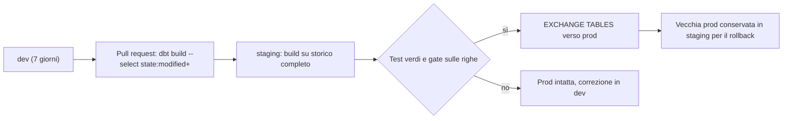

Un venerdì alle 17:30 viene unita una pull request che cambia la formula delle provvigioni nel mart `fct_sales_commissions`. Parte subito `dbt run --full-refresh` in produzione, senza passaggio in un ambiente di collaudo, senza piano di rollback e senza avvisare i commerciali (caso ricostruito con numeri di esempio). La tabella viene cancellata e ricostruita, ma al minuto 24 il job va in timeout per un limite di memoria sui dati del 2022 che in sviluppo, filtrato a sette giorni, non erano mai stati letti.

La tabella di produzione non esiste più. Le dashboard di 80 commerciali restano rotte fino a lunedì alle 09:00, cioè per `63,5` ore, e nessuno sa come tornare indietro.

> **Idea chiave:** in produzione non si distrugge mai la tabella che sta servendo gli utenti prima di aver costruito e testato per intero quella che deve sostituirla: si costruisce accanto e si scambiano i puntatori in un'operazione atomica.

## Venerdì alle 17:30: cosa è andato storto davvero

Il guasto non nasce dalla complessità della query. Nasce da tre scelte di processo che ciascuna sembrava ragionevole. La prima: non esisteva un ambiente di pre-produzione dove l'intero grafo girasse sui volumi completi, e il codice è passato dallo schema locale ridotto direttamente a `analytics_prod`.

La seconda: il `--full-refresh` esegue prima `DROP` o `TRUNCATE` e poi ricostruisce. Per i 25 minuti previsti di ricostruzione le dashboard mostrano `Table does not exist`, e se la query fallisce prima della fine la tabella precedente non c'è più. La terza: nessuno aveva conservato una copia né scritto una nota di rilascio, quindi chi era reperibile non sapeva cosa fosse cambiato né come tornare indietro in trenta secondi.

La disciplina di rilascio che evita questa sequenza poggia su tre elementi: ambienti separati con permessi diversi, promozione con scambio atomico e rollback pronto, e un registro delle dipendenze che dica chi avvisare. Si parte dagli ambienti.

## Tre ambienti, tre livelli di permessi

L'ambiente `dev` è individuale: ogni sviluppatore lavora nel proprio schema `dbt_dev_<nome>` con una finestra dati ridotta, per esempio gli ultimi sette giorni, per iterare in pochi secondi. L'ambiente `staging` compila e testa i modelli sui volumi reali completi, in `analytics_staging` o in schemi temporanei per pull request del tipo `dbt_ci_pr_<id>`. L'ambiente `prod` è `analytics_prod` ed è scritto soltanto dal service account dell'orchestratore, a partire da un tag Git certificato.

| Ambiente | Schema | Volume dati | Chi può scrivere | Scopo |
|---|---|---|---|---|
| dev | `dbt_dev_<nome>` | Ultimi 7 giorni | Lo sviluppatore | Iterazione veloce |
| staging | `analytics_staging`, `dbt_ci_pr_<id>` | Storico completo | CI e orchestratore | Test su volumi reali, durata, memoria |
| prod | `analytics_prod` | Storico completo | Solo `svc_dbt_prod_orchestrator` | Servire dashboard e job |

La separazione si esprime con i target di dbt. Il profilo di ciascun sviluppatore contiene solo `dev`, mentre i target `staging` e `prod` vivono sul server dell'orchestratore con credenziali lette dai segreti. Gli esseri umani hanno su `analytics_prod` il solo permesso `SELECT`, utile per confrontare i risultati con un Data Diff.

```yaml
# profiles.yml sul server di CI/CD: le credenziali arrivano da variabili d'ambiente, mai dal repository
analytics:
  target: staging
  outputs:
    staging:
      type: clickhouse
      host: "{{ env_var('CH_HOST') }}"
      user: svc_dbt_prod_orchestrator
      password: "{{ env_var('CH_PASSWORD') }}"
      schema: analytics_staging
      threads: 4
    prod:
      type: clickhouse
      host: "{{ env_var('CH_HOST') }}"
      user: svc_dbt_prod_orchestrator
      password: "{{ env_var('CH_PASSWORD') }}"
      schema: analytics_prod
      threads: 4
```

Condividere nei `profiles.yml` locali la password dell'utente con permessi `CREATE`, `DROP` e `INSERT` su `analytics_prod` garantisce che prima o poi qualcuno lanci `dbt run --target prod` da un ramo sporco. Un audit su `system.query_log` rivela chi ha scritto in produzione fuori dall'orchestratore.

```sql
-- Audit: scritture su analytics_prod negli ultimi 7 giorni da utenti diversi dall'orchestratore.
SELECT
    event_time,
    initial_user,
    query_kind,
    query
FROM system.query_log
WHERE event_date >= today() - 7
  AND current_database = 'analytics_prod'
  AND query_kind IN ('Create', 'Drop', 'Alter', 'Insert')
  AND initial_user != 'svc_dbt_prod_orchestrator'
ORDER BY event_time DESC;
```

## La promozione dev, staging e prod passo per passo

Una modifica attraversa gli ambienti in ordine. Lo sviluppatore apre la pull request e la CI esegue una build dei soli modelli modificati e dei loro discendenti. Dopo l'approvazione, il job di staging ricostruisce i marts coinvolti sui volumi completi e li testa. Solo a test verdi parte la promozione in produzione.



Per i marts di primo livello, quelli da cui dipendono bilanci e compensi, il nuovo codice resta in `analytics_staging` per un ciclo notturno completo, circa 24 ore, durante il quale si controllano tempi, memoria consumata e quadratura dei KPI. Per modifiche banali la finestra non serve, come si vedrà più avanti.

```bash
# Costruzione dei soli modelli modificati e dei loro discendenti nello schema di collaudo
dbt build --select state:modified+ --defer --state ./prod-artifacts --target staging

# Costruzione completa del mart critico, test inclusi, prima della promozione
dbt build --select fct_sales_commissions --full-refresh --target staging
```

## Blue/Green su ClickHouse con EXCHANGE TABLES

Invece di sovrascrivere sul posto `analytics_prod.fct_sales_commissions`, il job costruisce la nuova versione nella tabella gemella `analytics_staging.fct_sales_commissions`. Quando i test sono verdi si esegue `EXCHANGE TABLES`, che su database con motore `Atomic` scambia in modo atomico i due nomi: è un'operazione sui soli metadati, quindi non copia dati, e gli utenti non vedono mai una tabella mancante o parziale. La vecchia produzione finisce nello schema di staging e resta lì come paracadute.

Prima dello scambio serve un gate che confronti le due tabelle. Con numeri di esempio, supponiamo `1.200.000` righe in produzione e `1.236.000` in staging dopo la modifica: la variazione è (1.236.000 − 1.200.000) / 1.200.000 = 3%, compatibile con la crescita del periodo, e il gate dà via libera. Se invece staging avesse `1.128.000` righe, la variazione sarebbe (1.128.000 − 1.200.000) / 1.200.000 = −6%, sotto la soglia di −5%, e il deploy si fermerebbe per capire dove siano finite 72.000 righe.

```sql
-- Passo 1: gate pre-promozione. Confronta righe di staging e prod e blocca un calo anomalo.
SELECT
    (SELECT count() FROM analytics_staging.fct_sales_commissions) AS staging_rows,
    (SELECT count() FROM analytics_prod.fct_sales_commissions) AS prod_rows,
    round((staging_rows - prod_rows) * 100.0 / nullIf(prod_rows, 0), 2) AS delta_rows_pct,
    if(staging_rows > 0 AND delta_rows_pct >= -5.0, 'READY_FOR_SWAP', 'ABORT_DEPLOY') AS deploy_gate;

-- Passo 2: promozione atomica. La tabella validata diventa prod, la vecchia prod passa in staging.
EXCHANGE TABLES analytics_prod.fct_sales_commissions
            AND analytics_staging.fct_sales_commissions;

-- Passo 3: rollback. Lo stesso comando riporta in prod la versione precedente senza ricalcolare nulla.
EXCHANGE TABLES analytics_prod.fct_sales_commissions
            AND analytics_staging.fct_sales_commissions;
```

Il rollback è lo stesso comando perché lo scambio è simmetrico. Questo vale finché nessuno ricostruisce `analytics_staging.fct_sales_commissions` per un altro rilascio, quindi il job deve conservare la copia precedente fino alla fine della finestra di osservazione e non rilanciare la build di staging prima di averla chiusa.

## I conti del rilascio: indisponibilità con e senza Blue/Green

Il vantaggio dello scambio atomico si misura confrontando le finestre di indisponibilità nello scenario del venerdì (numeri di esempio). La ricostruzione completa dura 25 min in condizioni normali e le dashboard di 80 commerciali leggono la tabella ogni giorno lavorativo.

Con il rilascio non atomico `DROP` più `CREATE ... AS SELECT`, l'indisponibilità è pari alla durata della ricostruzione: 25 min nel caso buono. Nel caso del timeout, la tabella manca fino al ripristino manuale e l'indisponibilità sale da 25 min a 63,5 ore, cioè 63,5 × 60 = 3.810 min, un aumento di 3.810 / 25 = 152,4 volte. Con il rilascio Blue/Green, la build di 15 min sul solo staging non tocca la produzione: l'indisponibilità per gli utenti è 0 sec nel caso buono, e nel caso del timeout resta 0 sec perché la tabella di produzione non è mai stata sfiorata. Il tempo di ripristino dopo un'anomalia segnalata a posteriori passa dalle ore di ricostruzione al tempo di digitare un comando, inferiore a 2 min.

La differenza non è un'ottimizzazione di velocità. Con un rilascio non atomico la durata del guasto dipende dal punto in cui la ricostruzione fallisce, e quel punto non si controlla. Con il Blue/Green l'esito peggiore è una build di staging fallita, che non ha nessun effetto sugli utenti.

## Exposures e release note: chi avvisare prima di cambiare

Un cambio di logica su un KPI esistente ha un secondo rischio, di natura comunicativa. Se la correzione contabile concordata con la finanza modifica i numeri storici e nessuno lo sa, il mercoledì mattina i manager aprono ticket pensando a un guasto. Le `exposures` di dbt dichiarano quali dashboard e processi dipendono da ciascun mart, così prima del rilascio il team sa chi avvisare.

```yaml
# models/marts/sales/_sales__exposures.yml
version: 2

exposures:
  - name: dashboard_provvigioni_rete_vendita
    type: dashboard
    maturity: high
    url: https://bi.example.com/dashboards/provvigioni
    description: "Dashboard consultata ogni giorno dagli 80 commerciali per verificare le provvigioni maturate."
    depends_on:
      - ref('fct_sales_commissions')
    owner:
      name: Team Sales Operations
      email: sales-ops@example.com
```

Alla dichiarazione si affianca una nota di rilascio breve pubblicata nel canale dedicato, scritta con lo stesso schema ogni volta, in modo che chi la legge trovi subito cosa cambia, perché, quanto pesa sui numeri storici e da quando.

> **Release note, `fct_sales_commissions` v2:** dal 2 marzo la provvigione include le note di credito emesse nel mese.
> Impatto: le provvigioni storiche dei 12 mesi precedenti scendono in media del 1,8%.
> Motivo: correzione concordata con la finanza, che già escludeva le note di credito dal fatturato.
> Rollback disponibile per 7 giorni: il responsabile dati può riportare la versione precedente in meno di 2 min.

## Rilascio immediato o finestra di 24 ore: la regola per criticità

Dopo la CI verde conviene mandare subito la modifica in produzione oppure farla maturare 24 ore in staging? Dipende dal danno che l'errore può fare, non dalla dimensione del codice. Si classificano i modelli per criticità, per esempio `tier_1_board` per quelli da cui dipendono bilanci e compensi e `tier_3_internal` per le analisi interne.

La correzione di un refuso nella descrizione di una colonna, l'aggiunta di una colonna non distruttiva o un modello nuovo non ancora collegato a dashboard direzionali possono andare subito in produzione, con swap Blue/Green. La riscrittura della formula di un KPI di primo livello come MRR, margine o provvigioni, oppure del filtro incrementale di una tabella da miliardi di righe, richiede la finestra di 24 ore in `analytics_staging` e, quando i team di BI devono adattarsi, le versioni dei modelli di dbt con `latest_version` e `deprecation_date`, che mantengono online per 30 giorni sia la vecchia sia la nuova tabella. Applicare la stessa burocrazia a un refuso e alla riscrittura delle provvigioni rallenta tutto senza proteggere nulla.

## Tre errori nella gestione dei rilasci

I tre errori sono tra loro collegati e si riconoscono dalle tracce che lasciano. Ciascuno ha una correzione di processo, non di codice SQL.

### Permessi di scrittura sullo schema di produzione agli sviluppatori

Il sintomo è una tabella di produzione modificata fuori da qualsiasi pull request, individuabile nell'audit di `system.query_log`. Sembra ragionevole perché velocizza le correzioni urgenti e tutti sanno cosa stanno facendo. Succede però che un `dbt run --target prod` parta per sbaglio da un ramo di prova. Si corregge lasciando agli umani il solo `SELECT` su `analytics_prod` e assegnando `CREATE`, `ALTER`, `INSERT` ed `EXCHANGE TABLES` al ruolo `svc_dbt_prod_orchestrator`, custodito nei segreti del server di CI.

### Full-refresh in produzione senza costruire prima in staging

Il sintomo è una dashboard con errore di tabella mancante per tutta la durata del rebuild, e nel caso peggiore la tabella distrutta. Sembra ragionevole perché la query funziona in sviluppo sui sette giorni di dati. Succede che sui dati di tre anni compaiono limiti di memoria che il filtro di sviluppo nascondeva. Si corregge costruendo e testando sempre prima in `analytics_staging` e poi scambiando in modo atomico con `analytics_prod`.

### Cambiare una logica di business senza exposures né release note

Il sintomo è una raffica di ticket il giorno dopo il rilascio, dai manager che vedono cambiare i numeri storici. Sembra ragionevole perché la correzione era già stata concordata con un reparto. Succede che gli altri reparti non lo sanno e interpretano il cambio come un bug. Si corregge dichiarando le `exposures` del mart e pubblicando una release note con motivo, impatto percentuale sullo storico e data di entrata in vigore.

## Controllo prima di autorizzare un deploy in produzione

La maturità del processo si misura con due numeri: Deployment Downtime pari a 0 sec grazie allo scambio atomico e Mean Time To Recovery sotto i 2 min grazie al rollback. Le domande seguenti verificano che le condizioni per ottenerli siano soddisfatte.

1. Nessun essere umano ha permessi di scrittura su `analytics_prod`, e come lo verifichi?

<details>
<summary>Mostra risposta</summary>

Si verifica con l'audit su `system.query_log`, filtrando `current_database = 'analytics_prod'`, i tipi di query `Create`, `Drop`, `Alter`, `Insert` e un utente diverso dall'orchestratore. Il risultato atteso è zero righe. In aggiunta si controllano i `GRANT` dei ruoli umani, che devono contenere solo `SELECT`.

</details>

2. Il gate pre-swap trova `1.050.000` righe in staging contro `1.200.000` in prod. Il deploy procede?

<details>
<summary>Mostra risposta</summary>

No. La variazione è (1.050.000 − 1.200.000) / 1.200.000 = −12,5%, sotto la soglia di −5%, quindi il gate restituisce `ABORT_DEPLOY`. Prima di riprovare bisogna capire dove siano finite 150.000 righe, per esempio un filtro troppo stretto o un join che scarta chiavi.

</details>

3. Un rebuild non atomico dura 25 min e il job fallisce al minuto 24. Quale parte del rischio elimina il Blue/Green e quale lascia?

<details>
<summary>Mostra risposta</summary>

Elimina l'indisponibilità per gli utenti e il rischio di perdere la tabella: la build fallisce in staging e la produzione resta intatta. Lascia il costo del tempo di calcolo e la necessità di correggere il problema di memoria prima di ritentare.

</details>

4. Dopo uno `EXCHANGE TABLES` un direttore segnala un'anomalia. Qual è la sequenza di rollback e quale condizione deve essere ancora vera?

<details>
<summary>Mostra risposta</summary>

Si esegue di nuovo lo stesso `EXCHANGE TABLES`, che riporta in produzione la versione precedente, poi si pubblica una nota sull'incidente. La condizione è che `analytics_staging.fct_sales_commissions` contenga ancora la vecchia produzione, cioè che nessun altro job l'abbia ricostruita nel frattempo.

</details>

5. Per quale tipo di modifica salti la finestra di 24 ore e per quale la imponi?

<details>
<summary>Mostra risposta</summary>

La salti per refusi, nuove colonne non distruttive e modelli non ancora collegati a dashboard direzionali. La imponi per modifiche alla formula di KPI di primo livello e per cambi alla logica incrementale di tabelle molto grandi, dove un errore ha un costo economico o contabile alto.

</details>
