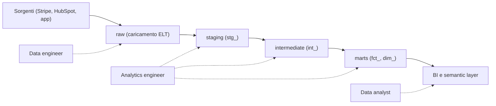

Scenario costruito con numeri di esempio: un'azienda SaaS B2B carica ogni notte Stripe, HubSpot e il database applicativo nel warehouse. Il direttore commerciale porta in consiglio un MRR (fatturato ricorrente mensile) di 410.000 euro, il direttore finanziario uno di 365.000 euro. Entrambi hanno ragione rispetto alla propria query, e nessuno dei due ha codice versionato né test automatici. Questa lezione fa da mappa del modulo: spiega perché i due numeri divergono, quale disciplina evita la divergenza e in che ordine si leggono le lezioni successive.

## Due MRR nello stesso consiglio di amministrazione

I data engineer hanno fatto il loro lavoro: le tabelle grezze arrivano puntuali nello schema `raw_stripe`. Quattro analisti scrivono però ciascuno la propria query da 600 righe dentro la vista del programma di BI, e ognuno risolve a modo suo tre questioni di dominio: come convertire i centesimi di Stripe in euro, quali account di test escludere, come trattare le fatture rimborsate.

Il bilancio di riconciliazione mostra dove nascono i 45.000 euro di scarto. Il commerciale non ha escluso le fatture rimborsate, che valgono 28.000 euro al mese, quindi il suo numero è 28.000 euro sopra il valore corretto. La finanza ha escluso i clienti in prova pagata, per 17.000 euro. Il valore corretto, con rimborsi tolti e prove pagate incluse, si calcola così: 410.000 − 28.000 = 382.000 euro. Il numero della finanza è 382.000 − 17.000 = 365.000 euro. La somma degli errori, 28.000 + 17.000 = 45.000 euro, coincide con la distanza tra le due cifre portate in consiglio.

Nessuno dei due analisti ha sbagliato un calcolo. Hanno applicato due regole di business diverse, nascoste dentro due viste che il resto dell'azienda non può leggere né testare. Questo è il vuoto che l'analytics engineering riempie: la lettera T di ELT (Extract, Load, Transform), cioè la trasformazione, trattata come software.

> **Idea chiave:** una definizione di business scritta una sola volta in un modello versionato e testato elimina i numeri discordanti; la stessa definizione scritta quaranta volte in quaranta report li produce per costruzione.

## I tre layer e la mappa del modulo

Un progetto dbt organizza la logica in tre strati con compiti separati. Lo staging (`stg_<sorgente>__<entita>`) ha rapporto uno a uno con la tabella grezza: rinomina le colonne, converte i tipi, porta i timestamp in UTC, elimina i duplicati tecnici e non fa mai join né aggregazioni. L'intermediate (`int_<dominio>__<verbo>`) unisce più modelli di staging e isola i calcoli complessi, come l'importo netto di una fattura dopo i rimborsi. I marts (`fct_<evento>` e `dim_<entita>`) sono il prodotto finito: tabelle al grano dichiarato, coperte da test, esposte a finanza, marketing e prodotto.



Le lezioni del modulo seguono questo percorso. Per primo viene il ruolo dell'analytics engineer e il ciclo di lavoro di dbt, poi la struttura del progetto con sorgenti e ambienti, lo staging che standardizza i dati di marketing e prodotto e i marts di funnel, retention e attribution. Seguono le materializzazioni, i test e i contratti dati, il lavoro in squadra su Git, la documentazione con lineage e governance, il semantic layer, il deploy con orchestrazione e CI/CD, infine un cheat sheet e un progetto che mette insieme tutti i pezzi.

| Fase del lavoro | Domanda a cui risponde | Dove si legge |
| --- | --- | --- |
| Struttura | Dove vive ogni file e come si isolano gli ambienti | Progetto dbt, fonti e ambienti |
| Standardizzazione | Come si rende uniforme un dato sporco | Staging dei dati martech |
| Modellazione | Quale grano e quali invarianti hanno i marts | Funnel, retention e attribution |
| Costo e freschezza | Cosa si ricalcola e cosa si accumula | Materializzazioni incremental e snapshot |
| Fiducia | Come si prova che un numero è giusto | Test e contratti dati |
| Collaborazione | Come si rilascia senza rompere la notte | Git, code review e CI/CD |

## Il profilo a T e i confini di ruolo

L'analytics engineer ha una competenza a T. L'asse orizzontale tocca due mondi: l'infrastruttura dei dati, con ingestione, motori colonnari e orchestratori, e il business, con funnel di acquisizione, costo di acquisizione, valore del cliente e churn. L'asse verticale è la modellazione in SQL, l'architettura a layer e il ciclo di sviluppo di dbt: trasformare tabelle sorgente sporche e mutevoli in tabelle di dominio pulite, testate e documentate.

Il confine con gli altri due ruoli si traccia sul layer. Il data engineer possiede tutto ciò che porta il dato fino allo schema `raw`: connettori, flussi di cambiamento, storage, sicurezza del cluster, orchestrazione di sistema. L'analytics engineer possiede il tratto da `raw` ai marts certificati e al semantic layer: standardizzazione, modellazione dimensionale, contratti, CI/CD e prestazioni delle query analitiche. Il data analyst lavora sopra i marts: esplora, disegna gli esperimenti A/B, analizza le coorti e porta raccomandazioni ai decisori.

Nelle piccole e medie imprese lo stesso professionista porta spesso più cappelli. Il rischio è chiedere all'analista di fare l'ingegnere del software senza formarlo su Git, test e modellazione dimensionale, oppure chiedere al data engineer di decidere come si calcola il margine di contribuzione delle campagne. Con una o tre persone nel team la separazione resta comunque utile, anche se è solo mentale: sapere in quale layer si sta lavorando decide dove una regola va scritta.

## Tre metriche per misurare la piattaforma

Un team di analytics engineering misura il proprio successo con tre numeri che si leggono dai metadati di dbt e dal log delle query del warehouse. La freschezza è il ritardo massimo tra il momento attuale e l'ultimo caricamento di ciascuna sorgente. La copertura dei test è la quota di marts con almeno un test di unicità e non-nullità sulla chiave primaria. Il tasso di adozione è la quota di query della BI che leggono dallo schema `marts` invece che da `raw`.

Un esempio con numeri costruiti. In una settimana la BI esegue 340 query: 306 leggono da `marts`, 34 da `raw`. Il tasso di adozione è 306 ÷ 340 = 0,90, cioè 90%, e le 34 query residue sono il debito da chiudere. L'inventario dei modelli conta 24 marts, di cui 18 hanno i test sulla chiave primaria: la copertura è 18 ÷ 24 = 75%. Il ritardo di caricamento dichiarato per Stripe è di 4 ore con soglia di errore a 12 ore: la sorgente è fresca. Il piano di lavoro è quindi concreto: scrivere i test per i 6 marts scoperti e spostare le 34 query residue sui marts, con l'obiettivo di arrivare a 100% di adozione e 100% di copertura.

La soglia di freschezza si dichiara in YAML, accanto alla sorgente che descrive, e si controlla con un comando prima di costruire i modelli:

```yaml
# models/staging/stripe/_stripe__sources.yml
version: 2
sources:
  - name: stripe
    schema: raw_stripe
    loaded_at_field: _ingested_at
    freshness:
      warn_after: {count: 6, period: hour}
      error_after: {count: 12, period: hour}
    tables:
      - name: charges
      - name: refunds
```

```bash
# Controlla la freschezza delle sorgenti, poi costruisce i marts finance con i loro test
dbt source freshness
dbt build --select +marts.finance
```

## Errori tipici quando si introduce dbt

### Costruire i marts direttamente sopra le tabelle raw

Il sintomo è un repository con dieci modelli `fct_` che ripetono tutti `amount_cents / 100.0` e la stessa lista di email di test. Sembra veloce, perché si salta un livello. Ricrea invece dentro dbt lo stesso caos che si voleva eliminare: se Stripe cambia un formato o compare un nuovo dominio di test, la correzione va fatta in dieci file. La cura è un unico `stg_stripe__charges` come ingresso autorizzato della tabella.

### Spostare una query monolitica dalla BI a dbt senza scomporla

Una vista da 800 righe incollata in `models/report_finale.sql` passa il controllo formale, ma non cambia nulla. Con quindici CTE annidate nessuno sa quale di esse moltiplica le righe quando il totale è sbagliato, e nessun passaggio intermedio è testabile o riusabile. La cura è scomporre la query in modelli di staging e intermediate, ciascuno con il proprio test sul grano.

### Non togliere alla BI l'accesso a raw

Costruire bei marts lasciando la BI libera di leggere `raw_*` fallisce sul piano dell'adozione: per abitudine gli utenti continuano con le vecchie query. La cura è revocare i permessi di lettura su `raw` e `intermediate` agli utenti di BI, e monitorare ogni settimana il log delle query per verificare che il tasso di adozione resti al 100%.

## Verifica sulla maturità del tuo team

1. In un'azienda i due direttori leggono MRR di 520.000 e 487.000 euro. Sai che uno dei due non ha escluso rimborsi per 21.000 euro e l'altro ha escluso prove pagate per 12.000 euro. Qual è il valore corretto e di quale layer è responsabile ciascuna regola?

<details>
<summary>Mostra risposta</summary>

Se il primo non ha escluso i rimborsi, il valore corretto è 520.000 − 21.000 = 499.000 euro. Il secondo parte dal valore corretto e toglie 12.000 euro di prove pagate: 499.000 − 12.000 = 487.000 euro, che coincide con la sua cifra. Lo scarto totale è 21.000 + 12.000 = 33.000 euro, pari a 520.000 − 487.000. L'esclusione dei rimborsi appartiene all'intermediate che calcola l'importo netto, la regola sulle prove pagate a un attributo dichiarato nello staging o nella dimensione cliente: entrambe vanno scritte una volta sola nel mart `fct_mrr_monthly`.

</details>

2. Quale layer deve contenere la conversione da centesimi a euro e perché non il mart?

<details>
<summary>Mostra risposta</summary>

Lo staging, perché è l'unico layer con rapporto uno a uno con la tabella grezza e perciò l'unico punto in cui una convenzione tecnica della sorgente viene tradotta nel linguaggio aziendale. Se la conversione stesse nei marts andrebbe ripetuta in ognuno e un cambio di formato di Stripe obbligherebbe a toccare molti file.

</details>

3. Il log mostra 500 query di BI in una settimana, di cui 425 su `marts`. Quanto vale il tasso di adozione e quante query restano da migrare per arrivare al 100%?

<details>
<summary>Mostra risposta</summary>

Il tasso è 425 ÷ 500 = 0,85, cioè 85%. Restano 500 − 425 = 75 query da portare sui marts. Finché quelle 75 leggono da `raw`, esistono percorsi non testati attraverso cui possono nascere numeri discordanti.

</details>

4. Hai 30 marts e 21 hanno test di unicità e non-nullità sulla chiave primaria. Che copertura hai e quanti test mancano per arrivare al 100%?

<details>
<summary>Mostra risposta</summary>

La copertura è 21 ÷ 30 = 0,70, cioè 70%. Mancano i test su 30 − 21 = 9 marts. Ogni mart senza test è un punto in cui un duplicato sulla chiave può gonfiare un totale senza che nessuna esecuzione fallisca.

</details>
