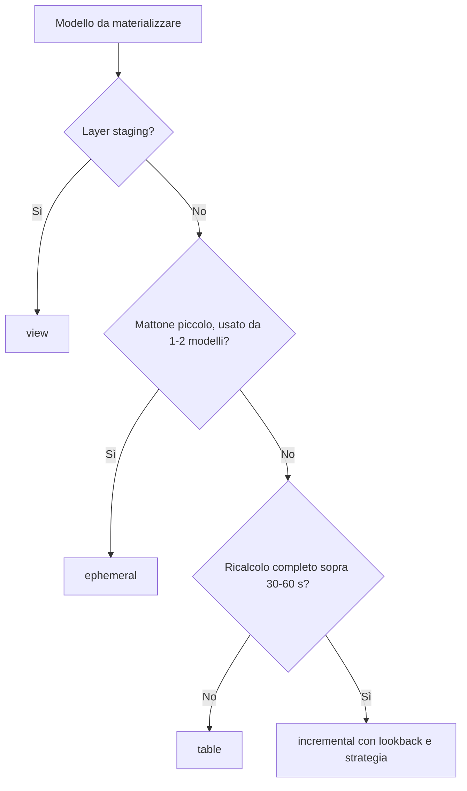

Caso ricostruito con numeri di esempio: un progetto dbt su ClickHouse costruisce la tabella dei fatti `fct_web_events`, 900 milioni di righe e circa cinque anni di storico, con `materialized = 'table'` e un run ogni ora. A ogni esecuzione il warehouse cancella e riscrive tutto, e il run dura 38 minuti. Quando il team passa a `incremental` con un filtro ingenuo sul massimo timestamp, i tempi scendono a pochi secondi, ma il modello perde silenziosamente gli eventi mobile arrivati in ritardo e non aggiorna gli ordini passati da `pending` a `paid`.

## Trentotto minuti per un run orario e gli eventi persi sul confine

Il team ha attraversato due estremi. All'inizio i modelli `stg_`, `int_` e `fct_` erano tutti `view`: le dashboard rieseguivano sette join a cascata a ogni clic, impiegando 25 secondi. Passando `fct_web_events` a `table` le letture sono diventate immediate, ma il costo si è spostato nel run: 38 minuti ogni ora significa che il warehouse passa il 63% del tempo a ricalcolare dati che non cambiano.

Il secondo passaggio è stato `incremental` con la condizione `WHERE occurred_at > (SELECT max(occurred_at) FROM {{ this }})`. Se il run delle 10:00 chiude con massimo `09:59:58`, quello delle 11:00 legge solo eventi con `occurred_at` successivo. Un evento generato su smartphone alle `09:58:30` e consegnato da Kafka alle `10:01:10` ha un timestamp precedente al watermark e non verrà mai ricaricato.

> **Idea chiave:** `incremental` scambia tempo di calcolo con stato da custodire. Il guadagno è reale solo se il confine temporale è protetto da una finestra di lookback e da una strategia che rende la rilettura idempotente.

## Le quattro materializzazioni e quando usarle

La materializzazione decide come l'istruzione `SELECT` di un modello diventa un oggetto fisico nel warehouse. In dbt le scelte di base sono quattro, e conviene attraversarle in ordine di costo di storage e di calcolo.

| Materializzazione | Cosa crea | Costo di build | Costo di lettura | Uso tipico |
| --- | --- | --- | --- | --- |
| `view` | Solo la definizione della query | Nullo | Ricalcolo a ogni lettura | Modelli `stg_` |
| `ephemeral` | Nessun oggetto: una CTE nel modello a valle | Nullo | Dentro la query a valle | Piccoli `int_` usati da uno o due modelli |
| `table` | Tabella ricostruita a ogni run | Proporzionale al dataset | Veloce | Dimensioni `dim_` e fatti medi |
| `incremental` | Tabella aggiornata solo nelle righe selezionate | Proporzionale al nuovo | Veloce | Fatti molto grandi |

Lo staging resta quasi sempre `view`, perché è una proiezione leggera della tabella grezza e non vale la pena duplicare lo storage. Un modello `ephemeral` non lascia traccia nello schema, il che rende più difficile il debug: va riservato a piccoli mattoni. Una `table` si ricostruisce con `CREATE OR REPLACE` ed è la scelta naturale per le dimensioni e per i fatti fino a qualche decina di milioni di righe, che ClickHouse riscrive in pochi secondi.

La scelta di passare a `incremental` si decide con un numero, non con un'impressione: quando il ricalcolo completo supera i 30-60 secondi o il modello arriva a decine di milioni di righe. Sotto quella soglia la complessità aggiunta non compensa. Un modello incrementale accumula stato: se si cambia un `CASE WHEN` storico, le righe già scritte non si aggiornano finché non si lancia `dbt build --full-refresh`.



## Watermark, lookback e idempotenza

Il blocco `` si applica solo ai run successivi al primo: al primo run (o con `--full-refresh`) dbt costruisce l'intera tabella ignorandolo. Dentro il blocco, il filtro non deve partire dal massimo esatto del timestamp, ma tornare indietro di una finestra di sicurezza pari almeno al ritardo massimo delle sorgenti. Tre giorni coprono i batch mobile ritardatari e i cambi di stato recenti, come un ordine creato ieri e pagato oggi.

La rilettura però crea un problema: ogni evento nella finestra viene scritto una seconda volta. L'idempotenza, cioè la proprietà per cui rileggere gli stessi dati non cambia il risultato, richiede una regola che sostituisca le righe già presenti: una `unique_key` con cancellazione e inserimento, la sostituzione di intere partizioni, oppure un motore `ReplacingMergeTree` che deduplica in background.

Un esempio numerico. L'azienda genera circa 480.000 eventi al giorno, cioè 20.000 all'ora, e il 2% arriva con ritardo oltre il watermark. Con il filtro ingenuo si perdono 20.000 × 2% = 400 eventi all'ora, quindi 400 × 24 = 9.600 al giorno e 9.600 × 30 = 288.000 al mese. Con il lookback di tre giorni la finestra riletta vale 3 × 480.000 = 1.440.000 righe, pari a 1.440.000 ÷ 900.000.000 = 0,16% della tabella. Il tempo del run è proporzionale: 38 minuti sono 2.280 secondi e 2.280 × 0,16% = 3,65 secondi, a cui si somma circa mezzo secondo di costo fisso: il run orario scende a circa 4,2 secondi. Nell'arco di un giorno, 24 run da 38 minuti sono 912 minuti, oltre 15 ore di calcolo; 24 run da 4,2 secondi sono 100,8 secondi. Gli eventi persi sono zero.

## Un modello incremental su ClickHouse

Il modello usa `delete_insert` su `unique_key = 'event_id'`, il motore `MergeTree` e la partizione mensile. Su dbt-clickhouse le strategie disponibili includono `append`, `delete_insert` e `insert_overwrite`, e conviene verificare nella documentazione dell'adapter quali siano abilitate nella versione in uso.

```sql
-- models/marts/product/fct_product_events.sql
-- Lookback di 3 giorni con delete_insert su event_id; dev e CI leggono solo 7 giorni
{{
    config(
        materialized = 'incremental',
        engine = 'MergeTree()',
        unique_key = 'event_id',
        incremental_strategy = 'delete_insert',
        partition_by = 'toYYYYMM(occurred_date)',
        order_by = '(tenant_id, occurred_date, event_id)',
        on_schema_change = 'append_new_columns'
    )
}}

SELECT
    event_id,
    tenant_id,
    user_id,
    event_name,
    toDate(occurred_at_utc) AS occurred_date,
    occurred_at_utc,
    revenue_eur
FROM {{ ref('stg_tracking__events') }}
WHERE 1 = 1

  -- Rilegge gli ultimi 3 giorni: assorbe i late-arriving events e i cambi di stato
  AND toDate(occurred_at_utc) >= (SELECT max(occurred_date) - INTERVAL 3 DAY FROM {{ this }})


  -- In sviluppo e CI si elaborano solo gli ultimi 7 giorni
  AND toDate(occurred_at_utc) >= today() - 7

```

Il filtro su `target.name` riduce il costo dello sviluppo: un `--full-refresh` locale che prima scansionava 900 milioni di righe ne legge 7 × 480.000 = 3.360.000, circa lo 0,37% del totale. La guardia protegge anche il budget del warehouse, perché ogni analista che prova una colonna nuova non innesca una scansione di cinque anni.

Per controllare che il modello tocchi solo ciò che serve, la tabella di sistema `system.parts` mostra le partizioni attive e la loro ultima modifica. Dopo un run orario deve risultare cambiata solo la partizione del mese corrente:

```sql
-- Verifica su ClickHouse: dopo un run orario cambia solo la partizione corrente
SELECT
    partition,
    count() AS active_parts,
    sum(rows) AS total_rows,
    round(sum(bytes_on_disk) / 1048576.0, 2) AS disk_size_mb,
    max(modification_time) AS last_modified_at
FROM system.parts
WHERE database = 'analytics_prod'
  AND table = 'fct_product_events'
  AND active = 1
GROUP BY partition
ORDER BY partition DESC
LIMIT 6
```

## Append, delete_insert o insert_overwrite

La strategia dipende da dove cadono gli aggiornamenti. Se si concentrano nelle ultime partizioni temporali, `insert_overwrite` sostituisce intere partizioni fisiche (ultimi giorni con partizione giornaliera) senza frammentare i file. Se singoli record vecchi, sparsi su molti mesi, possono cambiare, come lo stato di un contratto pluriennale, serve `delete_insert` su `unique_key`. L'`append` puro è corretto solo quando si filtra su un identificativo strettamente monotono senza lookback, oppure quando la tabella di destinazione è un `ReplacingMergeTree` che deduplica per conto suo.

Su ClickHouse un punto delicato è il costo di `delete_insert`. La cancellazione viene eseguita come mutazione, e una mutazione riscrive fisicamente i blocchi su disco. Lanciarla ogni cinque minuti su una tabella da miliardi di righe che tocca trenta partizioni accoda lavoro in `system.mutations` e può saturare il server. Per grandi flussi di eventi la scelta più robusta è `insert_overwrite` per partizione, oppure `append` su `ReplacingMergeTree`, riservando `delete_insert` a tabelle di dimensione moderata.

Quando si aggiunge una colonna a un modello incrementale, `on_schema_change` evita che il run fallisca: `append_new_columns` aggiunge la colonna alle righe nuove, `sync_all_columns` allinea anche rimozioni, `fail` interrompe e obbliga a una decisione esplicita. Una pianificazione settimanale di `--full-refresh`, per esempio la domenica notte, ripulisce la deriva di stato quando la logica dipende da dimensioni storiche mutevoli.

## Snapshot per le sorgenti che sovrascrivono

Un modello incrementale non basta quando la sorgente sovrascrive i valori sul posto: se un cliente cambia piano e la tabella applicativa conserva solo l'ultimo, la storia è persa. Lo snapshot di dbt costruisce una tabella a variazione lenta di tipo 2, con `dbt_valid_from` e `dbt_valid_to` per ogni versione della riga.

```sql
-- snapshots/snap_subscriptions.sql
-- Storicizza ogni cambio di piano o stato della sottoscrizione (SCD di tipo 2)

{{
    config(
        target_schema = 'snapshots',
        unique_key = 'subscription_id',
        strategy = 'check',
        check_cols = ['plan_tier', 'status']
    )
}}
SELECT subscription_id, customer_id, plan_tier, status
FROM {{ source('app', 'subscriptions') }}

```

```bash
# Esegue gli snapshot, poi costruisce i modelli incrementali con i loro test
dbt snapshot
dbt build --select fct_product_events
```

Con la strategia `check` dbt confronta le colonne indicate a ogni esecuzione e chiude la riga vecchia quando uno dei valori cambia. Se la sorgente ha un timestamp di ultima modifica affidabile, la strategia `timestamp` è più economica, perché evita di confrontare le colonne.

## Errori tipici nelle materializzazioni

### Filtrare su max(occurred_at) senza lookback

Il sintomo è un conteggio dell'incrementale leggermente più basso di quello di un ricalcolo completo, con differenze che crescono nel tempo. Sembra ragionevole perché presuppone che gli eventi arrivino nell'ordine in cui sono stati generati. Basta un orologio sbagliato di 10 secondi o un batch mobile in ritardo di 3 minuti per lasciare indietro eventi validi. La cura è sottrarre una finestra di sicurezza dal massimo, oppure filtrare sul timestamp di caricamento (`_ingested_at`) abbinato a una deduplicazione su `unique_key`.

### Usare incremental su tabelle che si ricostruiscono in un secondo

Il sintomo è un modello da 500.000 righe, che come `table` si ricostruirebbe in 0,4 secondi, trasformato in incrementale con regole di lookback e di schema. Sembra una ottimizzazione prudente, ma introduce deriva di stato senza alcun beneficio: dopo una modifica alla logica, i vecchi record restano calcolati con la regola precedente. La cura è tornare a `table` e riservare `incremental` ai modelli oltre la soglia dei 30-60 secondi.

### Non limitare l'orizzonte temporale in sviluppo

Il sintomo è un analista che lancia `dbt build --full-refresh` nel proprio schema e aspetta venti minuti per verificare una virgola. Succede perché il modello non distingue gli ambienti e ricalcola cinque anni. La cura è la guardia su `target.name` mostrata sopra: i run di sviluppo e di CI scendono da circa 20 minuti a pochi secondi.

## Verifica sulle materializzazioni

1. Un modello `table` da 120 milioni di righe impiega 20 minuti. Passandolo a incremental con lookback di 2 giorni su 400.000 righe al giorno, quante righe rilegge a ogni run e quale tempo approssimativo ti aspetti?

<details>
<summary>Mostra risposta</summary>

Rilegge 2 × 400.000 = 800.000 righe, pari a 800.000 ÷ 120.000.000 = 0,67% della tabella. Il tempo proporzionale è 1.200 secondi × 0,67% = 8 secondi circa, a cui va aggiunto un costo fisso di avvio. Il passaggio a incremental è giustificato, perché 20 minuti superano di gran lunga la soglia dei 60 secondi.

</details>

2. Un modello `stg_` e un modello da 500.000 righe che si ricostruisce in 0,4 secondi: quale materializzazione scegli per ciascuno?

<details>
<summary>Mostra risposta</summary>

Lo staging resta `view`, perché non conviene duplicare lo storage grezzo. Il modello da 500.000 righe va in `table`: il ricalcolo costa 0,4 secondi, molto sotto la soglia dei 30-60 secondi, e un incrementale aggiungerebbe solo rischio di deriva di stato.

</details>

3. Un ordine creato 5 giorni fa passa da `pending` a `paid` oggi. Il modello ha lookback di 3 giorni e `unique_key = order_id`. Lo stato aggiornato compare nella tabella?

<details>
<summary>Mostra risposta</summary>

No, perché la finestra copre solo gli ultimi 3 giorni e l'ordine ha 5 giorni. La rilettura non lo raggiunge e la riga resta `pending`. Soluzioni: allungare il lookback fino al ritardo massimo di aggiornamento che puoi tollerare, pari ad almeno 5 giorni in questo caso, oppure filtrare sulla data di ultima modifica della sorgente e non su quella di creazione.

</details>

4. Quante righe legge un run di sviluppo con guardia a 7 giorni su 480.000 eventi al giorno, e quale quota rappresenta di 900 milioni?

<details>
<summary>Mostra risposta</summary>

Legge 7 × 480.000 = 3.360.000 righe. La quota è 3.360.000 ÷ 900.000.000 = 0,37%, cioè circa 270 volte meno dati del ricalcolo completo.

</details>
