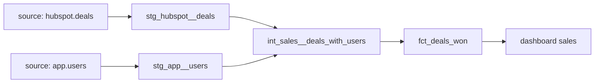

Scenario costruito con numeri di esempio: un team apre un progetto dbt con 80 file `.sql` nella stessa cartella `models/`, e dentro le query scrive `FROM prod_raw.stripe_invoices` e `JOIN analytics.clean_users` invece di usare `source()` e `ref()`. Alla prima esecuzione dbt non riesce a ricostruire le dipendenze e lancia i modelli finali prima di quelli intermedi. Il giorno dopo uno sviluppatore prova un filtro sul proprio branch, lancia `dbt run` dal portatile e svuota la tabella di produzione, perché sviluppo e produzione puntano allo stesso schema.

## Modelli nell'ordine sbagliato e produzione sovrascritta da un portatile

Il progetto trasforma dati di CRM, pagamenti e tracking web su ClickHouse. Nel repository iniziale si sommano tre errori di impostazione, e ciascuno si spiega con la stessa causa: dbt viene usato come un semplice esecutore di file SQL, senza le primitive che lo rendono un compilatore.

Il primo errore sono i nomi di tabella scritti a mano. Dbt scopre quale modello dipende da quale altro solo leggendo le chiamate `{{ ref() }}` e `{{ source() }}`; con nomi statici, per lui gli 80 modelli non hanno legami e li avvia in ordine imprevedibile su 4 thread paralleli. Capita così che `fct_orders` legga `stg_orders` prima che questa abbia finito di caricarsi, e che il report del giorno sia incompleto.

Il secondo errore è un `profiles.yml` in cui il profilo locale degli sviluppatori e il job notturno puntano allo stesso schema `analytics`. Il terzo è l'assenza di un file di sorgenti con controllo di freschezza: dbt ricalcola i modelli anche quando il connettore di ingestione è fermo da due giorni.

> **Idea chiave:** un progetto dbt è un grafo, non una cartella di query. Il grafo nasce solo da `source()` e `ref()`, le regole di layer si scrivono una volta in `dbt_project.yml` e ogni persona lavora nel proprio schema.

## Il grafo delle dipendenze, la gerarchia di cartelle e gli ambienti

Un progetto dbt professionale si regge su tre meccanismi. Il primo è la compilazione del grafo aciclico diretto (DAG, directed acyclic graph) attraverso `source()` per le tabelle grezze e `ref()` per i modelli interni. In dbt un modello è un file `.sql` con una sola istruzione `SELECT`: non si scrive mai `CREATE TABLE` né `INSERT INTO`, perché dbt avvolge la query nel DDL corretto per ClickHouse. Sostituendo i nomi fisici con le due macro si ottengono due vantaggi. Il primo è l'ordine garantito: tutti i genitori vengono completati prima dei figli, e con gli operatori di grafo si selezionano parti del progetto, per esempio `dbt build --select +fct_orders` esegue `fct_orders` e tutti i suoi antenati. Il secondo è la risoluzione dinamica dello schema, `dev_mario.stg_stripe__invoices` sul portatile di Mario e `analytics_prod.stg_stripe__invoices` in produzione, senza cambiare una riga di SQL.

Il secondo meccanismo è la gerarchia di cartelle collegata a `dbt_project.yml`. La directory `models/` si divide in `staging/<sorgente>/`, `intermediate/<dominio>/` e `marts/<dipartimento>/`, e le impostazioni comuni di ogni layer si dichiarano una volta sola a livello di cartella. Il terzo è il controllo di freschezza delle sorgenti nel file `_<sorgente>__sources.yml`, che fa fallire o avvisare prima del run quando i dati a monte sono vecchi.



Un esempio con numeri costruiti mostra il valore del grafo. Quattro modelli hanno tempi di costruzione di 40 secondi (`stg_orders`), 30 secondi (`stg_users`), 50 secondi (`int_orders_enriched`, che dipende da entrambi) e 20 secondi (`fct_orders`, che dipende dall'intermedio). Dbt vede che i due modelli di staging sono indipendenti e li costruisce in parallelo: 40 secondi, il massimo tra i due. Seguono i 50 secondi dell'intermedio e i 20 del fatto, per un totale di 40 + 50 + 20 = 110 secondi. Su un solo thread il tempo sarebbe 40 + 30 + 50 + 20 = 140 secondi: il parallelismo del grafo risparmia 30 secondi, il 21% circa. La differenza cresce con il numero di modelli indipendenti, e solo `ref()` la rende possibile.

## Sorgenti dichiarate con controllo di freschezza

Ogni tabella grezza si dichiara in un file YAML accanto ai modelli di staging che la leggono. Il campo `loaded_at_field` indica la colonna con l'istante di caricamento, e le soglie decidono quando dbt avvisa o fallisce.

```yaml
# models/staging/hubspot/_hubspot__sources.yml
version: 2
sources:
  - name: hubspot
    schema: prod_raw
    loaded_at_field: _ingested_at
    freshness:
      warn_after: {count: 6, period: hour}
      error_after: {count: 12, period: hour}
    tables:
      - name: deals
        description: "Opportunità di vendita caricate dal connettore HubSpot"
```

La regola si legge in due casi numerici. Se l'ultima riga caricata ha `_ingested_at` di 7 ore fa, il ritardo supera le 6 ore e resta sotto le 12: dbt segnala un avviso e prosegue. Se il connettore è fermo da 13 ore, il ritardo supera la soglia di errore e `dbt source freshness` restituisce un esito negativo, che l'orchestratore usa per non costruire i marts su dati vecchi. Il controllo non è un lusso: senza di esso, un connettore bloccato da due giorni produce un mart apparentemente sano e in realtà fermo.

## Configurazione per layer in dbt_project.yml e target isolati

Le impostazioni comuni si scrivono per cartella. In questo modo `{{ config(...) }}` nel singolo file serve solo per proprietà specifiche, come `unique_key` o `order_by` di un modello incrementale.

```yaml
# dbt_project.yml (estratto)
name: martech
profile: martech
models:
  martech:
    staging:
      +materialized: view      # proiezione leggera, nessun costo di storage
    intermediate:
      +materialized: view
    marts:
      +materialized: table
      +engine: "MergeTree()"
```

```yaml
# ~/.dbt/profiles.yml (estratto): un target per ambiente, nessuna password nel file
martech:
  target: dev
  outputs:
    dev:
      type: clickhouse
      host: "{{ env_var('CH_HOST') }}"
      port: 8443
      user: "{{ env_var('CH_USER') }}"
      password: "{{ env_var('CH_PASSWORD') }}"
      schema: "dbt_dev_{{ env_var('DBT_DEV_USER') }}"
      threads: 4
    prod:
      type: clickhouse
      host: "{{ env_var('CH_HOST') }}"
      port: 8443
      user: "{{ env_var('CH_PROD_USER') }}"
      password: "{{ env_var('CH_PROD_PASSWORD') }}"
      schema: analytics_prod
      threads: 8
```

Il target `dev` costruisce nello schema personale (`dbt_dev_mario`), il CI usa uno schema effimero per pull request come `dbt_ci_pr_142`, e solo l'orchestratore possiede le credenziali del target `prod`. Le password vivono in variabili d'ambiente, non nel file.

## Staging con source() e mart con ref()

Lo staging è l'unico punto in cui compare `source()`. Il modello standardizza i tipi, normalizza le stringhe e deduplica i retry tecnici, mantenendo per ogni `deal_id` solo l'ultima riga caricata.

```sql
-- models/staging/hubspot/stg_hubspot__deals.sql
-- Unico modello che legge la sorgente grezza: standardizza i tipi e deduplica per deal_id
SELECT
    deal_id,
    lower(trim(contact_email)) AS contact_email_clean,
    lower(deal_stage) AS deal_stage,
    toDecimal64(amount_eur, 2) AS deal_amount_eur,
    toDateTime(closed_at, 'UTC') AS closed_at_utc
FROM {{ source('hubspot', 'deals') }}
ORDER BY _ingested_at DESC
LIMIT 1 BY deal_id
```

```sql
-- models/marts/sales/fct_deals_won.sql
-- Mart collegato nel DAG solo tramite ref(), con motore e chiave di ordinamento ClickHouse
{{
    config(
        materialized = 'table',
        engine = 'MergeTree()',
        order_by = '(closed_date, deal_id)'
    )
}}
SELECT
    d.deal_id,
    u.user_id,
    u.company_segment,
    toDate(d.closed_at_utc) AS closed_date,
    d.deal_amount_eur
FROM {{ ref('stg_hubspot__deals') }} AS d
INNER JOIN {{ ref('stg_app__users') }} AS u
    ON d.contact_email_clean = u.email_clean
WHERE d.deal_stage = 'closedwon'
```

I comandi che si lanciano dal portatile e dal server di rilascio mostrano il vantaggio degli ambienti separati: lo stesso codice costruisce due schemi diversi.

```bash
# Sviluppo: costruisce fct_deals_won e i suoi antenati nello schema personale
dbt build --select +fct_deals_won --target dev

# Produzione (solo orchestratore): controlla la freschezza, poi costruisce tutto
dbt source freshness --target prod
dbt build --target prod
```

Una query su `system.tables` conferma da ClickHouse che l'esecuzione di Mario ha scritto solo in `dbt_dev_mario` e ha lasciato intatto `analytics_prod`:

```sql
-- Verifica su ClickHouse: dove sono stati costruiti i due modelli
SELECT
    database AS schema_env,
    name AS table_name,
    engine,
    total_rows,
    metadata_modification_time AS last_built_at
FROM system.tables
WHERE database IN ('analytics_prod', 'dbt_dev_mario', 'dbt_ci_pr_142')
  AND name IN ('stg_hubspot__deals', 'fct_deals_won')
ORDER BY database ASC, name ASC
```

## Cartelle per sorgente nello staging e per dominio nei marts

Un dubbio ricorrente riguarda il criterio di raggruppamento delle sottocartelle. La regola è asimmetrica: dentro `staging/` si raggruppa per sistema sorgente (`stripe/`, `hubspot/`, `postgres_erp/`), perché i modelli di una stessa fonte condividono modalità di caricamento, tipi e peculiarità. Dentro `intermediate/` e `marts/` si raggruppa per dominio di business (`finance/`, `marketing/`, `core/`), perché chi consuma un mart ragiona per processi aziendali che uniscono più fonti, non per quale software abbia generato la riga.

Sbagliare la simmetria produce due difetti opposti. Con cartelle per dipartimento dentro `staging/` si finisce per duplicare lo staging della stessa tabella HubSpot, una volta per il marketing e una per le vendite. Con cartelle per sorgente dentro `marts/` la BI deve fare join manuali tra Stripe e il gestionale. La convenzione del doppio underscore (`stg_stripe__payment_intents`) separa senza ambiguità il nome della sorgente da quello dell'entità, anche quando l'entità contiene già un underscore, e permette agli script di governance di leggere i nomi in modo meccanico.

Una convenzione dei nomi si misura. Se in un progetto di 80 modelli 76 rispettano i prefissi `stg_`, `int_`, `fct_` e `dim_`, la conformità è 76 ÷ 80 = 95%, e i 4 modelli fuori regola sono la lista di lavoro. Lo stesso vale per il grafo: nel `manifest.json` compilato non dovrebbe esistere nessun modello radice che non parta da una `source()` o da un `seed`.

## Errori tipici nella struttura di un progetto

### Scrivere nomi di schema e tabella statici

Il sintomo è `FROM raw_db.orders` dentro un modello. Sembra innocuo perché la query funziona. Disattiva però il cuore dello strumento: il lineage si spezza, `dbt build --select +fct_sales` non sa che deve aggiornare prima `stg_customers`, e le esecuzioni di sviluppo e CI leggono o scrivono sulle tabelle di produzione. La cura è sostituire ogni nome fisico con `source()` o `ref()`.

### Ripetere config() in ogni file

Il sintomo è lo stesso blocco `{{ config(materialized='view', schema='staging') }}` in cima a 120 file. Sembra esplicito, ma basta un nuovo file che lo dimentica per rompere la coerenza del layer. La cura è dichiarare materializzazione, schema e tag una volta a livello di cartella in `dbt_project.yml`, riservando `config()` alle proprietà del singolo modello.

### Condividere uno schema di sviluppo

Il sintomo è un'analista, Anna, che sta testando la rinomina di una colonna in `stg_orders` e vede la vista cambiare sotto i piedi perché Marco ha lanciato `dbt run` sullo stesso schema `dbt_dev`. Succede perché la configurazione unica è la più semplice da scrivere. La cura è uno schema per persona (`dbt_dev_anna`, `dbt_dev_marco`), uno schema effimero per ogni pull request e il solo orchestratore con permessi di scrittura su `analytics_prod`.

## Verifica sulla struttura del progetto

1. Un modello contiene `FROM prod_raw.stripe_invoices`. Quali due conseguenze concrete hai sul grafo e sugli ambienti?

<details>
<summary>Mostra risposta</summary>

Il modello non ha legami nel grafo, quindi dbt non sa che deve aspettare il caricamento della tabella né mostra la dipendenza nel lineage. Inoltre il nome fisico punta sempre a `prod_raw`, per cui anche un run di sviluppo legge dalla produzione, e se il modello scrivesse in uno schema cablato lo sovrascriverebbe. La sostituzione corretta è `{{ source('stripe', 'invoices') }}` in un modello di staging.

</details>

2. Una sorgente ha soglie di 6 e 12 ore. L'ultimo caricamento risale a 9 ore fa. Cosa fa `dbt source freshness`?

<details>
<summary>Mostra risposta</summary>

Il ritardo di 9 ore supera la soglia di avviso (6 ore) ma non quella di errore (12 ore), quindi dbt segnala un avviso e l'esito resta positivo. Se il ritardo salisse a 13 ore, il comando fallirebbe e l'orchestratore potrebbe bloccare la build dei marts.

</details>

3. Nel progetto di 80 modelli, 72 rispettano i prefissi `stg_`, `int_`, `fct_` e `dim_`. Quanto vale la conformità e quanti modelli devi rinominare?

<details>
<summary>Mostra risposta</summary>

La conformità è 72 ÷ 80 = 90%. Restano 80 − 72 = 8 modelli da rinominare per arrivare al 100%.

</details>

4. Perché le cartelle di `marts/` si raggruppano per dominio e non per sorgente?

<details>
<summary>Mostra risposta</summary>

Perché chi consuma un mart ragiona per processo aziendale, ad esempio finanza o marketing, e quel processo unisce dati di più fonti. Cartelle per sorgente nei marts costringerebbero la BI a fare join manuali tra Stripe e il gestionale, riportando fuori da dbt la logica che il mart doveva contenere.

</details>
