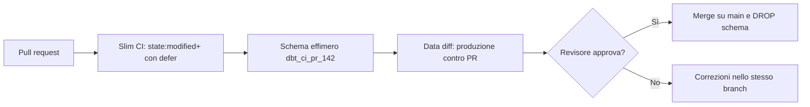

Scenario costruito con numeri di esempio: due analytics engineer lavorano sullo stesso progetto dbt da 180 modelli su ClickHouse. Il primo, alle 17:30, riceve su chat la richiesta di una modifica veloce e fa `git push origin main` rinominando `discount_eur` in `promo_discount_eur` dentro `stg_shop__orders`. Il secondo tiene aperta da tre settimane una pull request da 45 file che tocca marketing e finanza. Alle 03:00 il run notturno di produzione fallisce, perché tre modelli `fct_` a valle leggevano ancora il vecchio nome; il giorno dopo il merge della pull request gigante sovrascrive due settimane di correzioni dei colleghi.

## Un push diretto e una pull request da quarantacinque file

Il repository è lo stesso, gli strumenti sono quelli giusti e nessuno ha agito in malafede. Quello che manca è la disciplina di collaborazione che il software tradizionale ha già assorbito, e che nei dati si applica con due differenze: i modelli sono collegati tra loro da un grafo, quindi una modifica locale ha effetti a valle, e il risultato di una modifica è un numero di business, non un programma che compila.

Gli incidenti del caso sono tre e hanno la stessa radice. Il push diretto salta ogni controllo. La pull request da 45 file e 3.000 righe di SQL non è revisionabile con attenzione: dopo 28 conflitti Git viene approvata sulla fiducia con un "LGTM" e introduce un fan-out, cioè una moltiplicazione di righe causata da un join uno-a-molti. Infine la pipeline di integrazione continua (CI) o esegue solo `dbt compile`, che non verifica nessun dato, oppure ricostruisce tutti i 180 modelli in 40 minuti, un tempo che spinge tutti a saltarla.

> **Idea chiave:** in un team dbt la qualità di una modifica si misura confrontando i numeri prima e dopo, non leggendo il codice. Le regole di branching, la Slim CI e il data diff esistono per rendere quel confronto rapido e obbligatorio.

## Trunk-based development e branch protetto

Il branch `main` rappresenta in ogni istante ciò che gira in produzione e viene protetto contro i push diretti. Ogni modifica, anche di una sola riga, nasce in un feature branch piccolo e focalizzato, con nomi come `feat/add-refund-reason-to-orders` o `fix/dedup-hubspot-contacts`. Un branch vive al massimo uno o due giorni e tocca da 1 a 5 modelli correlati. Prima del merge la piattaforma (GitHub o GitLab) richiede due condizioni: la pipeline CI verde e l'approvazione di almeno un revisore umano.

La alternativa tradizionale, GitFlow, mantiene branch permanenti come `develop`, `release/*` e `hotfix/*`. Nasce per software distribuito in versioni, dove serve mantenere in parallelo la release 2.4 e la 2.5. Nei dati esiste un solo stato corrente della realtà aziendale e gli schemi del warehouse non sono binari isolati. Un branch `develop` che vive per settimane accumula conflitti nei file YAML dei modelli, disallinea il `manifest.json` usato dalla Slim CI e blocca le correzioni urgenti quando contiene già dieci modifiche a metà. Con un solo tronco e pull request brevi, ogni modifica viene testata contro la produzione reale e rilasciata appena è pronta.

## Slim CI con state:modified+ e defer

Ricostruire 180 tabelle in uno schema temporaneo a ogni pull request è uno spreco, ma testare solo il modello toccato non scopre cosa si rompe a valle. La soluzione di dbt combina due opzioni. Il selettore `state:modified+` confronta il branch con il `manifest.json` dell'ultima esecuzione di produzione e seleziona i modelli modificati più tutti i loro discendenti, grazie al segno `+` finale. L'opzione `--defer` indica che, per i modelli a monte non toccati, non serve ricostruire nulla nello schema della pull request: dbt può puntare alle tabelle già pronte in `analytics_prod`.



Un esempio con numeri costruiti. La pull request 142 modifica `stg_shop__orders`, che ha 2 modelli discendenti: i modelli selezionati sono 1 + 2 = 3 su 180, cioè 3 ÷ 180 = 1,7% del progetto. A 13 sec di media per modello il run vale 3 × 13 = 39 sec, contro 180 × 13 = 2.340 sec, circa 39 min, di una ricostruzione completa. La riduzione del tempo è del 98,3% e la CI diventa abbastanza rapida da non essere saltata.

Il comando completo si lancia dal runner di CI dopo aver scaricato il manifesto di produzione:

```bash
# CI di una pull request: costruisce modelli modificati e discendenti in uno schema effimero
dbt build --select state:modified+ --defer --state ./prod_manifest --target ci_pr
```

Il segno `+` finale non è un dettaglio. Senza di esso si testa solo il file toccato: se si cambia `status` da `'paid'` a `'PAID'` in `stg_shop__orders`, i test dello staging possono passare mentre `fct_revenue`, che filtra `WHERE status = 'paid'`, si svuota a zero righe.

## Data diff in code review

Revisionare un modello dati non significa solo leggere il testo della query: significa verificare che il grano e i conteggi non siano cambiati in modo involontario tra produzione e branch. Il confronto si fa con una query di data diff, da allegare alla descrizione della pull request, che mette a fianco conteggio righe, chiavi uniche e somma finanziaria per mese.

```sql
-- Data diff in ClickHouse: produzione contro schema effimero della pull request 142
WITH prod_summary AS (
    SELECT
        toStartOfMonth(occurred_date) AS mese,
        count() AS prod_rows,
        sum(net_amount_eur) AS prod_net_revenue_eur
    FROM analytics_prod.fct_orders
    WHERE occurred_date >= '2026-01-01'
    GROUP BY mese
),
pr_summary AS (
    SELECT
        toStartOfMonth(occurred_date) AS mese,
        count() AS pr_rows,
        uniqExact(order_id) AS pr_unique_orders,
        sum(net_amount_eur) AS pr_net_revenue_eur
    FROM dbt_ci_pr_142.fct_orders
    WHERE occurred_date >= '2026-01-01'
    GROUP BY mese
)
SELECT
    p.mese AS mese,
    p.prod_rows,
    c.pr_rows,
    c.pr_rows - p.prod_rows AS diff_rows,
    c.pr_rows - c.pr_unique_orders AS pr_duplicate_keys,
    p.prod_net_revenue_eur,
    c.pr_net_revenue_eur,
    round((c.pr_net_revenue_eur - p.prod_net_revenue_eur) * 100.0 / nullIf(p.prod_net_revenue_eur, 0), 2) AS diff_revenue_pct
FROM prod_summary AS p
INNER JOIN pr_summary AS c ON p.mese = c.mese
ORDER BY mese DESC
```

La query usa un `INNER JOIN` per semplicità; per scoprire anche mesi presenti in una sola delle due tabelle si passa a `FULL OUTER JOIN` con `coalesce` sul mese. Un esempio di lettura: a ottobre produzione ha 120.000 righe e 1.500.000 euro di ricavo netto, la pull request ha 121.200 righe e 1.488.000 euro. La differenza di righe è 121.200 − 120.000 = 1.200, cioè +1%, e quella di ricavo è 1.488.000 − 1.500.000 = −12.000 euro, cioè −0,8%. Se la pull request dichiarava di aggiungere solo una colonna descrittiva, entrambi gli scarti devono essere zero: righe in più e ricavo in meno indicano un join che duplica righe e un filtro che scarta ordini validi. Il revisore non ha bisogno di capire ogni CTE per respingere la modifica.

Alla chiusura della pull request lo schema effimero va eliminato, altrimenti si accumulano centinaia di database abbandonati che consumano memoria e rallentano le tabelle di sistema:

```sql
-- Pulizia automatica dopo il merge della pull request 142
DROP DATABASE IF EXISTS dbt_ci_pr_142 SYNC
```

## Come si legge un data diff e chi decide

Il data diff dà un numero, ma la decisione resta umana e va distribuita in modo chiaro. L'autore dichiara nella descrizione quale effetto si aspetta: nessuna variazione per un refactoring, una variazione quantificata per un cambio di regola di business. Il revisore confronta l'atteso con l'osservato. Se coincidono, approva. Se non coincidono, la pull request torna all'autore con la richiesta di spiegare lo scarto, e il merge resta bloccato finché la differenza non è chiarita o corretta.

Le variazioni volute meritano una procedura propria. Quando una pull request cambia davvero una definizione, per esempio escludere i rimborsi dal ricavo netto, il data diff mostrerà scarti diversi da zero in tutti i mesi storici. Questo è il risultato corretto, ma va comunicato a chi consuma i marts prima del rilascio, con la stima dell'impatto: se i rimborsi pesano il 2,3% del ricavo e il ricavo mensile è 1.500.000 euro, il numero ufficiale scende di 1.500.000 × 2,3% = 34.500 euro al mese. Senza questo avviso, il direttore finanziario vedrebbe il numero cambiare senza spiegazione e la fiducia nel team si incrinerebbe.

Il rilascio in produzione resta atomico: il merge su `main` fa partire il job che ricostruisce i modelli modificati, e se i test falliscono l'orchestratore segnala l'errore prima che i marts vengano sostituiti. In caso di problema si fa un revert del commit, e il run successivo riporta il progetto allo stato precedente. Un buon flusso di collaborazione rende il revert un'operazione banale e frequente, non un evento drammatico.

## Checklist di una pull request dbt

Una pull request ben fatta contiene nella descrizione l'obiettivo, l'elenco dei modelli impattati restituito da `state:modified+` e l'esito del data diff. Nel codice, il modello rispetta il proprio layer, usa solo `source()` e `ref()` e non ripete logica che appartiene a un modello a monte. Nel file YAML sono dichiarati la descrizione del grano e i test `unique` e `not_null` sulla chiave primaria, con contratto attivo se si tratta di un mart. Se il modello è incrementale, contiene il lookback e il filtro per non scansionare l'intero storico in sviluppo e CI.

La salute del processo si misura con tre numeri: tempo di ciclo di una pull request sotto le 24 ore, il 100% delle pull request validate da `dbt build --select state:modified+` e zero incidenti in produzione causati da cambi di schema o fan-out non rilevati in review. Un linter come SQLFluff o dbt-checkpoint, eseguito in pre-commit, può verificare automaticamente stile e presenza delle descrizioni; non rientra nel perimetro di questo testo, ma si inserisce nello stesso flusso.

## Errori tipici nel workflow Git di un team dbt

### Controllare un modello con SELECT * LIMIT

Il sintomo è un revisore che apre `dbt_dev_mario.fct_orders`, vede dieci righe piene e approva. Sembra un controllo, ma dieci righe casuali non rivelano se su 2 milioni di righe si è perso il 4% degli ordini esteri o duplicato l'1% delle fatture. La cura è allegare sempre il data diff con conteggi, chiavi uniche e somme finanziarie.

### Usare state:modified senza il segno più

Il sintomo è una CI verde seguita da un errore in produzione in un modello figlio. Succede perché il selettore senza `+` testa solo i file toccati e ignora l'effetto domino. La cura è `state:modified+`, che include tutti i discendenti.

### Lasciare gli schemi delle pull request dopo il merge

Il sintomo è una lista crescente di database `dbt_ci_pr_*` in `system.tables`, e interrogazioni sui metadati via via più lente. Il motivo è che nessuno ha pensato di automatizzare la pulizia. La cura è uno step di CI alla chiusura della pull request che esegue `DROP DATABASE IF EXISTS`.

## Verifica sul workflow di collaborazione

1. Una pull request modifica 2 modelli, che hanno in totale 5 discendenti non sovrapposti. Quanti modelli seleziona `state:modified+` e quanto dura la CI a 12 secondi per modello?

<details>
<summary>Mostra risposta</summary>

Seleziona i 2 modelli modificati più i 5 discendenti, quindi 2 + 5 = 7 modelli. Il tempo è 7 × 12 = 84 secondi. Con `--defer` nessun modello a monte viene ricostruito.

</details>

2. Il data diff mostra +0 righe ma −3.000 euro di ricavo su 600.000 euro. La pull request doveva solo rinominare una colonna. Accetti il merge?

<details>
<summary>Mostra risposta</summary>

No. La variazione è −3.000 ÷ 600.000 = −0,5%, e una semplice rinomina non può cambiare il ricavo. Probabilmente una colonna usata in un filtro o in un calcolo ha cambiato significato. Il revisore chiede all'autore di spiegare lo scarto, e il merge resta bloccato finché la differenza non è zero.

</details>

3. Perché in un progetto dbt conviene il trunk-based development rispetto a GitFlow?

<details>
<summary>Mostra risposta</summary>

Perché esiste un solo stato corrente dei dati aziendali. Branch permanenti come `develop` accumulano conflitti nei file YAML, disallineano il manifesto usato da `--defer` e bloccano le correzioni urgenti. Con un solo tronco e pull request brevi ogni modifica è testata contro la produzione reale.

</details>

4. Una pull request da 45 file è aperta da 20 giorni. Quale regola avrebbe evitato il problema e come si applica?

<details>
<summary>Mostra risposta</summary>

La regola dei branch brevi: da 1 a 5 modelli correlati e vita massima di 1-2 giorni. Si applica spezzando la modifica in pull request per dominio, ciascuna con la propria CI e il proprio data diff, in modo che ogni revisione sia leggibile e il rischio di conflitti resti basso.

</details>
