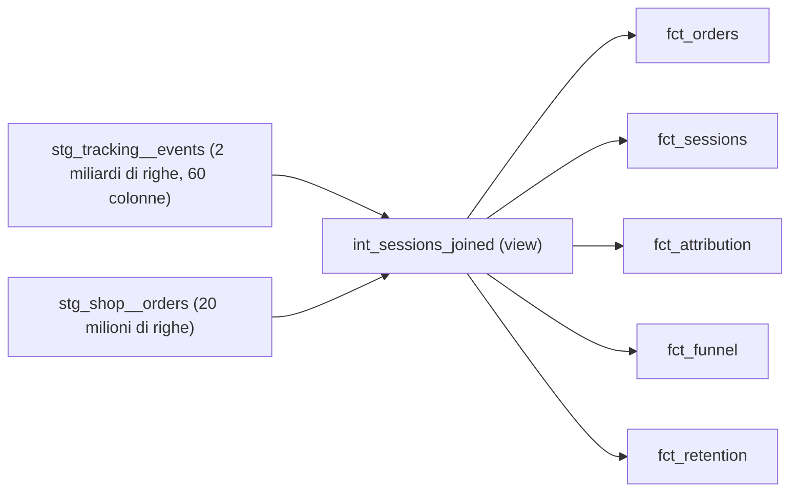

Scenario costruito con numeri di esempio: il job notturno `dbt build` di un e-commerce parte alle 02:00 e a gennaio finisce in 12 minuti. A novembre lo stesso job termina alle 09:40, quando gli uffici sono aperti e le dashboard della direzione leggono tabelle ancora in costruzione. Sono 7 ore e 40 minuti, cioè 460 minuti di esecuzione, e il cluster ClickHouse resta saturo per tutta la mattina. Nessuno ha toccato la logica di business: il progetto conta 140 modelli e il volume degli eventi è cresciuto in modo regolare, non esplosivo. Quello che è cambiato è che alcuni modelli scritti quando la tabella degli eventi pesava pochi gigabyte oggi leggono 142 GB per ogni esecuzione.

Il problema ha una forma ricorrente. In un grafo di 140 nodi il tempo non si distribuisce in modo uniforme: una manciata di modelli assorbe quasi tutto il costo e gli altri sono trascurabili. Ottimizzare a tappeto è uno spreco di ore, ottimizzare i cinque nodi giusti riporta il build a un tempo ragionevole. La lezione costruisce un metodo in tre mosse: misurare dove va il tempo, ridurre ciò che ogni query deve leggere, scegliere con criterio quali nodi persistere su disco.

> **Idea chiave:** il costo di una trasformazione dbt dipende da quante righe e quante colonne il motore deve toccare prima di poter scartare il superfluo. Ogni riga e ogni colonna che tagli nella prima CTE è un dato che non entra mai nella tabella hash di un join.

## Dove va il tempo di un build: pochi modelli balena

Prima di cambiare una riga di SQL serve una classifica. dbt scrive a ogni esecuzione il file `target/run_results.json`, che contiene per ogni nodo il tempo di esecuzione in secondi. Ordinando quel file si ottiene la lista dei modelli più lenti senza installare nulla. La seconda fonte è la telemetria del motore: su ClickHouse la tabella `system.query_log` registra per ogni query la durata, le righe lette, i byte letti e il picco di memoria. La prima dice quanto ci ha messo ogni modello, la seconda spiega perché.

```bash
# Classifica dei 10 modelli piu lenti dell'ultimo build, letta da run_results.json
dbt build --target prod
jq -r '.results
  | sort_by(-.execution_time)
  | .[0:10][]
  | "\(.execution_time | floor)s\t\(.unique_id)"' target/run_results.json
```

Nello scenario la classifica mostra cinque modelli che da soli valgono il 90% dei 460 minuti. Il calcolo è diretto: 460 minuti × 0,90 = 414 minuti per i cinque modelli balena, e 460 − 414 = 46 minuti per gli altri 135 modelli, cioè circa 20 secondi ciascuno in media. È la regola di Pareto applicata a un grafo: se tutti i nodi pesassero uguale, ogni nodo varrebbe lo 0,7% del tempo, mentre qui ciascuno dei cinque vale in media il 18%.

La struttura del problema si vede meglio nel grafo. I modelli balena sono quasi sempre nodi intermedi con due caratteristiche: leggono una tabella di fatti molto larga e sono letti da più modelli a valle.



Il nodo `int_sessions_joined` è una view letta da cinque marts. Ogni volta che dbt costruisce uno dei cinque marts, il motore esegue da capo l'intera piramide di join. Cinque letture della stessa view equivalgono a cinque esecuzioni del lavoro più pesante del progetto, con i marts costruiti in parallelo che si contendono la stessa RAM.

## Filtrare e proiettare prima del join

Il primo intervento riguarda ciò che entra nella query. In un database colonnare come ClickHouse, BigQuery, Snowflake o in una tabella Parquet su S3, il costo di lettura cresce con il numero di colonne toccate. Il costo di RAM e CPU di un join o di una window function cresce più che linearmente con il numero di righe e con la larghezza in byte di ciascuna. Chi scrive `SELECT *` in una CTE iniziale carica tutte e 60 le colonne, compresi i campi JSON e `user_agent` che il modello non userà mai.

Il secondo punto è l'ordine del filtro. Una window function come `row_number() OVER (PARTITION BY user_id ORDER BY occurred_at DESC)` calcola un numero che dipende da tutte le righe della stessa partizione. Se il filtro sulla data è scritto solo nella `SELECT` finale, l'ottimizzatore non può spostarlo sopra la window function senza cambiare il risultato, perché il valore di `row_number()` potrebbe dipendere dalle righe più vecchie. Il predicate pushdown resta bloccato e il motore ordina in memoria l'intero storico per scartarne la quasi totalità all'ultimo passaggio.

Il calcolo dell'effetto si fa in tre passaggi sui numeri dello scenario. La tabella degli eventi copre 5 anni, cioè 1.825 giorni, e contiene 2.000.000.000 di righe per 142 GB. Una finestra di 30 giorni vale 30 / 1.825 = 1,64% dello storico, quindi circa 32,9 milioni di righe e, a parità di larghezza di riga, 142 × 0,0164 = 2,33 GB. Tenere 3 colonne su 60 riduce ancora di un fattore 20, perché 3 / 60 = 5%, e porta la stima teorica a 2,33 × 0,05 = 0,12 GB. La misura reale è più alta, 0,95 GB, perché `session_id` è una stringa lunga e pesa più della media delle colonne. La stima dice comunque l'ordine di grandezza giusto: da 142 GB a meno di 1 GB.

Il modello riscritto applica entrambe le regole nella prima CTE e dichiara la configurazione fisica della tabella risultante.

```sql
-- models/marts/fct_orders_sessions.sql
-- Early filtering e early projection prima del join, con configurazione fisica esplicita (dbt-clickhouse)
{{
    config(
        materialized = 'table',
        engine = 'MergeTree()',
        partition_by = 'toYYYYMM(order_date)',
        order_by = '(order_date, user_id, order_id)'
    )
}}

WITH events_30d_slim AS (
    -- Solo la finestra di 30 giorni e solo 3 colonne: niente SELECT *
    SELECT
        session_id,
        user_id,
        max(occurred_at_utc) AS last_session_event_at
    FROM {{ ref('stg_tracking__events') }}
    WHERE occurred_date >= today() - 30
      AND session_id != ''
    GROUP BY session_id, user_id
),

orders_30d_slim AS (
    SELECT
        order_id,
        session_id,
        toDate(occurred_at_utc) AS order_date,
        net_amount_eur
    FROM {{ ref('stg_shop__orders') }}
    WHERE toDate(occurred_at_utc) >= today() - 30
      AND status = 'completed'
)

SELECT
    o.order_date,
    e.user_id,
    o.order_id,
    o.net_amount_eur,
    e.last_session_event_at
FROM orders_30d_slim AS o
INNER JOIN events_30d_slim AS e
    ON o.session_id = e.session_id
```

Nota che la `GROUP BY session_id, user_id` nella prima CTE rende la chiave di join unica sul lato destro: ogni sessione compare una sola volta, quindi il join non può moltiplicare gli ordini. Questa pre-aggregazione sostituisce il `SELECT DISTINCT` finale che il modello originale usava per nascondere i duplicati.

## Partition_by e order_by come contratto fisico con i modelli figli

La seconda leva è la configurazione fisica. Quando un modello è materializzato come `table` o `incremental`, ClickHouse lo scrive su disco con un ordinamento e un partizionamento che dbt può controllare dal blocco `config()`. Questi due parametri decidono quanta parte della tabella un modello figlio deve leggere.

`partition_by = 'toYYYYMM(order_date)'` divide la tabella in una partizione per mese. Un modello figlio incrementale che filtra gli ultimi 3 giorni tocca una partizione su 60, se la tabella copre 5 anni, e ignora le altre 59 senza nemmeno aprirle. `order_by = '(order_date, user_id, order_id)'` ordina fisicamente le righe su disco, e l'indice primario di MergeTree salta i blocchi di righe che non contengono la data o l'utente cercati.

Il punto delicato è la coerenza. Le colonne dell'`order_by` hanno senso solo se coincidono con i predicati e le chiavi di join dei modelli che leggeranno quella tabella. Un `order_by` su `order_id` quando tutti i figli filtrano per data e poi per utente non salta quasi nulla. Per questo conviene scrivere la configurazione guardando il DAG a valle: si elencano i `WHERE` e gli `ON` dei figli, e si ordinano le colonne dalla più selettiva e più usata verso la meno usata, con la data in testa quando i filtri temporali sono comuni.

Un modello incrementale spinge il ragionamento oltre, perché non ricostruisce tutta la tabella. Nel progetto i modelli intermedi condivisi si configurano per cartella, così la regola è scritta una volta sola.

```yaml
# dbt_project.yml (estratto): materializzazione per livello del DAG
models:
  martech_analytics:
    staging:
      +materialized: view          # un solo figlio, nessun calcolo pesante
    intermediate:
      +materialized: table         # nodi condivisi da piu marts: calcolati una volta
      +engine: MergeTree()
      +order_by: "(occurred_date, user_id)"
      +partition_by: "toYYYYMM(occurred_date)"
    marts:
      +materialized: table
      +engine: MergeTree()
      +partition_by: "toYYYYMM(order_date)"
```

## Calcolo passo-passo: quanto costa e quanto si risparmia

Il confronto numerico prima e dopo è la parte che convince chi approva le modifiche. Ecco la misura sul modello `int_sessions_joined`, preso da `system.query_log`.

La versione originale, con `SELECT *` e filtro dopo la window function, legge 2.000.000.000 di righe e 142,0 GB, usa un picco di 28,4 GB di RAM e impiega 184.000 ms, cioè 184 secondi. La versione riscritta legge circa 32.000.000 di righe e 0,95 GB, usa 0,62 GB di RAM e impiega 1.850 ms. I rapporti si calcolano così:

1. Byte letti: (142,0 − 0,95) / 142,0 = 0,9933, quindi una riduzione del 99,3%.
2. Memoria di picco: (28,4 − 0,62) / 28,4 = 0,9782, quindi una riduzione del 97,8%.
3. Durata: 184.000 / 1.850 = 99,5, quindi la query è circa 99 volte più veloce.

Passando al build intero, i cinque modelli balena valevano 414 minuti. Se ciascuno scende di circa 100 volte, il loro contributo diventa 414 / 100 = 4,1 minuti, arrotondati a 4. Gli altri 135 modelli restano a 46 minuti. Il build totale passa da 460 a 46 + 4 = 50 minuti, con una riduzione di (460 − 50) / 460 = 89%. Il job notturno delle 02:00 finisce alle 02:50 e non più alle 09:40.

Questo calcolo contiene un'indicazione utile: dopo l'intervento il 92% del tempo residuo (46 su 50 minuti) è nei modelli piccoli. Per scendere ancora bisogna cambiare approccio, per esempio passare i modelli di grandi dimensioni a incrementali o ridurre i test, non rifare la stessa ottimizzazione.

Il costo in euro segue lo stesso ragionamento, usando numeri di esempio per un warehouse che fattura la scansione, 5 euro per terabyte letto. Il modello originale legge 142 GB = 0,142 TB, quindi costa 0,142 × 5 = 0,71 euro per esecuzione. Con un build orario sono 24 esecuzioni al giorno: 0,71 × 24 = 17,04 euro al giorno e 17,04 × 30 = 511 euro al mese per questo solo modello. La versione riscritta legge 0,95 GB, cioè 0,00095 TB, e costa 0,00095 × 5 = 0,00475 euro a esecuzione, pari a 0,114 euro al giorno e 3,42 euro al mese. Su ClickHouse autogestito il costo non è per byte ma per core e memoria occupati, e il risparmio si traduce nel poter ridurre il cluster o nel liberare la mattina.

## Misurare prima e dopo con la telemetria del motore

Un'ottimizzazione senza misura è una convinzione. La tabella `system.query_log` permette di confrontare le esecuzioni prima e dopo la modifica sulle stesse metriche, e di scoprire quali modelli sono ancora costosi.

```sql
-- Telemetria dei modelli dbt su ClickHouse: i 5 CREATE TABLE piu costosi di oggi
SELECT
    extract(query, 'CREATE (?:OR REPLACE )?TABLE (\\S+)') AS dbt_model_target,
    query_duration_ms,
    round(read_bytes / 1073741824.0, 2) AS gb_read_from_disk,
    round(memory_usage / 1073741824.0, 2) AS peak_ram_gb,
    read_rows
FROM system.query_log
WHERE type = 'QueryFinish'
  AND event_date = today()
  AND query LIKE '%CREATE%TABLE%'
ORDER BY query_duration_ms DESC
LIMIT 5;
```

Il filtro `type = 'QueryFinish'` esclude le query fallite e quelle ancora in corso, e `event_date = today()` sfrutta la partizione della tabella di log, così la telemetria stessa è leggera. Per una misura riproducibile conviene annotare in un file di progetto le tre cifre di ogni modello balena prima dell'intervento: durata, byte letti e picco di RAM. La stessa query, rilanciata dopo il merge, produce la riga del dopo.

L'esecuzione dei test va tenuta fuori dal conto del build di produzione quando pesa. I test generici su tabelle da miliardi di righe vanno limitati alla finestra recente con la configurazione `where`, altrimenti ogni build ricontrolla anni di dati che non cambiano.

## View, ephemeral, table o incremental: il criterio del fan-out

Quando si ottimizza un grafo emerge una domanda ricorrente: i modelli intermedi vanno tenuti leggeri, come CTE o view, oppure persistiti? La risposta dipende da due proprietà del nodo: quanto lavoro contiene e da quanti modelli è letto. Il numero di modelli a valle si chiama fan-out.

| Tipo di nodo | Fan-out | Costo del calcolo | Materializzazione consigliata |
| --- | --- | --- | --- |
| Rinomina e cast di colonne | 1 | Basso | `view` oppure `ephemeral` |
| Join leggero usato da un solo mart | 1 | Medio | `ephemeral` o `view` |
| Join o aggregazione pesante | 2 o più | Alto | `table` |
| Tabella di fatti molto grande, aggiornata a righe nuove | qualsiasi | Alto | `incremental` |

La regola è netta: un nodo che esegue un'aggregazione o un join pesante ed è letto da due o più modelli va materializzato, così il lavoro si paga una volta e viene riletto da tutti i figli come una tabella già pronta. Un nodo leggero con un solo figlio resta una view, perché scrivere su disco un risultato che nessun altro riusa è un costo senza beneficio.

Il caso opposto si verifica quando l'intera cartella `intermediate/` viene impostata come `ephemeral` per non creare tabelle nel database. Una catena di 4 modelli `ephemeral` annidati e letta da 6 marts fa sì che dbt copi ricorsivamente tutte le CTE dentro ciascuno dei 6 marts. Ogni mart diventa una query di migliaia di righe che il parser deve analizzare e che l'ottimizzatore fatica a pianificare. Materializzare il nodo di snodo dimezza la complessità del grafo e rende le query leggibili.

C'è poi il parametro `threads` nel `profiles.yml`. Alzarlo da 4 a 32 su un cluster ClickHouse già al 90% di CPU non accelera il build, perché ogni singola query usa già tutti i core della macchina. Aggiunge soltanto query concorrenti che si contendono la memoria e finiscono in errore `MEMORY_LIMIT_EXCEEDED`. Un valore tra 4 e 8 è quasi sempre il migliore su un nodo singolo.

## Errori tipici nell'ottimizzazione dei modelli dbt

### SELECT * in una CTE iniziale e filtro sulla data solo alla fine

Il sintomo è un modello che rallenta con il crescere dello storico anche se il report usa sempre gli ultimi 30 giorni: la durata cresce in proporzione ai 5 anni e non ai 30 giorni. Succede perché la query è stata scritta quando la tabella era piccola e il filtro finale produceva il risultato corretto, quindi nessun test lo ha mai segnalato. Il difetto è invisibile a livello logico e visibile solo a livello fisico. La correzione è spostare filtro e proiezione nella prima CTE, come nel modello riscritto sopra, e verificare con `system.query_log` che `read_rows` sia sceso di conseguenza.

### Catene di view con join e aggregazioni lette da più marts

Il sintomo è un build in cui, ingrandendo il grafo, i tempi di marts apparentemente semplici sono altissimi e non spiegabili con le loro query. La causa è che una view non memorizza nulla: ogni mart che la legge ripete l'intera piramide di join sottostante. Sembra ragionevole perché la view è stata introdotta per evitare duplicazione di codice, ma riusa il codice e non il calcolo. La correzione è materializzare come `table` ogni nodo pesante con fan-out pari o superiore a 2 e lasciare view solo gli strati leggeri.

### SELECT DISTINCT finale per nascondere un join che moltiplica le righe

Il sintomo è un `SELECT DISTINCT` alla prima riga di un modello, aggiunto perché dopo un join comparivano duplicati. Sul piano logico non risolve la causa, cioè una chiave non unica sul lato destro. Sul piano delle prestazioni costringe il motore a un'operazione globale di hash o ordinamento su tutte le colonne di tutte le righe prodotte dal join già moltiplicato. La correzione è pre-aggregare o deduplicare la tabella di destra sulla sola chiave di join prima del join, e proteggere quella chiave con un test `unique`.

## Controllo prima di approvare una modifica di performance

1. Hai una classifica dei 10 modelli più lenti, estratta da `run_results.json`, e per ciascuno le righe lette e il picco di RAM in `system.query_log`?

<details>
<summary>Mostra risposta</summary>

Senza la classifica non sai dove intervenire. Con 140 modelli, i cinque più lenti possono valere il 90% del tempo: nello scenario 414 minuti su 460. Il comando `jq` su `target/run_results.json` ordina i modelli per `execution_time`, e la query su `system.query_log` aggiunge righe, byte e memoria per capire la causa. Se l'estrazione non esiste ancora, è il primo lavoro da fare, prima di qualunque riscrittura.

</details>

2. Un modello legge una tabella di eventi da 2 miliardi di righe su 1.825 giorni e il report usa gli ultimi 30 giorni: quante righe dovrebbe leggere dopo un filtro corretto nella prima CTE?

<details>
<summary>Mostra risposta</summary>

La finestra vale 30 / 1.825 = 1,64% dello storico, quindi circa 32,9 milioni di righe su 2.000.000.000. Se `read_rows` in `system.query_log` resta vicino a 2 miliardi, il filtro non viene applicato prima della window function o del join. Un valore vicino a 33 milioni conferma che il pruning di partizione o di indice funziona.

</details>

3. Un modello intermedio contiene una aggregazione pesante ed è letto da 4 marts, ed è configurato come `view`: quale materializzazione scegli e perché?

<details>
<summary>Mostra risposta</summary>

Scegli `table`, o `incremental` se la sorgente è molto grande e cresce per righe nuove. Il fan-out è 4, quindi una view ripeterebbe il calcolo pesante 4 volte a ogni build, mentre una tabella lo esegue una sola volta e lo fa rileggere ai marts. Un modello con fan-out 1 e solo rinomina di colonne, invece, resta una view.

</details>

4. Il build di un modello passa da 28,4 GB a 0,62 GB di picco di RAM: quale riduzione percentuale hai ottenuto e perché controlli anche i byte letti?

<details>
<summary>Mostra risposta</summary>

La riduzione è (28,4 − 0,62) / 28,4 = 97,8%. I byte letti vanno controllati a parte perché RAM e I/O non si muovono sempre insieme: un modello può ridurre la memoria con una pre-aggregazione e continuare a leggere tutte le colonne. Il confronto prima e dopo su durata, byte letti e RAM, sulla stessa query di telemetria, evita di dichiarare vittoria su una sola metrica.

</details>
