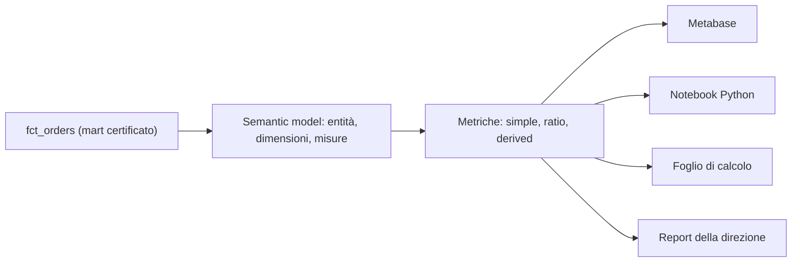

Scenario costruito con numeri di esempio: la tabella `fct_orders` è certificata, ha test `unique` e `not_null` sulla chiave e un contratto sui tipi. Eppure in riunione tre reparti presentano tre valori diversi dell'AOV, il valore medio dell'ordine. Il marketing calcola `avg(gross_amount_eur)` includendo gli ordini annullati. La finanza calcola ricavo netto diviso ordini pagati. Un analista che lavora su un foglio di calcolo fa la media delle medie giornaliere. Nessuno ha sbagliato la tabella: ognuno ha riscritto la formula dentro il proprio strumento, e la formula è la parte che la tabella non può proteggere.

Un test garantisce che la riga sia corretta, ma una metrica è una regola su come aggregare molte righe, e quella regola dipende dalla domanda posta: per giorno, per paese, per mese. Il livello semantico serve a scrivere la regola una volta, in Git, con un responsabile, e a farla applicare automaticamente da ogni strumento che interroga i dati.

> **Idea chiave:** le somme appartengono alle tabelle, le divisioni e i conteggi distinti appartengono al livello semantico. Un rapporto si calcola sempre come somma del numeratore diviso somma del denominatore, sul grano richiesto dalla domanda.

## Perché le formule divergono anche con una tabella perfetta

Il quadro di partenza è semplice. La tabella `marts.fct_orders` contiene ordini completati e annullati, importi lordi e netti di IVA e sconti. Ogni strumento a valle, Metabase, Tableau, un notebook Python, un foglio condiviso, la interroga e deve scegliere tre cose: quale colonna di importo usare, quali stati escludere, come aggregare. Se la scelta è nella testa di chi scrive il grafico, ci sono tante definizioni quante persone.

Le divergenze nascono da tre meccanismi distinti. Il primo è il filtro dimenticato: il marketing omette `status = 'completed'` e conta ordini che non hanno generato ricavo. Il secondo è la colonna sbagliata: il prodotto usa l'importo lordo dove la finanza usa il netto. Il terzo è l'aggregazione sbagliata, il più insidioso, perché produce un numero plausibile: un rapporto o un conteggio distinto pre-calcolato per giorno e poi ri-aggregato in dashboard.

A questi si aggiunge un costo di manutenzione. Quando la direzione decide di escludere dall'AOV ufficiale gli ordini gratuiti di campionatura B2B, chi ha definito la formula in 45 grafici sparsi in tre strumenti deve aprirli uno per uno. Se la formula fosse in un solo punto, la modifica sarebbe una riga in una pull request.



Il diagramma mostra la direzione corretta delle dipendenze: gli strumenti non leggono più la tabella con formule proprie, leggono le metriche, che a loro volta poggiano sul modello semantico della tabella.

## Semantic model: entità, dimensioni e misure

Un modello semantico si dichiara sopra un modello dbt, per esempio `ref('fct_orders')`, e descrive la tabella con tre tipi di elementi. Le entità sono i ganci per i join: una chiave primaria, `order_id`, e una chiave esterna, `customer_id`, che permette di collegare `fct_orders` a `dim_customers` senza scrivere un `JOIN` a mano. Le dimensioni sono gli assi di raggruppamento e filtro: la dimensione temporale primaria, `order_date`, e gli attributi categorici come `country_code` e `status`. Le misure sono le aggregazioni atomiche, cioè i mattoni su cui si costruiscono le metriche: una somma, un conteggio, un conteggio distinto.

```yaml
# models/semantic/sem_orders.yml
semantic_models:
  - name: orders
    description: "Un ordine per riga, grano dell'ordine."
    model: ref('fct_orders')
    defaults:
      agg_time_dimension: order_date
    entities:
      - name: order
        type: primary
        expr: order_id
      - name: customer
        type: foreign
        expr: customer_id
    dimensions:
      - name: order_date
        type: time
        type_params:
          time_granularity: day
      - name: country_code
        type: categorical
      - name: status
        type: categorical
    measures:
      - name: net_revenue_eur
        agg: sum
        expr: net_amount_eur
      - name: cogs_eur
        agg: sum
        expr: cogs_amount_eur
      - name: orders_count
        agg: count_distinct
        expr: order_id
      - name: paying_customers
        agg: count_distinct
        expr: customer_id
```

Le misure dichiarate qui sono additive per costruzione: la somma dei ricavi di due giorni è il ricavo dei due giorni. Questa proprietà è ciò che permette al livello semantico di riaggregarle a qualunque grano. Non compaiono rapporti: un AOV non è una misura, è una metrica costruita sopra due misure.

## Metriche simple, ratio e derived

Le metriche compongono le misure aggiungendo i filtri di business. Una metrica `simple` espone una misura con un filtro cablato: il ricavo netto degli ordini completati. Una metrica `ratio` divide due metriche: AOV è ricavo netto completato diviso ordini completati. Una metrica `derived` combina metriche con un'espressione: il margine di contribuzione è ricavo netto meno costo del venduto.

```yaml
# models/semantic/metrics_orders.yml
metrics:
  - name: net_revenue_completed
    label: "Ricavo netto (ordini completati)"
    description: "Somma di net_amount_eur sugli ordini con status completed."
    type: simple
    type_params:
      measure:
        name: net_revenue_eur
    filter: |
      {{ Dimension('order__status') }} = 'completed'
    meta:
      owner: "finance-team"
      tier: "tier_1_board"

  - name: cogs_completed
    label: "Costo del venduto (ordini completati)"
    type: simple
    type_params:
      measure:
        name: cogs_eur
    filter: |
      {{ Dimension('order__status') }} = 'completed'

  - name: completed_orders
    label: "Ordini completati"
    type: simple
    type_params:
      measure:
        name: orders_count
    filter: |
      {{ Dimension('order__status') }} = 'completed'

  - name: aov_net_eur
    label: "AOV netto"
    description: "Ricavo netto diviso numero di ordini, entrambi sugli ordini completati."
    type: ratio
    type_params:
      numerator: net_revenue_completed
      denominator: completed_orders
    meta:
      owner: "finance-team"

  - name: net_margin_eur
    label: "Margine di contribuzione"
    type: derived
    type_params:
      expr: net_revenue_completed - cogs_completed
      metrics:
        - net_revenue_completed
        - cogs_completed
```

Il filtro `status = 'completed'` è ripetuto nelle tre metriche simple e non nei grafici: nessun analista può dimenticarlo, perché non lo scrive. Il blocco `meta` registra il responsabile nominativo, quello che approva qualunque modifica in pull request. Il vincolo di nome è altrettanto importante: se esistono due concetti genuinamente diversi, per esempio il ricavo fatturato e l'incasso, si danno nomi di dominio inequivocabili, `gross_invoiced_revenue_eur` e `net_collected_mrr_eur`, e non versioni numerate della stessa sigla.

## Calcolo passo-passo: perché le medie e le somme sbagliano

Il caso della media delle medie si dimostra con due giorni. Il lunedì ha 1.000 ordini da 100 euro, quindi 100.000 euro di ricavo. La domenica ha 10 ordini da 50 euro, quindi 500 euro. L'AOV giornaliero è 100 euro il lunedì e 50 euro la domenica.

1. Media delle medie giornaliere: (100 + 50) / 2 = 75,00 euro.
2. Rapporto dei totali: (100.000 + 500) / (1.000 + 10) = 100.500 / 1.010 = 99,50 euro.
3. Errore: (99,50 − 75,00) / 99,50 = 24,6%, cioè la media delle medie sottostima l'AOV di circa un quarto.

La media non pesata dà lo stesso peso a un giorno da 10 ordini e a uno da 1.000. Lo stesso vale per il margine percentuale. Con costo del venduto di 60.000 euro il lunedì e 400 euro la domenica, il margine è (100.000 − 60.000) / 100.000 = 40% il lunedì e (500 − 400) / 500 = 20% la domenica. La media dei due è 30%, mentre il margine vero è (100.500 − 60.400) / 100.500 = 40.100 / 100.500 = 39,9%. Il livello semantico evita l'errore perché calcola sempre la somma del numeratore e la somma del denominatore sul grano richiesto e divide soltanto alla fine.

I conteggi distinti hanno un difetto diverso: non si possono sommare. Il cliente `C-10` acquista lunedì, mercoledì e venerdì: compare con valore 1 in ciascuno dei tre giorni e la somma dà 3, ma il cliente è uno solo. Su una settimana intera, se i clienti unici giornalieri sono 900, 850, 800, 1.000, 1.100, 950 e 700, la somma è 900 + 850 + 800 + 1.000 + 1.100 + 950 + 700 = 6.300. Se i clienti realmente distinti nella settimana sono 4.000, perché molti riacquistano, la somma sovrastima del 57,5%, dato da 6.300 / 4.000 = 1,575. Non esiste una formula per ricavare 4.000 dai sette conteggi: l'informazione su chi è tornato si è persa nel pre-calcolo.

| Metrica | Pre-calcolata per giorno | Aggregata al mese con | Risultato |
| --- | --- | --- | --- |
| Ricavo netto | somma giornaliera | somma delle somme | corretto |
| Ordini | conteggio giornaliero | somma dei conteggi | corretto |
| AOV | rapporto giornaliero | media dei rapporti | sbagliato di 24,5 punti nell'esempio |
| Clienti unici | conteggio distinto giornaliero | somma dei conteggi | sbagliato di 2.300 clienti nell'esempio |

## Che SQL genera il livello semantico

Per vedere cosa produce una definizione conviene scrivere la query equivalente a mano. Quella che segue riproduce, in dialetto ClickHouse, il comportamento delle metriche precedenti: filtra una volta, calcola le misure al grano richiesto e divide per ultimo. MetricFlow supporta un insieme definito di warehouse, quindi verifica la compatibilità del tuo adapter prima di adottarlo: dove non è disponibile, questa forma resta il modello di riferimento per le viste certificate.

```sql
-- Equivalente SQL delle metriche aov_net_eur e net_margin_eur, calcolate al grano mese x paese
WITH misure_base AS (
    SELECT
        toStartOfMonth(o.order_date) AS metric_time_month,
        o.country_code AS order__country_code,
        -- misure additive con il filtro della metrica incorporato
        sumIf(o.net_amount_eur, o.status = 'completed') AS m_net_revenue_eur,
        sumIf(o.cogs_amount_eur, o.status = 'completed') AS m_cogs_eur,
        uniqExactIf(o.order_id, o.status = 'completed') AS m_completed_orders,
        -- conteggio distinto calcolato sul grano richiesto, mai sommato dai giorni
        uniqExactIf(o.customer_id, o.status = 'completed') AS m_paying_customers
    FROM {{ ref('fct_orders') }} AS o
    WHERE o.order_date >= '2026-01-01'
    GROUP BY metric_time_month, order__country_code
)
SELECT
    metric_time_month,
    order__country_code,
    m_net_revenue_eur AS net_revenue_eur,
    m_paying_customers AS paying_customers,
    -- ratio: somma del numeratore diviso somma del denominatore, divisione per ultima
    round(m_net_revenue_eur / nullIf(m_completed_orders, 0), 2) AS aov_net_eur,
    -- derived: margine e margine percentuale dagli aggregati
    m_net_revenue_eur - m_cogs_eur AS net_margin_eur,
    round((m_net_revenue_eur - m_cogs_eur) * 100.0 / nullIf(m_net_revenue_eur, 0), 2) AS net_margin_pct
FROM misure_base
ORDER BY metric_time_month DESC, net_revenue_eur DESC
```

Quando serve riaggregare conteggi distinti senza rileggere la tabella atomica, ClickHouse offre gli stati binari `uniqState` e `uniqMerge`, che conservano un riassunto probabilistico mergeabile e non il numero finale.

```sql
-- Tabella giornaliera con lo stato dei clienti distinti, riaggregabile a settimana e mese
CREATE TABLE IF NOT EXISTS analytics_prod.daily_customers_state
(
    dt Date,
    country_code LowCardinality(String),
    customers_state AggregateFunction(uniq, String)
)
ENGINE = AggregatingMergeTree()
ORDER BY (dt, country_code);

-- Il mese si ottiene fondendo gli stati, non sommando i conteggi giornalieri
SELECT
    toStartOfMonth(dt) AS metric_time_month,
    uniqMerge(customers_state) AS paying_customers
FROM analytics_prod.daily_customers_state
GROUP BY metric_time_month;
```

L'unione di stati dà un conteggio approssimato con errore di pochi punti per mille, accettabile per un cruscotto ma non per un numero da contabilità, dove si usa `uniqExact` sulla tabella atomica.

## Mart SQL o livello semantico: dove vive ogni indicatore

La domanda pratica è quali indicatori scrivere nella tabella e quali nel livello semantico. Il criterio è la proprietà additiva. Vanno nel mart gli attributi veri a livello di riga atomica e puramente additivi, come `net_amount_eur = gross_amount_eur - discount_eur - vat_eur`, `delivery_days` o il flag `is_first_order`. Vanno nel livello semantico le metriche che dipendono dalla finestra e dalle dimensioni scelte al momento della query: tutti i rapporti, come AOV, tasso di conversione, ROAS e churn, e tutti i conteggi distinti, come utenti attivi e acquirenti unici.

La confusione tipica è pre-calcolare `conversion_rate` in una tabella fissa. Appena un utente filtra per dispositivo o raggruppa per settimana, quella colonna smette di avere senso. Separare i fatti additivi di riga, nel mart, dalle formule di aggregazione, nel livello semantico, risolve il problema alla radice.

La verifica delle definizioni si fa da riga di comando, nel repository, come ogni altro controllo di qualità.

```bash
# Controlla sintassi, riferimenti e coerenza di semantic model e metriche
dbt parse
mf validate-configs

# Elenca le metriche disponibili e interroga l'AOV al mese e al paese
mf list metrics
mf query --metrics aov_net_eur --group-by metric_time__month,order__country_code --order metric_time__month

# Stessa metrica senza dimensioni: deve restituire il rapporto dei totali, non la media dei mesi
mf query --metrics aov_net_eur
```

L'ultima query contiene il controllo più utile: il valore senza dimensioni deve coincidere con il rapporto dei totali, non con la media dei valori mensili. Se in una riunione due strumenti restituiscono numeri diversi per la stessa metrica, questa è la prova da eseguire.

Se non usi il server commerciale del livello semantico e leggi i dati con uno strumento open source come Metabase o Superset direttamente su ClickHouse, puoi ottenere la stessa garanzia matematica conservando nel mart le misure come stati componibili ed esponendo le formule ratio in un dataset certificato. Il principio non cambia: una sola definizione, in un solo posto.

## Errori tipici nella definizione delle metriche

### Fare la media di una colonna rapporto pre-calcolata

Il sintomo è un AOV mensile che non coincide con il rapporto tra ricavo mensile e ordini mensili, e che peggiora quanto più i giorni hanno volumi diversi. Succede perché la tabella aggregata per giorno contiene già `daily_aov` e lo strumento di BI applica `avg()` quando l'utente guarda il trimestre. Sembra ragionevole perché `avg` è l'operazione predefinita su una colonna numerica. Si corregge conservando nella tabella numeratore e denominatore, `net_revenue_eur` e `orders_count`, e dividendo solo all'ultimo stadio con `sum(num) / nullIf(sum(den), 0)`.

### Sommare conteggi distinti giornalieri

Il sintomo è un numero di clienti attivi mensili superiore alla base clienti totale, o che cresce solo perché il mese ha più giorni. Con i sette conteggi giornalieri dell'esempio la somma è 6.300 e i clienti distinti reali sono 4.000. Succede perché `uniq` pre-calcolato per giorno sembra un numero additivo come gli altri. Si corregge ricalcolando il conteggio distinto sul grano richiesto dalla tabella atomica, oppure conservando gli stati `uniqState` e fondendoli con `uniqMerge`.

### Moltiplicare le versioni della stessa metrica per accontentare ogni reparto

Il sintomo è un catalogo con `mrr_v1`, `mrr_finance`, `mrr_sales_new` e `mrr_board`, senza che nessuno sappia quale usare. Succede perché creare un nome nuovo è più rapido che negoziare una definizione comune. La correzione è un solo responsabile nominativo per metrica, scritto nel blocco `meta`, che approva le modifiche in pull request, e nomi di dominio distinti solo quando i concetti sono davvero diversi.

## Verifica sul catalogo delle metriche

1. Il lunedì ha 1.000 ordini da 100 euro e la domenica 10 ordini da 50 euro: quale AOV riporta il livello semantico per i due giorni insieme e perché non è 75 euro?

<details>
<summary>Mostra risposta</summary>

Il livello semantico riporta 99,50 euro, calcolato come (100.000 + 500) / (1.000 + 10) = 100.500 / 1.010. Il valore di 75 euro è la media dei due AOV giornalieri, che dà lo stesso peso a un giorno da 10 ordini e a uno da 1.000. Un rapporto si calcola sempre sommando prima numeratore e denominatore sul grano richiesto.

</details>

2. Il cliente C-10 acquista lunedì, mercoledì e venerdì: quanti clienti unici conta una somma dei conteggi giornalieri e come si ottiene il valore corretto?

<details>
<summary>Mostra risposta</summary>

La somma dei conteggi giornalieri dà 3, mentre il cliente è uno solo. Il valore corretto si ottiene ricalcolando il conteggio distinto sul grano richiesto, per esempio `uniqExact(customer_id)` sulla settimana dalla tabella atomica, oppure fondendo stati `uniqState` con `uniqMerge` se serve una riaggregazione economica e un errore di pochi punti per mille è accettabile.

</details>

3. Dove scrivi `delivery_days` e dove scrivi `conversion_rate`: nel mart o nel livello semantico?

<details>
<summary>Mostra risposta</summary>

`delivery_days` è un attributo di riga, additivo e vero a livello di singolo ordine, quindi va nel mart. `conversion_rate` è un rapporto che dipende dal raggruppamento scelto, quindi va nel livello semantico come metrica ratio, con numeratore e denominatore conservati come misure additive. Una colonna pre-calcolata di conversione smette di avere senso appena l'utente cambia filtro o granularità.

</details>

4. Due strumenti restituiscono valori diversi di AOV per lo stesso mese: quale controllo esegui per primo?

<details>
<summary>Mostra risposta</summary>

Esegui `mf query --metrics aov_net_eur` con lo stesso raggruppamento e confronta il valore con quello dei due strumenti. Poi controlla che entrambi applichino `status = 'completed'` e la stessa colonna di importo. Se uno strumento calcola il rapporto da colonne già divise, la differenza è di solito la media dei rapporti al posto del rapporto dei totali, e la correzione è spostare la formula nella metrica.

</details>
