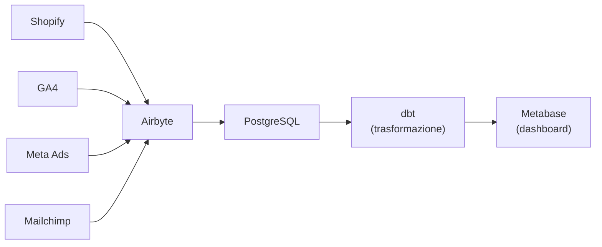

# Caso Studio — Dashboard e Visualizzazione

> **Scenario:** Un team marketing di un e-commerce (€8M revenue) deve costruire un sistema di dashboard che sostituisca i report manuali in Excel.

## 1. Situazione Iniziale

| Problema | Impatto |
|:---|:---|
| Report Excel creato ogni lunedì (6 ore) | 312 ore/anno sprecate |
| Dati da 5 fonti diverse non collegati | Decisioni su dati parziali |
| Ogni manager ha numeri diversi | Zero fiducia nei dati |
| Nessuna dashboard real-time | Reazione lenta ai problemi |

## 2. Architettura Implementata



## 3. Le 3 Dashboard Create

### Dashboard Executive (CEO)

```sql
SELECT
    DATE_TRUNC('week', order_date) AS week,
    SUM(net_revenue) AS revenue,
    COUNT(DISTINCT customer_id) AS customers,
    ROUND(SUM(net_revenue) / COUNT(*), 2) AS aov,
    SUM(marketing_spend) AS spend,
    ROUND(SUM(net_revenue) / NULLIF(SUM(marketing_spend), 0), 2) AS roas
FROM executive_summary
GROUP BY 1 ORDER BY 1 DESC LIMIT 12;
```

KPI mostrati: Revenue settimanale, AOV, ROAS, New vs Returning customers, Top 5 prodotti.

### Dashboard Marketing

KPI: CPA per canale, ROAS per campagna, Funnel (impression → click → purchase), Budget pacing.

### Dashboard Prodotto

KPI: Conversion rate per categoria, Cart abandonment rate, Search queries senza risultati, Top pages per bounce rate.

## 4. Risultati

| Metrica | Prima | Dopo 3 mesi |
|:---|:---:|:---:|
| Tempo per report | 6 ore/sett | 0 (automatico) |
| Fonti dati integrate | 2 | 5 |
| Tempo per identificare anomalie | 2-3 giorni | meno di 1 ora |
| Decisioni data-driven | circa 25% | circa 70% |

## Lezioni
1. **Meno è più:** la dashboard executive ha solo 6 KPI, non 30
2. **Automatizza prima i report più dolorosi** — il ROI è immediato
3. **Definisci le metriche PRIMA di costruire le dashboard**
