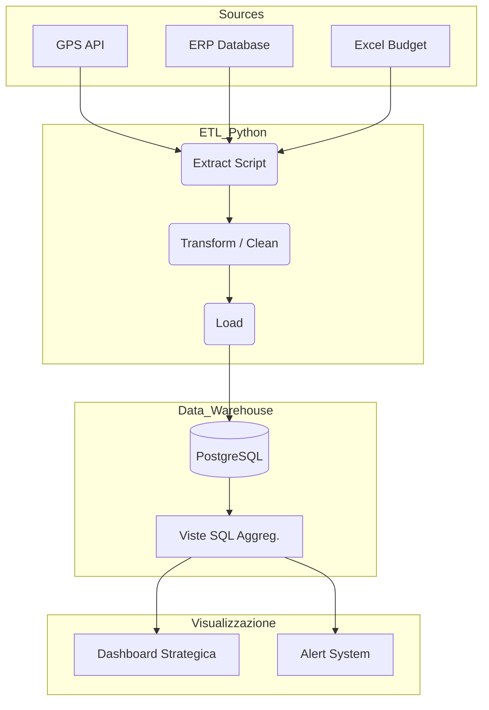
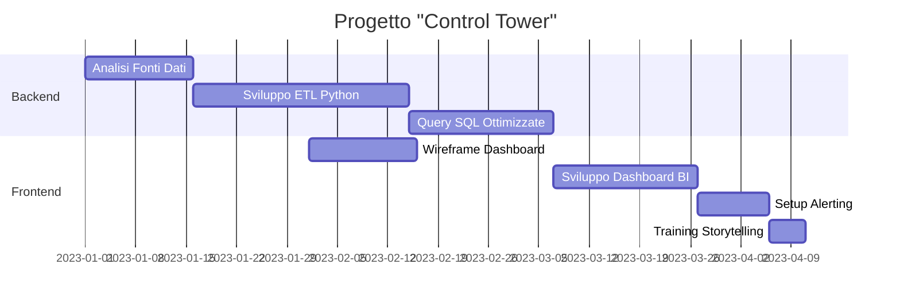
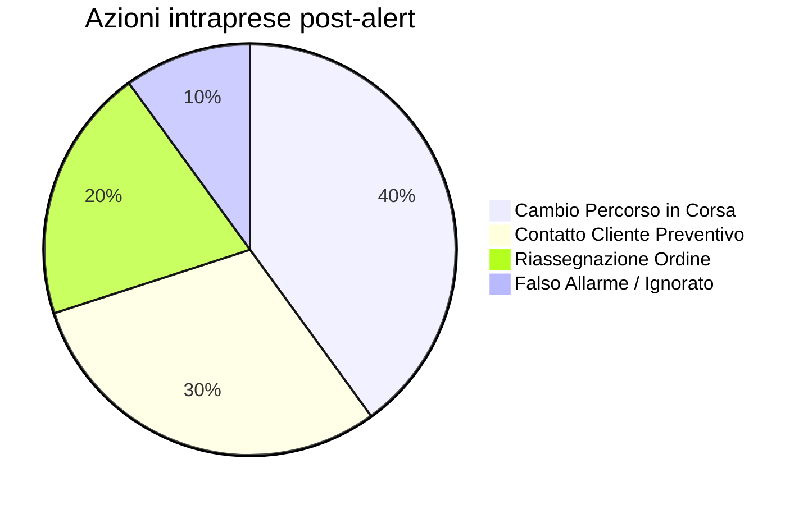

## Contesto Aziendale

**Azienda:** *GreenLogistics S.p.A.* (nome fittizio)
**Settore:** Logistica e Trasporti Ultimo Miglio
**Flotta:** 150 furgoni elettrici e ibridi
**Area:** Nord Italia

GreenLogistics sta crescendo, ma la gestione è ancora basata su fogli di calcolo. Ogni lunedì, tre analisti passano la giornata a scaricare CSV dai vari software (GPS, ERP, Magazzino) per creare un report Excel statico che arriva al management il martedì mattina.
Quando viene rilevato un problema (es. ritardi sistematici in una zona), è già passata una settimana.

### Dati Iniziali

| Metrica | Situazione Attuale | Obiettivo | Note |
| :--- | :--- | :--- | :--- |
| **Tempo di Reazione** | 48-72 ore | < 1 ora | I problemi vengono visti troppo tardi |
| **Reportistica** | 24 ore/uomo a settimana | 0 ore (Automatizzato) | Spreco di risorse umane |
| **OTIF (On Time In Full)** | 88% | 95% | KPI critico per i clienti |
| **Costo Carburante/Km** | €0.18 | €0.15 | Inefficienze di percorso non visibili |
| **Adozione Dati** | Bassa (solo Management) | Alta (anche Operativi) | I driver non hanno feedback |

**Problema Principale:** "Data Rich, Information Poor". L'azienda ha terabyte di dati ma nessuna visione sintetica e azionabile in tempo reale. Le dashboard attuali sono "muri di numeri" incomprensibili.

## Obiettivi del Progetto

Il progetto "Control Tower" mira a:

1.  **Azzerare il tempo di reportistica manuale** automatizzando l'ETL con Python e SQL.
2.  **Creare una Dashboard Strategica Live** che permetta al COO di vedere lo stato della flotta in tempo reale.
3.  **Migliorare l'OTIF del 7%** fornendo alert predittivi ai disponenti.
4.  **Adottare lo Storytelling** nelle riunioni mensili per comunicare efficacemente i risultati agli stakeholder non tecnici.

## Analisi e Strategia

### 1. Data Engineering (ETL & SQL)
Prima di visualizzare, dobbiamo strutturare.
*   **ETL in Python:** Script Python che estraggono i dati dalle API dei GPS e dal DB SQL del magazzino ogni 15 minuti.
*   **SQL Modeling:** Creazione di viste materializzate per aggregare i dati (es. `daily_fleet_performance`) e calcolare KPI complessi lato database, non lato visualizzazione.

### 2. Design della Dashboard
Applicheremo i principi di **Data Visualization Best Practices**:
*   *Niente Torte:* Sostituire pie chart con bar chart per confrontare le performance delle zone.
*   *Data-Ink Ratio:* Rimuovere griglie, sfondi e decorazioni inutili.
*   *Layout a Z:* KPI critici (OTIF, Ritardi) in alto a sinistra.

### 3. Storytelling e Alerting
Non basta mostrare i dati. Implementeremo un sistema di **Alerting** (via Slack/Email) quando un KPI esce dalla soglia di tolleranza. Per le review mensili, useremo lo **Storytelling** per spiegare il "perché" dietro ai numeri, usando annotazioni sui grafici.

### Diagramma della Data Pipeline



**Decisioni Chiave:**
*   **SQL prima di BI:** Tutta la logica di calcolo risiede in SQL, non nello strumento di BI. Questo garantisce performance e riusabilità.
*   **Mobile First:** La dashboard per i capi area deve essere leggibile da tablet/smartphone.

## Implementazione

### Timeline (3 Mesi)



### Dati Intermedi: Esempio Query SQL

Per calcolare l'OTIF giornaliero, abbiamo abbandonato i calcoli Excel per questa query SQL ottimizzata:

```sql
SELECT
    date_trunc('day', delivery_date) as giorno,
    zona,
    COUNT(CASE WHEN status = 'delivered' AND delay_minutes < 15 THEN 1 END) * 100.0 / COUNT(*) as otif_score
FROM spedizioni
GROUP BY 1, 2
ORDER BY 1 DESC;
```

**Problema Incontrato:** La dashboard era lenta (15 secondi di caricamento) a causa della mole di dati storici.
**Soluzione:** Implementazione di una tabella aggregata aggiornata incrementalmente dall'ETL Python, riducendo il tempo di caricamento a < 1 secondo.

## Risultati

Dopo il rilascio della Control Tower:

### KPI Prima vs Dopo

| KPI | Prima (T0) | Dopo (T3) | Variazione |
| :--- | :--- | :--- | :--- |
| **Tempo Creazione Report** | 24h / settimana | 0h (Automatico) | -100% |
| **Latenza Dati** | 7 Giorni | 15 Minuti | Real-time |
| **OTIF Medio** | 88% | 94% | +6.8% |
| **Reclami Clienti** | 50 / mese | 15 / mese | -70% |

### Analisi ROI

Il risparmio di 24 ore/uomo a settimana equivale a circa €30.000/anno di stipendi riallocati su attività a valore aggiunto (analisi proattiva).
Il miglioramento dell'OTIF ha evitato penali contrattuali per €50.000/anno.
Costo implementazione: €20.000 (una tantum).
**Payback Period:** < 3 mesi.

### Visualizzazione Impatto Alerting



## Lezioni Apprese

1.  **Non tutto merita una Dashboard:** Abbiamo imparato a dire "no" alle richieste di metriche di vanità. Se non cambia una decisione, non va nel grafico.
2.  **Il colore ha un significato:** Usare il rosso solo per le criticità vere. L'abuso di colori "semaforo" desensibilizza l'utente.
3.  **L'ETL è fragile:** I primi script Python fallivano silenziosamente. Abbiamo dovuto implementare un sistema di monitoraggio della pipeline stessa.
4.  **SQL è la lingua franca:** Formare gli analisti su SQL base ha permesso loro di rispondere a domande ad-hoc senza aspettare l'IT.
5.  **Contesto > Numero:** Un numero senza un confronto (vs target, vs anno precedente) è inutile.

## Domande di Discussione

1.  Come cambieresti la visualizzazione se il pubblico fosse composto dai driver invece che dai manager?
2.  In quale scenario preferiresti usare Python (Pandas) per l'aggregazione dati invece di SQL?
3.  Quali sono i rischi di automatizzare completamente il processo decisionale basandosi solo sugli alert?
4.  Come gestiresti la "resistenza al cambiamento" di manager abituati ai loro vecchi file Excel?
5.  Se la fonte dati GPS avesse un "buco" di 2 ore, come dovrebbe comportarsi la dashboard per non ingannare l'utente?

**Cosa faresti diversamente?**
*   *Se avessi più tempo:* Creerei una versione "Mobile App" nativa per i capi zona, invece di una dashboard web responsive.
*   *Se i dati fossero non strutturati:* Utilizzerei un Data Lake su S3 prima di caricare i dati aggregati nel Data Warehouse, per preservare i dati grezzi dei sensori IoT.
