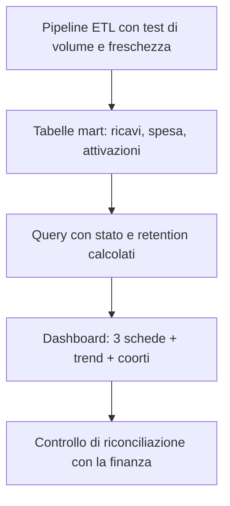

Caso ricostruito su una piattaforma SaaS B2B italiana, con numeri di esempio. La direzione generale chiede una vista unica per il lunedì mattina che risponda a tre domande: quanto ricavo netto nuovo stiamo generando, quanto costa acquisirlo, quanti clienti restano attivi dopo trenta giorni. Il team dati dispone già di una pipeline testata e di una tabella di attivazioni. Manca tutto il resto: le definizioni, la query che non inganna e un controllo che impedisca di arrivare in sala riunioni con un numero sbagliato.

Il caso percorre l'intero lavoro, dall'accordo sui KPI alla checklist di rilascio, e usa i principi dei moduli precedenti: codifica visiva accurata, piramide invertita, soglie nel database.

> **Idea chiave:** una dashboard executive è pronta quando chiunque può leggere formula, denominatore e data di aggiornamento di ogni numero senza chiedere spiegazioni all'analista.

## Il brief: tre domande, tre KPI

La richiesta della direzione è vaga, come quasi tutte. Il primo compito è trasformarla in tre KPI con una definizione che non ammetta interpretazioni. Lo si fa in una breve riunione con marketing, vendite e amministrazione, e il risultato si scrive in una tabella che diventerà la nota visibile sotto ogni scheda.

| KPI primario | Formula | Denominatore | Finestra e refresh |
| :--- | :--- | :--- | :--- |
| Ricavo ricorrente netto nuovo | Nuovi abbonamenti meno churn immediato, al netto di IVA | Mese di competenza | Mensile, refresh alle 07:00 |
| Costo di acquisizione (CAC) | Spesa marketing e vendite diretta | Nuovi clienti paganti nel mese | Mensile, refresh alle 07:00 |
| Retention a 30 giorni | Utenti attivi al giorno 30 | Utenti attivati nella coorte | Solo coorti mature, oltre 30 giorni |

Il punto delicato è il perimetro. «Cliente pagante» significa avere pagato almeno una fattura nel mese o avere un contratto firmato? «Spesa vendite diretta» include gli stipendi del team commerciale o solo i costi di campagna? Ognuna di queste domande ha una risposta che cambia il numero di decine di punti percentuali, e la riunione serve a scegliere una risposta e scriverla. Chi non partecipa all'accordo contesterà il numero più avanti.

## Come si legge la schermata

La schermata adotta la piramide invertita. In alto, tre schede con valore del mese, obiettivo e stato calcolato nel database. Al centro, l'andamento settimanale degli ultimi tre mesi per ricavo e CAC. In basso, la tabella delle coorti di attivazione con la retention.



Un esempio numerico di scheda. Il mese chiude con 38.400 euro di nuovo ricavo ricorrente lordo da abbonamenti e 3.600 euro di churn immediato: il ricavo netto nuovo è 38.400 - 3.600 = 34.800 euro. La spesa di acquisizione è 54.000 euro e i nuovi clienti paganti sono 90, quindi il CAC è 54.000 / 90 = 600 euro. Ogni scheda mostra questo valore, l'obiettivo e la distanza dall'obiettivo, con il colore derivato dalla regola di soglia salvata nel database.

## Il caso dell'IVA e delle valute

Un errore che nasce nei primi giorni è mescolare importi al lordo e al netto dell'IVA. Il marketing legge le fatture al lordo, la finanza ragiona sull'imponibile. Con aliquota del 22%, un abbonamento da 1.220 euro lordi corrisponde a 1.220 / 1,22 = 1.000 euro netti. Se il CAC divide una spesa netta per ricavi lordi, o viceversa, il rapporto tra ricavi e costo di acquisizione risulta sbagliato del 22% senza che nessun controllo se ne accorga.

La regola è semplice: ogni importo sulla dashboard è al netto di IVA e lo dichiara nel titolo. Se esistono più valute, la conversione avviene nella pipeline con un tasso storico dichiarato, non nella dashboard. Il controllo di riconciliazione con la finanza serve a catturare queste incoerenze prima che emergano in riunione.

## La retention a 30 giorni: la coorte matura

La retention a 30 giorni è la quota di utenti attivati in una settimana che risultano attivi al giorno 30. L'unità di analisi è la coorte, cioè l'insieme di utenti attivati nella stessa settimana. Il filtro di maturazione è la regola più importante: una coorte è utilizzabile solo se tutti i suoi membri hanno avuto almeno trenta giorni per essere attivi.

Esempio numerico svolto, con quattro coorti mature e una non matura. Le quattro coorti mature hanno dimensioni di 420, 380, 450 e 400 utenti, con utenti attivi al giorno 30 pari a 189, 152, 207 e 180. Le retention sono 189 / 420 = 45,0%, 152 / 380 = 40,0%, 207 / 450 = 46,0% e 180 / 400 = 45,0%. Il totale degli utenti è 420 + 380 + 450 + 400 = 1.650 e gli attivi sono 189 + 152 + 207 + 180 = 728, quindi la retention complessiva è 728 / 1.650 = 44,1%.

Ora aggiungi la coorte attivata dieci giorni fa: 300 utenti, nessuno dei quali può ancora avere compiuto trenta giorni, quindi tutti con indicatore uguale a zero. Se la includi, il totale diventa 1.650 + 300 = 1.950 utenti con 728 attivi e la retention scende a 728 / 1.950 = 37,3%. Un calo di 44,1 - 37,3 = 6,8 punti percentuali, completamente artificiale, che produce un falso allarme proprio il lunedì della presentazione.

```sql
-- Retention a 30 giorni per coorte settimanale, solo coorti mature e denominatore protetto
SELECT
  toStartOfWeek(activated_at) AS cohort_week,
  count() AS cohort_size,
  countIf(is_active_day_30 = 1) AS retained_users,
  round(retained_users * 100.0 / nullIf(cohort_size, 0), 1) AS retention_30d_pct
FROM mart_user_activations
WHERE activated_at <= today() - 30
GROUP BY cohort_week
ORDER BY cohort_week DESC
LIMIT 12;
```

Accanto al grafico va una nota esplicita nel sottotitolo: «Escluse le coorti attivate negli ultimi 30 giorni perché non ancora mature». Chi legge capisce perché l'ultima settimana mostrata non è quella corrente.

Il filtro `activated_at <= today() - 30` taglia sul giorno di attivazione; se l'attivazione è registrata con ora, conviene ragionare sulla settimana intera: una coorte settimanale è matura solo quando anche l'ultimo utente della settimana ha compiuto trenta giorni, cioè quando la fine della settimana è oltre la soglia.

## Il caso difficile: un numero che non torna con la finanza

Il lunedì di lancio il ricavo netto sulla dashboard è 34.800 euro, mentre la finanza ne riporta 33.900. La differenza è 900 euro, il 2,6% del valore della finanza. La tentazione è cercare un errore nella query; il metodo corretto è scomporre. Si confrontano le due fonti per cliente: si scopre che tre abbonamenti attivati il 30 del mese sono contati dalla dashboard nel mese corrente e dalla finanza nel successivo, per competenza di fatturazione. La somma dei tre è 300 + 300 + 300 = 900 euro.

Il risultato non è un errore ma una differenza di definizione. La soluzione è scegliere una regola, per esempio la data di competenza contrattuale, applicarla ovunque e scriverla nella nota del KPI. La riconciliazione non serve a eliminare ogni differenza; serve a spiegarla, e un numero spiegato smette di essere una discussione.

## Errori da evitare nel costruire la dashboard

Tre errori tecnici compromettono la credibilità davanti al management.

### Includere nella retention le coorti non mature

Il sintomo è una retention vicina allo zero sull'ultima riga della tabella, che spaventa chi legge. Succede perché la query calcola l'indicatore per ogni coorte senza chiedersi se il tempo è passato, e il valore zero sembra un dato. Si corregge filtrando sulla maturazione e dichiarandolo nel sottotitolo.

### Mescolare IVA inclusa ed esclusa

Il sintomo è un rapporto tra ricavi e CAC che non coincide con quello della finanza, con scarto vicino al 22%. Succede perché le fonti arrivano da sistemi diversi, uno commerciale e uno contabile, e nessuno ha fissato la convenzione. Si corregge convertendo tutto al netto in pipeline e scrivendo «netto IVA» nel titolo di ogni importo.

### Pubblicare senza proteggere i denominatori

Il sintomo è un errore o un valore infinito proprio nella settimana con pochi nuovi clienti o con un caricamento parziale. Succede perché la divisione per zero non compare mai nei dati di test, dove ci sono sempre clienti. Si corregge con `nullIf` sul denominatore e con una regola di visualizzazione che mostra «n.d.» al posto di un numero privo di senso.

## Checklist e controllo prima del rilascio

Prima di inviare il link alla direzione, verifica queste cinque domande.

1. Un'analista propone di includere nel grafico di retention anche la coorte attivata dieci giorni fa, con 300 utenti e nessun attivo al giorno 30, sul totale di 1.650 utenti già maturi con 728 attivi. Cosa succede al numero e cosa fai?

<details>
<summary>Mostra risposta</summary>

La retention passa da 728 / 1.650 = 44,1% a 728 / 1.950 = 37,3%, un calo di 6,8 punti dovuto solo alla mancanza di tempo. Escludi la coorte con il filtro di maturazione e dichiara l'esclusione nel sottotitolo.

</details>

2. Un abbonamento è fatturato 1.220 euro con IVA al 22%. Qual è l'importo da usare nel ricavo netto e perché è importante usare la stessa convenzione nel CAC?

<details>
<summary>Mostra risposta</summary>

L'importo netto è 1.220 / 1,22 = 1.000 euro. Se il numeratore è al netto e il denominatore al lordo, o viceversa, il rapporto è sbagliato del 22% senza alcun segnale; la convenzione va fissata in pipeline e scritta nel titolo.

</details>

3. La dashboard mostra 34.800 euro di ricavo netto e la finanza 33.900. Come procedi?

<details>
<summary>Mostra risposta</summary>

Scomponi per cliente invece di rivedere la query. La differenza di 900 euro, pari al 2,6% del dato della finanza, può derivare da competenza diversa, per esempio abbonamenti attivati il 30 del mese. Scegli una regola di competenza, applicala a entrambe le fonti e annotala nella definizione del KPI.

</details>

4. Il CAC del mese è 600 euro con 54.000 euro di spesa. Cosa mostri se in una settimana i nuovi clienti sono zero?

<details>
<summary>Mostra risposta</summary>

Non mostri 54.000 / 0. Proteggi il denominatore con `nullIf` e visualizza «n.d.» con una nota, oppure aggreghi il CAC su finestra mensile dove il denominatore non è nullo. Un valore infinito o un errore rompe la scheda proprio prima della riunione.

</details>

5. Il proprietario della dashboard cambia reparto. Quali informazioni devono restare visibili sulla schermata perché il numero sia ancora affidabile?

<details>
<summary>Mostra risposta</summary>

Definizione e formula di ogni KPI, denominatore, finestra temporale, data dell'ultimo refresh e nome del nuovo proprietario. Con queste informazioni chiunque può verificare un numero senza chiedere all'analista che l'ha costruito.

</details>
