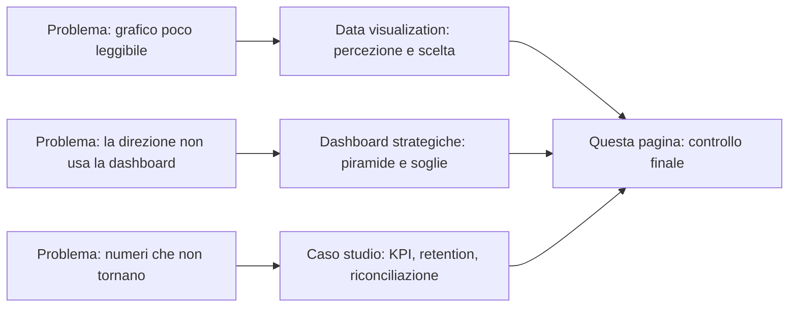

Scenario costruito, con numeri di esempio: un team analytics italiano invia ogni lunedì sei report alla direzione e riceve in media 20 messaggi di chiarimento a settimana, del tipo «da dove viene questo numero» o «perché i totali non coincidono». Dopo avere introdotto una checklist unica da cinque minuti prima di ogni invio, i messaggi scendono a 5 a settimana. La riduzione è 20 - 5 = 15 messaggi, cioè 15 / 20 = 75%. Non è cambiato il lavoro sui dati: è cambiato il momento in cui gli errori vengono intercettati.

Questa pagina raccoglie in forma compatta le regole del modulo e serve da indice: ogni sezione rimanda alla lezione dove il tema è sviluppato per intero.

> **Idea chiave:** una dashboard senza baseline di confronto, denominatore esplicito e data di ultimo aggiornamento è incompleta anche quando i grafici sono impeccabili.

## Mappa del modulo e quando usare ogni lezione

Il modulo segue il percorso di una vista: dalla scelta della forma, alla costruzione per un destinatario specifico, fino al rilascio. Questa mappa aiuta a capire quale lezione riaprire in base al problema che hai davanti.



Se il dubbio riguarda la codifica visiva, riparti dalla lezione sui principi della data visualization. Se riguarda la struttura della schermata e il colore dei semafori, rileggi le dashboard strategiche. Se riguarda definizioni, denominatori e riconciliazione, il caso studio contiene un percorso completo su numeri costruiti.

## Matrice di scelta del grafico

La scelta parte dalla domanda, non dallo strumento. Ogni riga della tabella associa una domanda a una forma, a una regola di preparazione dei dati e a un controllo obbligatorio.

| Bisogno informativo | Grafico | Regola di preparazione | Controllo obbligatorio |
| :--- | :--- | :--- | :--- |
| Confronto tra categorie | Barre orizzontali ordinate | Prime N categorie più «Altro» | Asse che parte da zero |
| Andamento nel tempo | Linee | Calendario continuo senza buchi | Baseline o target visibile |
| Relazione tra variabili | Scatter plot | Nessuna aggregazione forzata | Etichette sugli outlier chiave |
| Distribuzione dei valori | Istogramma o boxplot | Percentili P50 e P90 | Numero di osservazioni dichiarato |

La logica sottostante è la gerarchia percettiva: posizione su scala comune e lunghezza allineata si leggono meglio di angoli, aree e colore. Un doppio asse Y non è mai la risposta a due serie con unità diverse; si usano due pannelli allineati sul tempo oppure due serie indicizzate a base 100. Una torta è accettabile solo con due o tre fette.

## Il controllo numerico che evita l'inganno dell'asse

Un controllo da ripetere sempre sui grafici a barre è il calcolo del fattore di amplificazione, cioè del rapporto tra la differenza vista e la differenza reale. Esempio: due categorie valgono 95.000 euro e 92.000 euro. La differenza reale è 3.000 euro, pari a 3.000 / 92.000 = 3,3%. Se l'asse parte da 90.000 euro, le barre misurano 5.000 e 2.000 euro di altezza visiva, quindi la prima appare 5.000 / 2.000 = 2,5 volte la seconda, cioè 150% in più. L'amplificazione è 150 / 3,3, circa 46 volte.

Dopo questo calcolo la regola smette di essere astratta: se la barra non parte da zero, il grafico mente di un fattore che puoi misurare. La correzione è fissare il minimo a zero oppure mostrare direttamente la variazione percentuale.

## Controlli SQL prima di pubblicare

Prima di condividere il link, esegui due query sulla tabella che alimenta la vista. La prima verifica il grain: se il numero di righe supera il numero di ordini unici, c'è una duplicazione di join che gonfierà i totali.

```sql
-- Controllo del grain: righe totali contro ordini unici nella finestra di 30 giorni
SELECT
  count() AS total_rows,
  uniqExact(order_id) AS unique_orders,
  count() - uniqExact(order_id) AS duplicate_rows
FROM mart_dashboard_orders
WHERE order_date >= today() - 30;
```

Se `duplicate_rows` è diverso da zero, il grain della tabella non è quello dichiarato e i totali sono sbagliati. Esempio numerico: 12.400 righe contro 12.000 ordini unici significano 400 righe duplicate, pari a 400 / 12.000 = 3,3% di sovraconteggio sui ricavi.

La seconda query verifica freschezza e completezza.

```sql
-- Controllo di freschezza e valori nulli sulla tabella della vista executive
SELECT
  max(updated_at) AS last_refresh,
  dateDiff('hour', max(updated_at), now()) AS hours_old,
  count() AS row_count,
  countIf(primary_kpi IS NULL) AS null_kpi_rows
FROM mart_executive_summary;
```

Se `hours_old` rientra nello SLA concordato, per esempio 24 ore per un refresh notturno, e `null_kpi_rows` è zero, la vista è tecnicamente pronta. Se `hours_old` vale 40 con uno SLA di 24, la pipeline è in ritardo di 16 ore e la vista non va consegnata senza una nota esplicita.

## Il caso delle richieste dell'ultimo minuto

Quando un dirigente chiede un grafico veloce per la riunione tra un'ora, la tentazione è saltare i controlli. Proprio in quel caso applica almeno tre verifiche minime: il totale coincide con la fonte ufficiale, l'asse parte da zero, la data di aggiornamento è visibile. Portare in riunione un numero sbagliato costa più del ritardo di dieci minuti per controllarlo, e la credibilità persa si recupera in mesi.

Aggiungi sempre owner e perimetro: chi contattare se il numero sembra strano, quali filtri sono attivi, a che ora sono stati caricati i dati. Con questi tre elementi la maggior parte delle contestazioni si chiude in una riga.

## Errori da bloccare prima dell'invio

Tre problemi ricorrono nelle revisioni tra colleghi e si bloccano in pochi secondi.

### Grafici con doppio asse o torte a molte fette

Il sintomo è una correlazione apparente che nessuno riesce a verificare. Succede perché le scale indipendenti si possono regolare a piacere. Si corregge con due pannelli allineati o con la base 100.

### Percentuali senza baseline né denominatore

Il sintomo è un messaggio come «conversione al 4,2%, è tanto o poco?». Succede perché il valore è mostrato senza il numero di visite sottostante e senza il periodo di confronto. Si corregge mostrando il denominatore, per esempio 4,2% su 30.000 visite, e la media del trimestre precedente.

### Vista senza owner e data di refresh

Il sintomo è una catena di messaggi per capire chi risponde di un numero. Succede perché la dashboard nasce come prova e resta in produzione senza essere assegnata. Si corregge con proprietario, perimetro e ultimo refresh scritti sulla schermata.

## Controllo finale in cinque domande

Rispondi prima di inviare qualsiasi vista.

1. Un grafico a barre mostra 95.000 euro e 92.000 euro con asse che parte da 90.000 euro. Cosa controlli e cosa correggi?

<details>
<summary>Mostra risposta</summary>

L'asse non parte da zero: le barre appaiono nel rapporto 5.000 / 2.000 = 2,5 volte, mentre la differenza reale è 3,3%. Correggi portando il minimo a zero oppure mostrando la variazione percentuale.

</details>

2. La query di grain restituisce 12.400 righe e 12.000 ordini unici. Quanto sono gonfiati i ricavi e cosa fai?

<details>
<summary>Mostra risposta</summary>

Ci sono 400 righe duplicate, pari a 400 / 12.000 = 3,3% di sovraconteggio. Non pubblichi: cerchi il join che moltiplica le righe e correggi il grain prima di rieseguire il controllo.

</details>

3. Lo SLA è 24 ore e `hours_old` vale 40. Come procedi?

<details>
<summary>Mostra risposta</summary>

La pipeline è in ritardo di 40 - 24 = 16 ore. Non consegni la vista come aggiornata: segnali il ritardo con una nota visibile oppure rinvii l'invio finché il refresh non è completo.

</details>

4. Devi confrontare sessioni e ordini con ordini di grandezza diversi. Quale soluzione scegli al posto del doppio asse?

<details>
<summary>Mostra risposta</summary>

Due pannelli allineati sullo stesso asse temporale oppure due serie indicizzate a base 100 sul mese iniziale. L'indicizzazione mostra la crescita relativa di entrambe senza che la scelta delle scale suggerisca un legame inesistente.

</details>

5. Un dirigente chiede un grafico entro un'ora. Quali tre controlli minimi non salti mai?

<details>
<summary>Mostra risposta</summary>

Riconciliazione del totale con la fonte ufficiale, asse a base zero e data di ultimo aggiornamento visibile. A questi aggiungi owner e perimetro, così chi legge sa a chi rivolgersi.

</details>
