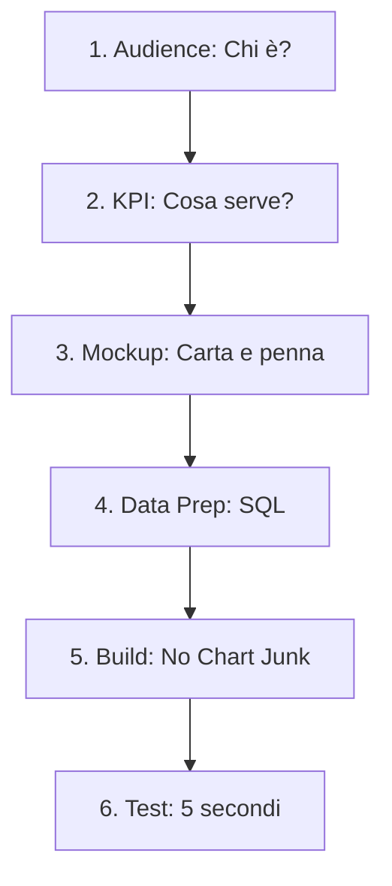

## Concetti Chiave

- **Data Storytelling**: L'arte di comunicare insight, non solo dati. Si divide in *Exploratory* (analisi interna) ed *Explanatory* (presentazione al pubblico).
- **Minto Pyramid (SCQA)**: Struttura di comunicazione per executive: Situation, Complication, Question, Answer. La risposta (Answer) va data subito.
- **ETL vs ELT**: *Extract-Transform-Load* (vecchia scuola) vs *Extract-Load-Transform* (moderno, trasforma i dati già nel warehouse).
- **CTE (Common Table Expressions)**: Uso di `WITH` in SQL per creare tabelle temporanee leggibili invece di subquery annidate.
- **Window Functions**: Funzioni SQL (`RANK`, `LEAD`, `LAG`) che operano su un set di righe senza raggrupparle in una sola.
- **Chart Junk**: Elementi visivi inutili (griglie pesanti, effetti 3D, ombre) che distraggono dal dato.
- **Strategic Dashboard**: Per dirigenti. KPI di alto livello, trend a lungo termine. Aggiornamento mensile/trimestrale.
- **Operational Dashboard**: Per operatori. Monitoraggio real-time, alert, stato dei sistemi. Aggiornamento continuo.

## Formule e Sintassi SQL

| Comando | Sintassi / Esempio | Uso |
|---------|--------------------|-----|
| **CTE** | `WITH sales AS (SELECT...) SELECT * FROM sales` | Rendere le query leggibili e modulari. |
| **Window (Rank)** | `RANK() OVER (PARTITION BY city ORDER BY sales DESC)` | Classificare elementi all'interno di gruppi (es. Top 3 prodotti per città). |
| **Window (Lag)** | `LAG(sales) OVER (ORDER BY month)` | Accedere alla riga precedente (es. per calcolare crescita MoM). |
| **Inner Join** | `FROM A JOIN B ON A.id = B.id` | Prende solo le righe che matchano in entrambe le tabelle. |
| **Left Join** | `FROM A LEFT JOIN B ON A.id = B.id` | Prende tutte le righe di A, e quelle di B che matchano (o NULL). |
| **Aggregazione** | `SUM(rev) ... GROUP BY region` | Somma i valori raggruppandoli per una dimensione. |

## Framework e Modelli

### Matrice di Scelta del Grafico
Quale visualizzazione usare in base al messaggio?

```mermaid
graph TD
    Start{Cosa vuoi mostrare?}
    Start --> Confronto[Confronto]
    Start --> Trend[Evoluzione]
    Start --> Relazione[Correlazione]
    Start --> Parte[Composizione]

    Confronto --> Bar[Bar Chart (Orizzontale)]
    Trend --> Line[Line Chart]
    Relazione --> Scatter[Scatter Plot]
    Parte --> Stack[Stacked Bar / Treemap]
```

### Struttura Narrativa (SCQA)
Come presentare i dati per convincere.

```mermaid
flowchart TD
    S[Situation: Fatti noti e condivisi] --> C[Complication: Il problema o il cambiamento]
    C --> Q[Question: Cosa dobbiamo fare?]
    Q --> A[Answer: La tua raccomandazione (Subito!)]
    A --> Evidence[Prove a supporto (Dati)]
```

## Processo Step-by-Step: Creazione Dashboard

1.  **Definizione Audience**: Chi la userà? (CEO vs Analista). Cosa deve decidere?
2.  **Scelta KPI**: Seleziona 3-5 metriche chiave. Tutto il resto è rumore.
3.  **Mockup (Low-fi)**: Disegna su carta il layout. I dati più importanti in alto a sinistra (F-Pattern).
4.  **Data Prep**: Scrivi le query SQL pulite e testate.
5.  **Build**: Costruisci i grafici nel tool (Tableau/PowerBI). Rimuovi il "Chart Junk".
6.  **User Testing**: Chiedi all'utente "Cosa capisci in 5 secondi?". Se esita, semplifica.



## Errori da Evitare

-   ❌ **Pie Charts con > 3 fette** → ✅ Il cervello fatica a confrontare gli angoli. Usa un Bar Chart.
-   ❌ **Grafici 3D** → ✅ Distorcono i dati e rendono impossibile la lettura precisa. Mai usarli.
-   ❌ **Titoli generici ("Vendite Q1")** → ✅ Usa titoli "Attivi" che dicono l'insight ("Le vendite sono calate del 10%").
-   ❌ **Spaghetti SQL** → ✅ Query di 500 righe con subquery annidate sono immantenibili. Usa le CTE.
-   ❌ **Troppi colori (Effetto Arlecchino)** → ✅ Usa il colore solo per evidenziare il dato importante (es. grigio per il contesto, rosso per il calo).
-   ❌ **Dashboard "Tuttofare"** → ✅ Una dashboard che cerca di servire tutti non serve a nessuno. Fanne due separate.

## Quick Reference

| Strumento | A cosa serve | Quando usarlo |
|-----------|--------------|---------------|
| **Tableau** | Data Visualization | Leader per visualizzazioni complesse e belle esteticamente. |
| **Power BI** | Business Intelligence | Ottimo se l'azienda usa l'ecosistema Microsoft. |
| **Looker** | Data Exploration | Basato su LookML, ottimo per governare le metriche centralmente. |
| **SQL (Postgres)** | Querying | Il coltellino svizzero per estrarre e manipolare i dati. |
| **Python (Matplotlib)** | Analisi Statistica | Per visualizzazioni scientifiche o custom non possibili nei tool BI. |
