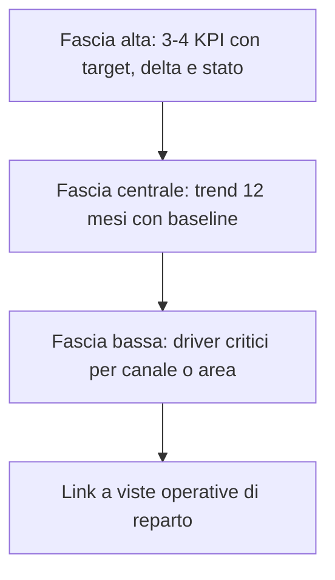

Caso ricostruito, con numeri di esempio: il team BI di un'azienda SaaS B2B italiana consegna all'amministratore delegato una dashboard con trentasei riquadri, dodici filtri a tendina e una tabella con una riga per cliente. Il CEO la apre due volte, la trova illeggibile e torna a chiedere il riassunto settimanale via email. Il lavoro tecnico era corretto; il problema era il destinatario. La schermata rispondeva alle domande dell'analista operativo e ignorava le tre domande che un dirigente si pone in meno di un minuto: come stiamo andando rispetto al piano, dove si forma lo scostamento, chi deve intervenire.

Una dashboard strategica si progetta a partire dalla decisione che deve rendere possibile, non dai grafici che il sistema sa produrre.

> **Idea chiave:** una dashboard executive è uno strumento di attenzione, non un archivio. Mostra pochi numeri con un giudizio già calcolato e rimanda il dettaglio a viste separate.

## Il tempo di lettura come vincolo di progetto

Un dirigente apre la dashboard tra due riunioni e ha poche decine di secondi. Questo vincolo è più utile di qualunque linea guida estetica, perché obbliga a scegliere. Se una informazione non serve a rispondere alle tre domande, non sta sulla prima schermata.

La struttura che ne deriva è la piramide invertita, la stessa del giornalismo: la notizia più importante in cima, i dettagli sotto, in ordine decrescente di urgenza. In alto stanno tre o quattro schede KPI, ciascuna con valore attuale, obiettivo del periodo, scostamento e giudizio di colore. Al centro sta il trend degli ultimi dodici mesi con la baseline visibile, perché solo la serie storica permette di distinguere un calo strutturale da una normale oscillazione stagionale. In basso sta una tabella sintetica dei driver, cioè dei canali, delle aree o delle linee di prodotto che spiegano lo scostamento.



| Livello | Contenuto | Tempo di lettura | Decisione che abilita |
| :--- | :--- | :--- | :--- |
| Fascia alta | 3-4 schede con valore, target e delta | 10 secondi | Capire se si è in linea con il piano |
| Fascia centrale | Serie a 12 mesi con baseline | 20 secondi | Separare calo strutturale da rumore stagionale |
| Fascia bassa | Tabella dei driver per canale o area | 30 secondi | Decidere dove intervenire per primo |

Il totale è di circa un minuto. Ogni elemento che allunga il tempo di lettura senza spostare una decisione è un candidato alla rimozione.

## Scegliere pochi KPI e dichiararne il significato

Il numero di KPI in prima schermata dovrebbe stare tra tre e quattro. Con più di sette, la memoria di lavoro di chi legge non regge il confronto, e la dashboard diventa una galleria. La scelta nasce da una domanda: quali metriche, se cambiassero in modo evidente, farebbero cambiare un piano? Per un SaaS possono essere il ricavo ricorrente netto, il costo di acquisizione di un cliente, la retention a trenta giorni e il margine lordo.

Ogni KPI dichiara per iscritto la propria definizione: formula, denominatore, finestra temporale, perimetro. Se il margine mostrato non specifica se include spedizioni e resi, metà della riunione se ne va a confrontare quel numero con quello della contabilità. Il testo della definizione sta accanto al titolo, in una nota visibile, non in un documento separato che nessuno apre.

Il secondo ingrediente è il confronto. Un valore isolato non dice se va bene. Servono almeno l'obiettivo del periodo e il valore dello stesso periodo dell'anno precedente quando la stagionalità conta. Il giudizio visivo, verde, ambra o rosso, è la sintesi di quel confronto; se il confronto manca, il colore è arbitrario.

Un terzo elemento, spesso dimenticato, è la frequenza di aggiornamento coerente con la frequenza della decisione. Un board che si riunisce ogni trimestre non ha bisogno di una dashboard che si aggiorna ogni ora; un comitato che decide ogni lunedì ha bisogno di dati chiusi al venerdì sera e non di numeri parziali di domenica. Dichiarare accanto a ogni scheda la data dell'ultimo caricamento e il momento del prossimo evita che qualcuno discuta un valore ancora in assestamento. Se una fonte arriva in ritardo, la scheda lo dice con una nota esplicita e non mostra un numero incompleto come se fosse definitivo.

Infine, il racconto. Una schermata executive funziona meglio se chi la presenta ha deciso in anticipo quale storia raccontano i numeri: un titolo di una riga sopra il trend, scritto come affermazione e non come etichetta, per esempio «il ricavo è sotto piano da due mesi per il calo del canale diretto». Il titolo obbliga l'analista a trarre una conclusione e permette alla direzione di contestarla, che è esattamente il tipo di discussione che la dashboard deve produrre.

## Dove nasce il colore: soglie nel database e non nello strumento

Le soglie che accendono l'ambra o il rosso derivano da regole di business: tolleranza sul piano, margine minimo accettabile, livello di servizio promesso. Queste regole devono vivere in un solo posto, versionate e leggibili da ogni strumento, cioè nel database. Quando il responsabile BI digita a mano le soglie dentro la dashboard, ogni nuovo report le replica in modo leggermente diverso e dopo qualche mese due schermate mostrano colori diversi per lo stesso dato.

Esempio numerico svolto. Il target di ricavo netto del mese è 480.000 euro. Le regole aziendali dicono: verde se il ricavo raggiunge o supera il target; ambra se sta tra il 92% e il 100% del target; rosso sotto il 92%. La soglia ambra è quindi 480.000 × 0,92 = 441.600 euro. Il ricavo reale di ottobre è 452.000 euro: lo scostamento è 452.000 - 480.000 = -28.000 euro, pari a -28.000 / 480.000 = -5,8%. Poiché 452.000 sta sopra 441.600 e sotto 480.000, lo stato è ambra. A novembre il ricavo è 430.000 euro: lo scostamento è -50.000 euro, cioè -10,4%, e siccome 430.000 è sotto 441.600 lo stato è rosso. Il margine di manovra tra i due stati, 441.600 - 430.000 = 11.600 euro, è esattamente la distanza che separa un monitoraggio da un intervento.

```sql
-- Stato e scostamento calcolati nel database a partire da target e regola di soglia
SELECT
  k.month,
  k.net_revenue_eur,
  t.target_revenue_eur,
  round((k.net_revenue_eur - t.target_revenue_eur) * 100.0 / nullIf(t.target_revenue_eur, 0), 1) AS delta_pct,
  multiIf(
    k.net_revenue_eur >= t.target_revenue_eur, 'ON_TRACK',
    k.net_revenue_eur >= t.target_revenue_eur * r.attention_ratio, 'ATTENTION',
    'CRITICAL'
  ) AS status_flag
FROM mart_monthly_revenue AS k
INNER JOIN dim_monthly_targets AS t ON k.month = t.month
CROSS JOIN (SELECT attention_ratio FROM dim_kpi_thresholds WHERE kpi_id = 'net_revenue') AS r
ORDER BY k.month DESC
LIMIT 12;
```

La tabella delle regole è piccola e sta in un posto solo. Cambiare la tolleranza da 92% a 90% diventa una modifica documentata, con data e autore, non un ritocco nascosto in una dashboard.

```sql
-- Tabella delle regole di soglia: una riga per KPI, modificabile con audit
CREATE TABLE IF NOT EXISTS dim_kpi_thresholds
(
  kpi_id String,
  attention_ratio Float64,
  valid_from Date,
  updated_by String
)
ENGINE = MergeTree
ORDER BY (kpi_id, valid_from);
```

Con questa struttura lo strumento BI si limita a colorare i tre stati senza duplicare formule, e un'email automatica o un messaggio su chat mostrano lo stesso giudizio della dashboard.

## Una schermata per ogni destinatario

Il direttore commerciale vuole vedere i venditori uno per uno; il CEO vuole il margine netto per linea di prodotto. Mettere tutto nella stessa pagina produce lo schermo da trentasei riquadri. La soluzione è separare: una vista executive pulita, con le tre fasce della piramide, e una serie di viste operative per reparto, collegate con un link diretto da ogni riga o scheda della vista principale.

Questa separazione ha un effetto organizzativo. Il CEO sa che la vista executive cambia solo se la strategia cambia e impara a leggerla in fretta; il responsabile di reparto ha uno spazio dove la complessità è legittima. Ogni vista ha un proprietario che risponde delle definizioni e una data di revisione.

Sul layout valgono poche regole. In alto a sinistra va il numero principale, perché l'occhio parte da lì. Sotto, l'andamento, per capire la direzione. Più in basso, la scomposizione. Le etichette riportano sempre unità di misura e data di aggiornamento; un valore in euro senza dire se è lordo o netto di IVA è un invito alla discussione.

## Errori comuni nelle dashboard per la direzione

Tre abitudini tecniche rendono inutilizzabile il risultato, anche quando i dati sono corretti.

### Riempire la prima schermata di filtri e tabelle lunghe

Il sintomo è un dirigente che chiede la stessa informazione via email, nonostante la dashboard la contenga. Succede perché ogni stakeholder ha aggiunto il proprio filtro e nessuno ha tolto nulla, e perché chi costruisce vuole dimostrare completezza. Si evita fissando un budget: tre o quattro KPI, nessun filtro obbligatorio per vedere il quadro d'insieme, il dettaglio in una vista separata raggiungibile con un clic.

### Lasciare le definizioni implicite

Il sintomo è una riunione che si apre con la frase «il mio numero è diverso dal tuo». Succede perché marketing, vendite e amministrazione usano la stessa parola con filtri temporali o perimetri diversi. Si evita scrivendo la definizione accanto al titolo del KPI e conservando un glossario unico, con un responsabile per ogni voce.

### Colorare con soglie scelte dal designer

Il sintomo è un rosso acceso su un -2% che rientra nella normale oscillazione stagionale, e la direzione che smette di fidarsi dello strumento. Succede perché la soglia viene scelta per ottenere un effetto visivo e non da una regola di business. Si evita derivando ogni colore da una regola documentata nel database, come nella tabella delle soglie, e verificando lo storico: se il rosso si sarebbe acceso in tre mesi su dodici senza che nessuno intervenisse, la soglia è troppo stretta.

## Controllo sulla tua dashboard prima della presentazione

Rispondi a queste domande sulla schermata che stai per mostrare alla direzione.

1. Il ricavo netto di ottobre è 452.000 euro contro un target di 480.000 euro, con regola ambra al 92%. Che stato mostri e perché?

<details>
<summary>Mostra risposta</summary>

Stato ambra. Lo scostamento è 452.000 - 480.000 = -28.000 euro, pari a -5,8%. La soglia ambra è 480.000 × 0,92 = 441.600 euro e il ricavo la supera, quindi non è rosso; è sotto il target, quindi non è verde.

</details>

2. La tua dashboard ha trentasei riquadri e il CEO non la apre. Quale struttura proponi e con quale criterio scegli cosa tenere?

<details>
<summary>Mostra risposta</summary>

Proponi una vista executive a piramide invertita: tre o quattro KPI con target e stato in alto, trend a dodici mesi al centro, driver critici in basso. Tieni solo ciò che, cambiando in modo evidente, farebbe cambiare un piano; il resto passa a viste operative collegate con link.

</details>

3. Due dashboard mostrano colori diversi per lo stesso KPI nello stesso mese. Qual è la causa più probabile e come la elimini?

<details>
<summary>Mostra risposta</summary>

Le soglie sono state digitate a mano in ciascuno strumento e hanno valori diversi. Si elimina spostando le regole in una tabella nel database, letta da tutte le dashboard, versionata con data e autore della modifica.

</details>

4. A novembre il ricavo è 430.000 euro con lo stesso target. Quale stato e quanto manca per tornare ambra?

<details>
<summary>Mostra risposta</summary>

Stato rosso: 430.000 è sotto 441.600 euro e lo scostamento è -50.000 euro, pari a -10,4%. Per tornare ambra servono 441.600 - 430.000 = 11.600 euro di ricavo aggiuntivo.

</details>
