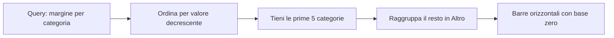

Scenario costruito, con numeri di esempio: una rete commerciale italiana presenta ogni mese al comitato vendite una torta tridimensionale con otto fette colorate, una per categoria di prodotto. La categoria A pesa 500.000 euro di ricavi e la categoria B 420.000. Nel secondo trimestre il margine di A passa dal 24% al 20%: sono 120.000 euro di margine che diventano 100.000, cioè 20.000 euro in meno, una perdita del 16,7%. Sulla torta la fetta di A resta più grande di quella di B e nessuno lo nota, perché l'occhio non sa confrontare angoli e aree inclinate con la precisione necessaria. Per due trimestri la riunione discute di altro.

Un grafico non è un ornamento dei numeri: è un ragionamento codificato in forme e posizioni. Se la codifica scelta è imprecisa, il ragionamento arriva storto anche quando i dati sono perfetti.

> **Idea chiave:** ogni grafico deve rispondere a una sola domanda, usando la codifica visiva che il cervello legge con più precisione, cioè posizione su una scala comune e lunghezza allineata.

## Come il cervello legge un grafico

Quando guardiamo una figura, estraiamo i valori con compiti percettivi diversi: confrontare posizioni lungo uno stesso asse, confrontare lunghezze, stimare angoli, stimare aree, distinguere sfumature di colore. Gli studi di Cleveland e McGill, pubblicati nel 1984 sul Journal of the American Statistical Association, hanno ordinato questi compiti per accuratezza media degli errori di stima. Il risultato è stabile e utile come regola di progetto.

Le posizioni su una scala comune si leggono meglio di tutto, seguite dalle lunghezze allineate su una base comune. Gli angoli e le pendenze vengono dopo, poi le aree, infine volume e saturazione del colore. Una torta usa angoli e aree; una barra usa lunghezza; un grafico a punti usa posizione. Per questo, quando la domanda è «chi vince tra queste categorie e di quanto», una barra orizzontale ordinata batte quasi sempre la torta.

Il secondo principio riguarda lo scopo. Ogni grafico risponde a un tipo di domanda, e la domanda decide la forma. Confrontare categorie chiede barre; seguire un andamento chiede una linea; vedere se due variabili si muovono insieme chiede uno scatter; capire come sono distribuiti i valori chiede un istogramma o un boxplot. Se per leggere il vincitore devi fermarti sulle etichette numeriche stampate sopra le forme, la codifica non sta lavorando e il grafico è sbagliato per quella domanda.

| Domanda analitica | Grafico consigliato | Codifica primaria | Da evitare |
| :--- | :--- | :--- | :--- |
| Confronto tra categorie | Barre orizzontali ordinate | Lunghezza su base zero | Torte 3D, bolle |
| Andamento nel tempo | Linee su asse comune | Posizione | Barre impilate con 20 serie |
| Relazione tra due variabili | Scatter plot | Posizione X e Y | Doppio asse Y sovrapposto |
| Distribuzione dei valori | Istogramma o boxplot | Altezza e quartili | Media singola senza dispersione |

La tabella non è un dogma. Una torta con due fette, 70% contro 30%, funziona perfettamente: la metà del cerchio è un riferimento che l'occhio riconosce al volo. Il problema nasce quando le fette sono cinque o più e hanno pesi simili, perché in quel caso confrontare 18% e 21% a colpo d'occhio è quasi impossibile.

## Preparare le categorie: ordine, coda lunga e riferimento

Un grafico leggibile comincia dalla query che prepara la tabella. Tre decisioni vanno prese lì, prima di aprire lo strumento di visualizzazione.

La prima è l'ordine. Le categorie di un grafico a barre si ordinano per valore decrescente, non in ordine alfabetico: l'ordine alfabetico è comodo per chi cerca un nome, ma costringe chi vuole il confronto a saltare avanti e indietro. L'eccezione è la dimensione temporale o ordinale, come i mesi o le fasce di età, dove l'ordine naturale prevale.

La seconda è la coda lunga. Con venti categorie, le ultime dieci pesano una frazione minima e disegnano barre quasi invisibili. Si tengono le prime cinque o sei e si raggruppa il resto in una voce «Altro», che resta presente per non perdere il totale. Se «Altro» diventa la barra più lunga, il raggruppamento è troppo aggressivo e va ridotto.

La terza è il riferimento. Un valore senza confronto non comunica nulla: i 420.000 euro di una categoria diventano informazione solo accanto a un obiettivo, al periodo precedente o a una media di settore dichiarata. La variazione percentuale rispetto alla baseline va calcolata nella query, non lasciata a un secondo asse disegnato a mano.

Ecco il calcolo sulle otto categorie dello scenario, con il margine mensile in euro, dalla più grande: 420.000 euro, 310.000 euro, 180.000 euro, 95.000 euro, 60.000 euro, 45.000 euro, 30.000 euro e 20.000 euro. La somma è 420.000 + 310.000 + 180.000 + 95.000 + 60.000 + 45.000 + 30.000 + 20.000 = 1.160.000 euro. Tenendo le prime cinque, il totale visibile è 1.065.000 euro. La voce «Altro» raccoglie 45.000 + 30.000 + 20.000 = 95.000 euro, pari a 95.000 / 1.160.000 = 8,2% del totale. Le prime tre categorie valgono 910.000 euro, cioè 910.000 / 1.160.000 = 78,4%. Il grafico a sei barre mostra quindi quasi quattro quinti del margine con tre barre e conserva tutta la coda in una sola.



```sql
-- Barre ordinate con categoria residuale: prime 5 per margine, il resto in "Altro"
WITH ranked AS (
  SELECT
    product_category,
    sum(net_margin_eur) AS margin_eur,
    row_number() OVER (ORDER BY sum(net_margin_eur) DESC) AS rn
  FROM fact_sales
  WHERE sale_date >= today() - 30
  GROUP BY product_category
)
SELECT
  if(rn <= 5, product_category, 'Altro') AS category_group,
  sum(margin_eur) AS total_margin_eur
FROM ranked
GROUP BY category_group
ORDER BY if(category_group = 'Altro', 1, 0), total_margin_eur DESC;
```

L'ultimo `ORDER BY` mette «Altro» in fondo anche quando pesa più di una categoria singola, una convenzione che i lettori si aspettano.

## Gli assi decidono quanto è grande una differenza

Nelle barre la lunghezza codifica il valore, quindi la base deve valere zero. Se l'asse parte da un numero più alto, la barra non rappresenta più il valore ma la sua distanza dal taglio, e le differenze si gonfiano.

Calcoliamo il caso concreto. La categoria A ha un margine di 95.000 euro e la categoria B di 92.000 euro. La differenza reale è 95.000 - 92.000 = 3.000 euro, che rispetto a B vale 3 / 92 = 3,3%. Se l'asse parte da 90, le barre disegnate misurano 95 - 90 = 5 unità e 92 - 90 = 2 unità. A sembra 5 / 2 = 2,5 volte B, cioè una differenza visiva del 150%. Il rapporto tra l'effetto mostrato e quello reale è 150 / 3,3 ≈ 46: il grafico ha amplificato il divario di circa quarantasei volte.

Edward Tufte chiama questo rapporto lie factor, il fattore di inganno: un grafico onesto sta intorno a 1. Per le linee la regola è più morbida, perché la posizione non dipende dalla base, ma anche lì un asse stretto trasforma ogni oscillazione in un'impennata. In quel caso conta dichiarare la scala e mostrare una baseline.

Un altro modo di barare, spesso involontario, è il doppio asse Y. Due scale verticali indipendenti permettono di allineare due curve senza alcun legame reale, semplicemente scegliendo minimi e massimi. Chi legge vede un parallelismo e inferisce una causa che i dati non sostengono.

## Serie con unità diverse: pannelli allineati e base 100

Quando devi davvero mettere in relazione grandezze con unità o ordini di grandezza diversi, per esempio sessioni del sito e ordini completati, il doppio asse non è la risposta. Ci sono due alternative sane.

La prima sono due pannelli impilati con lo stesso asse temporale orizzontale: ognuno ha la sua scala, ma le date sono allineate e la lettura verticale è immediata. La seconda è l'indicizzazione a base 100: si divide ogni valore per quello del mese iniziale e si moltiplica per 100, così entrambe le serie partono dallo stesso punto e il confronto riguarda la crescita relativa.

Esempio numerico: a gennaio il sito registra 40.000 sessioni e 1.200 ordini. A giugno le sessioni sono 46.000 e gli ordini 1.260. L'indice delle sessioni è 46.000 / 40.000 × 100 = 115; l'indice degli ordini è 1.260 / 1.200 × 100 = 105. In sei mesi il traffico è cresciuto del 15% e gli ordini del 5%, quindi la conversione si è abbassata: da 1.200 / 40.000 = 3,00% a 1.260 / 46.000 = 2,74%. Un doppio asse avrebbe potuto far sembrare le due curve gemelle; la base 100 mostra il divario.

```sql
-- Serie indicizzate a base 100 sul primo mese della finestra
SELECT
  month,
  round(sessions * 100.0 / first_value(sessions) OVER (ORDER BY month), 1) AS sessions_idx,
  round(orders * 100.0 / first_value(orders) OVER (ORDER BY month), 1) AS orders_idx
FROM monthly_kpis
WHERE month >= toStartOfMonth(today() - 180)
ORDER BY month;
```

## Colore, evidenziazione e rumore

Il colore serve a guidare l'attenzione, non a decorare. Una palette ad arcobaleno su otto serie costringe a consultare continuamente la legenda e impedisce di capire dove guardare. La pratica più efficace è usare un grigio neutro per tutto ciò che è contesto e un solo colore saturo per il punto su cui vuoi che si fermi l'occhio: la categoria che perde margine, il mese anomalo, la serie sopra soglia.

Vale anche per l'accessibilità. Circa un uomo su dodici ha una forma di daltonismo per il rosso e il verde, perciò un semaforo che distingue solo per tonalità è illeggibile per una quota non trascurabile di chi apre la dashboard. Affianca al colore una seconda codifica: un'etichetta, un simbolo, una posizione.

Il rumore visivo è l'altro nemico. Bordi pesanti, sfondi ombreggiati, griglie fitte, effetti tridimensionali: tutto ciò che non porta informazione sottrae attenzione a ciò che la porta. Tufte lo misura con il data-ink ratio, la quota di inchiostro che rappresenta dati; la regola pratica è togliere elemento dopo elemento finché il grafico non perde significato, e fermarsi un passo prima.

## Errori che distorcono i numeri aziendali

Con dati perfetti nel database, tre scelte grafiche frequenti nei fogli di calcolo falsano comunque la lettura.

### Il doppio asse Y che suggerisce correlazioni inesistenti

Il sintomo è un grafico in cui sessioni e ricavi sembrano muoversi in parallelo, e la riunione ne deduce che il traffico genera il fatturato. Succede perché con due scale libere qualsiasi coppia di serie crescenti si può sovrapporre regolando a mano minimo e massimo; il parallelismo è un effetto del grafico, non del fenomeno. Si evita con due pannelli allineati o con serie indicizzate a base 100, e controllando poi la relazione con un calcolo, non con lo sguardo.

### La torta con molte fette o con prospettiva 3D

Il sintomo è una legenda di otto colori simili e fette in primo piano più grandi di quelle sullo sfondo. Succede perché la prospettiva ingrandisce ciò che sta davanti e perché l'occhio stima male angoli e aree vicine. Il rimedio è una barra orizzontale ordinata, con la voce «Altro» oltre la quinta o sesta categoria. Se la torta serve davvero, per esempio per mostrare una quota maggioritaria, limitala a due o tre fette.

### L'asse delle barre che non parte da zero

Il sintomo è una colonna che sembra tripla di un'altra mentre la differenza è del 3%, come nell'esempio con base 90. Succede perché lo strumento sceglie automaticamente un intervallo che riempie lo spazio disponibile, e nessuno lo controlla. Il rimedio è fissare esplicitamente il minimo a zero per ogni grafico a barre e, se le differenze sono troppo piccole per essere viste, mostrare direttamente la variazione percentuale come numero o come punto su una linea.

## Controllo prima di pubblicare un grafico

Rispondi a queste domande davanti a un grafico che stai per inserire in una dashboard o in una presentazione.

1. Hai una torta con sei fette di peso simile e devi far confrontare 18%, 21% e 19%: quale forma scegli e perché?

<details>
<summary>Mostra risposta</summary>

Scegli barre orizzontali ordinate. Il confronto di valori vicini richiede lunghezze allineate su base zero, che l'occhio legge con precisione; angoli e aree di fette simili sono quasi indistinguibili. Se vuoi comunque mostrare il totale, aggiungi una nota con la somma.

</details>

2. Un grafico a barre mostra A a 95 e B a 92 con asse che parte da 90. Quanto appare A rispetto a B e qual è la differenza reale?

<details>
<summary>Mostra risposta</summary>

Le barre disegnate misurano 5 e 2 unità, quindi A appare 2,5 volte B, una differenza visiva del 150%. La differenza reale è 3 / 92, pari a circa 3,3%. L'asse troncato amplifica il divario di circa quarantasei volte; la correzione è portare la base a zero.

</details>

3. Hai sessioni a 40.000 e ordini a 1.200 a gennaio, 46.000 e 1.260 a giugno. Come confronti la crescita senza doppio asse e cosa ne ricavi?

<details>
<summary>Mostra risposta</summary>

Indicizza entrambe le serie a base 100 su gennaio: sessioni 46.000 / 40.000 × 100 = 115, ordini 1.260 / 1.200 × 100 = 105. Il traffico cresce del 15% e gli ordini del 5%, quindi la conversione scende da 3,00% a 2,74%. Il grafico indicizzato mostra il divario tra le due curve.

</details>

4. Hai venti categorie di prodotto e la barra più lunga è «Altro» dopo aver tenuto le prime cinque. Cosa fai?

<details>
<summary>Mostra risposta</summary>

Il raggruppamento è troppo aggressivo: se «Altro» supera la categoria più grande, nasconde informazione. Aumenta il numero di categorie mantenute, per esempio fino a otto, oppure ridefinisci le categorie con un criterio di business che raggruppi per famiglia di prodotto. Controlla poi che la quota di «Altro» resti sotto il 15-20% del totale.

</details>
