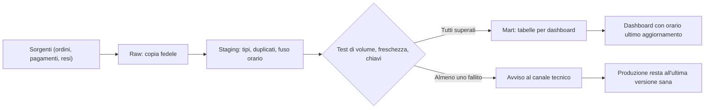

Scenario costruito, con numeri di esempio: un e-commerce italiano di abbigliamento imposta l'aggiornamento di tutte le 24 tabelle commerciali ogni cinque minuti, perché il direttore vuole "i numeri in tempo reale". Dopo un mese la fattura del warehouse è triplicata. Quando l'analista controlla gli accessi alle dashboard scopre che le viste direzionali vengono aperte una volta al giorno, alle nove del mattino, durante la riunione commerciale. Per ventitré ore e cinquantacinque minuti al giorno la pipeline lavora per nessuno.

## Il refresh costa, e il ritardo ha un prezzo

Una pipeline ETL per la business intelligence serve a consegnare dati che qualcuno usa per decidere. Tre grandezze si tengono in equilibrio e nessuna può essere massimizzata da sola: la freschezza del dato, l'affidabilità dei numeri e il costo di elaborazione. Se spingi la freschezza al massimo, il costo cresce quasi in proporzione al numero di esecuzioni e aumenta la probabilità di leggere dati parziali, perché ogni esecuzione può cadere nel mezzo di un caricamento a monte. Se spingi l'affidabilità senza guardare i costi, finisci con controlli così pesanti da ritardare ogni pubblicazione.

> **Idea chiave:** la frequenza di refresh non si decide in base al desiderio di avere numeri "live", ma in base al momento in cui qualcuno prende la decisione che quel numero deve guidare, e a quanto costa aspettare.

Il ragionamento si traduce in una domanda semplice da porre a ogni committente prima di scrivere una riga di codice: chi guarda questa dashboard, quante volte al giorno, e che cosa cambia se il dato ha sei ore di ritardo. Se la risposta è "niente, decidiamo il lunedì", un refresh notturno è la scelta corretta e costa una frazione del refresh continuo.

## Dalla decisione alla frequenza di aggiornamento

La tabella seguente raccoglie tre famiglie di dashboard con esigenze molto diverse. Le frequenze indicate sono punti di partenza ragionevoli, da correggere con i log di accesso della tua organizzazione.

| Tipo di dashboard | Frequenza tipica | Costo del ritardo | Test richiesti |
| :--- | :--- | :--- | :--- |
| Executive e finanza | Giornaliera, prima delle 08:00 | Basso entro 24 ore | Riconciliazione contabile e controllo dei valori nulli |
| Marketing e acquisizione | Ogni 4-6 ore | Medio: ottimizzazione delle campagne in corso | Volume minimo e integrità dei canali |
| Operazioni e logistica | Ogni 15-30 minuti | Alto: blocchi di spedizione e antifrode | Freschezza e avviso immediato su Slack |

La riga operativa merita un commento a parte. Un ritardo di un'ora su un cruscotto di magazzino significa spedizioni sbagliate, quindi lì il costo del ritardo giustifica un refresh frequente. La stessa logica applicata al cruscotto direzionale produce soltanto una bolletta più alta. Non esiste una frequenza corretta in assoluto: esiste una frequenza proporzionata al ciclo decisionale di chi legge.

## Quanto costa davvero il refresh uniforme: un calcolo completo

Riprendiamo lo scenario dell'e-commerce con 24 tabelle e stimiamo il costo con un prezzo unitario di 0,02 euro per esecuzione di una tabella, un numero di esempio che ti permette di rifare il conto con il tuo listino.

Con il refresh uniforme ogni cinque minuti ci sono 24 ore × 60 min / 5 min = 288 esecuzioni al giorno per tabella. Su 24 tabelle otteniamo 24 × 288 = 6.912 esecuzioni giornaliere, pari a 6.912 × 0,02 euro = 138,24 euro al giorno.

Dopo il confronto con i log di accesso classifichiamo le tabelle in tre gruppi: 10 tabelle alimentano le viste executive (1 esecuzione al giorno), 8 alimentano il marketing (una ogni 4 ore, cioè 6 esecuzioni al giorno) e 6 alimentano le operazioni (una ogni 15 minuti, cioè 96 esecuzioni al giorno). Il totale è 10 × 1 + 8 × 6 + 6 × 96 = 10 + 48 + 576 = 634 esecuzioni al giorno, cioè 634 × 0,02 euro = 12,68 euro al giorno.

La differenza è 138,24 - 12,68 = 125,56 euro al giorno, pari a 125,56 × 30 = 3.766,80 euro al mese. In termini relativi la riduzione è 125,56 / 138,24 = 90,8%. Le esecuzioni scendono da 6.912 a 634, quindi 6.278 esecuzioni in meno ogni giorno, e nessuna decisione reale è stata rallentata, perché le tabelle che servono le decisioni rapide mantengono la frequenza alta.

Nota che il 91% del risparmio arriva dal fatto di aver smesso di aggiornare spesso ciò che non serve. Nessuna ottimizzazione SQL darebbe un ritorno paragonabile.

## Raw, staging e mart: tre livelli con una responsabilità ciascuno

Una pipeline pensata per la BI separa i dati in livelli, e ogni livello risponde a una sola domanda. Il livello raw conserva ciò che arriva dalle sorgenti senza modifiche, così puoi sempre rifare un calcolo. Il livello di staging pulisce tipi, duplicati e fusi orari. Il livello mart contiene tabelle già al grain che serve alle dashboard, con definizioni di business scritte una volta sola.



Il punto decisivo del diagramma è il rombo centrale: la pubblicazione dal livello di staging al mart avviene solo se i test passano. In caso di fallimento la dashboard continua a leggere la versione precedente, ed è importante che mostri la data di quell'aggiornamento, altrimenti nessuno si accorge che il dato è fermo.

## Test automatici prima della pubblicazione

Un test efficace costa poco e protegge molto. Tre controlli coprono quasi tutti i guasti reali: il volume (la tabella ha almeno qualche riga e non ne ha perse la metà), la freschezza (l'ultimo record non è troppo vecchio) e l'integrità referenziale (ogni chiave dei fatti esiste nella dimensione corrispondente).

```sql
-- Controllo di volume e freschezza sul lotto in staging (ClickHouse)
SELECT
  count() AS rows_loaded,
  countIf(customer_id IS NULL) AS null_customers,
  dateDiff('minute', max(updated_at), now()) AS lag_minutes
FROM staging.mart_daily_kpis
HAVING rows_loaded = 0 OR null_customers > 0 OR lag_minutes > 120;
```

La query restituisce una riga solo se qualcosa non va: zero righe caricate, clienti nulli o un ritardo superiore ai 120 minuti dello SLA. L'orchestratore interpreta una riga come "stop". Il secondo controllo cerca le chiavi orfane, cioè gli ordini con un canale che non esiste nella tabella dimensione.

```sql
-- Integrità referenziale: ordini con canale assente dalla dimensione
SELECT count() AS orphan_orders
FROM staging.fact_orders AS o
LEFT ANTI JOIN dim.channels AS c ON o.channel_id = c.channel_id
HAVING orphan_orders > 0;
```

Se questa query restituisce un valore, c'è un nuovo canale pubblicitario entrato nei fatti prima di essere registrato nella dimensione. Senza il controllo, un normale `INNER JOIN` nel mart farebbe sparire quegli ordini dalla dashboard senza alcun errore visibile.

## Ambienti separati e orchestrazione versionata

Le trasformazioni vivono in un repository, non in una finestra di editor collegata alla produzione. Ogni modifica passa da un ambiente di sviluppo con una copia ridotta dei dati, poi da un ambiente di test con volumi reali, e solo dopo viene promossa in produzione. La definizione della pianificazione resta in un file versionato, così chi arriva dopo di te sa quando e perché una tabella viene ricalcolata.

```yaml
# Pianificazione della pipeline BI: frequenza per gruppo di tabelle
pipeline: bi_daily_marts
environments:
  dev:  { schema: dev_bi,  sample_rate: 0.05 }
  test: { schema: test_bi, sample_rate: 1.0 }
  prod: { schema: bi,      sample_rate: 1.0 }
schedules:
  - group: executive
    cron: "30 5 * * *"        # una volta al giorno, prima delle 08:00
  - group: marketing
    cron: "0 */4 * * *"       # ogni 4 ore
  - group: operations
    cron: "*/15 * * * *"      # ogni 15 minuti
gates:
  - volume_min_rows: 1
  - freshness_max_minutes: 120
  - orphan_keys_max: 0
```

La separazione degli schemi impedisce il caso classico: una colonna nuova testata direttamente sulla tabella che le dashboard stanno leggendo, con numeri ballerini nel mezzo della giornata lavorativa.

## Dati tardivi: la finestra mobile di ricarica

In molti settori i dati di una giornata continuano ad arrivare per giorni. I resi di un e-commerce o le conferme bancarie di un incasso possono comparire fino a cinque giorni dopo. Se la pipeline elabora solo "ieri", quei record restano fuori per sempre dal totale del giorno a cui appartengono.

Prendiamo il giorno D con 40.000 ordini e il 3% di resi. I resi totali sono 40.000 × 3% = 1.200 e arrivano così: 500 il giorno D+1, 300 il D+2, 200 il D+3, 120 il D+4 e 80 il D+5. Somma: 500 + 300 + 200 + 120 + 80 = 1.200. Una pipeline che guarda solo ieri registra, al momento della chiusura notturna del giorno D+1, 500 resi su 1.200, cioè il 41,7% del totale: il tasso di reso del giorno D appare pari a 500 / 40.000 = 1,25% invece del 3,0% reale, una sottostima di 1,75 punti percentuali. Con una finestra di ricarica di 7 giorni il valore si corregge a mano a mano che i record arrivano e a D+5 il tasso è 1.200 / 40.000 = 3,0%.

```sql
-- Ricarica incrementale degli ultimi 7 giorni, sostituendo le partizioni (ClickHouse)
ALTER TABLE bi.mart_daily_returns
  DELETE WHERE day >= today() - 7;

INSERT INTO bi.mart_daily_returns
SELECT toDate(returned_at) AS day, count() AS returns_count
FROM staging.returns
WHERE returned_at >= today() - 7
GROUP BY day;
```

Cancellare e reinserire la finestra rende l'operazione idempotente: se la pipeline viene eseguita due volte, il risultato non cambia. Per tabelle molto grandi si preferisce sostituire intere partizioni giornaliere invece di usare `DELETE`, ma il principio resta lo stesso.

## Tre errori che minano la fiducia nelle dashboard

### Aggiornare la produzione durante lo sviluppo

Il sintomo è un numero che cambia tra le dieci e le undici del mattino senza che nessuno abbia toccato i dati. Succede perché è comodo provare la modifica dove i dati già esistono, e un `TRUNCATE` seguito da un `INSERT` sembra un'operazione veloce. Per quei pochi secondi, però, la tabella è vuota o parziale. Si evita scrivendo sempre in uno schema di staging e promuovendo la tabella solo dopo i test, con una sostituzione atomica.

### Saltare i test di integrità referenziale

Il sintomo è un fatturato della dashboard più basso di quello contabile, con una differenza che non corrisponde a nessun errore di calcolo. La causa è un join interno che scarta in silenzio le righe con una chiave senza corrispondenza, ad esempio un canale nuovo non ancora presente nella dimensione. Il rimedio è il controllo con `LEFT ANTI JOIN` mostrato sopra, eseguito prima della pubblicazione, e una regola per cui un canale nuovo viene registrato nella dimensione prima di apparire nei fatti.

### Non registrare l'orario dell'ultimo caricamento riuscito

Il sintomo è un dirigente che commenta i dati "di oggi" mentre sta leggendo quelli di ieri, perché la pipeline notturna è fallita e nessuno lo ha segnalato. Succede perché una dashboard senza data di aggiornamento sembra sempre fresca. Si risolve con una piccola tabella di metadati che registra l'ultima esecuzione riuscita e con un'etichetta ben visibile in ogni vista, accanto al titolo.

## Verifica sulla tua pipeline

1. Una tabella alimenta una dashboard consultata solo il lunedì in riunione. Quale frequenza scegli e con quale argomento la difendi davanti a chi chiede il tempo reale?

<details>
<summary>Mostra risposta</summary>

Un aggiornamento giornaliero o al massimo ogni 4 ore, completato prima della riunione. L'argomento è il ciclo decisionale: se la decisione si prende una volta a settimana, ogni esecuzione tra un lunedì e l'altro costa denaro senza cambiare nessuna scelta. Puoi portare il conto dello scenario: da 6.912 a 634 esecuzioni al giorno, un risparmio del 90,8%.

</details>

2. Con un prezzo di 0,02 euro per esecuzione, quanto costa al giorno una tabella aggiornata ogni 15 minuti?

<details>
<summary>Mostra risposta</summary>

Ogni 15 minuti sono 24 × 60 / 15 = 96 esecuzioni al giorno, quindi 96 × 0,02 euro = 1,92 euro al giorno, circa 57,60 euro in 30 giorni.

</details>

3. Perché la query di controllo restituisce una riga solo in caso di problema, invece di restituire sempre un esito positivo o negativo?

<details>
<summary>Mostra risposta</summary>

Perché l'orchestratore può interpretare il risultato in modo semplice: nessuna riga significa tutto in regola, una riga significa blocco della pubblicazione. Un test che restituisce sempre un valore richiede una seconda logica per decidere se quel valore è accettabile, e la soglia finisce nascosta fuori dalla query.

</details>

4. Il giorno D ha 40.000 ordini e 1.200 resi totali, di cui 500 arrivati il giorno dopo. Che tasso di reso vede la dashboard alla chiusura notturna di D+1 se non c'è finestra di ricarica, e quanto manca al valore reale?

<details>
<summary>Mostra risposta</summary>

Vede 500 / 40.000 = 1,25%. Il valore reale è 1.200 / 40.000 = 3,0%. Mancano 1,75 punti percentuali, cioè 700 resi che arriveranno nei giorni successivi e verranno recuperati solo se la pipeline ricarica gli ultimi giorni.

</details>

5. Una pipeline notturna fallisce e la dashboard mostra ancora i numeri di ieri senza alcuna indicazione. Quale modifica minima impedisce che il problema passi inosservato?

<details>
<summary>Mostra risposta</summary>

Una tabella di metadati con l'orario dell'ultimo caricamento riuscito, letta dalla dashboard e mostrata accanto al titolo. Aggiungi un avviso al canale tecnico quando il ritardo supera lo SLA, così il guasto viene segnalato prima che qualcuno lo noti leggendo un numero vecchio.

</details>
