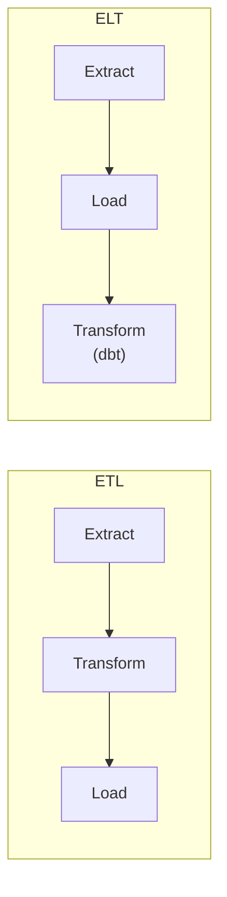

# ETL e Data Pipeline per la Visualizzazione

> **Obiettivo:** Costruire pipeline dati affidabili che alimentino le dashboard con dati puliti e aggiornati.

## 1. ETL vs ELT

| Approccio | Processo | Quando Usarlo |
|:---|:---|:---|
| **ETL** | Extract → Transform → Load | Dati sensibili, trasformazioni complesse |
| **ELT** | Extract → Load → Transform | Cloud DW moderni, dbt |



## 2. Pipeline con dbt

```sql
-- models/staging/stg_orders.sql
WITH source AS (
    SELECT * FROM {{ source('shopify', 'orders') }}
),
cleaned AS (
    SELECT
        id AS order_id,
        customer_id,
        CAST(created_at AS DATE) AS order_date,
        total_price - total_discounts - total_tax AS net_revenue,
        financial_status,
        fulfillment_status
    FROM source
    WHERE financial_status = 'paid'
      AND cancelled_at IS NULL
)
SELECT * FROM cleaned
```

```sql
-- models/marts/mart_daily_revenue.sql
SELECT
    order_date,
    COUNT(DISTINCT order_id) AS orders,
    COUNT(DISTINCT customer_id) AS unique_customers,
    SUM(net_revenue) AS revenue,
    ROUND(SUM(net_revenue) / COUNT(DISTINCT order_id), 2) AS aov
FROM {{ ref('stg_orders') }}
GROUP BY order_date
```

## 3. Data Quality Checks

```sql
-- tests/assert_revenue_positive.sql
SELECT order_id, net_revenue
FROM {{ ref('stg_orders') }}
WHERE net_revenue <= 0

-- Se restituisce righe, il test fallisce
```

```python
# Test automatici per la pipeline
def test_data_freshness(engine, table: str, max_hours: int = 24):
    """Verifica che i dati siano aggiornati."""
    result = engine.execute(f"""
        SELECT MAX(updated_at) as last_update,
               EXTRACT(hours FROM NOW() - MAX(updated_at)) as hours_ago
        FROM {table}
    """).fetchone()
    assert result.hours_ago < max_hours, f"Dati vecchi di {result.hours_ago}h!"
```

## 4. Orchestrazione

| Tool | Tipo | Prezzo |
|:---|:---|:---|
| **cron + dbt** | Semplice, affidabile | Gratis |
| **Airflow** | Enterprise, DAG complessi | Gratis (self-hosted) |
| **Dagster** | Modern, developer-friendly | Gratis (self-hosted) |
| **Prefect** | Cloud-native | Freemium |

## Risorse
- **Tool:** dbt Core, Airbyte, Airflow
- **Best Practice:** Idempotenza, incremental models, testing
