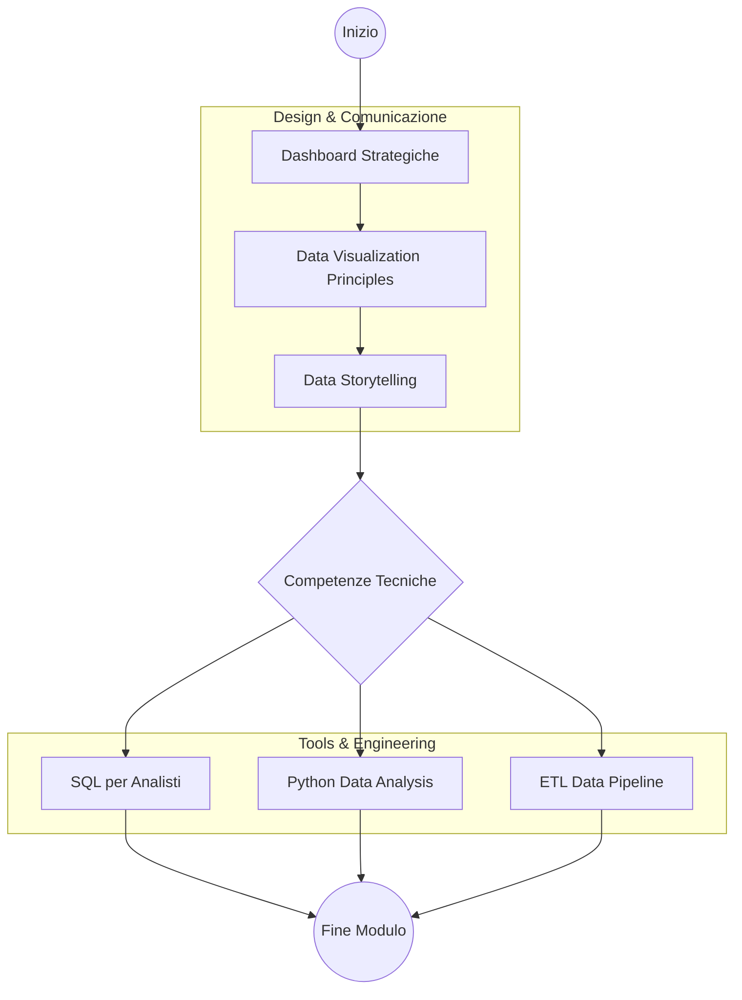

## Panoramica del Modulo

Il modulo **Dashboard & Data Visualization** si concentra sull'ultimo miglio dell'analisi: la comunicazione. Puoi avere i modelli statistici più sofisticati del mondo, ma se non riesci a spiegarli o a renderli azionabili per i decision-maker, il tuo lavoro perde valore.
In questo modulo imparerai a progettare dashboard che non sono solo "belle", ma **utili**. Passeremo dai principi di design visuale alla narrazione (Data Storytelling), fino alle competenze tecniche necessarie per estrarre e preparare i dati in autonomia (SQL, Python, ETL).

## Obiettivi di Apprendimento

Al termine di questo modulo sarai in grado di:

- **Progettare** dashboard strategiche che rispondono a domande di business precise, evitando il "caos visivo".
- **Scegliere** il grafico giusto per ogni tipo di dato, applicando i principi della percezione visiva (Gestalt).
- **Raccontare** una storia con i dati (Data Storytelling) per influenzare le decisioni e guidare il cambiamento.
- **Scrivere** query SQL intermedie per estrarre dati grezzi dai database.
- **Utilizzare** Python (Pandas/Matplotlib) per analisi esplorative e visualizzazioni custom.
- **Comprendere** il flusso di una pipeline ETL (Extract, Transform, Load) per automatizzare l'aggiornamento dei dati.

## Prerequisiti

- Concetti base di analisi dati (media, tendenza, categorie).
- Nessuna esperienza di programmazione richiesta (partiremo dalle basi per SQL e Python).

## Percorso delle Lezioni

| N° | Lezione | Argomento Principale | Durata | Difficoltà |
| :-- | :--- | :--- | :--- | :--- |
| 1 | **Dashboard Strategiche** | Definire KPI e layout per i decision-maker | 40 min | ⭐⭐ |
| 2 | **Data Visualization** | Teoria del colore, scelta dei grafici e best practice | 50 min | ⭐⭐ |
| 3 | **Storytelling con i Dati** | Strutturare una narrazione efficace | 45 min | ⭐⭐ |
| 4 | **SQL per Analisti** | Interrogare i database relazionali | 60 min | ⭐⭐⭐ |
| 5 | **Python Data Analysis** | Analisi e visualizzazione con codice | 60 min | ⭐⭐⭐ |
| 6 | **ETL Data Pipeline** | Automatizzare il flusso dei dati | 50 min | ⭐⭐⭐ |

## Competenze Acquisite

**Competenze Tecniche:**
- Scrittura di query SQL (SELECT, JOIN, GROUP BY).
- Manipolazione dati con Python (Libreria Pandas).
- Design di dashboard interattive (principi applicabili a Tableau, PowerBI, Looker).
- Comprensione dell'architettura dei dati (Pipeline ETL).

**Competenze Analitiche:**
- Capacità di sintesi visiva: trasformare tabelle complesse in insight immediati.
- Data Storytelling: strutturare un'analisi come un racconto con un inizio, uno svolgimento e una raccomandazione finale.
- Pensiero critico nella scelta delle metriche da visualizzare (evitare le vanity metrics).

## Tempo Stimato

- **Durata Totale:** Circa 6-7 ore di studio (lezioni + esercizi di codice).
- **Tempo Consigliato:** 2 settimane (3 lezioni a settimana).

## Come Usare Questo Modulo

Questo modulo ha una doppia anima: **Design** e **Codice**.
Per la parte di Design (Dashboard, Viz, Storytelling), esercitati a criticare le dashboard che vedi in giro o quelle che usi al lavoro: cosa funziona? Cosa confonde?
Per la parte Tecnica (SQL, Python), l'unico modo per imparare è scrivere codice. Non limitarti a leggere: apri l'editor e prova gli esempi. Gli errori di sintassi sono i tuoi migliori maestri.
