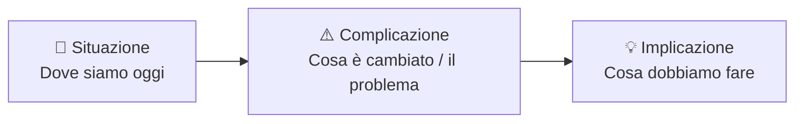

# Storytelling con i Dati

> **Obiettivo:** Trasformare numeri e grafici in narrative persuasive che guidano le decisioni aziendali.

## 1. Perché lo Storytelling è Cruciale

Un'analisi perfetta che nessuno capisce ha **zero impatto**. Lo storytelling trasforma i dati in decisioni.

| Solo Dati 🚫 | Dati + Storia ✅ |
|:---|:---|
| "Il churn è 4.2%" | "Stiamo perdendo 84 clienti al mese — €420K/anno di revenue" |
| "CT rate è 2.3%" | "Solo 2 persone su 100 cliccano — stiamo sprecando il 98% del budget" |
| "NPS è 32" | "1 cliente su 3 ci raccomanderebbe — ma 1 su 5 ci sconsiglia attivamente" |

## 2. Il Framework SCI

Ogni presentazione dati efficace segue la struttura **SCI**:



### Esempio

```
SITUAZIONE: "Il nostro e-commerce genera €500K/mese con un AOV di €75"
COMPLICAZIONE: "Negli ultimi 3 mesi il cart abandonment è salito dal 65% al 78%"  
IMPLICAZIONE: "Se non interveniamo, perderemo €180K/anno. 
              Propongo: (1) email recupero carrello, (2) semplificare il checkout"
```

## 3. Regole di Visualizzazione per lo Storytelling

| Regola | Applicazione |
|:---|:---|
| **Annota** | Evidenzia i punti importanti direttamente sul grafico |
| **Confronta** | Mostra sempre il "prima vs dopo" o "noi vs benchmark" |
| **Semplifica** | Un grafico = un messaggio |
| **Colore con scopo** | Grigio per contesto, colore per il focus |
| **Titolo = Insight** | Non "Revenue per mese" ma "Revenue in calo del 12% da ottobre" |

## 4. Template per Presentazione Dati

```python
presentation_template = {
    "title": "Analisi Cart Abandonment Q4 2025",
    "audience": "Leadership team",
    "duration": "10 minuti",
    "slides": [
        {"type": "context", "content": "Obiettivo: ridurre cart abandonment del 15%"},
        {"type": "data", "chart": "line_chart_abandonment_trend", "insight": "Peggiorato del 20% in 3 mesi"},
        {"type": "diagnosis", "content": "Il 60% abbandona al form di pagamento"},
        {"type": "recommendation", "content": "3 azioni: guest checkout, Apple Pay, email recovery"},
        {"type": "impact", "content": "Impatto stimato: +€180K/anno, implementazione: 3 settimane"}
    ]
}
```

## 5. Errori di Storytelling

| Errore | Soluzione |
|:---|:---|
| Iniziare con la metodologia | Inizia con il risultato |
| Troppi grafici | Max 1 grafico per minuto di presentazione |
| Nessuna raccomandazione | Ogni analisi finisce con "Cosa fare" |
| Gergo tecnico | Parla la lingua del pubblico |

## Risorse
- **Libro:** *Storytelling with Data* — Cole Nussbaumer Knaflic
- **Libro:** *The Pyramid Principle* — Barbara Minto
