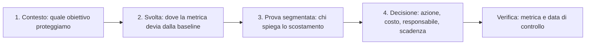

Scenario costruito, con numeri di esempio: in un team prodotto italiano l'analista presenta la rassegna mensile del tasso di abbandono, dodici slide con dodici metriche in ordine cronologico, dalla più vecchia alla più recente. I manager annuiscono, ringraziano e chiudono la riunione senza assegnare una sola azione. Nessuno ha capito quale gruppo di clienti stia davvero andando via e quanto costi lasciarlo andare, perché la risposta era nella slide nove, tra due grafici che sembravano uguali.

## Perché una rassegna di grafici non muove nessuno

Un elenco di metriche risponde alla domanda "che cosa abbiamo misurato", mentre chi siede in riunione si sta chiedendo "che cosa devo decidere". Se la presentazione segue l'ordine in cui l'analista ha esplorato i dati, chi ascolta deve ricostruire da solo il percorso, e di solito rinuncia a metà. L'analisi migliore del mondo, consegnata in questa forma, produce lo stesso effetto di nessuna analisi.

> **Idea chiave:** un grafico senza baseline e senza decisione proposta è solo informazione passiva; lo storytelling trasforma l'evidenza in scelta, e lo fa riordinando i fatti secondo le domande di chi decide, non secondo la cronologia del tuo lavoro.

Raccontare con i dati non significa abbellire i numeri né semplificarli fino a falsarli. Significa scegliere quali fatti servono alla decisione, metterli nell'ordine in cui il pubblico ne ha bisogno e dire chiaramente che cosa propone l'analista di fare lunedì mattina.

## I quattro atti della narrazione analitica

Una presentazione che muove una decisione segue quattro passaggi. Il contesto dice quale obiettivo stiamo proteggendo e perché oggi guardiamo quel numero. La svolta mostra il punto in cui la metrica si stacca dalla sua baseline storica. La prova segmentata indica dove si concentra il fenomeno, per esempio quale canale, quale fascia di clienti o quale coorte spiega la maggior parte dello scostamento. La decisione chiude con una raccomandazione concreta, con un responsabile, una scadenza e una stima dell'effetto.

La tabella associa a ogni atto la domanda a cui risponde, l'elemento visivo più adatto e l'errore più comune.

| Atto | Domanda del pubblico | Elemento visivo | Errore tipico |
| :--- | :--- | :--- | :--- |
| 1. Contesto | Perché guardiamo questo numero oggi? | KPI attuale contro obiettivo | Aprire con dettagli tecnici di estrazione |
| 2. Svolta | Che cosa è cambiato e da quando? | Serie storica con punto di rottura | Mostrare una media senza trend |
| 3. Prova segmentata | Dove si concentra il fenomeno? | Barre ordinate per segmento | Mostrare solo il totale aggregato |
| 4. Decisione | Che cosa facciamo lunedì mattina? | Tabella di opzioni con costo e impatto | Chiudere con "monitoriamo" |

Il quarto atto è quello che più spesso manca, ed è anche quello che giustifica gli altri tre. Un'analisi che finisce al terzo atto lascia al pubblico il compito di decidere, e in assenza di un'indicazione la decisione più probabile è non fare niente.

## Un calo di retention raccontato in quattro atti

Applichiamo la struttura a un caso con numeri. Un servizio in abbonamento misura la retention a 30 giorni, cioè la quota di utenti di una coorte ancora attivi dopo un mese. La coorte di settembre ha 10.000 utenti e quella di ottobre ne ha altrettanti.

**Contesto.** L'obiettivo trimestrale è una retention a 30 giorni di almeno il 63%. A settembre il servizio era in linea.

**Svolta.** Per settembre la retention complessiva è del 64,7%, mentre per ottobre scende al 56,6%. Il calo è di 8,1 punti percentuali, e l'obiettivo è mancato di 6,4 punti. Su 10.000 utenti, 8,1 punti equivalgono a 810 utenti in meno ancora attivi.

**Prova segmentata.** Il totale non dice dove guardare, quindi si scompone per canale di acquisizione. Settembre: organico 5.000 utenti con retention del 69%, email 3.000 con il 62%, social a pagamento 2.000 con il 58%. Ottobre: organico 4.000 al 68%, email 3.000 al 62%, social a pagamento 3.000 al 36%.

Si calcolano gli utenti trattenuti in ciascun canale. A settembre: 5.000 × 69% = 3.450, 3.000 × 62% = 1.860 e 2.000 × 58% = 1.160, per un totale di 6.470 su 10.000, cioè 64,7%. A ottobre: 4.000 × 68% = 2.720, 3.000 × 62% = 1.860 e 3.000 × 36% = 1.080, per un totale di 5.660 su 10.000, cioè 56,6%. La differenza è 6.470 - 5.660 = 810 utenti, coerente con gli 8,1 punti.

Per isolare il responsabile si fa un controfattuale: se il canale social a pagamento avesse mantenuto il 58% di settembre sui suoi 3.000 utenti di ottobre, avrebbe trattenuto 3.000 × 58% = 1.740 utenti invece di 1.080, cioè 660 in più. La retention complessiva sarebbe stata (2.720 + 1.860 + 1.740) / 10.000 = 63,2%, quasi sull'obiettivo. Quindi il calo del solo canale a pagamento spiega 660 / 810 = 81,5% dello scostamento. I restanti 150 utenti, il 18,5%, dipendono dal cambio di mix e da piccoli cali negli altri canali.

Questa frase è l'asse della presentazione: "L'81% del calo viene da un solo canale, cresciuto da 2.000 a 3.000 utenti con una retention scesa dal 58% al 36%". Il pubblico non ha bisogno di sapere altro per capire dove guardare.

## Dalla prova alla decisione: confrontare opzioni con costo e impatto

La decisione si presenta come un confronto tra opzioni, non come una sola proposta. Per ciascuna serve il costo, l'effetto atteso e il valore che ne deriva. Assumiamo, come numero di esempio, che un utente trattenuto valga 40 euro e che acquisire un utente dal canale a pagamento costi 9 euro.

| Opzione | Costo | Effetto atteso | Valore netto mensile |
| :--- | :--- | :--- | :--- |
| A. Correggere l'onboarding del canale a pagamento | 12.000 euro una tantum | Recupero di metà dei 660 utenti persi, cioè 330 | 330 × 40 = 13.200 euro, meno 12.000 = +1.200 euro nel primo mese |
| B. Dimezzare il budget del canale | Risparmio di 1.500 × 9 = 13.500 euro di acquisizione | Si perdono 1.500 × 36% = 540 utenti trattenuti, cioè 21.600 euro | 13.500 - 21.600 = -8.100 euro |
| C. Monitorare senza intervenire | 0 euro | Si continuano a perdere 660 utenti al mese | 660 × 40 = -26.400 euro al mese di valore non realizzato |

Il confronto cambia la conversazione. L'opzione B, che sembra prudente perché riduce la spesa, è in realtà la peggiore tra quelle che agiscono, mentre l'opzione C ha un costo nascosto di 26.400 euro al mese. L'opzione A ha un ritorno modesto nel primo mese ma ricorrente nei successivi: dal secondo mese il costo una tantum è già pagato e il recupero di 330 utenti vale 13.200 euro al mese. La raccomandazione è A, con un responsabile, una scadenza di tre settimane e una verifica fissata a fine novembre sulla retention della coorte successiva.

Dichiarare le assunzioni, qui il valore di 40 euro e il recupero della metà degli utenti, è parte della persuasione. Chi ascolta può contestarle, e se le contesta la discussione passa a un parametro preciso invece che a un'impressione generale.

## Come scrivere i titoli e il messaggio di ogni slide

Il titolo di una slide è la frase che il pubblico ricorderà, quindi deve dichiarare la conclusione e non il nome della variabile. "Retention a 30 giorni per canale" è un'etichetta, mentre "Il canale a pagamento spiega l'81% del calo di retention di ottobre" è un messaggio. Se riesci a leggere in sequenza solo i titoli di tutta la presentazione e a ricostruire la storia, la struttura regge.

Un modello utile per preparare la presentazione è una scheda di tre righe da compilare prima di aprire gli strumenti grafici.

> **Scheda della storia.** Decisione richiesta: che cosa deve scegliere il pubblico e entro quando.
> Prova in una frase: il fatto numerico che sostiene la scelta, con baseline e segmento.
> Azione proposta: chi fa che cosa, con costo stimato, effetto atteso e metrica di verifica.

Se non riesci a compilare le tre righe, il problema è nell'analisi e non nelle slide. Aggiungere grafici non lo risolve.

## Quando i dati contraddicono un progetto voluto dalla direzione

Capita che un'analisi solida smentisca un'iniziativa che la direzione ha sostenuto a lungo. In questi casi il tono conta quanto il contenuto. Riconosci l'obiettivo dichiarato dal progetto, mostra la prova segmentata in modo neutro, senza aggettivi, e porta subito una proposta costruttiva: un test ridotto, una modifica di un parametro o una verifica con un gruppo di controllo. Chi ha investito in un'idea reagisce meglio a una strada per salvarne l'obiettivo che a una dimostrazione che aveva torto. Se i numeri sono incerti, dichiara anche questo: un intervallo di valori dice più di una stima precisa che nessuno crede.

## Tre segnali di una narrazione debole

### Il totale che nasconde il segmento

Il sintomo è una frase come "la retention media è scesa di quattro punti" seguita da discussioni su che cosa fare, senza che nessuno proponga qualcosa di specifico. Succede perché la media è il primo numero disponibile e sembra sufficiente. Si corregge scomponendo sempre per le due o tre dimensioni che il business controlla, come canale, piano o coorte, e dicendo quale quota del calo spiega ciascuna.

### La variazione senza baseline né peso economico

Il sintomo è un'attenzione sproporzionata a un +20% su un segmento minuscolo, mentre un -3% sul segmento che produce il 70% del margine passa inosservato. Succede perché le variazioni percentuali sembrano comparabili, anche se non lo sono. Si risolve affiancando a ogni variazione la baseline e il peso, in euro o in utenti.

### La chiusura senza azione

Il sintomo è la frase "teniamo d'occhio il fenomeno". Sembra prudente, ma lascia in sospeso la decisione e ha un costo, come mostra l'opzione C, che perde 26.400 euro al mese. Si evita chiudendo sempre con almeno due opzioni operative, con pro, contro e stima dell'effetto.

## Verifica sulla tua presentazione

1. Un'analisi mostra una retention scesa dal 64,7% al 56,6% su 10.000 utenti. Quanti utenti trattenuti in meno rappresenta il calo?

Mostra risposta

Il calo è 64,7 - 56,6 = 8,1 punti percentuali. Su 10.000 utenti sono 10.000 × 8,1% = 810 utenti in meno ancora attivi dopo 30 giorni, coerente con 6.470 - 5.660 = 810.

2. Il canale a pagamento ha 3.000 utenti con retention al 36%, contro il 58% di settembre. Quanta parte del calo complessivo spiega?

Mostra risposta

Con il 58% avrebbe trattenuto 3.000 × 58% = 1.740 utenti invece di 3.000 × 36% = 1.080, cioè 660 in più. Rispetto agli 810 utenti persi in totale, 660 / 810 = 81,5%.

3. Perché l'opzione "dimezzare il budget del canale" risulta peggiore dell'intervento sull'onboarding?

Mostra risposta

Perché risparmia 1.500 × 9 = 13.500 euro di acquisizione ma rinuncia a 1.500 × 36% = 540 utenti trattenuti, che valgono 540 × 40 = 21.600 euro. Il saldo è 13.500 - 21.600 = -8.100 euro, mentre l'onboarding corretto ha un saldo positivo già nel primo mese e più alto nei successivi.

4. Come trasformi il titolo "Retention a 30 giorni per canale" in un messaggio?

Mostra risposta

Dichiari la conclusione che il grafico dimostra, per esempio "Il canale a pagamento spiega l'81% del calo di retention di ottobre". Il titolo deve contenere il segmento, la direzione e la quantità, così chi legge solo i titoli ricostruisce la storia.

5. Quale informazione manca a una presentazione che termina con "continuiamo a monitorare"?

Mostra risposta

Manca la decisione: almeno due opzioni con costo, effetto atteso, responsabile e scadenza. Senza queste, il pubblico non ha nulla da approvare e il costo dell'inazione, che si può calcolare, resta invisibile.

