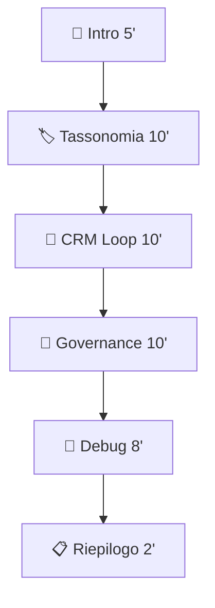
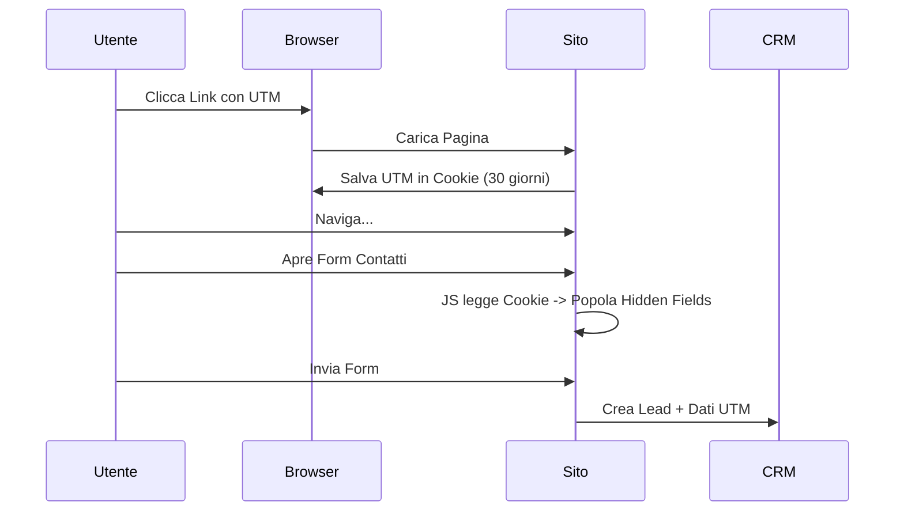

## Analisi End-to-End con UTM: Dal Clic al Fatturato — Lezione Completa

Immagina di spendere 1 milione di euro in pubblicità e non sapere quali campagne hanno portato i clienti paganti. È l'incubo di ogni marketer, ma è la realtà per chi non padroneggia i parametri UTM. I link "nudi" sono muti. I link con UTM raccontano una storia. In questa lezione, impareremo a costruire una tassonomia di tracciamento rigorosa che collega il primo clic su Facebook all'ultima fattura nel CRM.

### Obiettivi di Apprendimento

Al termine di questa lezione, lo studente sarà in grado di:
1.  Progettare una nomenclatura UTM standardizzata per evitare la frammentazione dei dati (es. "facebook" vs "Facebook").
2.  Utilizzare i 5 parametri standard (`source`, `medium`, `campaign`, `term`, `content`) in modo strategico.
3.  Implementare script per catturare gli UTM nei form del sito e passarli al CRM (Hidden Fields).
4.  Analizzare i dati UTM per calcolare il ROI reale per campagna, non solo i clic.
5.  Evitare gli errori comuni come l'uso di UTM nei link interni o nei redirect 301 errati.

### Timeline della Lezione

| Fase | Argomento | Durata |
|------|-----------|--------|
| 1 | Introduzione: Il ponte tra Ad e CRM | 5 min |
| 2 | Teoria: La Tassonomia UTM Perfetta | 10 min |
| 3 | Tecnica: Implementazione End-to-End | 10 min |
| 4 | Strategia: Governance e Automazione | 10 min |
| 5 | Esercizi: Debugging di Link Rotti | 8 min |
| 6 | Riepilogo e Domande | 2 min |
| **Totale** | | **45 min** |

### Fase 1 — Introduzione: Il ponte tra Ad e CRM (5 min)

Google Analytics ti dice che hai avuto 100 visite da "Facebook". Il CRM ti dice che hai avuto 10 vendite.
Ma *quale* campagna Facebook ha generato quelle vendite? Quella video o quella carosello? Quella con lo sconto o quella emozionale?
Senza UTM, questo collegamento è spezzato.

L'**Analisi End-to-End** significa tracciare l'utente lungo tutto il funnel:
`Ad Cliccato (UTM) -> Visita Sito -> Lead Form (UTM salvati) -> CRM -> Offerta -> Fattura`.

### Fase 2 — Teoria: La Tassonomia UTM Perfetta (10 min)

Gli UTM (Urchin Tracking Module) sono parametri aggiunti alla fine dell'URL. Non cambiano la destinazione, ma dicono a GA4 da dove vieni.

**I 5 Parametri:**
1.  **`utm_source` (Chi?):** La piattaforma.
    *   *Standard:* `facebook`, `google`, `linkedin`, `newsletter`. (Tutto minuscolo!).
2.  **`utm_medium` (Come?):** Il mezzo.
    *   *Standard:* `cpc` (pagamento), `organic` (gratis), `email`, `referral`.
3.  **`utm_campaign` (Perché?):** Il nome della campagna marketing.
    *   *Standard:* `black_friday_2023`, `summer_sale`, `lead_gen_q1`.
4.  **`utm_content` (Cosa?):** Il contenuto creativo.
    *   *Standard:* `video_testimonial`, `banner_blu`, `cta_learn_more`.
5.  **`utm_term` (Parola chiave):** Usato per le keyword di Google Ads o per identificare l'audience (es. `lookalike_1`).

**Regola d'Oro:** Consistenza.
Se metà team scrive `utm_source=Facebook` e l'altra metà `utm_source=fb`, avrai due righe separate nei report. Usa sempre **minuscolo** e **underscore** (`_`) al posto degli spazi.

### Fase 3 — Tecnica: Implementazione End-to-End (10 min)

Come portiamo questi dati nel CRM?

**Step 1: Link in Ingresso**
L'utente clicca: `sito.com/landing?utm_source=linkedin&utm_medium=cpc`

**Step 2: Script sul Sito**
Un pezzo di JavaScript deve leggere l'URL, estrarre i parametri e salvarli in un cookie (perché l'utente potrebbe navigare 5 pagine prima di convertire).

**Step 3: Hidden Fields nel Form**
Quando l'utente compila il form "Contattaci", il form deve avere campi nascosti (`input type="hidden"`). Lo script popola questi campi con i valori del cookie.

**Step 4: CRM**
Quando il form viene inviato, nel CRM (HubSpot, Salesforce) viene creato un contatto con proprietà:
*   Nome: Mario
*   Email: mario@email.com
*   Original Source: linkedin
*   Original Campaign: black_friday

Ora puoi fare report nel CRM: "Fatturato per Campagna".

### Fase 4 — Strategia: Governance e Automazione (10 min)

Non fidarti della memoria umana. Se devi creare un link, usa un tool.

**Il foglio "URL Builder" condiviso:**
Un Google Sheet dove il marketer seleziona Source e Medium da un menu a tendina (così non sbaglia a scrivere) e il foglio genera l'URL finale.

**Validazione Automatica:**
Imposta regole in GA4 o nel Data Warehouse per pulire i dati sporchi.
*   `IF source == 'Facebook' OR source == 'fb' THEN source = 'facebook'`

**Errore da non fare mai:**
Usare UTM nei link interni (es. dal Blog alla Home).
*   *Perché:* Se l'utente arriva da Google (`organic`) e clicca su un banner interno con `utm_source=banner_interno`, GA4 chiude la sessione "Google" e ne apre una nuova "banner_interno". Hai perso l'attribuzione originale.

### Fase 5 — Esercizi: Debugging di Link Rotti (8 min)

**Scenario:** Il CEO dice "La newsletter non sta portando traffico!", ma tu sai che la gente clicca.

**Analisi del Link:**
`sito.com/offerta?utm_source=newsletter?utm_medium=email`
*   *Errore:* C'è un secondo `?` prima di `utm_medium`. Il primo parametro funziona, il secondo si rompe.
*   *Correzione:* Il primo parametro vuole `?`, tutti i successivi vogliono `&`.
    `sito.com/offerta?utm_source=newsletter&utm_medium=email`

**Analisi del Redirect (301):**
L'utente clicca `sito.com/promo` (con UTM). Il server fa redirect a `sito.com/promo-2024`.
*   *Errore:* Il server dimentica di passare i parametri al nuovo URL. Gli UTM si perdono nel salto.
*   *Soluzione:* Configurare il server (Nginx/Apache) per preservare la Query String durante i redirect.

### Fase 6 — Riepilogo e Domande (2 min)

1.  **Standardizza.** Minuscolo, niente spazi.
2.  **Persisti.** Salva i dati nel CRM, non solo in Analytics.
3.  **Tool.** Usa un URL Builder.
4.  **No Interni.** Mai UTM per link interni.

### Domande di Verifica

1.  Qual è la differenza tra `utm_source` e `utm_medium`? Fai un esempio.
2.  Perché è un errore grave usare i parametri UTM per i link interni (es. dal menu alla pagina contatti)?
3.  Come funziona tecnicamente il passaggio dei dati UTM dall'URL al CRM quando un utente compila un form?
4.  Cosa succede se in un URL inserisci due punti interrogativi `?` (es. `?utm_source=x?utm_medium=y`)?
5.  In che modo i parametri UTM aiutano a calcolare il ROI preciso di una campagna di Influencer Marketing?

### Riferimenti Bibliografici

-   Google Analytics Help, "Campaign URL Builder".
-   Annie Cushing, "The Definitive Guide to Campaign Tagging".
-   Reforge, "Marketing Analytics Loop".
