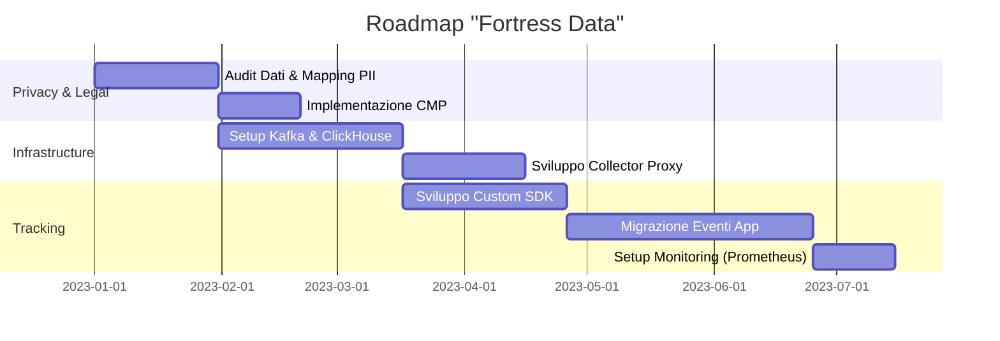
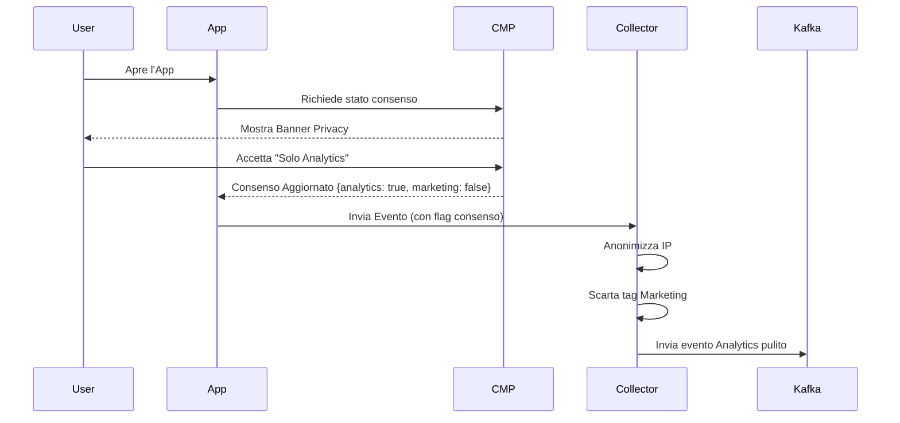

## Contesto Aziendale

**Azienda:** *FinTechSecure S.p.A.* (nome fittizio)
**Settore:** Neobank & Servizi Finanziari
**Utenti:** 500.000 attivi mensili
**Piattaforme:** iOS, Android, Web App

FinTechSecure sta scalando rapidamente, ma la sua infrastruttura dati è rimasta quella di una startup in fase early-stage: script di Google Analytics lato client, pixel di marketing sparsi nel codice e log backend non strutturati.
Con l'entrata in vigore di normative privacy più stringenti (GDPR, ePrivacy) e l'aumento degli AdBlocker, l'azienda sta perdendo visibilità su circa il 30% delle transazioni e rischia sanzioni pesanti.

### Dati Iniziali

| Metrica | Valore Attuale | Obiettivo | Note |
| :--- | :--- | :--- | :--- |
| **Data Loss** | ~30% | < 1% | Dati persi per AdBlock/ITP |
| **Compliance GDPR** | A rischio | 100% | Gestione consenso manuale e fallace |
| **Latenza Dati** | 24 ore | < 5 secondi | Necessario per Fraud Detection |
| **Data Quality** | Bassa | Alta (Schema Enforced) | Spesso i tracciamenti si rompono post-release |
| **Identificazione Utente** | Frammentata | Single Customer View | Impossibile unire sessioni Web e App |

**Problema Principale:** L'architettura "Client-Side" non è più sostenibile per un'azienda che gestisce dati finanziari sensibili. Serve passare a un approccio "Server-Side" robusto e sicuro.

## Obiettivi del Progetto

Il progetto "Fortress Data" mira a:

1.  **Recuperare il 100% dei dati persi** migrando a un tracciamento Server-Side che bypassa gli AdBlocker (nel rispetto del consenso).
2.  **Garantire la Compliance GDPR Automatica** integrando Consent Mode v2 e anonimizzazione PII alla fonte.
3.  **Ridurre la latenza a < 1 secondo** per abilitare casi d'uso Real-Time (es. notifiche anti-frode).
4.  **Eliminare i "Bad Data"** introducendo la validazione degli schemi (JSON Schema) nella pipeline CI/CD.

## Analisi e Strategia

### 1. Architettura Server-Side (Privacy-First)
Invece di inviare dati direttamente a Google/Meta dal browser, l'App invierà eventi a un nostro **Collector proprietario** (proxy).
*   **Vantaggio:** Pieno controllo sui dati prima che lascino la nostra infrastruttura. Possiamo rimuovere IP, hashare email e filtrare eventi in base al consenso.

### 2. Streaming Data Pipeline
Abbandoniamo l'ETL batch notturno per uno streaming con **Apache Kafka**.
*   **App/Web** -> **Collector** -> **Kafka Topic** -> **ClickHouse** (Analytics) & **S3** (Data Lake).

### 3. Data Governance & Schema Registry
Implementeremo un **Schema Registry**. Ogni evento deve conformarsi a uno schema definito (es. Avro o JSON Schema). Se un dev invia un evento `purchase` senza il campo `currency`, la pipeline lo scarta e invia un alert, invece di inquinare il Data Lake.

### Diagramma dell'Architettura

```mermaid
flowchart LR
    subgraph Client
        A[Mobile App SDK]
        B[Web App SDK]
    end

    subgraph Infrastructure_Proprietaria
        C(Load Balancer / Proxy)
        D{Consent & PII Filter}
        E[Kafka Cluster]
        F[Schema Registry]
    end

    subgraph Destinations
        G[(ClickHouse - RealTime)]
        H[(S3 - Data Lake)]
        I[Google GA4 (Server-Side)]
        L[Meta CAPI (Server-Side)]
    end

    A --> C
    B --> C
    C --> D
    D -- Validazione --> F
    D --> E
    E --> G
    E --> H
    E --> I
    E --> L
```

**Decisioni Chiave:**
*   **Costruire vs Comprare:** Costruiremo un SDK leggero in TypeScript ("Quickstart: Costruisci il tuo Tracker") per non dipendere da librerie black-box di terze parti.
*   **Privacy by Design:** L'ID utente viene generato lato server e hashato. Nessuna PII (Personal Identifiable Information) viene mai scritta in chiaro nei log.

## Implementazione

### Timeline (6 Mesi)



### Dati Intermedi: Confronto Qualità Dati

Durante la fase di parallelo (vecchio vs nuovo sistema), abbiamo misurato le discrepanze:

| Evento | Conteggio Client-Side (GA4) | Conteggio Server-Side (Kafka) | Discrepanza (Recupero) |
| :--- | :--- | :--- | :--- |
| **Session Start** | 120.000 | 155.000 | +29% |
| **Transaction** | 4.500 | 4.850 | +7.7% |
| **KYC Completed** | 3.200 | 3.200 | 0% (Backend event) |
| **Page View (iOS)** | 450.000 | 600.000 | +33% (ITP impact) |

**Problema Incontrato:** I volumi di dati su Kafka erano enormi, causando costi di retention alti.
**Soluzione:** Implementazione di una **Partitioning Strategy** aggressiva su S3 e retention breve (7 giorni) su Kafka, spostando lo storico su S3 (storage economico) e ClickHouse (storage compresso).

## Risultati

A progetto concluso, FinTechSecure ha una "Data Foundation" solida.

### KPI Prima vs Dopo

| KPI | Prima (T0) | Dopo (T6) | Variazione |
| :--- | :--- | :--- | :--- |
| **Accuratezza Ordini** | 92% | 99.98% | Problema Risolto |
| **Tempo Rilevamento Frodi** | 24 ore | < 2 secondi | Real-time |
| **Consenso Privacy** | Ignoto | 100% Tracciato | Compliance Totale |
| **Costo Data Infrastructure** | €500/mese | €2.500/mese | Aumento giustificato dal valore |

### Analisi ROI

Nonostante l'aumento dei costi infrastrutturali, il ROI è positivo grazie a:
1.  **Marketing Efficiency:** Il recupero del 30% dei dati di conversione ha abbassato il CPA (Cost Per Acquisition) reale del 20%, risparmiando €50.000/mese in ads.
2.  **Fraud Prevention:** Il sistema real-time blocca frodi per un valore di €10.000/mese.

### Visualizzazione Flusso Consenso



## Lezioni Apprese

1.  **La Privacy è un vantaggio competitivo:** Gli utenti si fidano di più e noi abbiamo dati più puliti (niente "rumore" da utenti che non vogliono essere tracciati).
2.  **Schema Registry salva la vita:** Impedire ai dati "sporchi" di entrare nella pipeline è 100 volte più economico che pulirli dopo nel Data Lake.
3.  **Observability è cruciale:** Monitorare la "freshness" del dato è importante quanto monitorare l'uptime del server. Se i dati arrivano in ritardo, le decisioni sono sbagliate.
4.  **Buy vs Build:** Per l'SDK è valsa la pena costruire (customizzazione totale), per l'infrastruttura (Kafka) meglio soluzioni gestite se il team è piccolo.
5.  **Cultura Data-Driven:** Gli sviluppatori ora capiscono che "rompere l'analytics" è grave quanto "rompere il login".

## Domande di Discussione

1.  In uno scenario in cui il 50% degli utenti rifiuta il consenso, come useresti la "modellazione statistica" per stimare i dati mancanti?
2.  Quali sono i rischi di sicurezza nel gestire un proprio Collector Server-Side e come li mitigeresti?
3.  Come gestiresti il "Diritto all'Oblio" (GDPR) in un Data Lake immutabile basato su S3?
4.  Perché ClickHouse è preferibile a PostgreSQL per l'analisi di log ed eventi di data collection?
5.  Come cambia la strategia di partizionamento su S3 se i dati vengono interrogati principalmente per "Data" vs per "User ID"?

**Cosa faresti diversamente?**
*   *Se fossimo in fase Seed:* Userei strumenti SaaS come Segment o PostHog invece di costruire tutto in casa su Kafka, per velocità di esecuzione.
*   *Se il traffico fosse basso:* Userei un'architettura Serverless (Lambda/Cloud Functions) per il Collector invece di container sempre attivi, per risparmiare costi.
