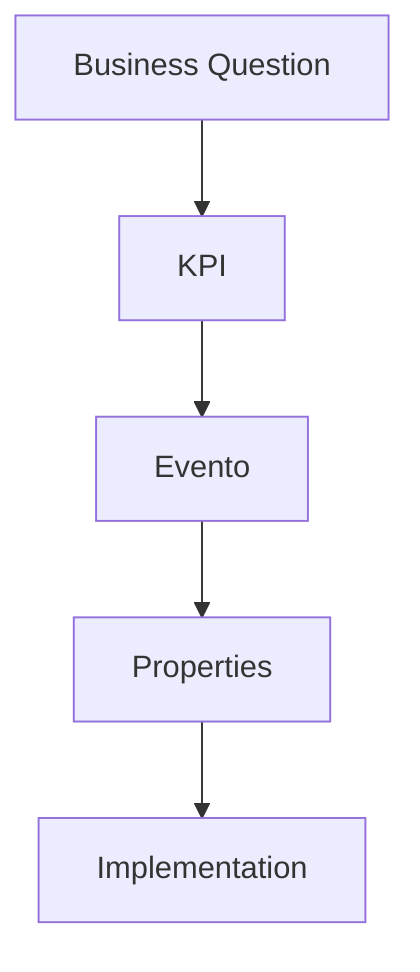
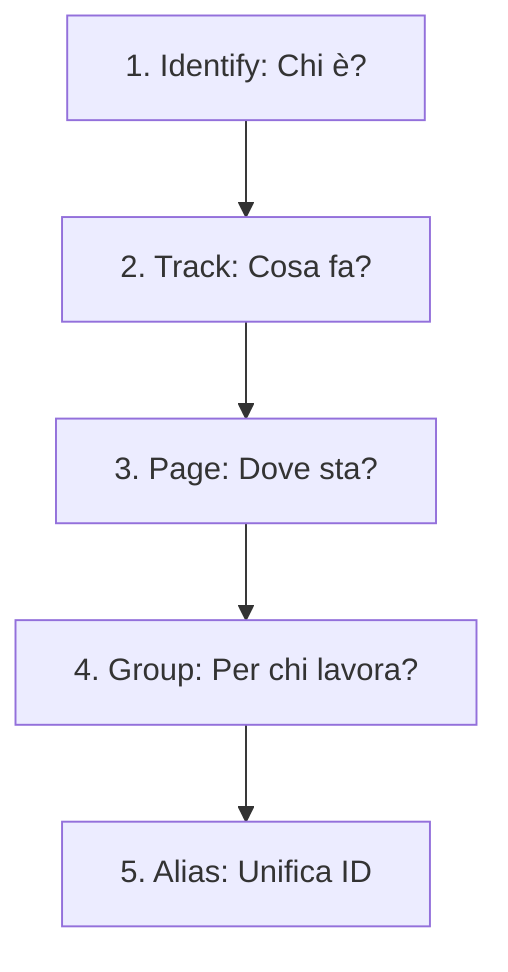

## Concetti Chiave

- **Tracking Plan**: Il documento "sacro" che definisce quali eventi tracciare, le loro proprietà e il perché. Senza piano, i dati sono spazzatura.
- **Event vs User Property**:
    - *Event Property*: Descrive l'azione (es. `product_price`, `page_url`). Cambia ad ogni evento.
    - *User Property*: Descrive chi fa l'azione (es. `subscription_plan`, `gender`). Resta costante (o cambia raramente).
- **Client-side vs Server-side**:
    - *Client-side*: Il browser invia i dati. Facile, ma bloccabile (AdBlock, ITP).
    - *Server-side*: Il server invia i dati. Affidabile, sicuro, ma richiede sviluppo.
- **Identity Resolution**: Unire le sessioni di un utente anonimo (cookie) con l'utente loggato (User ID) quando fa Login.
- **CDP (Customer Data Platform)**: Software (es. Segment) che raccoglie i dati da tutte le fonti, li normalizza e li smista alle destinazioni.
- **PII (Personally Identifiable Information)**: Dati che identificano una persona (Email, IP, Nome). Vanno hashate o non raccolte per GDPR.

## Formule e Metriche

| Metrica | Calcolo | Uso |
|---------|---------|-----|
| **Volume Eventi** | `DAU × Avg Eventi/User` | Stimare i costi di infrastruttura (es. Segment/ClickHouse). |
| **Match Rate** | `Utenti Identificati / Utenti Totali` | Capire quanti utenti anonimi riusciamo a convertire in profili noti. |
| **Data Quality** | `% Eventi conformi allo Schema` | Monitorare la salute della pipeline (alert se < 99%). |
| **AdBlock Rate** | `1 - (Eventi Client / Eventi Server)` | Stimare la perdita dati lato client (tipicamente 10-30%). |

## Framework e Modelli

### Struttura dell'Evento (Spec)
Un buon evento risponde a: *Chi? Cosa? Dove? Quando?*

```json
{
  "event": "Order Completed",       // Cosa (Object + Action)
  "userId": "user_12345",           // Chi (Login ID)
  "anonymousId": "cookie_abc",      // Chi (Cookie ID)
  "timestamp": "2024-03-15T10:00:00Z", // Quando
  "properties": { "order_id": "999", "total": 50.00 } // Dettagli
}
```

### Processo di Tracking Design
Dal business al codice.



## Processo Step-by-Step: Implementazione Tracking

1.  **Identify**: Identifica l'utente al Login (`userId`, `traits`).
2.  **Track**: Traccia le azioni chiave (`event`, `properties`).
3.  **Page/Screen**: Registra la navigazione (`page_name`).
4.  **Group**: (B2B) Associa l'utente a un'azienda (`groupId`).
5.  **Alias**: Unisci profilo anonimo e loggato alla registrazione.



## Errori da Evitare

-   ❌ **Tracciare Tutto** → ✅ "Data Swamp". Traccia solo ciò che serve a rispondere a una domanda di business.
-   ❌ **Nomi Generici** → ✅ `Click` è inutile. Usa `Button Clicked` con proprietà `button_name`.
-   ❌ **Inviare PII a GA4** → ✅ Google ti chiude l'account se invii email in chiaro. Hasha sempre i dati.
-   ❌ **Tracking Client-side per il Fatturato** → ✅ Il 10-30% degli utenti ha AdBlock. Per i pagamenti, usa sempre eventi Server-side.
-   ❌ **Rompere la History** → ✅ Non rinominare eventi esistenti. Crea un nuovo evento (`Order V2`).

## Quick Reference

| Strumento | A cosa serve | Quando usarlo |
|-----------|--------------|---------------|
| **Google Tag Manager** | Tag Management | Gestire pixel senza codice. |
| **Segment** | CDP | Raccogliere dati una volta e inviarli ovunque. |
| **Avo** | Data Governance | Disegnare il Tracking Plan type-safe. |
| **GA4** | Analytics | Analisi traffico aggregato. |
| **Amplitude** | Product Analytics | Analisi comportamentale (Retention). |
