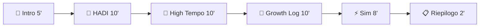

## HADI Cycles: Il segreto della crescita rapida — Lezione Completa

La velocità di esecuzione è l'unico vero vantaggio competitivo che una startup ha su una grande azienda. Ma correre a caso non porta da nessuna parte. Il Ciclo HADI (Hypothesis, Action, Data, Insight) è il framework operativo per trasformare la velocità in direzione strategica, applicando il metodo scientifico al business quotidiano.

### Obiettivi di Apprendimento

Al termine di questa lezione, lo studente sarà in grado di:
1.  Strutturare un esperimento di crescita seguendo rigorosamente le 4 fasi HADI.
2.  Formulare ipotesi testabili che colleghino input (azioni) e output (metriche).
3.  Definire la durata ottimale di un ciclo (Sprint settimanale o bisettimanale).
4.  Utilizzare un "Growth Log" per documentare gli apprendimenti e non ripetere gli stessi errori.
5.  Applicare il concetto di "High Tempo Testing" per scalare il numero di esperimenti.

### Timeline della Lezione

| Fase | Argomento | Durata |
|------|-----------|--------|
| 1 | Introduzione: Perché i cicli rapidi vincono | 5 min |
| 2 | Teoria: Le 4 fasi HADI nel dettaglio | 10 min |
| 3 | Metodologia: High Tempo Testing | 10 min |
| 4 | Strumenti: Il Growth Log | 10 min |
| 5 | Esercizi: Simulare un Ciclo HADI | 8 min |
| 6 | Riepilogo e Domande | 2 min |
| **Totale** | | **45 min** |



### Fase 1 — Introduzione: Perché i cicli rapidi vincono (5 min)

Immagina due team di Formula 1.
*   Il Team A progetta la macchina perfetta per 12 mesi e poi la porta in pista.
*   Il Team B progetta una macchina decente in 1 mese, la porta in pista, vede cosa non va, la modifica, torna in pista... per 12 volte.

Chi vince? Il Team B. Ha avuto 12 occasioni di imparare (Feedback Loop) contro 1 del Team A.
Nel marketing, il mercato cambia ogni giorno. Se il tuo ciclo di feedback dura mesi, sei morto. HADI ti costringe a cicli settimanali.

### Fase 2 — Teoria: Le 4 fasi HADI nel dettaglio (10 min)

Il ciclo è continuo. L'Insight di oggi diventa l'Hypothesis di domani.

1.  **Hypothesis (Ipotesi):**
    *   Tutto parte da una domanda: "Cosa succederebbe se...?"
    *   Formula standard: *Se [Azione], allora [Risultato] perché [Motivo].*
    *   *Esempio:* "Se togliamo il campo 'Telefono' dal form, il tasso di conversione salirà del 10% perché riduce la frizione e la paura di spam."

2.  **Action (Azione):**
    *   Costruisci il test. Deve essere il *Minimum Viable Test*.
    *   Non rifare tutto il sito. Fai una Landing Page, un A/B test su un bottone, o invia una mail a un segmento.
    *   *Obiettivo:* Velocità. Massimo 2-3 giorni di sviluppo.

3.  **Data (Dati):**
    *   Raccogli i risultati.
    *   Definisci *prima* la metrica di successo (KPI).
    *   *Esempio:* Conversion Rate del form. (Non guardare le visite, guarda le conversioni!).

4.  **Insight (Apprendimento):**
    *   Analizza i dati. L'ipotesi è validata o confutata?
    *   *Validata:* Ottimo! Implementa la modifica per tutti (Roll-out).
    *   *Confutata:* Ottimo! Hai imparato che agli utenti *serve* il campo telefono (magari per sentirsi sicuri?).
    *   *Non Conclusiva:* Il test era fatto male o il campione troppo piccolo.

```mermaid
graph TD
    H[Hypothesis: Idea] --> A[Action: Test]
    A --> D[Data: Misura]
    D --> I[Insight: Impara]
    I --> H2[Nuova Hypothesis]
    I --> Scale[Scala (se vincente)]
```

### Fase 3 — Metodologia: High Tempo Testing (10 min)

Sean Ellis (colui che ha coniato il termine "Growth Hacking") suggerisce di puntare a **3 esperimenti a settimana**.
Sembra folle? Sì, se pensi a "rifare il sito". No, se pensi a "cambiare l'oggetto della mail", "testare un'audience su Facebook", "cambiare il prezzo di un piano".

**Il Punteggio ICE per Prioritizzare:**
Come scegli quale ipotesi testare per prima?
*   **Impact:** Quanto sposta l'ago della bilancia? (1-10)
*   **Confidence:** Quanto sono sicuro che funzioni? (1-10)
*   **Ease:** Quanto è facile da implementare? (1-10)
*   *Score:* I + C + E.

Testa prima le idee con alto punteggio ICE. Spesso sono le "Low Hanging Fruit" (facili e d'impatto).

### Fase 4 — Strumenti: Il Growth Log (10 min)

La memoria aziendale è corta. Senza un registro, tra 6 mesi qualcuno dirà: "Ehi, rimettiamo il campo telefono nel form!" e tu non ricorderai perché l'avevate tolto.

**Struttura del Growth Log (Excel/Notion/Airtable):**
*   **ID Test:** #042
*   **Data:** 01/10/2023 - 15/10/2023
*   **Ipotesi:** Togliere campo telefono aumenta conv.
*   **Metriche:** Conv Rate Controllo (2.1%) vs Variante (2.8%).
*   **Risultato:** Successo (+33% uplift). P-value < 0.05.
*   **Insight:** La frizione era un ostacolo maggiore della fiducia.
*   **Next Step:** Implementare su tutte le LP.

Questo log diventa l'asset più prezioso del team di marketing.

### Fase 5 — Esercizi: Simulare un Ciclo HADI (8 min)

**Scenario:** Sei il Marketing Manager di un'app di food delivery. Il problema è che molti utenti scaricano l'app ma non fanno il primo ordine (Attivazione bassa).

**1. Hypothesis:**
*   *Studente:* "Se offriamo la consegna gratuita sul primo ordine, l'attivazione aumenterà del 20% perché rimuove la barriera del costo extra."

**2. Action:**
*   *Studente:* Creare un codice sconto `PRIMO-FREE`. Inviare una push notification a 1.000 utenti che hanno l'app da 3 giorni ma zero ordini. (Non serve sviluppare feature complesse, basta un codice manuale).

**3. Data:**
*   *Studente:* Gruppo A (1.000 utenti, nessuna push): 5 ordini (0.5%).
*   *Studente:* Gruppo B (1.000 utenti, push `PRIMO-FREE`): 25 ordini (2.5%).

**4. Insight:**
*   *Studente:* L'offerta funziona (5x uplift!). Ma è sostenibile economicamente? Il costo della consegna (es. 5€) è minore del LTV (Lifetime Value) di questi 20 nuovi clienti?
*   *Nuova Ipotesi:* "Se offriamo consegna gratuita solo per ordini > 20€..."

### Fase 6 — Riepilogo e Domande (2 min)

1.  **Velocità.** Sbaglia velocemente per imparare velocemente.
2.  **Rigore.** Scrivi l'ipotesi *prima* del test, non dopo.
3.  **Documentazione.** Il Growth Log evita di ripetere errori.
4.  **Minimo Sforzo.** Non costruire la soluzione perfetta per testare un'idea.

### Domande di Verifica

1.  Qual è la differenza tra "Action" e "Insight" nel ciclo HADI?
2.  Perché è importante definire la metrica di successo *prima* di iniziare l'esperimento?
3.  Cosa si intende per "Minimum Viable Test" (MVT)?
4.  Come useresti il framework ICE per decidere quale test HADI eseguire per primo?
5.  Se un test HADI fallisce (l'ipotesi è confutata), è considerato un fallimento del team? Perché?

### Riferimenti Bibliografici

-   Eric Ries, "The Lean Startup", Crown Business, 2011.
-   Sean Ellis & Morgan Brown, "Hacking Growth", Crown Business, 2017.
-   Andrew Chen, "The Cold Start Problem", Harper Business, 2021.
