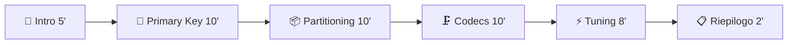

## ClickHouse: Ottimizzazione e Best Practices — Lezione Completa

ClickHouse è come una Ferrari: veloce di default, ma se non sai guidarla rischi di andare contro un muro. La differenza tra una query che gira in 0.1 secondi e una che ne impiega 10 sta tutta nello schema design e nelle impostazioni di compressione. In questa lezione avanzata, entreremo nel cofano del motore per capire come spremere ogni bit di performance dal database analitico più veloce al mondo.

### Obiettivi di Apprendimento

Al termine di questa lezione, lo studente sarà in grado di:
1.  Progettare la Primary Key (`ORDER BY`) ottimale per massimizzare la velocità di lettura.
2.  Scegliere la strategia di Partitioning corretta per gestire miliardi di righe senza esplodere.
3.  Applicare Codec di compressione avanzati (Delta, Gorilla, ZSTD) per risparmiare il 50-80% di spazio su disco.
4.  Scrivere query performanti utilizzando `PREWHERE` e tipi di dati `LowCardinality`.
5.  Diagnosticare colli di bottiglia usando le tabelle di sistema `system.query_log`.

### Timeline della Lezione

| Fase | Argomento | Durata |
|------|-----------|--------|
| 1 | Introduzione: Come ClickHouse legge i dati | 5 min |
| 2 | Teoria: Primary Key & Data Skipping | 10 min |
| 3 | Pratica: Partitioning Strategy | 10 min |
| 4 | Tecnica: Compression Codecs | 10 min |
| 5 | Esercizi: Query Tuning & Monitoring | 8 min |
| 6 | Riepilogo e Domande | 2 min |
| **Totale** | | **45 min** |



### Fase 1 — Introduzione: Come ClickHouse legge i dati (5 min)

ClickHouse è un database **Colonnare**.
*   In un DB tradizionale (PostgreSQL, MySQL), i dati sono salvati riga per riga: `[ID, Nome, Età, Città]`. Per leggere solo l'età, devi leggere tutta la riga. Lento.
*   In ClickHouse, i dati sono salvati colonna per colonna: `[Età1, Età2, Età3...]`. Per leggere l'età media, leggi solo quel file. Velocissimo.

Ma non basta. ClickHouse usa gli **Sparse Index**. Non indicizza ogni riga (sarebbe enorme), ma indicizza gruppi di righe (granuli, default 8192). L'indice dice: "In questo blocco, il valore minimo è A e il massimo è Z". Se cerchi "M", ClickHouse sa che deve leggere quel blocco. Se cerchi "1", lo salta.

### Fase 2 — Teoria: Primary Key & Data Skipping (10 min)

La scelta dell'**ORDER BY** (che in MergeTree funge da Primary Key) è la decisione più critica. Determina come i dati sono ordinati fisicamente su disco.

**Regola d'Oro:** Metti prima le colonne che usi più spesso nei filtri `WHERE`, iniziando da quelle con cardinalità più bassa.

*   *Scenario:* Analisi Web. Filtri spesso per `Date`, `SiteID` e `EventName`.
*   *Cardinalità:*
    *   `SiteID`: 10 (bassa).
    *   `EventName`: 100 (media).
    *   `UserID`: 1.000.000 (alta).
    *   `Timestamp`: Infinito (altissima).

**Cattivo ORDER BY:** `(Timestamp, UserID)`
I dati sono ordinati per tempo. Se cerchi `SiteID=1`, ClickHouse deve leggere *tutto* il database perché il SiteID 1 è sparso ovunque nel tempo.

**Buon ORDER BY:** `(SiteID, EventName, Timestamp)`
Tutti i dati del Sito 1 sono vicini fisicamente. Se cerchi `SiteID=1`, ClickHouse legge solo quel blocco e salta il 90% dei dati. Velocità 10x.

```sql
CREATE TABLE hits (
    SiteID UInt16,
    EventName String,
    UserID UInt64,
    Timestamp DateTime
) ENGINE = MergeTree
ORDER BY (SiteID, EventName, Timestamp); -- La chiave vincente
```

### Fase 3 — Pratica: Partitioning Strategy (10 min)

Il Partitioning divide la tabella in cartelle fisiche separate.
È utile per la gestione dei dati (es. cancellare vecchi dati), non per la velocità delle query (l'indice fa già quel lavoro).

**Best Practice:**
*   Partiziona per **Mese** (`toYYYYMM(date)`) o **Giorno** (se hai >100M righe/giorno).
*   **NON** partizionare per colonne ad alta cardinalità (es. `UserID`, `CampaignID`). Se crei 1.000 partizioni, ClickHouse esplode (Too many parts).

```sql
PARTITION BY toYYYYMM(Timestamp)
```
*Vantaggio:* Quando devi cancellare i dati vecchi di 1 anno, fai `ALTER TABLE DROP PARTITION 202201`. È istantaneo e non tocca il disco (cancella solo il link alla cartella).

### Fase 4 — Tecnica: Compression Codecs (10 min)

ClickHouse supporta codec specifici per tipo di dato. Comprimere significa leggere meno dati dal disco -> query più veloci.

1.  **LZ4 (Default):** Veloce decompressione. Buono per tutto.
2.  **ZSTD:** Compressione migliore (risparmi 30% vs LZ4), decompressione un po' più lenta (CPU intensive). Ottimo per Log storici.
3.  **Delta:** Memorizza la differenza tra un valore e il precedente.
    *   *Timestamp:* `10:00:01`, `10:00:02`, `10:00:03` -> Delta: `1`, `1`, `1`. Comprimibile all'infinito.
4.  **Gorilla:** Per i Float.
5.  **DoubleDelta:** Per Time Series lisce.
6.  **LowCardinality(String):** Il trucco magico. Se hai una colonna String con pochi valori ripetuti (es. `Browser`: Chrome, Firefox...), usa questo. ClickHouse crea un dizionario interno e sostituisce le stringhe con numeri interi piccoli. Risparmio spazio: enorme. Velocità query: doppia.

```sql
CREATE TABLE optimized (
    Timestamp DateTime CODEC(Delta, ZSTD(3)), -- Ottimo per tempo
    Browser LowCardinality(String),           -- Ottimo per stringhe ripetute
    Revenue Float64 CODEC(Gorilla, ZSTD(1))   -- Ottimo per numeri
)
```

### Fase 5 — Esercizi: Query Tuning & Monitoring (8 min)

**1. PREWHERE vs WHERE**
In ClickHouse, `PREWHERE` è un filtro che viene applicato *prima* di leggere le altre colonne.
*   *Query:* `SELECT UserID FROM hits WHERE Browser='Chrome'`
*   ClickHouse legge prima *solo* la colonna `Browser`. Trova le righe dove è 'Chrome'. Poi legge *solo* quelle righe della colonna `UserID`.
*   *Automatico:* Le versioni recenti spostano automaticamente le condizioni in PREWHERE, ma saperlo aiuta.

**2. System Query Log**
La tua query è lenta. Perché?
```sql
SELECT
    query,
    query_duration_ms,
    read_rows,
    read_bytes,
    memory_usage
FROM system.query_log
WHERE type = 'QueryFinish'
ORDER BY query_duration_ms DESC
LIMIT 10
```
*   Se `read_rows` è alto ma il risultato è piccolo, l'indice non sta funzionando (rivedere ORDER BY).
*   Se `memory_usage` è alto, stai facendo JOIN enormi o `GROUP BY` su colonne con troppi valori unici.

### Fase 6 — Riepilogo e Domande (2 min)

1.  **ORDER BY** è tutto. Metti prima le colonne che filtri.
2.  **Partiziona poco.** Mesi, non ID.
3.  **LowCardinality** è il tuo migliore amico per le stringhe.
4.  **Codec** giusti = disco dimezzato e velocità raddoppiata.

### Domande di Verifica

1.  Perché `ORDER BY (Timestamp)` è spesso una scelta sub-ottimale per le query analitiche che filtrano per utente o sito?
2.  Qual è la differenza tra "Partitioning" e "Primary Key Indexing" in ClickHouse?
3.  Spiega come funziona il codec "Delta" e per quale tipo di dati è più efficace.
4.  Cosa succede se si definisce una partizione su una colonna ad alta cardinalità (es. UserID)?
5.  In che situazione il tipo di dato `LowCardinality(String)` offre i maggiori benefici rispetto a `String` o `Enum`?

### Riferimenti Bibliografici

-   ClickHouse Official Docs (Performance Guide).
-   Altinity Blog (Deep dive on codecs).
-   Uber Engineering Blog (How Uber uses ClickHouse).
