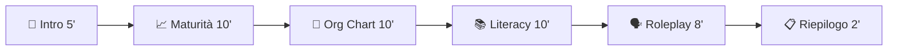
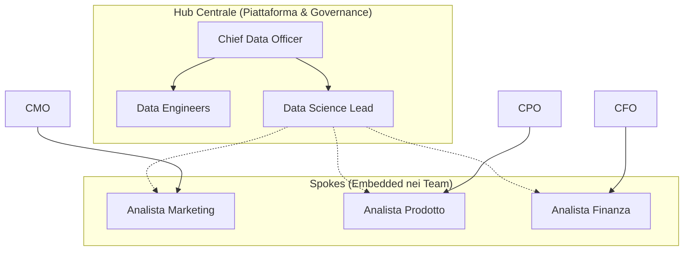

## Cultura Data-Driven — Lezione Completa

La tecnologia è facile; le persone sono difficili. Acquistare un data warehouse moderno o una piattaforma di BI è questione di carta di credito. Convincere un'intera organizzazione a prendere decisioni basate sull'evidenza anziché sull'opinione della persona più pagata nella stanza (HiPPO) è una sfida culturale profonda.

### Obiettivi di Apprendimento

Al termine di questa lezione, lo studente sarà in grado di:
1.  Identificare i 4 stadi di maturità analitica di un'azienda.
2.  Implementare strategie concrete per passare da decisioni "di pancia" a decisioni informate.
3.  Progettare l'organigramma di un team dati efficace (Centralizzato vs Embedded vs Ibrido).
4.  Superare le resistenze interne all'adozione dei dati.
5.  Promuovere la "Data Literacy" (alfabetizzazione ai dati) a tutti i livelli aziendali.

### Timeline della Lezione

| Fase | Argomento | Durata |
|------|-----------|--------|
| 1 | Introduzione: Perché la cultura batte la tecnologia | 5 min |
| 2 | Teoria: I 4 Livelli di Maturità Analitica | 10 min |
| 3 | Teoria: Organizzazione del Team Dati | 10 min |
| 4 | Strategia: Democratizzazione e Data Literacy | 10 min |
| 5 | Esercizi: Gestire le obiezioni | 8 min |
| 6 | Riepilogo e Domande | 2 min |
| **Totale** | | **45 min** |



### Fase 1 — Introduzione: Perché la cultura batte la tecnologia (5 min)

"Data-driven" non significa che i dati prendono le decisioni al posto tuo. Significa che i dati sono il *linguaggio comune* con cui le decisioni vengono discusse, giustificate e valutate.

Spesso si confonde l'essere "Data-Rich" (avere tanti dati) con l'essere "Data-Driven" (usare i dati). Molte aziende raccolgono terabyte di log, ma i manager continuano a decidere basandosi solo sulla loro intuizione o sull'esperienza passata. Questo crea un divario costoso: si pagano strumenti costosi che nessuno usa davvero.

La cultura data-driven si manifesta quando, in una riunione, di fronte a un'opinione forte, qualcuno chiede serenamente: "Quali dati abbiamo a supporto di questa ipotesi?". E nessuno si offende.

### Fase 2 — Teoria: I 4 Livelli di Maturità Analitica (10 min)

Ogni organizzazione si trova in uno di questi stadi. Capire dove sei è il primo passo per evolvere.

1.  **Analitica Descrittiva (Cosa è successo?)**
    *   L'azienda guarda solo al passato. Report mensili statici (spesso in Excel/PDF).
    *   *Sintomo:* "Mandami il report delle vendite del mese scorso".
    *   *Valore:* Basso. È un'autopsia.

2.  **Analitica Diagnostica (Perché è successo?)**
    *   Si inizia a fare *drill-down*. Si cercano le cause radice.
    *   *Sintomo:* "Perché le vendite sono scese in Lombardia?".
    *   *Valore:* Medio. Aiuta a capire, ma è ancora reattivo.

3.  **Analitica Predittiva (Cosa succederà?)**
    *   Si usano modelli statistici per stimare trend futuri.
    *   *Sintomo:* "Qual è la previsione di churn per il prossimo trimestre?".
    *   *Valore:* Alto. Permette di agire *prima* che il problema esploda.

4.  **Analitica Prescrittiva (Cosa dovremmo fare?)**
    *   Il sistema suggerisce azioni ottimali (es. algoritmi di raccomandazione, prezzi dinamici).
    *   *Sintomo:* "Il sistema ha automaticamente offerto uno sconto al cliente X per evitarne l'abbandono".
    *   *Valore:* Altissimo. Automazione decisionale.

```mermaid
graph TD
    A[Dati Grezzi] --> B[Informazione<br/>(Descrittiva)]
    B --> C[Conoscenza<br/>(Diagnostica)]
    C --> D[Insight<br/>(Predittiva)]
    D --> E[Saggezza/Azione<br/>(Prescrittiva)]
```

### Fase 3 — Teoria: Organizzazione del Team Dati (10 min)

Dove posizionare gli analisti e i data scientist nell'organigramma? Non esiste una risposta unica, ma tre modelli prevalenti.

**1. Modello Centralizzato (Center of Excellence)**
*   Tutti gli analisti riportano a un "Head of Data" o CDO (Chief Data Officer).
*   *Vantaggi:* Standard elevati, condivisione di conoscenza, carriera chiara per gli analisti, "unica fonte di verità".
*   *Svantaggi:* Lontani dal business ("Torre d'avorio"). Lenti a rispondere alle richieste dei team di prodotto/marketing. Diventano un "collo di bottiglia".

**2. Modello Decentrato (Embedded)**
*   Gli analisti sono assunti direttamente dai team funzionali (es. un analista nel team Marketing, uno nel team Prodotto).
*   *Vantaggi:* Velocità, contesto di business profondo, allineamento agli obiettivi del team.
*   *Svantaggi:* Silos di dati (ognuno calcola i KPI a modo suo), duplicazione del lavoro, isolamento professionale dell'analista.

**3. Modello Ibrido (Hub & Spoke)**
*   C'è un team centrale (Hub) che gestisce l'infrastruttura, la governance e le best practice.
*   Gli analisti (Spokes) lavorano *quotidianamente* nei team funzionali, ma mantengono una linea di riporto (spesso tratteggiata) con il team centrale per la formazione e gli standard.
*   *Vantaggi:* "Best of both worlds". Autonomia locale con standard globali.
*   *È il modello raccomandato per le aziende in scala (Scale-up).*



### Fase 4 — Strategia: Democratizzazione e Data Literacy (10 min)

Per scalare, non puoi assumere un analista per ogni dipendente. Devi rendere i dati accessibili a tutti (Democratizzazione) e insegnare a tutti come leggerli (Literacy).

**Data Democratization**
Significa fornire strumenti *Self-Service*. Un Product Manager non dovrebbe dover aprire un ticket a un ingegnere per sapere quanti utenti si sono registrati ieri. Dovrebbe poter aprire una dashboard (es. Tableau, Looker, Metabase) e trovare la risposta in 3 click.
*   *Requisito:* Dati puliti e documentati. Se i dati sono "sporchi", il self-service crea caos.

**Data Literacy (Alfabetizzazione)**
È la capacità di leggere, lavorare, analizzare e argomentare con i dati.
*   Insegnare la differenza tra *correlazione* e *causalità*.
*   Insegnare a leggere un grafico a dispersione o un istogramma.
*   Insegnare a diffidare delle medie (e guardare le distribuzioni).

*Esempio concreto:* Un'azienda organizza "Data University" interne: sessioni mensili di 1 ora dove il team dati spiega un concetto (es. "Come si calcola il Churn") a tutta l'azienda.

### Fase 5 — Esercizi: Gestire le obiezioni (8 min)

In questo esercizio di role-play, affronteremo le frasi "killer" della cultura data-driven.

**Scenario A: L'Intuizione dell'Esperto**
*   *Manager:* "Ho 20 anni di esperienza in questo settore. So che questa campagna funzionerà. Non mi servono i test."
*   *La tua risposta:* (Come risponderesti in modo costruttivo per introdurre un approccio data-driven senza offendere?)
    *   *Suggerimento:* "La tua esperienza è preziosa per generare l'ipotesi migliore. Usiamo i dati per *validarla* su un piccolo campione prima di investire tutto il budget. Se hai ragione, i dati lo confermeranno e avremo un caso studio solido."

**Scenario B: La Paralisi da Analisi**
*   *Collega:* "Non possiamo lanciare, non abbiamo ancora dati sufficienti per essere sicuri al 100%."
*   *La tua risposta:*
    *   *Suggerimento:* "Nel business, il 100% di certezza non esiste o arriva troppo tardi. Abbiamo dati sufficienti per avere una confidenza del 70%? Se sì, lanciamo e iteriamo. Il costo del ritardo supera il rischio dell'errore."

**Scenario C: I Dati "Sbagliati"**
*   *Direttore Vendite:* "Questi numeri non possono essere giusti, i miei agenti mi dicono che vendono tantissimo."
*   *La tua risposta:*
    *   *Suggerimento:* Indagare insieme la discrepanza. Spesso è un problema di definizioni (es. "vendita" = contratto firmato o fattura pagata?). Usare l'occasione per allineare il glossario aziendale.

### Fase 6 — Riepilogo e Domande (2 min)

1.  **Cultura > Tool.** Non comprare software costosi se non hai processi per usarli.
2.  **Parti dal "Perché".** L'analitica deve risolvere problemi di business, non produrre report che nessuno legge.
3.  **Hub & Spoke.** Centralizza gli standard, decentralizza l'esecuzione.
4.  **Formazione Continua.** Investi nella data literacy dei team non tecnici.

### Domande di Verifica

1.  Qual è la differenza fondamentale tra analitica "Descrittiva" e "Prescrittiva"?
2.  Quali sono i rischi principali di un modello organizzativo completamente "Decentrato" (Embedded)?
3.  Cosa si intende per "Democratizzazione dei Dati" e qual è il prerequisito fondamentale perché funzioni?
4.  Come risponderesti a un manager che rifiuta i dati dicendo "fido solo del mio istinto"?
5.  Perché la "Data Literacy" è considerata una competenza trasversale e non solo tecnica?

### Riferimenti Bibliografici

-   Carl Anderson, "Creating a Data-Driven Organization", O'Reilly Media, 2015.
-   Brent Dykes, "Effective Data Storytelling: How to Drive Change with Data, Narrative and Visuals", Wiley, 2019.
-   DJ Patil & Hilary Mason, "Data Driven: Creating a Data Culture", O'Reilly Media, 2015.
