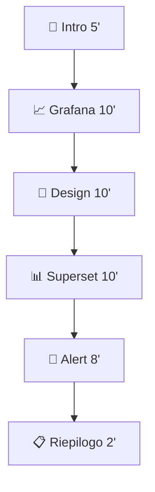
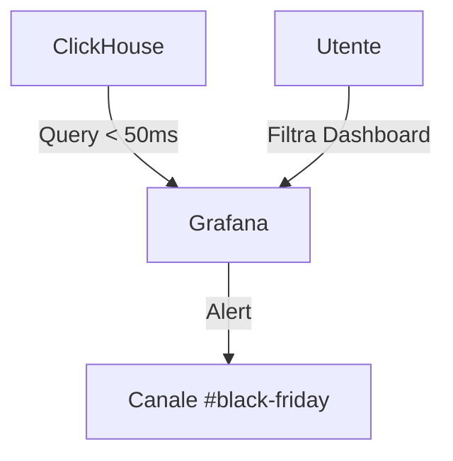

## Dashboard Live e Alerting: Vedere l'invisibile — Lezione Completa

Avere dati in tempo reale in ClickHouse è inutile se nessuno li guarda. Ma nessuno vuole scrivere query SQL alle 3 del mattino. Abbiamo bisogno di un'interfaccia visiva che trasformi i flussi di dati grezzi in insight istantanei e di un sistema di allarme che ci svegli solo quando serve. In questa lezione, collegheremo ClickHouse ai due strumenti open-source più potenti del mercato: Grafana (per il monitoraggio operativo) e Apache Superset (per la Business Intelligence esplorativa).

### Obiettivi di Apprendimento

Al termine di questa lezione, lo studente sarà in grado di:
1.  Connettere ClickHouse a Grafana e visualizzare serie temporali ad alta frequenza.
2.  Costruire una "Marketing War Room" dashboard con refresh automatico ogni 5 secondi.
3.  Configurare alert intelligenti basati su soglie dinamiche (es. calo improvviso conversioni).
4.  Utilizzare Apache Superset per creare grafici interattivi drag-and-drop per il team business.
5.  Implementare la Row-Level Security per mostrare a ogni country manager solo i suoi dati.

### Timeline della Lezione

| Fase | Argomento | Durata |
|------|-----------|--------|
| 1 | Introduzione: Grafana vs Superset vs Tableau | 5 min |
| 2 | Pratica: Grafana & ClickHouse Plugin | 10 min |
| 3 | Design: La "War Room" Dashboard | 10 min |
| 4 | Pratica: Apache Superset & BI | 10 min |
| 5 | Strategia: Alerting & Anomaly Detection | 8 min |
| 6 | Riepilogo e Domande | 2 min |
| **Totale** | | **45 min** |



### Fase 1 — Introduzione: Grafana vs Superset vs Tableau (5 min)

Non tutti i tool di visualizzazione sono uguali.
*   **Grafana:** Nato per monitorare server (CPU, RAM), è diventato il re delle *Time Series*.
    *   *Pro:* Velocissimo, refresh automatico (anche 1s), alerting integrato.
    *   *Uso:* Monitoraggio tecnico, Real-time Marketing, War Room.
*   **Apache Superset:** Nato in Airbnb, è la risposta open-source a Tableau.
    *   *Pro:* Bellissimo semantic layer, SQL Lab potente, permessi granulari.
    *   *Uso:* Analisi esplorativa, Report per il Management, Self-service BI.
*   **Tableau / PowerBI:** I giganti enterprise.
    *   *Contro:* Spesso usano "Extract" (copiano i dati), uccidendo il real-time di ClickHouse. Costosi.

### Fase 2 — Pratica: Grafana & ClickHouse Plugin (10 min)

Per visualizzare i dati di ClickHouse in Grafana, usiamo il plugin ufficiale (Altinity o Grafana Labs).

**Configurazione Data Source:**
1.  URL: `http://clickhouse-server:8123`
2.  Auth: User/Pass (es. `default`/`password`).
3.  Default Database: `marketing_db`.

**Scrivere Query Ottimizzate per Grafana:**
Grafana usa variabili magiche come `$__interval` per adattare la query allo zoom del grafico. Se guardi 30 giorni, raggruppa per giorno. Se guardi 1 ora, raggruppa per minuto.

```sql
SELECT
    $__timeGroupAlias(event_time, $__interval),
    campaign_name,
    sum(revenue) as revenue
FROM visits_v1
WHERE $__timeFilter(event_time)
GROUP BY 1, 2
ORDER BY 1
```
*   `$__timeFilter`: Diventa `event_time BETWEEN '2023-10-27 10:00' AND '2023-10-27 11:00'`.
*   `$__timeGroupAlias`: Diventa `toStartOfMinute(event_time)` o `toStartOfHour(...)`.

Questo rende la dashboard velocissima: ClickHouse aggrega solo i dati necessari per i pixel dello schermo.

### Fase 3 — Design: La "War Room" Dashboard (10 min)

Immagina di essere durante il Black Friday. Il team marketing ha bisogno di una dashboard proiettata sul muro (o su un secondo monitor) per reagire istantaneamente.

**Cosa mettere nella War Room:**
1.  **Big Numbers (Stat):** Fatturato Ora Corrente vs Ieri. (Verde/Rosso).
2.  **Real-time Trend (Graph):** Ordini al minuto ultimi 60 min.
3.  **Top Products (Table):** Cosa sta vendendo ora? (Per riassortire o spingere).
4.  **Error Rate (Graph):** Pagamenti falliti. Se sale, ferma tutto!

**Best Practice:**
*   Sfondo scuro (Dark Mode) per ridurre l'affaticamento visivo.
*   Niente torte (Pie Charts). Sono difficili da leggere in fretta.
*   Refresh rate: 10 secondi.



### Fase 4 — Pratica: Apache Superset & BI (10 min)

Per l'analisi approfondita ("Perché ieri abbiamo venduto meno scarpe rosse in Lombardia?"), Grafana è limitato. Superset brilla qui.

**Concetti Chiave:**
1.  **Dataset:** Definisci la tabella (o vista) fisica.
2.  **Calculated Columns:** Crea metriche riutilizzabili (es. `ROAS = Revenue / Spend`) direttamente nel layer semantico, così gli utenti non devono riscrivere la formula.
3.  **Chart Builder:** Interfaccia Drag-and-Drop.
    *   X-Axis: `event_time`
    *   Metrics: `SUM(revenue)`
    *   Group By: `product_category`

**SQL Lab:**
Per gli analisti SQL, Superset offre un editor potente per scrivere query complesse, salvarle e trasformarle in grafici con un click.

### Fase 5 — Strategia: Alerting & Anomaly Detection (8 min)

Guardare la dashboard è passivo. L'alerting è attivo.

**Grafana Alerting:**
*   Definisci una query: `Media ordini ultimi 5 min`.
*   Definisci una condizione: `IS BELOW 10`.
*   Definisci un canale: Slack, Email, PagerDuty (per svegliarti di notte).

**Anomaly Detection (Z-Score in SQL):**
Invece di una soglia fissa ("Meno di 10 ordini"), usa la statistica.
"Se gli ordini sono inferiori a 2 Deviazioni Standard rispetto alla media delle ultime 4 settimane a quest'ora".

```sql
-- Esempio Concettuale SQL
WITH stats AS (
    SELECT avg(orders) as media, stddevPop(orders) as deviazione
    FROM sales WHERE time > now() - INTERVAL 4 WEEK
)
SELECT now(), current_orders,
       (current_orders - media) / deviazione as z_score
FROM realtime_sales, stats
WHERE z_score < -2 -- Allarme!
```

### Fase 6 — Riepilogo e Domande (2 min)

1.  **Grafana** per il "Qui e Ora" (Operativo).
2.  **Superset** per il "Perché e Come" (Strategico).
3.  **ClickHouse** è il motore che rende tutto possibile (velocità).
4.  **Alert** intelligenti per dormire tranquilli.

### Domande di Verifica

1.  Qual è la differenza principale nell'uso di variabili come `$__interval` in Grafana rispetto a una query SQL statica?
2.  Perché i grafici a torta (Pie Charts) sono sconsigliati in una dashboard "War Room" operativa?
3.  Come funziona il collegamento tra Superset e ClickHouse (via SQLAlchemy)?
4.  Spiega il vantaggio di usare un calcolo Z-Score per l'alerting rispetto a una soglia fissa.
5.  In che scenario useresti la funzione "SQL Lab" di Superset invece del builder drag-and-drop?

### Riferimenti Bibliografici

-   Grafana Documentation (Best Practices for Dashboards).
-   Apache Superset Official Docs.
-   Altinity Blog (ClickHouse + Grafana integration guides).
