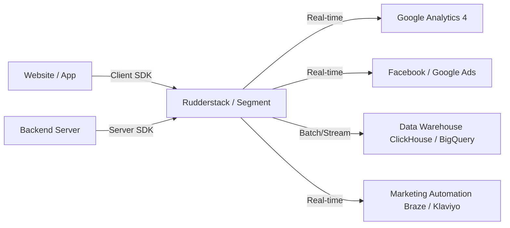

## Event Tracking Design

La progettazione del tracciamento eventi è la fase più critica di qualsiasi progetto di data analytics. Se i dati in ingresso ("garbage in") sono di bassa qualità o mal strutturati, nessuna quantità di ingegneria o data science a valle potrà correggerli ("garbage out").


## 1. La Filosofia del Tracking :badge[Fondamentale]{variant="tip"}

Il tracking non dovrebbe mai essere un "afterthought", algo aggiunto alla fine dello sviluppo frontend. Il tracking è un **prodotto** a sé stante, consumato da analisti, PM e algoritmi.


> **Consiglio:**
> Tratta il tuo Tracking Plan come un **contratto API** tra chi produce il dato (Engineering) e chi lo consuma (Data Team). Ogni modifica al tracking deve essere versionata e approvata.


### Approccio "Explicit Tracking"

Evita l'autotrack (codeless tracking) strumenti come Heap o Pendo per progetti seri. Sebbene comodi all'inizio, creano un debito tecnico enorme. Preferisci sempre il **Precision Tracking**: definisci esplicitamente *cosa* tracciare e *perché*.


###

<Card title="✅ Precision Tracking" icon="approve-check-circle">
    - Definisci esplicitamente ogni evento
    - Controllo granulare sui dati
    - Schema validato e versionato
    - Zero "dark data" inutile


### ❌ Autotrack / Codeless

- Cattura tutto indiscriminatamente
    - Debito tecnico crescente
    - Dati rumorosi e non strutturati
    - Difficile da manutenere


## 2. Il Tracking Plan (Schema Registry) :badge[Best Practice]{variant="note"}

Un Tracking Plan è un documento (o un repo JSON/YAML) che definisce ogni evento tracciato.


1. **Definisci gli eventi** — Identifica tutte le azioni utente rilevanti per il business

2. **Specifica le proprietà** — Per ogni evento, definisci i metadati contestuali necessari

3. **Documenta i trigger** — Quando e dove deve scattare ogni evento

4. **Valida con gli stakeholder** — PM, Analyst e Engineering devono approvare il piano

5. **Versiona e deploya** — Tratta il tracking plan come codice: versionato in Git


### Schema di un Tracking Plan

| Campo | Tipo | Descrizione | Esempio |
|---|---|---|---|
| **Event Name** | `string` | Nome dell'azione tracciata | `Order Completed` |
| **Trigger** | `string` | Quando deve scattare | Pagina di conferma ordine |
| **Properties** | `object` | Metadati contestuali | `order_id`, `revenue` |
| **Type** | `enum` | Tipo del dato | String, Integer, Boolean |
| **Required** | `boolean` | Obbligatorietà | `true` / `false` |

### Esempio di Struttura Evento

```json title="order-completed.json"
{
  "event": "Order Completed",
  "properties": {
    "order_id": "ORD-12345",
    "total": 99.99,
    "currency": "EUR",
    "products": [
      {
        "product_id": "P-1",
        "sku": "SKU-ABC",
        "name": "Corso Data Engineering",
        "price": 99.99,
        "quantity": 1
      }
    ]
  }
}
```


> **Attenzione:**
> Non creare eventi generici come `Button Clicked` con una proprietà `button_name`. Crea eventi specifici come `Add to Cart Clicked`, `Checkout Started`, etc. Questo rende l'analisi molto più semplice.


## 3. Naming Conventions :badge[Best Practice]{variant="note"}

La consistenza è re. Scegli uno standard e mantienilo.


###

<Card title="Object-Action (Consigliato)" icon="approve-check-circle">
    `Noun + Verb` (Sostantivo + Verbo passato).
    *   `Order Completed`
    *   `Button Clicked`
    *   `Page Viewed`
    *   `Form Submitted`
    
    Questo formato raggruppa naturalmente gli eventi nell'interfaccia degli strumenti di analisi (es. tutti gli eventi `Order ...` saranno vicini).


### Action-Object

`Verb + Noun`.
    *   `complete_order`
    *   `click_button`
    *   `view_page`
    
    Meno leggibile per i business user, ma spesso preferito dagli sviluppatori.

### Casing

| Stile | Esempio | Quando usarlo |
|---|---|---|
| **Snake Case** | `order_completed` | Data warehouses e SQL |
| **Title Case** | `Order Completed` | Strumenti come Mixpanel/Amplitude |
| **Camel Case** | `orderCompleted` | SDK JavaScript |


> **Note:**
> Resta coerente. Se usi Segment/Rudderstack, loro spesso normalizzano, ma è meglio inviare dati puliti alla fonte.


## 4. Proprietà (Properties) :badge[Avanzato]{variant="caution"}

Le proprietà danno contesto all'evento. Si dividono in tre categorie:

### Event Properties

Specifiche per quell'azione. Cambiano ad ogni occorrenza dell'evento.
    
    | Proprietà | Tipo | Esempio |
    |---|---|---|
    | `product_name` | `string` | "Corso Data Engineering" |
    | `revenue` | `number` | 99.99 |
    | `currency` | `string` | "EUR" |
    | `quantity` | `integer` | 1 |


### User Properties

Attributi dell'utente che **persistono** tra sessioni. Aggiornate con la chiamata `identify`.
    
    | Proprietà | Tipo | Esempio |
    |---|---|---|
    | `email` | `string` | "user@example.com" |
    | `subscription_plan` | `string` | "premium" |
    | `ltv` | `number` | 450.00 |
    | `signup_date` | `date` | "2025-01-15" |


### Context Properties

**Automaticamente** raccolte dagli SDK. Non richiedono implementazione manuale.
    
    | Proprietà | Tipo | Fonte |
    |---|---|---|
    | `page_url` | `string` | Browser |
    | `user_agent` | `string` | Browser |
    | `ip_address` | `string` | Network |
    | `device_type` | `string` | SDK |


## 5. Client-side vs Server-side :badge[Fondamentale]{variant="tip"}

Dove implementare il tracking?

### 🖥️ Client-side (Browser/App)

**Pro**:
    - Facile da implementare.
    - Cattura interazioni UI (click, scroll, focus).
    - Contesto del dispositivo ricco (User Agent, Screen Size).

    **Contro**: 
    - Bloccato da AdBlockers (uBlock Origin).
    - ITP (Safari) limita i cookie.
    - Problemi di connettività.
    - Meno affidabile per dati critici (revenue).
    

> **Note:**
> Analisi UX e interazione (Navigazione, Click, Engagement, Heatmaps).


### ⚙️ Server-side (Backend)

**Pro**:
    - 100% affidabile (no adblockers).
    - Accesso a dati sicuri/privati.
    - Non rallenta il client.

    **Contro**: 
    - Non vede le interazioni UI.
    - Manca contesto del browser (referrer, UTMs vanno passati manualmente).
    

> **Attenzione:**
> Eventi critici di business (Sign Up, Order Completed, Subscription Renewed).

### Best Practice: Hybrid Approach


> **Consiglio:**
> - Usa **Client-side** per analizzare la UX e l'interazione.
- Usa **Server-side** per eventi critici di business.
- Implementa un **proxy server-side** per bypassare gli adblockers sui dati critici.


## 6. Tools Landscape :badge[Avanzato]{variant="caution"}

Il moderno stack di Data Collection si basa spesso su una **Customer Data Platform (CDP)** o un'infrastruttura di **Event Streaming**.



| Categoria | Strumenti | Tipo |
|---|---|---|
| **Collection** | Rudderstack, Segment, Snowplow | CDP / Event Router |
| **Analytics** | GA4, Mixpanel, Amplitude | Product Analytics |
| **Warehouse** | BigQuery, ClickHouse, Snowflake | Data Warehouse |
| **Marketing** | Facebook CAPI, Google Ads | Ad Platform |


## Esercizio Pratico :badge[Hands-On]{variant="tip"}

Nel prossimo capitolo, implementeremo un semplice tracker personalizzato in TypeScript per capire cosa succede "sotto il cofano" di un SDK di analytics.


1. Crea un file `tracker.ts` con le funzioni `track()` e `identify()`

2. Implementa una coda di eventi con retry automatico

3. Aggiungi la validazione dello schema con Zod

4. Testa il tracker con eventi reali nella console


