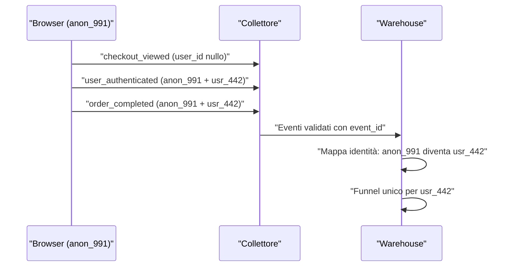

Un'azienda SaaS europea con 40.000 utenti attivi decide di centralizzare il tracciamento delle azioni di prodotto e stima due settimane di lavoro (caso ricostruito, con numeri di esempio). Dopo tre mesi il catalogo conta 47 nomi diversi per lo stesso acquisto, alcuni campi cambiano tipo da stringa a numero a metà mese e la fattura del warehouse è triplicata per via dei ritrasmessi non deduplicati.

Il difetto non sta nello strumento di raccolta e nemmeno nel browser. Gli eventi sono stati trattati come log applicativi improvvisati, quando in realtà sono contratti tra chi emette il dato e chi lo interroga mesi dopo, spesso senza conoscersi.

> **Idea chiave:** un evento è affidabile solo se nasce con un identificativo univoco d'origine, separa busta, contesto e proprietà di business, e conserva la coppia tra identità anonima e identità autenticata.

## Quarantasette nomi per lo stesso acquisto

Il caso ricostruito riguarda tre squadre di prodotto che rilasciano ogni settimana su web, applicazione iOS e applicazione Android. Il team web chiama l'evento di pagamento `checkout_success` e passa il prezzo in euro con due decimali. Il team iOS lo chiama `PurchaseCompleted` e invia il valore in centesimi interi. Il backend emette `order_paid` a ogni tentativo di addebito della carta, anche quando la banca lo respinge.

Quando la connessione mobile cade in galleria, l'SDK del telefono riprova l'invio quattro volte senza alcun identificativo univoco. In una settimana di campagna promozionale il database contabile registra 18.400 ordini reali, mentre la tabella degli eventi nel warehouse ne conta 24.120. A questo si aggiungono 1.900 sessioni rimaste orfane, perché l'identificativo anonimo assegnato prima del login non è mai stato ricongiunto all'identificativo dell'utente autenticato.

Nessuna di queste anomalie dipende da un guasto. Sono la conseguenza normale di tre scelte mancate: non separare ciò che descrive il fatto da ciò che descrive l'ambiente, non dare a ogni evento una chiave che sopravviva ai ritentativi, non tenere insieme le due identità dello stesso soggetto. Il resto della lezione costruisce un contratto che le risolve una per una, e poi lo verifica con numeri.

## Anatomia di un evento: busta, contesto e proprietà

Un payload ben progettato si divide in tre livelli con responsabilità diverse. La **busta** (`envelope`) contiene i metadati che esistono su ogni evento del sistema e non cambiano mai di significato: `event_id`, `event_name`, `occurred_at`, `received_at`, `schema_version`, `anonymous_id` e `user_id`. Il **contesto** (`context`) descrive l'ambiente tecnico in cui l'azione è avvenuta: versione dell'app, sistema operativo, URL della pagina, parametri UTM. Le **proprietà** (`properties`) portano solo gli attributi del fatto di business, per esempio l'importo dell'ordine o il codice del piano sottoscritto.

La separazione serve a chi interroga. Una query di funnel usa solo la busta. Un'analisi dell'attribuzione aggiunge il contesto. Un modello di ricavo legge le proprietà. Se tutto è mescolato in una stringa JSON piatta, ogni analista deve riscoprire quali campi sono stabili e quali no.

Questo è un evento `order_completed` completo, nella forma in cui lo riceve il collettore:

```json
{
  "event_id": "018f1a00-0000-7000-8000-000000000003",
  "event_name": "order_completed",
  "occurred_at": "2026-10-12T10:14:05.500Z",
  "anonymous_id": "anon_991",
  "user_id": "usr_442",
  "schema_version": 1,
  "context": {
    "app_version": "4.12.0",
    "platform": "ios",
    "page_path": "/conferma"
  },
  "properties": {
    "order_id": "ord_20261012_7781",
    "importo_centesimi": 12050,
    "valuta": "EUR"
  }
}
```

Nota che `received_at` non compare: lo assegna il server al momento dell'arrivo, perché l'orologio del dispositivo può essere sfasato di minuti e non è mai una fonte affidabile per l'ordinamento. L'importo è un intero in centesimi con valuta separata, non una stringa come `"120.50 EUR"`: un tipo numerico stabile evita i cast fragili a valle.

| Livello | Chi lo scrive | Esempi di campi | Cosa succede se cambia |
|---|---|---|---|
| Busta | SDK o servizio emittente | `event_id`, `occurred_at`, `anonymous_id` | Si rompono deduplicazione e funnel |
| Contesto | SDK in automatico | `app_version`, `platform`, `page_path` | Si perde il confronto tra versioni |
| Proprietà | Codice di prodotto | `order_id`, `importo_centesimi` | Si rompono le metriche di business |

Il nome segue la forma `oggetto_azione` con il verbo al passato, in `snake_case`: `order_completed`, `subscription_started`, `checkout_viewed`. Il passato è una scelta di significato, non di stile: l'evento certifica un fatto già avvenuto e confermato, non un tentativo.

## Il ponte tra identità anonima e utente autenticato

Un visitatore esplora il catalogo, aggiunge un prodotto al carrello e solo al momento del pagamento esegue il login. Per tutto il percorso precedente esiste soltanto un identificativo di dispositivo o di cookie. Se il sistema salva una sola colonna `utente` e la sovrascrive al login, il visitatore diventa due persone: una che ha navigato senza mai comprare, una che ha comprato senza mai navigare.

La soluzione è tenere due colonne separate. `anonymous_id` viaggia su ogni evento, sempre. `user_id` resta nullo finché l'autenticazione non riesce. Al login viene emesso un evento esplicito, `user_authenticated`, che porta entrambi gli identificativi e funge da legame. Il warehouse ricava da quegli eventi una mappa `anonymous_id → user_id` e la usa per attribuire retroattivamente le pagine viste prima del login.



Il legame ha una conseguenza pratica da conoscere. Lo stesso dispositivo condiviso da due persone produce due mappature per lo stesso `anonymous_id`. Una buona regola è usare l'ultimo legame osservato e tenere la storia dei legami in una tabella separata, così da poter ricalcolare l'attribuzione se la regola cambia.

## Idempotenza, ritardi di rete e ordine degli eventi

La rete mobile garantisce al massimo una consegna *at-least-once*: se il telefono non riceve la conferma, riprova, e il server può ricevere lo stesso messaggio più volte. L'unico modo per distinguere un ritentativo da un secondo acquisto è una chiave generata all'origine, nel momento in cui il fatto avviene. Questa è la chiave di idempotenza, e coincide con `event_id`.

Il client accumula gli eventi in una coda locale e li spedisce a blocchi, con ritentativi a intervallo crescente. Ecco una versione essenziale in JavaScript:

```javascript
// Coda locale con event_id generato alla nascita dell'evento, non all'invio
const QUEUE_KEY = "evt_queue_v1";

function track(name, properties = {}) {
  const evento = {
    event_id: crypto.randomUUID(),            // chiave di idempotenza
    event_name: name,
    occurred_at: new Date().toISOString(),    // orologio del dispositivo
    anonymous_id: getAnonymousId(),
    user_id: getUserId(),                     // null prima del login
    schema_version: 1,
    properties,
  };
  const coda = JSON.parse(localStorage.getItem(QUEUE_KEY) || "[]");
  coda.push(evento);
  localStorage.setItem(QUEUE_KEY, JSON.stringify(coda));
  flush();
}

async function flush(tentativo = 0) {
  const coda = JSON.parse(localStorage.getItem(QUEUE_KEY) || "[]");
  if (coda.length === 0) return;
  const blocco = coda.slice(0, 20);
  try {
    const res = await fetch("https://collect.esempio.it/v1/batch", {
      method: "POST",
      headers: { "Content-Type": "application/json" },
      body: JSON.stringify({ sent_at: new Date().toISOString(), events: blocco }),
    });
    if (!res.ok) throw new Error("HTTP " + res.status);
    localStorage.setItem(QUEUE_KEY, JSON.stringify(coda.slice(blocco.length)));
  } catch (e) {
    // Backoff esponenziale: 1 s, 2 s, 4 s ... fino a 60 s; gli stessi event_id verranno ritrasmessi
    const attesa = Math.min(60000, 1000 * 2 ** tentativo);
    setTimeout(() => flush(tentativo + 1), attesa);
  }
}
```

Il campo `sent_at` permette al server di correggere l'orologio del dispositivo: la differenza tra `sent_at` e l'orario di arrivo misura lo sfasamento, e si applica a `occurred_at`. In questo modo anche un telefono con l'ora sbagliata di tre minuti colloca l'evento nella finestra giusta.

Il worked example numerico mostra quanto costa non avere la chiave. Nella settimana di campagna il database contabile contiene 18.400 ordini, con un valore medio di 120,50 €.

1. La tabella grezza contiene 24.120 eventi `order_completed`, a fronte di 18.400 ordini reali.
2. Gli eventi in eccesso sono 24.120 − 18.400 = 5.720 eventi.
3. Lo scostamento percentuale è 5.720 / 18.400 = 31,1% in più del reale.
4. Il ricavo attribuito dal warehouse è 24.120 × 120,50 € = 2.906.460 €.
5. Il ricavo reale è 18.400 × 120,50 € = 2.217.200 €.
6. Il ricavo fantasma è 2.906.460 − 2.217.200 = 689.260 €, pari al 31,1% del reale.

Dopo la deduplicazione su `event_id` gli eventi tornano a 18.400 e lo scarto scende a zero. Il marketing, che aveva attribuito 689.260 € di ricavo a campagne che non li avevano generati, correggeva il budget su un dato gonfiato di quasi un terzo.

Lo stesso ritardo di rete spiega il secondo problema. Un acquisto avvenuto alle 10:14:05,5 e ricevuto alle 10:48:11 arriva con 2.045 secondi, circa 34 minuti, di ritardo. Se la finestra oraria si calcola su `received_at`, l'ordine finisce nell'ora sbagliata. Per questo la busta porta entrambi i timestamp e le analisi temporali usano `occurred_at`, mentre `received_at` serve a controllare la latenza della pipeline.

## Una tabella con contratto in ClickHouse

Lo schema fisico riflette il contratto. La busta diventa colonne tipizzate, la chiave di ordinamento include `event_id` e il motore `ReplacingMergeTree` elimina i duplicati con la stessa chiave durante i merge, tenendo la riga con `received_at` più recente.

```sql
-- Tabella eventi con contratto: busta tipizzata e deduplicazione su (event_name, occurred_at, event_id)
CREATE TABLE eventi_contratto
(
    event_id UUID,
    event_name LowCardinality(String),
    occurred_at DateTime64(3, 'UTC'),
    received_at DateTime64(3, 'UTC'),
    anonymous_id String,
    user_id Nullable(String),
    schema_version UInt16,
    importo_centesimi UInt64,
    valuta FixedString(3),
    page_path String
)
ENGINE = ReplacingMergeTree(received_at)
PARTITION BY toYYYYMM(occurred_at)
ORDER BY (event_name, occurred_at, event_id);

-- Visita pre-login, login che lega anon_991 a usr_442, acquisto inviato due volte per retry
INSERT INTO eventi_contratto VALUES
    ('018f1a00-0000-7000-8000-000000000001', 'checkout_viewed', '2026-10-12 10:14:02.100', '2026-10-12 10:14:02.350', 'anon_991', NULL, 1, 12050, 'EUR', '/carrello'),
    ('018f1a00-0000-7000-8000-000000000002', 'user_authenticated', '2026-10-12 10:14:04.000', '2026-10-12 10:14:04.200', 'anon_991', 'usr_442', 1, 0, 'EUR', '/login'),
    ('018f1a00-0000-7000-8000-000000000003', 'order_completed', '2026-10-12 10:14:05.500', '2026-10-12 10:14:05.900', 'anon_991', 'usr_442', 1, 12050, 'EUR', '/conferma'),
    ('018f1a00-0000-7000-8000-000000000003', 'order_completed', '2026-10-12 10:14:05.500', '2026-10-12 10:48:11.000', 'anon_991', 'usr_442', 1, 12050, 'EUR', '/conferma');

-- Mappa identità e conteggio reale: un solo ordine da 120,50 euro collegato allo stesso soggetto
WITH mappa_identita AS (
    SELECT anonymous_id, anyLast(user_id) AS utente_risolto
    FROM eventi_contratto FINAL
    WHERE user_id IS NOT NULL
    GROUP BY anonymous_id
)
SELECT
    coalesce(e.user_id, m.utente_risolto, e.anonymous_id) AS identita_finale,
    countIf(e.event_name = 'checkout_viewed') AS aperture_carrello,
    countIf(e.event_name = 'order_completed') AS ordini_confermati,
    sumIf(e.importo_centesimi, e.event_name = 'order_completed') / 100.0 AS ricavo_euro
FROM eventi_contratto AS e FINAL
LEFT JOIN mappa_identita AS m USING (anonymous_id)
GROUP BY identita_finale;
```

Il modificatore `FINAL` forza la deduplicazione al momento della lettura, anche se i merge in background non sono ancora avvenuti. Su tabelle molto grandi ha un costo, quindi in produzione si usa su finestre temporali limitate oppure si materializza una tabella già deduplicata. Il risultato sui quattro eventi di esempio è un unico percorso coerente per `usr_442`: un'apertura del carrello, un ordine confermato e 120,50 € di ricavo.

## Client-side o server-side: chi emette quale evento

Con uno schema solido resta da decidere da dove parte ciascun evento. Il criterio è netto. Dal client si emettono le interazioni con l'interfaccia che non cambiano lo stato del database aziendale: scorrimento, apertura di un filtro, visualizzazione di un banner. Dal server si emette tutto ciò che certifica una transazione economica, un cambio di contratto o un'autenticazione.

La ragione è fisica. Un acquisto tracciato solo dalla pagina di ringraziamento perde tra il 10% e il 25% del volume per via di ad-blocker, chiusure della scheda dopo il redirect bancario e script di terze parti bloccati. Su 1.000 ordini reali, con una perdita del 18%, il browser ne registra 820 e ne manca 180. Il backend, che scrive l'evento nel momento esatto in cui il database conferma il pagamento, non ha questo problema.

Il server deve però ricevere l'`anonymous_id` del client, altrimenti l'ordine è contato bene ma non è attribuibile al canale di acquisizione. Il browser lo allega alla richiesta di acquisto e il backend lo ripropone nell'evento:

```python
# Emissione server-side di order_completed dopo la conferma sul database
import json
import uuid
from datetime import datetime, timezone

def emetti_order_completed(ordine, anonymous_id, producer):
    evento = {
        # chiave deterministica: lo stesso ordine produce sempre lo stesso event_id
        "event_id": str(uuid.uuid5(uuid.NAMESPACE_URL, f"order_completed:{ordine['order_id']}")),
        "event_name": "order_completed",
        "occurred_at": datetime.now(timezone.utc).isoformat(),
        "anonymous_id": anonymous_id,
        "user_id": ordine["user_id"],
        "schema_version": 1,
        "properties": {
            "order_id": ordine["order_id"],
            "importo_centesimi": ordine["totale_centesimi"],
            "valuta": "EUR",
        },
    }
    producer.send("eventi_prodotto", json.dumps(evento).encode("utf-8"))
```

Usare un UUID deterministico derivato da `order_id` rende l'emissione idempotente anche lato server: se un job di recupero rilancia lo stesso ordine, l'`event_id` è identico e il warehouse scarta il duplicato. La configurazione del consenso privacy e l'oscuramento dei dati personali prima dell'archiviazione sono trattati nella lezione dedicata del modulo.

## Errori ricorrenti nello schema degli eventi

Una tabella costruita senza contratto mostra tutti e tre gli errori insieme. Un solo ordine genera tre righe: due nomi diversi e un ritentativo di rete senza chiave. Il conteggio legge tre ordini invece di uno e non collega `anon_991` a `usr_442`.

### Il nome legato all'interfaccia invece che al fatto di business

Chiamare un evento `Click Bottone Acquista` o `submit_form_blu` sembra naturale a chi sviluppa il componente grafico, perché descrive il gestore del clic nel codice. Il sintomo compare al primo ridisegno: il bottone cambia nome o sparisce, la serie storica si spezza in due, e l'evento scatta anche quando il pagamento fallisce per carta scaduta, gonfiando le conversioni con tentativi respinti. Si corregge nominando il fatto confermato, `order_completed`, ed emettendolo dopo la conferma del backend.

### Un solo campo utente che sovrascrive l'identità anonima

Mettere `anon_991` e `usr_442` nella stessa colonna sembra un modo pulito per avere sempre una chiave non nulla. Il sintomo è un funnel con tasso di conversione pari a zero per il visitatore anonimo e al cento percento, senza sorgente di traffico, per l'utente autenticato. Succede perché al login l'identificativo cambia e la storia precedente resta appesa al vecchio valore. La correzione è tenere `anonymous_id` e `user_id` in colonne separate ed emettere l'evento di legame.

### L'assenza di event_id e di separazione tra occurred_at e received_at

Un unico timestamp generato all'inserimento e nessun identificativo creato sul client sembrano sufficienti finché la rete di test risponde in dieci millisecondi. In produzione un utente su un treno compra alle 10:14, il telefono perde segnale e rinvia il pacchetto quando torna online alle 10:48. Il sintomo è un ordine contato due volte e collocato nella finestra oraria sbagliata. La correzione è generare `event_id` alla nascita e registrare sia `occurred_at` sia `received_at`. Non è retroattiva: gli eventi storici senza chiave non possono più essere distinti con certezza, quindi il costo di aggiungerla dopo sei mesi è molto più alto di quello di farlo prima del lancio.

## Verifica sulla pipeline di eventi

Due metriche dicono se la pipeline è affidabile. La prima è lo scostamento percentuale tra gli eventi `order_completed` nel warehouse e le righe della tabella contabile degli ordini. La seconda è il tasso di eventi respinti dal validatore di schema, che devono finire in una coda di scarto ispezionabile e non nella tabella analitica. Con il primo sotto lo 0,5% e il secondo vicino a zero, il tracciamento è un'infrastruttura di cui ci si può fidare.

1. In una settimana la tabella grezza conta 9.300 eventi `order_completed` e il database contabile 7.500 ordini. Quanto vale lo scostamento e che cosa lo spiega?

<details>
<summary>Mostra risposta</summary>

Gli eventi in eccesso sono 9.300 − 7.500 = 1.800, cioè 1.800 / 7.500 = 24% in più del reale. La causa più probabile sono i ritentativi di rete e i doppi invii senza `event_id`. Dopo la deduplicazione su `event_id` il conteggio deve tornare vicino a 7.500, con scarto sotto lo 0,5%.

</details>

2. Un utente naviga come `anon_55`, fa il login come `usr_9` e compra. Perché una singola colonna `utente` produce un funnel sbagliato e quale evento serve a ripararlo?

<details>
<summary>Mostra risposta</summary>

Con una sola colonna le pagine viste prima del login restano assegnate ad `anon_55` e l'acquisto a `usr_9`, quindi il funnel vede due soggetti diversi. Servono due colonne separate e un evento `user_authenticated` che porti entrambi gli identificativi, da cui ricavare la mappa di corrispondenza usata nelle query.

</details>

3. Perché `received_at` non va usato per assegnare un evento a una finestra oraria di analisi?

<details>
<summary>Mostra risposta</summary>

Perché misura quando l'evento è arrivato, non quando è avvenuto. Un acquisto delle 10:14:05 ricevuto alle 10:48:11 con 2.045 secondi di ritardo finirebbe nella mezz'ora sbagliata. Le analisi temporali usano `occurred_at`, corretto con lo sfasamento tra `sent_at` e l'orario di arrivo, mentre `received_at` serve a monitorare la latenza.

</details>

4. Su 1.000 ordini reali il browser ne registra 820. Da dove emetti `order_completed` per avere 1.000 eventi, e quale dato devi far viaggiare fino al server per non perdere l'attribuzione?

<details>
<summary>Mostra risposta</summary>

Lo emetti dal backend, dopo la conferma del pagamento sul database, così la perdita del 18% (180 ordini) sparisce. Fai viaggiare l'`anonymous_id` del client nella richiesta di acquisto, in modo che l'evento server-side lo riporti e l'ordine resti attribuibile al canale di provenienza.

</details>
