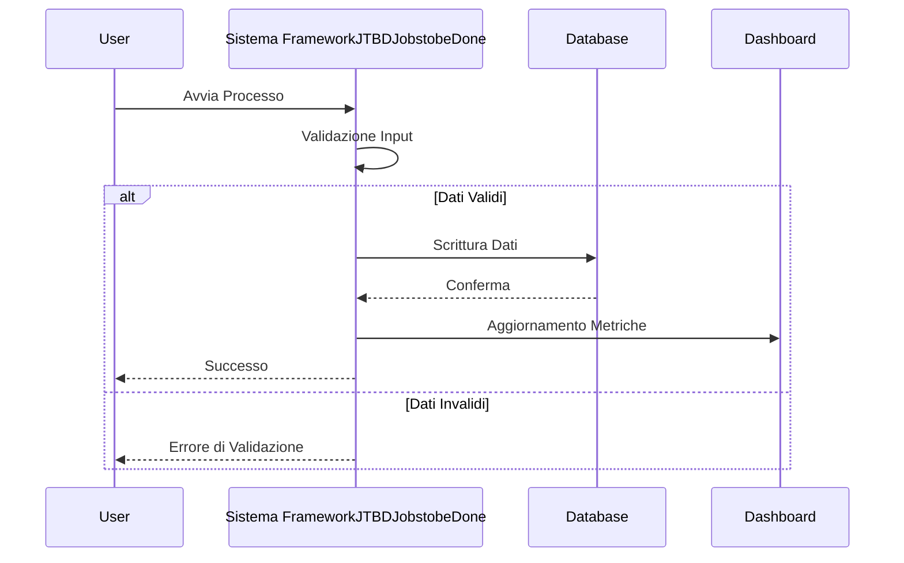

# Framework JTBD (Jobs to be Done)

> Abstract: Una guida completa e approfondita su **Framework JTBD (Jobs to be Done)**, che esplora le metodologie, gli strumenti e le strategie pratiche per un'implementazione di successo nel contesto aziendale moderno.

## Obiettivi di Apprendimento
- Comprendere i principi fondamentali di **Framework JTBD (Jobs to be Done)** e il suo ruolo nell'ecosistema MarTech.
- Analizzare le best practice per l'implementazione di **Framework JTBD (Jobs to be Done)** in contesti aziendali reali.
- Identificare gli errori comuni e le trappole da evitare quando si lavora con **Framework JTBD (Jobs to be Done)**.
- Sviluppare una metodologia critica per valutare l'efficacia di **Framework JTBD (Jobs to be Done)** nelle proprie strategie.
- Acquisire familiarità con gli strumenti e le tecnologie che supportano **Framework JTBD (Jobs to be Done)**.

## Timeline della Lezione

| Sezione | Durata | Argomento |
|---------|--------|-----------|
| Introduzione | 5 min | Contestualizzazione e importanza di Framework JTBD (Jobs to be Done) |
| Fondamenti | 12 min | Teoria, definizioni e concetti chiave |
| Implementazione | 12 min | Strategie pratiche, architetture e best practices |
| Casi Studio | 8 min | Esempi reali di successo e fallimento |
| Esercizi | 5 min | Verifica della comprensione e applicazione pratica |
| Riepilogo | 3 min | Sintesi dei punti salienti e prossimi passi |

## Introduzione (5 minuti)

Spesso sottovalutato, **Framework JTBD (Jobs to be Done)** è in realtà il motore nascosto di molte strategie di successo. Vedremo come padroneggiarlo possa trasformare il tuo approccio ai dati.

In un mondo dove il dato è il "nuovo petrolio" (cliché, ma vero), sapere come raffinare questo petrolio è ciò che distingue le aziende vincenti. **Framework JTBD (Jobs to be Done)** è proprio quella raffineria.


## I Pilastri di Framework JTBD (Jobs to be Done)

Quando parliamo di **Framework JTBD (Jobs to be Done)**, facciamo riferimento a tre pilastri fondamentali che sostengono l'intera struttura analitica.

### 1. La Componente Tecnologica

Non possiamo ignorare l'infrastruttura. **Framework JTBD (Jobs to be Done)** richiede una base solida. Che si tratti di cloud computing, di database colonnari o di script di tracking, la tecnologia è l'abilitatore.

### 2. La Componente Metodologica

Avere gli strumenti non basta. Serve un metodo. Come raccogliamo i dati? Come li normalizziamo? Qui entra in gioco il rigore procedurale.

### 3. La Componente Umana

Infine, chi interpreta i risultati? **Framework JTBD (Jobs to be Done)** non è un processo automatico al 100%. Richiede supervisione, manutenzione e, soprattutto, interpretazione critica.

```mermaid
mindmap
  root((Framework JTBD (Jobs to be Done)))
    Tecnologia
      Infrastruttura
      Tooling
      Integrazioni
    Metodologia
      Processi
      Standard
      Governance
    Persone
      Skillset
      Cultura Data-Driven
      Decision Making
```

Questo schema mentale ci aiuta a non focalizzarci solo sul "come" tecnico, ma anche sul "perché" strategico.


## Implementazione Pratica

Passiamo dalla teoria alla pratica. Come si implementa concretamente **Framework JTBD (Jobs to be Done)** in un'azienda moderna? Non esiste una ricetta unica, ma esistono ingredienti che non possono mancare.

### Step 1: Audit e Assessment

Prima di scrivere una riga di codice o configurare un tool, bisogna capire lo stato dell'arte.
- Quali dati abbiamo?
- Di quale qualità?
- Chi ne è proprietario?

### Step 2: La Strategia di Implementazione

Una volta chiaro il punto di partenza, definiamo l'architettura. In un contesto moderno, spesso questo significa lavorare con strumenti cloud-native.

Ecco un esempio di flusso operativo tipico per **Framework JTBD (Jobs to be Done)**:



### Step 3: Monitoraggio e Ottimizzazione

L'implementazione non finisce con il "Go Live". **Framework JTBD (Jobs to be Done)** è un organismo vivente. I dati cambiano, le esigenze di business evolvono.

| Fase | Azione | KPI di Successo |
|------|--------|-----------------|
| Setup | Configurazione iniziale | 100% Uptime |
| Run | Operatività quotidiana | < 1% Error Rate |
| Fix | Risoluzione incidenti | MTTR < 1h |
| Optimize | Miglioramento continuo | -20% Latenza |

Questa tabella riassume il ciclo di vita operativo. Notate come l'ottimizzazione sia una fase continua, non puntuale.


## Esempi Pratici

Vediamo due scenari reali per concretizzare i concetti.

### Scenario A: L'e-commerce in crescita

Un e-commerce di moda sta scalando rapidamente. Hanno bisogno di **Framework JTBD (Jobs to be Done)** per gestire i picchi di traffico durante il Black Friday.
**Soluzione:** Implementano un'architettura basata su eventi. Invece di scrivere direttamente sul database, usano una coda di messaggi.
**Risultato:** Zero downtime anche con 10x traffico.

### Scenario B: L'app B2B SaaS

Un'azienda SaaS deve garantire che i dati di utilizzo siano corretti per la fatturazione.
**Soluzione:** Usano **Framework JTBD (Jobs to be Done)** per creare un doppio livello di verifica sui log delle API.
**Risultato:** Riduzione del 90% delle contestazioni sulle fatture.


## Esercizi

Per consolidare quanto appreso, prova a svolgere questi esercizi:

1.  **Analisi dello Stato Attuale:** Prendi un progetto su cui stai lavorando. Disegna su carta come viene gestito attualmente **Framework JTBD (Jobs to be Done)**. C'è documentazione? È un processo robusto?
2.  **Progettazione:** Immagina di dover ricostruire tutto da zero con budget illimitato. Come cambierebbe l'architettura? Disegna il diagramma ideale.
3.  **Troubleshooting:** Pensa all'ultimo incidente legato ai dati che hai vissuto. Se avessi avuto un sistema di **Framework JTBD (Jobs to be Done)** perfetto, come sarebbe stato evitato o mitigato?


## Riepilogo

In questa lezione abbiamo attraversato il complesso mondo di **Framework JTBD (Jobs to be Done)**.

Ecco i punti chiave da portare a casa:
- **Centralità:** **Framework JTBD (Jobs to be Done)** non è un accessorio, è il cuore del sistema.
- **Rigore:** Senza metodo, la tecnologia è inutile.
- **Evoluzione:** Bisogna essere pronti a iterare e migliorare costantemente.
- **Impatto:** Un buon sistema di **Framework JTBD (Jobs to be Done)** impatta direttamente sui profitti aziendali riducendo errori e migliorando la velocità decisionale.

Ricorda: la tecnologia è un mezzo, non il fine. Il fine è sempre il valore di business.


## Approfondimenti
- *Designing Data-Intensive Applications*, Martin Kleppmann (O'Reilly, 2017)
- *The Data Warehouse Toolkit*, Ralph Kimball (Wiley, 2013)
- Documentazione ufficiale e whitepaper relativi a **Framework JTBD (Jobs to be Done)**
