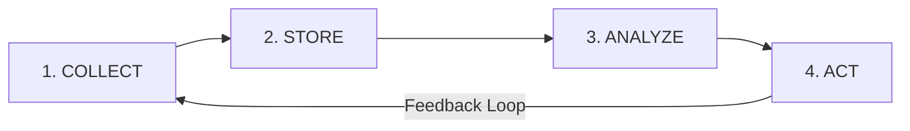

## Il Framework dei 4 Pilastri


> **Consiglio:**
> Questa lezione presenta il modello concettuale che guiderà tutto il corso. I 4 pilastri non sono una teoria astratta: sono un framework operativo testato sul campo per costruire strategie di crescita basate sui dati.


## L'Esigenza di un Framework

La maggior parte delle aziende che falliscono nel diventare data-driven non falliscono per mancanza di dati o tecnologia. Falliscono per mancanza di **struttura**. Hanno strumenti potenti ma non sanno come usarli in modo coordinato. Hanno analisti brillanti ma isolati in silos. Hanno dashboard bellissime che nessuno guarda.

Un framework risolve questo problema fornendo un **modello mentale condiviso** — una mappa che tutti i team possono usare per orientarsi. Non importa se sei un marketer, un product manager, un data engineer o un CEO: i 4 pilastri ti danno un linguaggio comune e una sequenza logica per costruire la tua strategia.

## I 4 Pilastri

Il nostro framework si basa su 4 pilastri fondamentali, ciascuno dei quali corrisponde a una fase della maturità data-driven e a un modulo del corso:

```
┌─────────────────────────────────────────────────────────────┐
│                    STRATEGIA DI CRESCITA                     │
├──────────┬──────────┬──────────────────┬────────────────────┤
│ PILASTRO │ PILASTRO │    PILASTRO      │     PILASTRO       │
│    1     │    2     │       3          │        4           │
│          │          │                  │                    │
│ COLLECT  │ STORE    │   ANALYZE        │    ACT             │
│          │          │                  │                    │
│ Raccolta │ Archi-   │   Analisi &      │   Decisione &      │
│ Dati     │ viazione │   Comprensione   │   Azione           │
└──────────┴──────────┴──────────────────┴────────────────────┘
```

### Pilastro 1: COLLECT — Raccolta Dati

**Domanda chiave**: *"Stiamo raccogliendo i dati giusti, nel modo giusto, al momento giusto?"*

La raccolta dati è il fondamento dell'intero edificio analitico. Senza dati di qualità, nessuna analisi, modello o dashboard potrà produrre valore. Questo pilastro copre:

- **Event Tracking Design**: Progettare uno schema di tracciamento robusto con naming conventions chiare, proprietà ben tipizzate e trigger precisi.
- **Implementazione Hybrid**: Capire quando usare tracking client-side (browser/app) e quando server-side (backend), e come combinarli.
- **Customer Data Platform**: Configurare una CDP (Rudderstack, Segment) come hub centrale per la raccolta e distribuzione dei dati.
- **Qualità e Validazione**: Implementare contratti sui dati, schema validation e processi di QA per garantire che ciò che raccogli sia affidabile.
- **Privacy & Compliance**: Raccogliere dati nel rispetto di GDPR, CCPA e delle aspettative degli utenti.

**Output del Pilastro 1**: Un flusso di dati puliti, affidabili e completi che alimenta il resto dello stack.

**Segnali che il Pilastro 1 è fragile:**
- "Non abbiamo i dati per rispondere a questa domanda"
- Due sistemi mostrano numeri diversi per la stessa metrica
- Il tracking si rompe ad ogni rilascio senza che nessuno se ne accorga
- Dati critici (revenue, conversioni) raccolti solo client-side

### Pilastro 2: STORE — Archiviazione e Organizzazione

**Domanda chiave**: *"I dati sono accessibili, performanti e organizzati in modo da abilitare l'analisi?"*

Raccogliere dati è inutile se finiscono in un buco nero. Il secondo pilastro riguarda dove e come archiviare i dati per renderli utilizzabili:

- **Data Warehouse Moderno**: Capire le differenze tra data warehouse colonnari (ClickHouse, BigQuery), data lake, e lakehouse. Scegliere l'architettura giusta per il tuo caso d'uso.
- **SQL ad Alte Prestazioni**: Padroneggiare le query SQL ottimizzate per volumi massivi — miliardi di righe interrogate in secondi.
- **OLAP e Modellazione Dimensionale**: Organizzare i dati in strutture ottimizzate per l'analisi (star schema, fact tables, dimension tables).
- **Trasformazione con dbt**: Usare dbt per costruire modelli di trasformazione versionati, testati e documentati.

**Output del Pilastro 2**: Un data warehouse performante, ben organizzato e accessibile a tutti i consumatori di dati.

**Segnali che il Pilastro 2 è fragile:**
- Le query impiegano minuti (o ore) a completarsi
- Ogni analista ha la propria versione della "tabella utenti"
- Nessuno sa cosa significano le colonne delle tabelle
- I costi del warehouse crescono senza controllo

### Pilastro 3: ANALYZE — Analisi e Comprensione

**Domanda chiave**: *"Stiamo estraendo insight azionabili dai dati, o stiamo solo producendo report?"*

Avere dati puliti e ben organizzati è necessario ma non sufficiente. Il terzo pilastro riguarda la trasformazione dei dati in comprensione:

- **Framework di Sperimentazione**: A/B testing, cicli HADI, approccio scientifico alle decisioni.
- **Modelli di Attribuzione**: Capire quale canale/azione ha contribuito a una conversione — last click, multi-touch, Markov, Shapley.
- **Customer Analytics**: Segmentazione, analisi di coorte, retention analysis, funnel analysis.
- **Unit Economics**: Calcolare LTV, CAC, payback period e capire la sostenibilità del modello di business.
- **Marketing Data Science**: Cluster analysis, embeddings, text generation, analisi predittiva.

**Output del Pilastro 3**: Insight chiari, azionabili e supportati da evidenze che guidano le decisioni di business.

**Segnali che il Pilastro 3 è fragile:**
- I report sono descrittivi ("cosa è successo") ma mai prescrittivi ("cosa dobbiamo fare")
- Le decisioni importanti vengono prese senza consultare i dati
- Non si fanno esperimenti strutturati (A/B test)
- L'analisi arriva troppo tardi per essere utile

### Pilastro 4: ACT — Decisione e Azione

**Domanda chiave**: *"Gli insight si traducono in azioni concrete e misurabili?"*

Il pilastro più trascurato e il più importante. Un insight che non diventa azione è uno spreco di risorse. Questo pilastro chiude il cerchio:

- **Real-Time Analytics**: Dashboard in tempo reale per decisioni immediate — monitoring, alerting, anomaly detection.
- **Automazione**: Trigger automatici basati su dati — email personalizzate, notifiche, workflow.
- **Reverse ETL**: Riportare i dati dal warehouse ai tool operativi (CRM, marketing automation, support).
- **Cultura dell'Azione**: Creare processi dove ogni insight ha un owner, una timeline e un meccanismo di follow-up.
- **Feedback Loop**: Misurare l'impatto delle azioni per alimentare il ciclo successivo.

**Output del Pilastro 4**: Un'organizzazione che reagisce ai dati in modo rapido, sistematico e misurabile.

**Segnali che il Pilastro 4 è fragile:**
- Le dashboard vengono create ma nessuno le guarda regolarmente
- Gli insight rimangono nelle slide senza diventare azioni
- Non c'è un processo per misurare l'impatto delle decisioni prese
- Le azioni sono reattive ("il numero è sceso, facciamo qualcosa!") invece che proattive

## La Sequenza Conta

I 4 pilastri devono essere costruiti **in ordine**. Non puoi saltare al Pilastro 3 (Analisi avanzata) se il Pilastro 1 (Raccolta) è fragile. Non puoi automatizzare azioni (Pilastro 4) se non hai un warehouse performante (Pilastro 2).



Questo non significa che devi completare perfettamente ogni pilastro prima di passare al successivo. L'approccio è **iterativo**: costruisci una versione minima di ogni pilastro, poi torni indietro e migliori ciascuno in cicli successivi.

### L'Approccio Iterativo

**Ciclo 1 — MVP (Settimane 1-4):**
- Collect: Tracking Plan base con 10-15 eventi core
- Store: Un semplice data warehouse con le tabelle grezze
- Analyze: Dashboard con le 5 metriche più importanti
- Act: Review settimanale dei numeri con il team

**Ciclo 2 — Consolidamento (Mesi 2-3):**
- Collect: Tracking Plan completo, server-side per eventi critici
- Store: Modelli dbt per le trasformazioni principali
- Analyze: Analisi di coorte e funnel, primi A/B test
- Act: Automazioni base (alert su anomalie, email trigger)

**Ciclo 3 — Maturità (Mesi 4-6):**
- Collect: Schema validation automatica, data quality monitoring
- Store: Ottimizzazione costi e performance, data catalog
- Analyze: Modelli predittivi, attribuzione multi-touch
- Act: Reverse ETL, personalizzazione in tempo reale

## Come I Pilastri Si Mappano ai Ruoli

Ogni pilastro ha stakeholder e owner diversi, ma la collaborazione cross-funzionale è essenziale:

| Pilastro | Owner Primario | Collaboratori | Tool Tipici |
|----------|---------------|---------------|-------------|
| **COLLECT** | Data Engineer | Frontend Dev, PM | Rudderstack, Segment, GTM |
| **STORE** | Data Engineer | Analytics Engineer | ClickHouse, BigQuery, dbt |
| **ANALYZE** | Data Analyst / Scientist | PM, Marketing, Sales | Metabase, Looker, Python |
| **ACT** | PM / Marketing | Data Team, Engineering | Braze, Reverse ETL, Alerting |


> **Note:**
> In team piccoli, una sola persona potrebbe coprire più ruoli. In team grandi, ogni pilastro potrebbe avere un intero team dedicato. Il framework è lo stesso — cambia solo la scala.


## Il Pilastro Zero: La Cultura

C'è un pilastro nascosto che precede tutti gli altri: la **cultura del dato**. Puoi avere la tecnologia migliore del mondo, ma se l'organizzazione non ha una cultura che valorizzi i dati, il framework non funzionerà.

### Elementi di una Cultura del Dato

1. **Trasparenza**: I dati sono accessibili a tutti, non solo al team di analytics. Ogni persona può consultare le metriche rilevanti per il suo lavoro.

2. **Accountability**: Ogni KPI ha un owner. Ogni decisione importante è documentata con il razionale basato sui dati.

3. **Sperimentazione**: È sicuro testare ipotesi e fallire. L'errore è un risultato — non un fallimento — se genera apprendimento.

4. **Sfida costruttiva**: Nessuno è immune dalla domanda "quali dati supportano questa decisione?", dal CEO allo stagista.

5. **Velocità**: La cultura del dato non rallenta le decisioni — le accelera. Se i dati non sono disponibili in tempo, si decide comunque, ma si documenta l'incertezza.

## Come Usare Questo Framework nel Corso

Ogni modulo del corso corrisponde a uno o più pilastri:


###

### Data Collection


**Pilastro 1: COLLECT** — Event tracking, privacy, integrazioni, terminologia. È il modulo in cui ti trovi ora.


### Data Warehousing

**Pilastro 2: STORE** — SQL avanzato, ClickHouse, OLAP, modellazione dati.


### Marketing Data Science

**Pilastro 3: ANALYZE** — Attribuzione, sperimentazione, analytics, unit economics, ML.


### Real-Time Analytics

**Pilastro 4: ACT** — Streaming, dashboard real-time, automazioni, decisioni immediate.

In aggiunta, i moduli **Infrastructure & Ops** e **Management** forniscono competenze trasversali che supportano tutti e 4 i pilastri:

- **Infrastructure & Ops**: CI/CD per i dati, gestione dei costi, documentazione
- **Management**: Framework JTBD per capire le motivazioni dei clienti

## Assessment: A Che Punto Sei?

Prima di procedere, valuta onestamente la maturità della tua organizzazione su ogni pilastro, da 1 (inesistente) a 5 (eccellente):

| Pilastro | 1 - Inesistente | 3 - Base | 5 - Eccellente |
|----------|-----------------|----------|----------------|
| **COLLECT** | Nessun tracking strutturato | Tracking Plan con eventi core | Schema validation, hybrid tracking, data contracts |
| **STORE** | Dati in spreadsheet | Data warehouse base con query ad-hoc | dbt, data catalog, ottimizzazione costi/performance |
| **ANALYZE** | Report manuali occasionali | Dashboard automatiche, analisi regolari | A/B testing sistematico, modelli predittivi, attribuzione |
| **ACT** | Nessun processo strutturato | Review settimanale dei numeri | Real-time alerting, automazioni, reverse ETL |

Il tuo score ti indica dove concentrare gli sforzi. La regola è semplice: **non investire nel pilastro N+1 se il pilastro N è sotto il 3**.

## Esercizio Pratico

1. Compila l'assessment qui sopra per la tua organizzazione
2. Identifica il pilastro più debole — è lì che devi concentrare l'attenzione
3. Per il pilastro più debole, scrivi 3 azioni concrete che potresti fare nella prossima settimana per migliorarlo
4. Condividi l'assessment con il tuo team — il framework è utile solo se è condiviso


*Nella prossima lezione, entreremo nel vivo del Pilastro 1 con l'Event Tracking Design: come progettare un sistema di tracciamento robusto, scalabile e manutenibile.*
